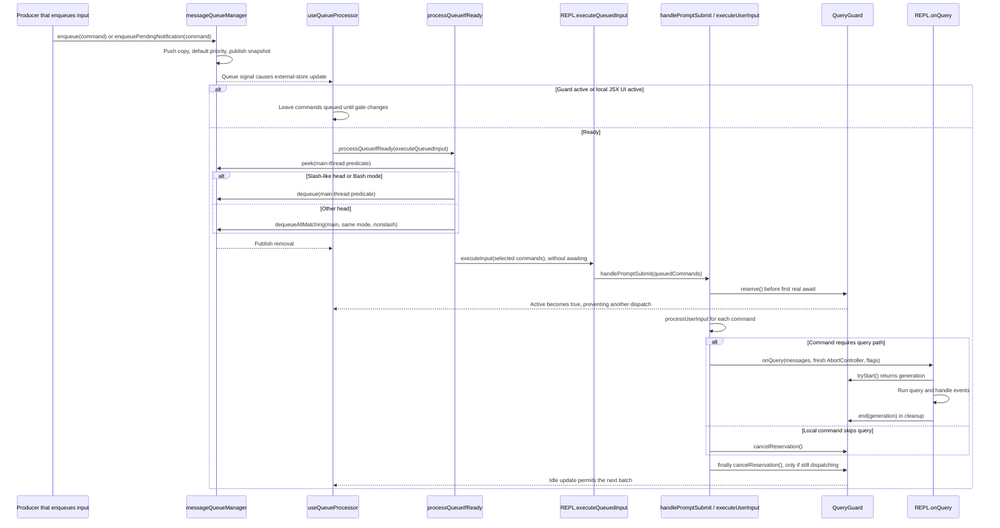
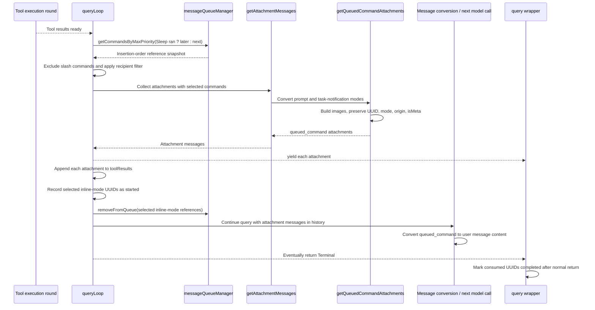
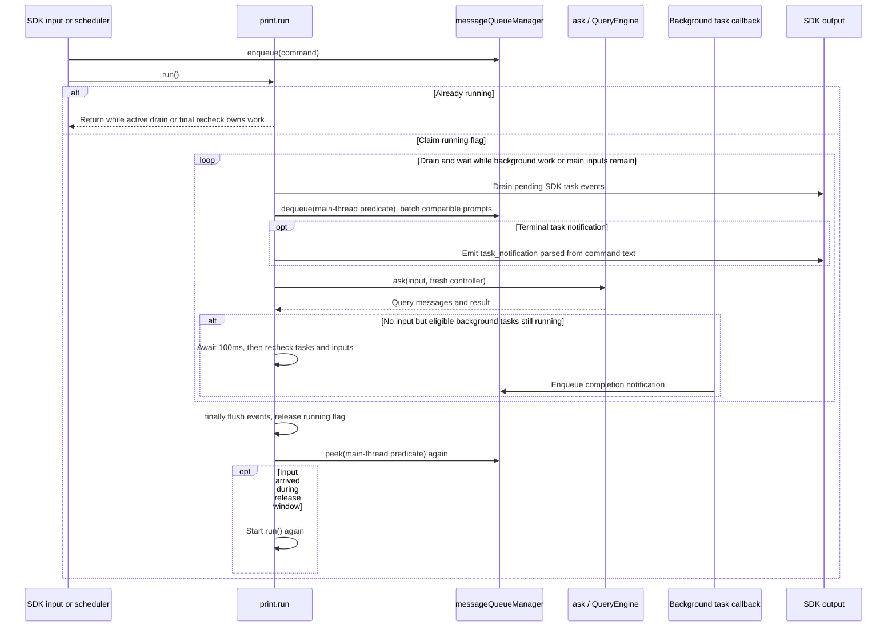
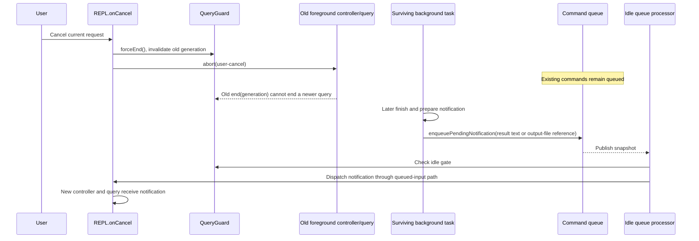

# Command Queue Internals

Primary source: `utils/messageQueueManager.ts`.

Consumers: `utils/queueProcessor.ts`, `hooks/useQueueProcessor.ts`,
`query.ts`, and `cli/print.ts`.

---

## Purpose and reading model

The command queue holds **inputs waiting to enter a conversation**: **human**
**prompts, Bash input, background-task notifications, generated prompts, and**
**resumed permission responses.** It bridges callbacks that produce inputs with
the foreground or agent loop that can consume them.

**Ordinary local user submissions do not always enter this queue.** After
input preparation, `handlePromptSubmit()` executes idle input directly. It
queues prompt/Bash input when the query guard is active or external work is
loading. SDK/headless user input follows its own enqueue-and-drain path.

This document follows the queue manager in source order, then traces each
consumer through its callers, timing gates, message conversion, and cleanup.
Like [query-loop-internals.md](./query-loop-internals.md), it groups related
statements into executable regions and explains ordering and failure paths.
Line numbers identify this recovered snapshot; function names are the durable
lookup handles. Feature-gated callers are described conditionally.

**Enqueueing stores a command and publishes a signal. Execution, interruption,
recipient selection, and batching belong to consumers.** The queue manager
does not run tools, await a model response, or manage a background process.

## Component and caller boundary

| Component | Responsibility |
|---|---|
| `types/textInputTypes.ts` | Defines `QueuedCommand`, input modes, and priorities. |
| `utils/messageQueueManager.ts` | Owns the module-level array, snapshots, subscriptions, selection, removal, and operation logging. |
| `utils/signal.ts` | Supplies synchronous listener registration and emission. |
| `hooks/useCommandQueue.ts` | Exposes the queue snapshot to React through `useSyncExternalStore()`. |
| `hooks/useQueueProcessor.ts` | Dispatches queued main-thread commands when the REPL guard is idle and no local JSX UI blocks input. |
| `utils/queueProcessor.ts` | Selects an idle REPL batch and calls the injected executor. |
| `utils/handlePromptSubmit.ts` | Converts a standalone command batch into messages and invokes the REPL query callback. |
| `utils/QueryGuard.ts` | Serializes REPL dispatch and fences cleanup from canceled generations. |
| `query.ts` | Selects eligible commands after a tool round and incorporates them into the current query. |
| `utils/attachments.ts`, `utils/messages.ts` | Convert mid-turn commands into attachments and subsequently model-facing user messages. |
| `cli/print.ts` | Owns the headless drain loop, its `running` mutex, SDK notification events, and explicit wake-ups. |
| `utils/sessionStorage.ts` | Appends queue-operation records to the session log when persistence is enabled. |

**The ordinary local REPL submission boundary is**
`handlePromptSubmit()` (`utils/handlePromptSubmit.ts:313-394`):

```text
Human prompt or ! Bash input -> handlePromptSubmit()
  -> idle (guard inactive and no external loading):
     construct QueuedCommand -> executeUserInput() directly
       -> processUserInput() -> onQuery() when needed -> query()
  -> busy (guard active or external loading):
     enqueue() -> commandQueue -> an eligible queue consumer below
```

The idle branch constructs a `QueuedCommand` and passes `[cmd]` through the
`queuedCommands` parameter to reuse `executeUserInput()`. Neither that type
name nor that parameter means the command was inserted into the global
`commandQueue`. Local commands can complete without a model query.

For inputs that are enqueued, the execution boundaries are:

```text
producers that enqueue inputs
  -> enqueue() / enqueuePendingNotification()
     -> one process-local commandQueue
        -> idle REPL:
           useQueueProcessor -> processQueueIfReady -> executeQueuedInput
             -> handlePromptSubmit -> executeUserInput -> onQuery -> query
        -> active main/subagent query:
           queryLoop -> getCommandsByMaxPriority -> getAttachmentMessages
             -> getQueuedCommandAttachments -> removeFromQueue
        -> headless:
           explicit run() wake-up -> drainCommandQueue -> dequeue -> ask
             -> QueryEngine -> query
```

Here, **idle REPL describes the consumer's readiness at dispatch time**, not
the REPL's state when the input was submitted. A human prompt submitted while
busy may be consumed at an active query's tool boundary, or remain queued until
idle dispatch. Bash-mode input is excluded from inline attachments and waits
for standalone dispatch.

This is separate from the tool executor's pending tool calls, permission-dialog
queues, teammate-specific `pendingMessages`, SDK output events, and the
background-task registry in app state. A task can keep running while the
command queue is empty. Its completion callback may enqueue an input later.

---

## Command contract (`types/textInputTypes.ts:265-358`)

### Payload and execution metadata

| Field | Meaning and downstream use |
|---|---|
| `value` | String or Anthropic content-block array. Can hold text and images; a notification's XML is simply text here. |
| `mode` | `prompt`, `bash`, `orphaned-permission`, or `task-notification`. Consumers choose processing paths from this value. |
| `priority` | Optional `now`, `next`, or `later`; insertion helpers fill in a default. |
| `uuid` | Optional input identity for messages, SDK replay, and command-lifecycle notifications. The manager does not generate or deduplicate it. |
| `orphanedPermission` | Saved permission result and unresolved assistant tool-use message for the resume path. |
| `pastedContents` | Paste/image data, including IDs needed by the image store. Images are built at consumption time. |
| `preExpansionValue` | Text before paste expansion, used by keyword-based routing. |
| `skipSlashCommands` | Requests plain-text handling of slash-prefixed content. Not all queue-side slash detectors inspect it; see below. |
| `bridgeOrigin` | Selects downstream bridge-safe command handling. |
| `isMeta` | Marks generated input for hidden presentation while retaining model visibility; also prevents editing it back into the prompt. |
| `origin` | Structured provenance, including channel identity and trust-related message wrapping. |
| `workload` | Attribution carried across the asynchronous queue boundary, such as scheduled-task billing context. |
| `agentId` | Recipient: `undefined` means the main thread; a defined ID addresses an agent's query loop. |

Mode, priority, provenance, and recipient are independent fields. For example,
a scheduled prompt can have `mode: 'prompt'`, `priority: 'later'`, and
`isMeta: true`. Calling `enqueuePendingNotification()` does not force
`mode: 'task-notification'`.

### Priority contract versus consumer behavior

The manager maps `now -> 0`, `next -> 1`, and `later -> 2`.

| Priority | Active query's normal tool-boundary gate | Idle dispatch |
|---|---|---|
| `now` | Included; REPL effect and SDK subscription also abort the current controller with reason `interrupt`. | Selected ahead of lower priorities by `peek()` / `dequeue()`. |
| `next` | Included after the current tool round. | Selected before `later`. |
| `later` | Normally excluded; included when that tool round contained Sleep. | Eligible once the consumer can dispatch another turn. |

**One takeaway:**

- **Queued human prompt: defaults to `next`, so it can enter the existing query at its next tool boundary. If it misses that opportunity, idle dispatch handles it afterward.**
- **Async local-agent completion notification: defaults to `later`, so it normally waits until the foreground query finishes, then triggers a new query. The Sleep boundary is an exception.**

These are eligibility and selection rules, not a global execution order.
Bulk operations preserve insertion order, and the REPL can batch commands
from different priorities. `now` does not synchronously execute or abort
anything inside `enqueue()`.

The SDK abort subscription is in `cli/print.ts:1859-1863`. The REPL implements
its counterpart in an effect following the proactive wiring
(`screens/REPL.tsx:4098`): if its queue snapshot contains a `now` entry, it
aborts `abortControllerRef.current` with `interrupt`. Both checks inspect the
global queue without recipient filtering. The interactive queue-processing
hook itself only checks readiness. User submission can separately interrupt
an interruptible tool in `handlePromptSubmit()`.

---

## Queue-manager walkthrough

### 1. Record operations (`messageQueueManager.ts:28-38`)

`logOperation()` captures the current session ID and constructs a record with:

```text
type: queue-operation
operation: enqueue | dequeue | remove | popAll
timestamp: ISO timestamp
sessionId: current session
content: optional string
```

It starts `recordQueueOperation()` using `void`; queue APIs neither await disk
storage nor acknowledge a durable write. String payloads are included for
enqueue and pop operations; block-array payloads are omitted. Dequeue and
removal operations omit content.

The storage chain is:

```text
logOperation
  -> recordQueueOperation                 utils/sessionStorage.ts:1464
     -> getProject().insertQueueOperation utils/sessionStorage.ts:1101
        -> appendEntry
           -> enqueueWrite(sessionFile)  queue-operation branch at :1218
```

Queue operations append to the main session file rather than following a
command's `agentId` to an agent transcript. Persistence can be disabled by the
storage layer. The records omit full command metadata and content blocks, and
some clearing operations emit no record. They are an operation history, not a
complete durable representation from which this manager reconstructs its array.

The imported `types/messageQueueTypes.ts` is absent from the recovered tree.
The runtime record shape above is directly visible in `logOperation()`;
missing type source should not be filled in from assumptions.

### 2. Own the live array and publish snapshots (`:54-80`)

The module owns three objects:

1. `commandQueue`, the mutable array in insertion order.
2. `snapshot`, a cached `Object.freeze([...commandQueue])` array.
3. `queueChanged`, a signal created by `createSignal()`.

`notifySubscribers()` first replaces the snapshot, then synchronously emits
the signal. React reads a stable snapshot reference until the next publication.
The freeze is shallow: snapshot entries are the same command objects as the
live queue, and nested content is not frozen.

`subscribeToCommandQueue()` returns the signal's unsubscribe function.
`createSignal()` stores listeners in a `Set` and invokes them synchronously;
it does not catch listener exceptions. Queue mutation and publication are not
an asynchronous broker transaction. For insertion, publication precedes
operation logging, so a throwing listener can interrupt that later logging.

### 3. Read or republish (`:90-117`)

| API | Behavior |
|---|---|
| `getCommandQueue()` | Returns a new array containing existing command references. |
| `getCommandQueueLength()` | Returns total length without copying. |
| `hasCommandsInQueue()` | Tests whether any recipient or mode has an entry. |
| `getCommandQueueSnapshot()` | Returns the cached frozen array. |
| `recheckCommandQueue()` | If nonempty, publishes a fresh snapshot and emits again without changing membership. |

The broad presence test is not a readiness test: all entries could belong to
another agent. `recheckCommandQueue()` only wakes subscribers; it does not call
`processQueueIfReady()` or the headless `run()` function itself.

### 4. Insert commands (`:128-149`)

Both insertion helpers are synchronous and return `void`:

1. Push a shallow copy of the command.
2. Fill in an absent priority.
3. Publish the snapshot and signal.
4. Start recording an `enqueue` operation.

**`enqueue()` defaults to `next`; `enqueuePendingNotification()` defaults to** 
`later`.** Explicit priorities win in both cases. Defaults come from the helper,
despite the command type's comment saying priority is implied by mode.

There is no queue capacity, UUID deduplication, task lookup, XML validation,
recipient validation, timeout, or backpressure check. Producers must perform
their own eligibility and duplicate-notification checks.

The stored top-level object differs from the producer's input object. Later
reference-based removal must use a reference obtained from the queue, not the
original object passed to `enqueue()`.

### 5. Select and dequeue (`:151-265`)

#### `dequeue(filter?)` and `peek(filter?)`

Both scan the array and select the lowest numeric priority among matching
entries. A strict comparison preserves FIFO order within one priority.
Missing priority is treated as `next`.

`peek()` returns the stored object without removing it. `dequeue()` splices
that entry, publishes once, logs `dequeue`, and returns it. With no matching
entry, neither mutates the queue and both return `undefined`.

An optional predicate scopes selection; the manager does not automatically
filter by `agentId`.

#### `dequeueAll()`

Copies the array in insertion order, clears it, publishes once, and records
each removal as `dequeue`. It does not sort by priority.

#### `dequeueAllMatching(predicate)`

Partitions the array into matching and retained entries. It replaces the live
array with retained entries, publishes once when matches exist, logs each
matched entry, and returns matches in insertion order.

Its comment says it preserves priority order, but no priority comparison or
sort occurs. It preserves the original relative order, including across
priorities. This distinction directly affects REPL batch execution.

### 6. Remove known entries (`:273-317`)

`remove(commandsToRemove)` compares object references with `includes()` while
scanning backward. It removes only the selected snapshot objects, preserving
commands enqueued later, even if their text is identical.

It publishes only when membership changed, but logs one `remove` operation for
every requested reference, including references no longer present. A removal
log is therefore not proof that an entry was still queued.

`removeByFilter(predicate)` also scans backward, builds its return array with
`unshift()`, and preserves insertion order for both removed and retained
commands. It publishes and logs only actual removals. REPL session backgrounding
uses this API to transfer notification inputs into the background conversation.

### 7. Clear and reset (`:322-337`)

`clearCommandQueue()` removes every entry and publishes if the array was
nonempty. It does not log individual removals, terminate tasks, or abort queries.

`resetCommandQueue()` clears the array and replaces the snapshot without
emitting. It is documented for test cleanup. It does not clear signal listeners.

The clear function's comment mentions Escape, but ordinary REPL `onCancel()`
does not call it. The explicit confirmed kill-agents gesture does; see the
cancellation section below.

### 8. Decide which commands the user can edit or see (`:343-375`)

`isPromptInputModeEditable()` excludes only `task-notification`.
`isQueuedCommandEditable()` additionally requires `!cmd.isMeta`.

`isQueuedCommandVisible()` normally follows editability. With the relevant
KAIROS/channel feature enabled, channel-origin messages remain visible in the
preview even though generated channel content cannot be edited back into the
input buffer.

These helpers govern UI presentation, not query eligibility. A hidden meta
prompt can still enter a model request.

### 9. Restore editable input (`:382-484`)

`popAllEditable(currentInput, currentCursorOffset)` supports prompt editing
from `components/PromptInput/PromptInput.tsx` and REPL cancellation/recovery
callbacks:

1. Return `undefined` if the queue is empty or has no editable entries.
2. Partition all entries by `isQueuedCommandEditable()`.
3. Extract strings or text blocks from editable commands in insertion order.
4. Join queued text followed by current input with newlines, omitting falsy
   strings from the resulting text.
5. Compute cursor position as joined queued-text length + 1 + existing offset.
6. Preserve image-valued `pastedContents`, including their original IDs.
7. Convert embedded base64 image blocks to pasted-image records with generated
   numeric IDs starting at `Date.now()`; URL image sources are not converted.
8. Log `popAll` for each editable command.
9. Keep only noneditable entries, publish, and return `{ text, cursorOffset,
   images }`.

This is a destructive move into the editor, not command execution. It does not
preserve all execution metadata as separate commands, nor filter by recipient.
The UI decides the input mode after accepting the returned text and images.

### 10. Compatibility aliases and active-query helpers (`:491-548`)

The deprecated `*PendingNotification*` subscription, snapshot, presence, count,
recheck, dequeue, reset, and clear names alias this same unified queue. They do
not represent a second array or automatically filter to notification mode.

`getCommandsByMaxPriority(maxPriority)` filters entries at or above the
requested priority threshold. It neither sorts nor removes them. It returns
stored references for later `remove()` calls; the caller supplies routing.

The exported `isSlashCommand()` recognizes only string values beginning with
`/` after trimming, and respects `skipSlashCommands`. The separate private
detector in `queueProcessor.ts` also checks the first text block in block-array
values, but ignores `skipSlashCommands`. These detectors affect different
consumption paths and are not interchangeable.

### Management API caller map

| Caller | Queue APIs | When / why |
|---|---|---|
| `useCommandQueue()` and `useQueueProcessor()` | Subscribe and snapshot | Render queue state and react to membership/readiness changes. |
| REPL's `now` effect | Snapshot via `useCommandQueue()` | Interrupt the current foreground controller when urgent input appears. |
| SDK abort subscriber | Subscribe, `getCommandsByMaxPriority('now')` | Detect urgent input during a headless operation. |
| `processQueueIfReady()` | `peek`, `dequeue`, `dequeueAllMatching` | Choose and remove an idle main-thread batch. |
| Headless `run()` | `peek`, `dequeue` | Drain main-thread inputs, test prompt compatibility, and close the release race. |
| `queryLoop()` | `getCommandsByMaxPriority`, exported `isSlashCommand`, `remove` | Select inline inputs and remove the selected references after attachment handling. |
| REPL input/idle handling | `getCommandQueue`, `getCommandQueueLength` | Inspect pending prompt/Bash work, include pending work in UI state, and avoid restoring canceled input over newer queued work. |
| PromptInput and REPL pop callbacks | `popAllEditable` | Move editable queued input and images back into the editor. |
| Queue preview / placeholder components | Editability and visibility helpers | Decide which entries can be previewed or offered for editing. |
| REPL `handleBackgroundQuery()` | `removeByFilter` | Transfer queued notifications into a background main-session query. |
| `killShellTasksForAgent()` | `dequeueAllMatching` | Purge inputs whose recipient agent is exiting. |
| Confirmed kill-agents handler | `clearCommandQueue` | Discard current queued inputs before reporting aggregate agent termination. |

No external executable call sites were found in the recovered TS/TSX tree for
`dequeueAll()`, `recheckCommandQueue()`, or `resetCommandQueue()`, or their
deprecated recheck/reset aliases. Their exported contracts are described above
without implying a live polling or reset path.

---

## Producers: who enqueues, and when

The following table lists executable producer paths in this snapshot. Multiple
calls in one file are grouped by their lifecycle rather than repeated verbatim.

| Producer / source | Trigger | Command shape and timing |
|---|---|---|
| `handlePromptSubmit()` — <br />`utils/handlePromptSubmit.ts:289,336,591` | A prompt/Bash input arrives while a query or external operation is busy; a command requests automatic follow-up input. | `enqueue()`, normally `next`. Busy submission preserves paste data, raw input, UUID, and slash-handling flags. An idle ordinary submission executes directly without first entering the global queue. |
| REPL `onQuery()` — <br />`screens/REPL.tsx:2877` | Another query already owns the guard. | Requeues eligible human message text as prompt input. This fallback reconstructs inputs rather than preserving every field of an original queued command. |
| REPL proactive tick — <br />`screens/REPL.tsx:4090` | Feature-gated proactive scheduling asks the main loop to continue. | Generated prompt input; inspect its explicit flags rather than assuming human input from `mode`. |
| `enqueueShellNotification()` — <br />`tasks/LocalShellTask/LocalShellTask.tsx:108-172` | A background shell reaches completed, failed, or killed state and its notification bookkeeping allows delivery. | Notification with task ID, optional tool-use ID, output-file path, status, and summary. `next` with `MONITOR_TOOL`, otherwise `later`; routes to owning `agentId`. |
| Shell stall watchdog — same file `:75-95` | Output inactivity plus a likely interactive prompt. | `next` notification to the owner. Includes output path and recent output, but deliberately omits terminal `<status>`. |
| Local agent completion — <br />`tasks/LocalAgentTask/LocalAgentTask.tsx:210-263` | An eligible agent completion/failure/stop callback prepares a notification. | Default `later`, main-thread notification. Can embed final response, usage, and worktree information as well as output path. |
| Main-session task — `tasks/LocalMainSessionTask.ts:262` | A background main-session task reports its result. | Default `later` notification. |
| Remote agent task —<br /> `tasks/RemoteAgentTask/RemoteAgentTask.tsx:179,235,338,356` | Remote lifecycle and result paths produce model-facing updates. | Default `later` notifications; notification construction remains owned by the task implementation. |
| Async rewake hook — <br />`utils/hooks.ts:237` | A detached `asyncRewake` hook exits with blocking-error code 2. | Default `later` notification containing the hook error. Successful exits do not enqueue through this branch. |
| Forked slash-command result —<br /> `utils/processUserInput/processSlashCommand.tsx:126` | Detached command work produces a result for the main agent. | `prompt`, `later`, `isMeta`, `skipSlashCommands`; propagates spawn-time workload. |
| Ultraplan — <br />`commands/ultraplan.tsx`; <br />`components/permissions/`<br />`ExitPlanModePermissionRequest/`<br />`ExitPlanModePermissionRequest.tsx` | Detached plan work or refinement reports an outcome. | Uses `enqueuePendingNotification()`; inspect each call's mode/flags because the helper does not enforce notification mode. |
| Cron — `hooks/useScheduledTasks.ts:72` | Scheduler fires a lead-owned task. | `prompt`, `later`, `isMeta`, cron workload. Teammate-owned cron work uses direct teammate injection instead of this queue. |
| MCP channel — `services/mcp/useManageMCPConnections.ts:523` | An allowed, feature-gated channel sends a notification. | `prompt`, `next`, `isMeta`, channel origin, `skipSlashCommands`. Channel authorization is upstream of queue insertion. |
| Remote Control bridge — `hooks/useReplBridge.tsx:204` | An inbound user message passes bridge extraction and attachment resolution. | `prompt`, default `next`, UUID, `skipSlashCommands`, `bridgeOrigin`. |
| Cancel handler — `hooks/useCancelRequest.ts` | Explicit agent-stop operation needs one aggregate result. | Default `later` notification after suppressing individual task notifications. |
| SDK input — `cli/print.ts:4102` | A nonduplicate incoming SDK user message is accepted and attachments resolved. | `prompt`, UUID, incoming priority; then explicitly calls `run()`. Deduplication is performed before insertion. |
| SDK resume — `cli/print.ts:1187,5291` | Interrupted-turn auto-resume or an unresolved permission response needs processing. | Reconstructed prompt, or `orphaned-permission` carrying saved tool-use and permission state. Resume is explicit producer logic, not queue-operation replay. |
| Other headless producers — `cli/print.ts` | Proactive tick, cron, teammate inbox/shutdown input, channel delivery. | Enqueue their command shape; wake behavior is discussed in the headless section. |

Two apparent producers need qualification in the recovered source:

- `hooks/usePromptsFromClaudeInChrome.tsx` imports the insertion helper and has
  a prompt-listener description, but its executable listener effect is an
  empty `_temp()`. Embedded source-map text is not an active producer.
- `utils/task/framework.ts:255-289` contains `pollTasks()` and
  `enqueueTaskNotification()`, but `generateTaskAttachments()` currently
  returns an unpopulated attachment array. Its notification loop produces no
  commands through that path. Concrete task completion callbacks own delivery.

## Consumer 1: idle interactive REPL

This section follows commands already stored in `commandQueue`. A normal
idle human submission takes the direct path above and does not pass through
`useQueueProcessor()`, `processQueueIfReady()`, or `executeQueuedInput()`.

### Readiness and reservation

`useQueueProcessor()` (`hooks/useQueueProcessor.ts:28-68`) subscribes to both
the queue snapshot and the `QueryGuard`'s Boolean active snapshot. Its effect
returns when a query is active, a local JSX UI is active, or the queue is empty.
Otherwise it calls `processQueueIfReady()`.

This is reactive dispatch, not a timer. Queue publication, guard transitions,
or changes to the UI gate cause reevaluation.

`processQueueIfReady()` (`utils/queueProcessor.ts:49-87`) scopes both head
selection and removal to `cmd.agentId === undefined`. Without that filter, a
subagent-only notification could select a mode with no drainable main-thread
entries and stall main-thread work.

Its batching algorithm is:

1. `peek(isMainThread)` chooses the highest-priority main-thread entry.
2. If the head is slash-like or Bash mode, dequeue just that entry.
3. Otherwise remove **all** nonslash main-thread entries of the head's mode
   with `dequeueAllMatching()`.
4. Pass the selected array to `void executeInput(commands)` and report
   `{ processed: true }`.

The batch can cross intervening entries of another mode and mix priorities.
It retains insertion order, and each command is processed into its own
messages. `processed` means dispatched, not successfully queried. The processor
does not await completion or restore removed entries after failure.

### Full queued-input dispatch sequence when the REPL is ready



The synchronous chain from `executeQueuedInput()` (`screens/REPL.tsx:3861`)
through `handlePromptSubmit()` to `executeUserInput()` reaches `reserve()`
before yielding. This closes the gap between dequeue publication and
asynchronous command preparation.

`handlePromptSubmit()` recognizes an existing `queuedCommands` array early
(`utils/handlePromptSubmit.ts:148-171`) and sends it directly to execution,
instead of applying the ordinary busy-input enqueue path again.

`executeUserInput()` creates a new controller, reserves the guard, and processes
each entry. The first entry controls turn-level attachments and the primary
query flags. It stamps explicit origin, or notification origin for notification
mode, on resulting user messages. Workload is adopted when the batch agrees on
one nonundefined workload; mixed batches do not inherit one entry's tag.

`onQuery()` calls `tryStart()`. A concurrent-running rejection has a fallback
that requeues eligible human text. Normal completion calls `end(generation)`;
only the current generation may perform the corresponding shared cleanup.
The submit helper's `finally` releases any reservation left in `dispatching`.

### QueryGuard state transitions

| Operation | Transition | Consequence |
|---|---|---|
| `reserve()` | `idle -> dispatching`; otherwise false | Blocks another idle dispatch during preparation. |
| `tryStart()` | `idle/dispatching -> running`; rejects `running` | Advances generation and grants query ownership. |
| `cancelReservation()` | `dispatching -> idle`; otherwise no-op | Releases preparation that failed or needed no query. |
| `end(generation)` | Matching generation and `running -> idle` | Old cleanup cannot end a newer query. |
| `forceEnd()` | Active state -> idle, increment generation | Allows cancellation to release the foreground guard immediately. It does not itself abort a controller. |

The guard serializes foreground ownership. Detached tasks and the asynchronous
unwinding of an older canceled query can still exist concurrently.

## Consumer 2: active query's tool-boundary drain

### Select by priority, recipient, and syntax (`query.ts:1550-1584`)

After tool execution, `queryLoop()` takes a snapshot before collecting
attachments. It uses maximum priority `next`, or `later` when the tool-use
batch contained `SLEEP_TOOL_NAME`.

It then excludes commands recognized by the manager's exported
`isSlashCommand()` and applies recipient rules:

| Query identity | Commands eligible after priority/syntax filtering |
|---|---|
| `querySource` begins `repl_main_thread`, or equals `sdk` | Entries with `agentId === undefined`. |
| Other query sources | Only `task-notification` entries whose `agentId` equals `toolUseContext.agentId`. |

Subagents do not consume the human prompt stream, even if a producer assigns
an agent ID to a prompt. The filter compares values directly; routing depends
on the caller supplying the intended agent identity.

The selection contains references and remains queued during asynchronous
attachment construction. It is not a dequeue, lease, or reservation.

### Convert, yield, then remove (`query.ts:1586-1643`)



`getQueuedCommandAttachments()` (`utils/attachments.ts:1044-1086`) only
converts `prompt` and `task-notification` modes. Bash and orphaned permission
inputs stay queued for a standalone consumer.

For each converted entry, it builds paste-image blocks and emits an attachment
with `prompt`, `source_uuid`, `imagePasteIds`, `commandMode`, `origin`, and
`isMeta`. This path does not execute `handlePromptSubmit()` or
`processSlashCommand()`, and does not carry all command execution metadata,
such as `workload` and `bridgeOrigin`, into the attachment.

When paste-image blocks are built, the helper combines extracted value text
with those images. Otherwise it retains the original value, which can already
be a content-block array.

After attachment iteration and other intervening attachment work, the loop
computes `consumedCommands` from the selected snapshot's two inline modes.
It marks available UUIDs `started`, records them in the wrapper's array, and
removes those exact command references. New arrivals remain queued.

The exported `query()` wrapper (`query.ts:219-238`) marks those UUIDs
`completed` only after `yield* queryLoop(...)` returns normally. An exception
or external generator close does not execute that normal-return completion
loop. Queue removal is not an acknowledgment that a model answered the input.

The normal attachment aggregator wraps queued-command conversion in
`maybe('queued_commands', ...)`, whose error path logs and returns an empty
array (`utils/attachments.ts:1026-1040`). The later queue-removal selection is
still based on mode, not on a returned per-entry success receipt. A conversion
failure swallowed there can therefore drop selected commands without producing
their attachments. Conversely, disabled-attachment/simple modes explicitly
call `getQueuedCommandAttachments()` instead of skipping queue input entirely
(`:751-760`); that early-return path bypasses the `maybe()` wrapper.

### Attachment-to-model conversion (`utils/messages.ts:3739`, `:5501`)

The `queued_command` conversion preserves explicit origin and supplies
`{ kind: 'task-notification' }` as the notification-mode fallback. It wraps
the content according to provenance:

- Human/default: describes a user message arriving while work was running.
- Task notification: prefixes the notification text as background completion.
- Channel: identifies the external server and marks the content untrusted.
- Coordinator: supplies coordinator-specific instructions.

Origin-bearing or meta commands become meta user messages; human commands
without those markers remain visible. This is where queued content becomes
model-facing conversation input, rather than a separate tool-result block.

### Timing limits and Sleep recovery

This drain occurs at the tool-result boundary, not during arbitrary token
streaming. A command arriving after the snapshot waits for another eligible
boundary or idle dispatch. A turn with no subsequent tool boundary can finish
without consuming a `next` command inline.

Allowing notification mode in inline attachments prevents an active proactive
loop from keeping a notification queued forever while Sleep repeatedly sees
pending input. The widened threshold after Sleep is directly visible in
`query.ts`; the SleepTool implementation itself is absent from this archive
(only its prompt source remains), so its exact listener/abort implementation
cannot be established from the executable tool source here.

## Consumer 3: headless / SDK dispatch (`cli/print.ts`)

### Wake-up and mutex ownership

`run()` (`:1865`) returns immediately when `running` is true. Otherwise it
claims that flag, updates session state, prepares current commands/MCP state,
and enters the drain loop. The main-thread predicate is the same
`agentId === undefined` condition as the idle REPL.

There is **no general idle subscriber that invokes `run()` on every enqueue**.
SDK user input, proactive ticks, cron, and several control/inbox paths
explicitly enqueue and call `run()`. The cron wiring documents this distinction
from the interactive REPL (`:2696-2727`).

The queue subscription at `:1859` only aborts an existing controller when any
`now` command is present. Its presence test is global, without recipient
filtering. It does not dispatch that command itself.

Channel handlers at `:4749,4825` enqueue without directly calling `run()`.
They can be consumed by an active query or a later drain, but those insertion
callbacks alone do not wake a fully idle headless run. This is an observed
wake-up boundary, not a promise implied by priority `next`.

### Drain, batch, and execute (`:1934-2270`)

`drainCommandQueue()` repeatedly dequeues the highest-priority main-thread
entry. It accepts prompt, task-notification, and orphaned-permission modes;
Bash mode is rejected with an error after dequeue.

Prompt commands greedily collect additional entries while
`canBatchWith(head, peek(isMainThread))` succeeds (`:443-453`). A follower must
be prompt mode and have the same `workload` and `isMeta` as the head. Selection
of each follower uses priority-aware `peek()` / `dequeue()`, so these are
consecutive eligible selections, not necessarily adjacent array positions.

`joinPromptValues()` joins all-string values with newlines, or combines content
blocks. The merged command spreads the head's other fields and selects the
last defined UUID from the batch. When user-message replay is enabled, it emits
replays for the other batch UUIDs so merging does not lose their acknowledgments.

It marks batch UUIDs `started`, creates a fresh controller for the turn, and
runs `ask()` under `runWithWorkload(cmd.workload ?? options.workload, ...)`.
The SDK `QueryEngine` owns the subsequent session/query processing.
After the `ask()` iteration returns normally, the drain marks all batch UUIDs
`completed` (`:2248-2250`).

Unlike the REPL, this batch becomes one merged prompt. Nonprompt modes are
processed individually, and the predicate does not use the REPL's slash/Bash
classification logic.

### Notification has both SDK and model delivery (`:2015-2090`)

For notification mode, the drain parses the text's XML tags for task ID,
tool-use ID, output file, status, summary, and usage. A notification with a
`<status>` tag can produce an SDK `task_notification` event. `killed` maps to
SDK `stopped`; an unrecognized status falls back to completed. A statusless
stall warning deliberately does not produce a terminal SDK notification.

It then falls through to `ask()` so the model receives the notification too.
The SDK event is not a substitute for that input. Agent notifications can
include final text; shell notifications ordinarily point to their output file.
The queue manager never opens that file on their behalf.

### Background waiting and release race (`:2366-2495`)



The outer do/while drains SDK task events before commands, then waits while
eligible background tasks or main-thread inputs remain. Long-lived
`in_process_teammate` tasks are excluded from this background-wait check;
teammate inbox/shutdown handling has its own later path.

When tasks are running but no command is ready, it sleeps 100ms and checks
again. Thus a completion callback can be serviced without invoking `run()`
itself while this owner is waiting.

After `finally` flushes events and sets `running = false`, it checks the queue
again. This closes the window where a producer enqueued and called `run()`
while the old invocation still held the mutex after its last empty dequeue.
The producer's call returned early; the post-release check starts another run.

## Ordering comparison

Suppose main-thread entries were inserted in this order:

```text
A: prompt/later
B: task-notification/next
C: prompt/now
D: prompt/next
```

| Consumer / operation | Selection |
|---|---|
| Repeated `dequeue()` | C, B, D, A. Priority first, FIFO within a priority. |
| `getCommandsByMaxPriority('next')` | B, C, D. Threshold filter, insertion order. |
| `dequeueAllMatching(mode === 'prompt')` | A, C, D. Matching entries in insertion order. |
| Idle REPL batch | Head is C; drains A, C, D as one prompt-mode batch, leaving B. |
| Headless prompt batch | Starts with C; next head is B, so prompt batching stops before D or A. |

This is why a statement such as “the queue always executes now, then next,
then later” is too strong. The ordering guarantee belongs to a particular API
and consumer algorithm.

## Cancellation, transfer, and recipient cleanup

### Ordinary foreground cancellation

`CancelRequestHandler` (`hooks/useCancelRequest.ts`) prioritizes an active
request over editing queued input. It invokes REPL `onCancel()` when there is
an unaborted foreground controller. If idle and queued work exists, it can
instead call the supplied pop-to-editor callback.

REPL `onCancel()` (`screens/REPL.tsx:2106-2167`) releases foreground guard
ownership with `forceEnd()`, resets UI state, and aborts the active controller
with `user-cancel` on the ordinary local path. It clears the stored controller
but **does not clear the command queue or generally kill background tasks**.
Dialog and remote-mode branches have their own cancellation behavior.



Assuming the local JSX gate is open and the REPL is still mounted, a surviving
task completion can therefore start a new foreground query after cancellation.
Pausing proactive ticking in `onCancel()` does not add a pause condition to
`useQueueProcessor()`.

### Explicit kill-all-agents gesture

The confirmed `chat:killAgents` path in `hooks/useCancelRequest.ts` clears the
whole command queue, kills running local agent tasks, marks them notified,
emits terminal SDK events, and queues one aggregate notification. This is a
separate operation from canceling the foreground query. Clearing first does
not prevent subsequent callbacks from enqueueing new entries.

### Backgrounding the main session

`handleBackgroundQuery()` (`screens/REPL.tsx:2526-2567`) aborts foreground
execution with reason `background`, removes notification-mode entries using
`removeByFilter()`, converts them to attachments, and passes them into
`startBackgroundSession()` with the conversation.

It deduplicates already-yielded notification text against the existing history
before transfer. This compensates for the active-query path retaining snapshot
entries until after yielding attachments. The removal predicate checks mode,
not recipient; it is broader than the normal main-thread drain filter.

### Agent exit

`killShellTasksForAgent()` (`tasks/LocalShellTask/killShellTasks.ts:75`) purges
queued entries addressed to the exiting agent after killing its owned shell
tasks. Later asynchronous killed notifications can still arrive. A dead
agent's entries have no matching consumer, and main-thread consumers skip them.
The manager has no automatic recipient expiry or garbage collection.

## Failure and ownership boundaries

| Boundary | Observed behavior |
|---|---|
| Insertion | No validation, capacity limit, deduplication, or retry policy in the manager. |
| Queue subscription | Synchronous signal listeners can throw; insertion is already applied before notification runs. |
| Operation persistence | Fire-and-forget; mutation does not await durable storage, and clearing has no operation record. |
| Idle REPL execution | Entries are removed before asynchronous processing; processor has no generic failure requeue. The submit helper releases a stranded guard reservation in `finally`. |
| Active-query attachment conversion | Entries remain queued while attachments are awaited/yielded; there is no lease. Removal is computed from selected inline modes, not a durable per-command acknowledgment. |
| Interruption during active-query conversion | A yielded attachment may precede reference removal. The session-background transfer includes explicit text deduplication for this overlap. |
| Command lifecycle | UUID `started`/`completed` events are separate from queue storage and from task status. A normal `query()` wrapper return closes inline-consumed UUIDs; exceptional exits do not run that normal completion loop. |
| Headless dispatch | `running` serializes drains, and a post-release recheck closes one wake-up race. Enqueue-only idle producers still need a later dispatch opportunity. |
| Recipient lifetime | Unknown/dead recipients can retain entries indefinitely unless an owner explicitly removes them. |
| Output ownership | Notifications reference or embed producer-defined results. Queue removal does not delete task output files or evict task state. |

There is no general exactly-once delivery guarantee across enqueue, message
construction, queue removal, model execution, and persistence. The code uses
local measures for particular races: guard generations, SDK input UUID
deduplication, task `notified` flags, reference removal, and transfer-time
notification deduplication.

## Overall flow

1. A producer determines that an input or asynchronous result should enter a
   conversation and supplies mode, priority, provenance, and recipient.
2. An insertion helper copies it into the singleton array, publishes a snapshot,
   and starts logging the operation.
3. An eligible consumer selects work: idle REPL batch, active-query attachment
   snapshot, or headless priority dequeue.
4. The consumer converts the command through its own processing path and owns
   removal timing, query/controller ownership, and lifecycle reporting.
5. Remaining inputs wait for the next readiness transition, tool boundary,
   explicit headless wake-up, or background-task polling cycle.
6. Task/process cleanup and task-output retention continue under their own
   subsystems, independently of queue membership.

## Related documents

- [Prompt submission flow](./prompt-submission-flow.md): end-to-end REPL input,
  reservation, message construction, and displayed response.
- [Query loop internals](./query-loop-internals.md): source-order loop context
  and the tool-boundary attachment drain.
- [Query engine](./query-engine.md): SDK session ownership downstream of `ask()`.
- [Messages](./messages.md): attachment conversion and API message boundaries.
- [Session storage](./storage-session.md): transcript and auxiliary JSONL entries.
- [Shared task utilities](./task/README.md): task registration and output storage.
- [Concrete task internals](./tasks/README.md): task-specific completion and stop
  behavior, including notification construction.
- [SleepTool internals](./tools/scheduling-workflow/SleepTool/internals.md):
  recovered-source limits and the surrounding proactive-loop behavior.
