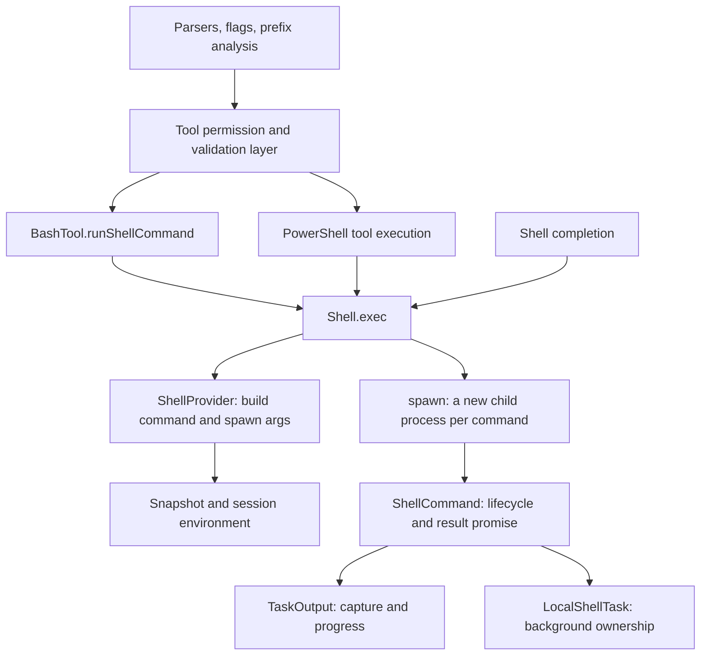

# Shell utilities

This directory documents the shared shell implementation under `utils/`: command preparation, process ownership, snapshots, output, parsing, and supporting entry points. These are internal utilities, not additional model-facing tools. The implementation described here was inspected on 2026-10-22; symbol names are the navigation anchors when line numbers move.

## Reading map

| Document | Main sources and questions |
|---|---|
| [Execution](./execution.md) | `Shell.ts`: what does `await exec()` await, where is the process spawned, and how does cwd survive? |
| [Providers](./providers.md) | `shell/`: shell selection, command construction, Bash versus PowerShell, sandbox arguments |
| [Snapshots and environment](./snapshots-and-environment.md) | `bash/ShellSnapshot.ts`, `sessionEnvironment.ts`, `subprocessEnv.ts`: capture script versus saved snapshot, startup and replay |
| [Lifecycle and output](./lifecycle-and-output.md) | `ShellCommand.ts`, `task/TaskOutput.ts`, `task/diskOutput.ts`: promises, termination, background ownership, file descriptors |
| [Bash parsing and quoting](./bash-parsing.md) | `bash/`: parser layers, AST contracts, conservative fallback, heredocs, execution quoting |
| [PowerShell analysis and prefixes](./analysis-and-prefixes.md) | `powershell/`, shared flag validation and prefix extraction: parse subprocesses versus execution subprocesses |
| [Supporting utilities](./supporting-utilities.md) | Completion, prompt commands, shell configuration, and direct subprocess wrappers |

## Boundaries and callers

Execution is downstream of the tool permission layer. `Shell.exec()` does not ask the user to authorize a command. Parsing produces structural evidence; prefix extraction proposes permission-rule text; neither is itself an execution sandbox.

The reusable object is the shell provider and its snapshot promise, **not a persistent shell process**. Each invocation gets a new process. Selected state is reconstructed from a snapshot and session scripts, and cwd is explicitly communicated back through a temporary file. Arbitrary variables/functions defined by one command do not automatically persist to the next.

## Existing design documents

- [Bash tool internals](../tools/shell-repl-internal-execution/BashTool/internals.md): model input, progress generator, background transfer, semantic exit interpretation, result mapping.
- [PowerShell tool internals](../tools/shell-repl-internal-execution/PowerShellTool/internals.md): tool-level lifecycle and permission boundaries.
- [Permissions](../permissions.md): authorization above the execution utilities.
- [Runtime artifacts](../storage-runtime-artifacts.md): storage context for task output and other session files.

## Source interpretation notes

Current [bashParser.ts](../../../utils/bash/bashParser.ts) implements a pure-TypeScript parser. Names and comments in its consumers still say tree-sitter, native, or WASM; those names describe the compatible AST/API, not the current parser implementation. Likewise, older top-level archive descriptions that say no runtime scaffolding exists do not describe the current checkout. These documents follow implementation bodies where comments differ.
