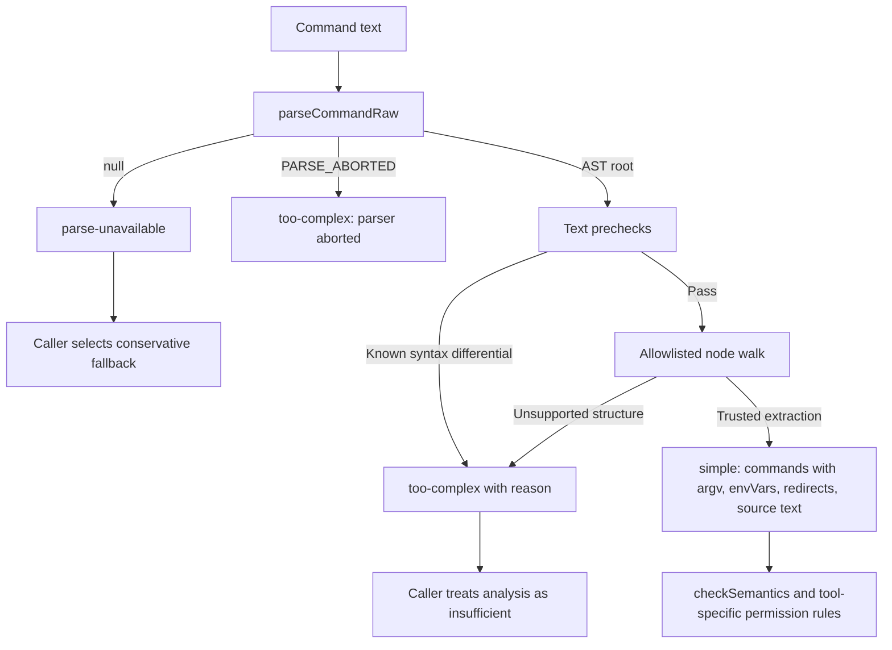

# Bash parsing, structural analysis, and execution quoting

The Bash utilities serve different consumers. A security parser answers whether structure can be analyzed; a parsed-command facade supports slicing and legacy checks; execution quoting preserves program text while embedding it in a wrapper. A successful parse alone is not permission to run the command.

## Module map

| Source | Contract |
|---|---|
| [bashParser.ts](../../../utils/bash/bashParser.ts) | Pure-TypeScript lexer/parser producing compatible `TsNode` trees |
| [parser.ts](../../../utils/bash/parser.ts) | Feature gates, length bound, parser availability/abort distinction, command extraction |
| [ast.ts](../../../utils/bash/ast.ts) | Conservative walk to argv/environment/redirections, plus semantic checks |
| [ParsedCommand.ts](../../../utils/bash/ParsedCommand.ts) | Pipe/redirection facade with AST and legacy implementations |
| [treeSitterAnalysis.ts](../../../utils/bash/treeSitterAnalysis.ts) | Quote spans, compound structure, dangerous-pattern flags |
| [commands.ts](../../../utils/bash/commands.ts) | Legacy split/redirection helpers and model-assisted prefix wiring |
| [heredoc.ts](../../../utils/bash/heredoc.ts) | Conservative heredoc extraction into placeholders and restoration |
| [shellQuote.ts](../../../utils/bash/shellQuote.ts) | Wrapped shell-quote parsing/quoting and differential guards |
| [shellQuoting.ts](../../../utils/bash/shellQuoting.ts) | Whole-command quoting, stdin heuristics, Windows-null rewrite |
| [bashPipeCommand.ts](../../../utils/bash/bashPipeCommand.ts) | Place stdin redirection without corrupting pipeline syntax |

## Parser implementation and entry points

`bashParser.ts` implements `TsNode` as `{type, text, startIndex, endIndex, children}`. Offsets are UTF-8 byte offsets. Lexer logic tracks quoting, expansions, operators, and heredoc boundaries; recursive parsers build programs/lists/pipelines, simple commands, assignments and redirects, substitutions, compound statements, tests, and arithmetic. `parseSource` returns null on caught failure or budget abort. Its default budget is 50 ms and 50,000 nodes; time is checked periodically, not continuously.

`ensureParserInitialized()` is a no-op resolved promise and `getParserModule()` returns the TypeScript module. Comments in `parser.ts` describing WASM initialization or native loading are historical; the feature-gated API still exists, but its current implementation does not load WASM.

| Entry point | Gates and return contract |
|---|---|
| `parseCommand` | `TREE_SITTER_BASH`; empty or over 10,000 JS code units returns null; successful parse returns root, first command node, leading env assignments, original text |
| `parseCommandRaw` | Main or shadow feature; same length gate; successful root, null for unavailable/disabled/length guard, or `PARSE_ABORTED` when an attempted parse fails |
| `parseForSecurity` | Empty string is simple with no commands; otherwise raw parse then security walk |
| `parseForSecurityFromAst` | Reuses an existing root or abort sentinel and still runs text prechecks |

`parseCommand` is a convenience view of a first command, not a full permission verdict. `extractCommandArguments` skips leading assignments, strips outer quotes from recognized simple argument types, and stops at command/process substitution nodes rather than inventing runtime output.

## Security walk and failure branches

Prechecks reject control characters, selected Unicode whitespace, backslash-escaped whitespace, zsh dynamic-directory/equals expansion, and brace/quote differentials. The AST walker only interprets structures it explicitly understands. It traverses structural list/pipeline nodes to produce simple commands and handles supported substitutions/assignments with tracked values or placeholders. A placeholder is not a claim that runtime expansion has been evaluated.

The result union matters: `simple`, `too-complex`, and `parse-unavailable` are distinct. A loaded parser that aborts must not silently receive the weaker unavailable-parser fallback. The convenience `ParsedCommand.parse` fallback below has a different contract and must not substitute for this security gate.

`checkSemantics` runs after argv extraction. It unwraps recognized wrappers such as time/nohup/timeout/nice and checks executable/argument hazards. Unknown timeout flags or unsupported duration forms fail analysis rather than treating the wrapper name as sufficient evidence. Detailed policy remains in the [Bash security](../tools/shell-repl-internal-execution/BashTool/security.md), [read-only](../tools/shell-repl-internal-execution/BashTool/read-only-validation.md), and [path](../tools/shell-repl-internal-execution/BashTool/path-validation.md) documents.

## ParsedCommand facade and analysis reuse

`IParsedCommand` supplies original text, pipe segments, output redirections, text without those redirections, and optional structural analysis. `buildParsedCommandFromRoot` lets callers reuse a root already obtained for security analysis.

The AST implementation stores a UTF-8 Buffer so byte spans can safely slice multibyte text. It removes redirection spans in descending order; its final whitespace collapse is an analysis normalization, not a guarantee of a semantics-preserving executable rewrite.

`treeSitterAnalysis.analyzeCommand` combines quote-context variants, compound operator/segment information, actual operator-node detection, and flags for substitutions, heredocs, parameter expansion, and comments. These support checks that distinguish operator text inside quotes from executable structure.

`ParsedCommand.parse` caches the last command/promise. It separately memoizes an availability probe, attempts the AST path, then uses `RegexParsedCommand_DEPRECATED` on failure/unavailability. The fallback relies on `splitCommandWithOperators` and `extractOutputRedirections`, and reports no tree analysis. Its existence does not authorize downgrading `PARSE_ABORTED` in `parseForSecurity`.

## Legacy splitting and heredoc preservation

`commands.splitCommandWithOperators` extracts heredocs, joins odd-backslash newline continuations without adding spaces, protects syntax using per-parse random placeholders, tokenizes, and restores protected material. It retains operators; `splitCommand_DEPRECATED` exposes a command-oriented view. Redirection helpers distinguish file paths from fd operations and avoid stripping dynamic or ambiguous targets that permission checks still need to inspect.

`heredoc.extractHeredocs` returns processed text plus a map of delimiter/body/span metadata. Randomized placeholder identifiers avoid collisions with user text. It conservatively declines extraction for unsupported quoting/nesting patterns rather than hiding incorrectly bounded text. `quotedOnly` limits which bodies are protected; restoration reconstitutes saved text. It is a scanner with explicit limitations, not another complete shell parser.

## Quoting before execution

The Bash provider applies `rewriteWindowsNullRedirect`, then `shouldAddStdinRedirect`, then `quoteShellCommand`. The null rewrite is regex-based without quote context: even literal `">nul"` can change. This is actual behavior, not a promise to preserve every input byte.

`quoteShellCommand` uses single-quoted eval arguments for recognized heredocs/multiline strings, escaping embedded single quotes. Heredocs suppress added stdin redirection. Ordinary commands delegate to `quote`; stdin detection itself is heuristic.

For pipe commands requiring stdin isolation, `rearrangePipeCommand` has two paths:

| Condition | Returned eval argument/redirect form |
|---|---|
| Safely tokenizable simple pipeline | Rebuild `first-command < /dev/null | rest`, then single-quote for eval |
| Backticks, substitution, variable reference, control structure, real newline, malformed tokens, parser failure, or unusable pipe boundary | Preserve original command as one single-quoted eval argument, with `< /dev/null` applied to eval itself |

The fallback is conceptually `eval 'original pipeline' < /dev/null`. Adding a quoted `< /dev/null` argument to eval would concatenate it into the program and can redirect the last pipeline stage. The distinction prevents a downstream `wc` from losing its pipe input.

`shellQuote.tryParseShellCommand` and `tryQuoteShellArgs` return success/error unions. `quote` additionally tries lenient conversion after strict validation fails. Single-quote and malformed-token guards exist because shell-quote tokenization differs from Bash syntax; rebuilding a malformed command can change behavior. These are construction/analysis helpers, not authorization checks.
