# Shell execution

Primary source: [utils/Shell.ts](../../../utils/Shell.ts), especially `exec`, `findSuitableShell`, `getShellConfig`, and `setCwd`. See [providers](./providers.md) for shell-specific construction and [lifecycle](./lifecycle-and-output.md) for what happens after spawn.

## Contract and caller

`exec(command, abortSignal, shellType, options): Promise<ShellCommand>` performs asynchronous preparation and returns a process handle. [BashTool.runShellCommand](../../../tools/BashTool/BashTool.tsx) awaits this handle and then races its `result` promise with progress/background events.

```ts
const handle = await exec(command, signal, 'bash', options)
// Preparation is complete. The command may still be running.
const result = await handle.result
// Result assembly is complete; inspect code/interrupted/backgroundTaskId.
```

`ShellCommand` exposes `result`, `status`, `kill`, `background`, `cleanup`, `taskOutput`, and an optional timeout callback registration method. A background transfer does not resolve `handle.result`; the tool can return a separate running-task response while that promise remains pending.

| Input/option | Use |
|---|---|
| `command` | Shell program text, not an argv array |
| `shellType` | Provider key: `bash` (Bash or zsh executable) or `powershell` |
| `abortSignal` | Pre-spawn cancellation check and subsequent wrapper listener |
| `timeout` | `timeout || 30 * 60 * 1000`; zero also selects the default |
| `onProgress` | Receives output tail, counts, and incomplete indicator through TaskOutput |
| `onStdout` | Selects pipe capture and receives stdout chunks |
| `preventCwdChanges` | Suppresses adoption of the child shell's final directory |
| `shouldUseSandbox` | Requests sandbox wrapping; authorization is the caller's responsibility |
| `shouldAutoBackground` | Enables timeout callback registration in the lifecycle wrapper |

## Source-order execution

1. Resolve the provider. Bash configuration and PowerShell provider lookup are memoized. Bash provider construction starts snapshot creation; `buildExecCommand` later waits for it.
2. Allocate a four-hex-digit identifier for the cwd tracking filename. This is separate from the generated `local_bash` task ID used for output, even when the selected provider is PowerShell.
3. Compute the per-user sandbox temporary directory and call `provider.buildExecCommand`. The returned `commandString` includes environment setup and a cwd trailer; `cwdFilePath` tells the parent where to read that trailer's result.
4. Read the tracked cwd using `pwd()`, then probe it with `realpath`. On failure, probe the original cwd and adopt it if available. If both probes fail, return `createFailedCommand` with `preSpawnError` instead of creating a process.
5. Check `abortSignal.aborted`. An already-cancelled invocation returns `createAbortedCommand`. This check occurs after provider/command preparation, not at function entry.
6. If requested, call `SandboxManager.wrapWithSandbox` and attempt to create the sandbox temp directory with mode `0700`. Directory creation failure is logged and execution continues; wrapper failure is outside the later spawn try/catch.
7. Obtain the executable, argument list, and provider environment overrides. Sandboxed PowerShell uses `/bin/sh` as the outer and sandbox shell; the provider embeds the actual encoded PowerShell invocation.
8. Create `TaskOutput`, ensure its directory, and open an output file unless `onStdout` selected pipe mode. POSIX file opening combines write/create/append with `O_NOFOLLOW`; Windows uses `w` for inherited-handle compatibility.
9. Call `spawn` with cwd, environment, stdio, provider detachment setting, and `windowsHide`. Environment order is subprocess base, shell/editor/Claude markers, provider overrides, then the internal session ID where enabled.
10. Immediately call `wrapSpawn`. This installs error/exit handling before awaiting closure of the parent's output file descriptor. The child has its own inherited descriptor; closing the parent's copy does not stop capture.
11. Attach the optional stdout callback and a result handler for sandbox cleanup/cwd synchronization. Return the handle without awaiting its result.

## Two asynchronous boundaries

```mermaid
sequenceDiagram
    participant T as Tool caller
    participant E as Shell.exec
    participant P as Provider
    participant C as Child shell
    participant W as ShellCommand
    T->>E: exec(command, signal, type, options)
    E->>P: buildExecCommand(command)
    P->>P: Await snapshot if Bash&#59; assemble setup and cwd trailer
    P-->>E: commandString, cwdFilePath
    E->>E: Validate cwd&#59; check abort&#59; optionally wrap sandbox
    E->>C: spawn(binary, args, env, cwd, stdio)
    E->>W: wrapSpawn(child, signal, timeout, output)
    E->>W: Register result.then(cwd cleanup)
    E-->>T: ShellCommand handle
    T->>W: Await result or transfer task ownership
    C-->>W: exit or error event
    W->>W: Read output and settle result
    W-->>E: Run registered cleanup reaction
    E->>E: Read cwd file synchronously&#59; update tracked state
    W-->>T: Result continuation
```



The cleanup callback is declared async, but its cwd reads, updates, and unlink occur synchronously before any await. It is registered before the caller gets the handle, so ordinary later `await handle.result` continuations observe the cwd update. The separate promise returned by `.then()` is discarded; it is not a replacement result promise.

## Working directory persistence

The Bash provider appends `pwd -P >| <cwd file>` after `eval` in an `&&` chain. Thus a failing command, explicit `exit`, or termination can prevent creation of the cwd file. The result handler tolerates missing files. PowerShell has a different trailer that preserves its selected exit status while writing `(Get-Location).Path`.

Only results without `backgroundTaskId` and with `preventCwdChanges` false can update cwd. Paths are converted on Windows and normalized for comparison; `setCwd` resolves relative paths and physical paths. A change invalidates session environment cache and triggers the cwd hook notification. This is parent-managed persistence, not a child changing its parent's operating-system cwd by `cd`.

## Failure boundaries

| Failure | Observable behavior |
|---|---|
| Provider resolution, command building, sandbox wrapping, output setup throws before spawn try | `exec()` can reject; it is not a universal no-throw wrapper |
| Current and original cwd unavailable | Resolved failed handle, code 1, `preSpawnError`, not interrupted |
| Already aborted at explicit check | Resolved killed handle, default code 145, interrupted |
| Exception caught inside spawn/setup try | Close parent fd, clear output, return aborted-style handle with code 126 and error text |
| Asynchronous child `error` event | Wrapper resolves exit code 1 through its normal result assembly |
| Child returns nonzero | Returned as result data; BashTool later applies command-specific success/error interpretation |

The spawn options intentionally omit `signal`; cancellation is delegated to tree-kill through `ShellCommand`. Low-level kill and background behavior are covered in the [lifecycle document](./lifecycle-and-output.md).
