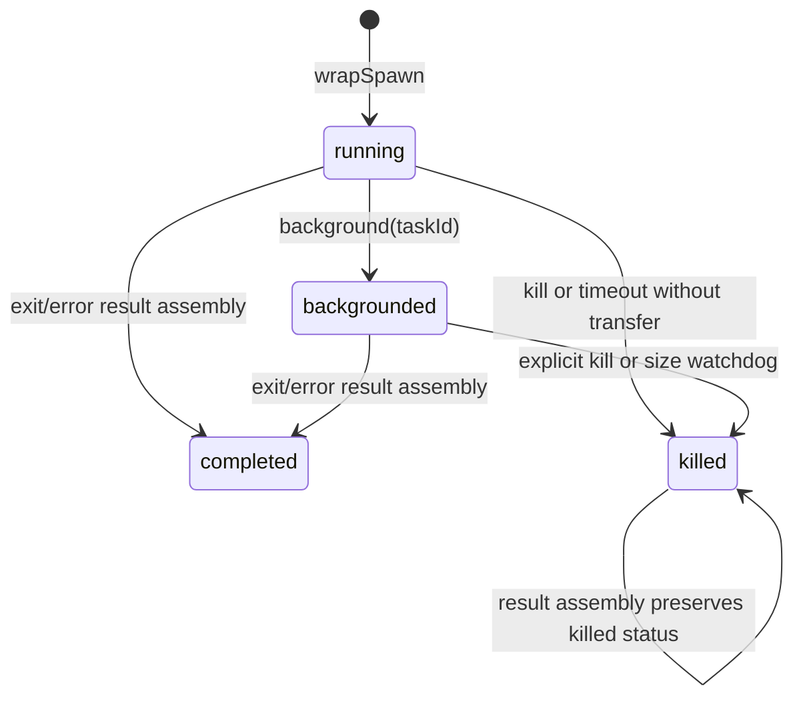

# Process lifecycle and output ownership

Sources: [ShellCommand.ts](../../../utils/ShellCommand.ts), [TaskOutput.ts](../../../utils/task/TaskOutput.ts), [diskOutput.ts](../../../utils/task/diskOutput.ts), [outputLimits.ts](../../../utils/shell/outputLimits.ts), and [LocalShellTask.tsx](../../../tasks/LocalShellTask/LocalShellTask.tsx).

## Promise mechanics

`wrapSpawn` constructs `ShellCommandImpl`. Its constructor creates pipe wrappers only for child streams that exist, optionally exposes `onTimeout`, and creates the result promise.

`#createResultPromise` installs abort, child `exit`, and child `error` listeners and a timeout. An inner `Promise<number>` stores `#exitCodeResolver`; an outer `Promise<ExecResult>` stores `#resultResolver`. Exit/error/kill routes feed the inner resolver. Its `.then(#handleExit)` continuation reads output and resolves the outer promise. Clearing each stored resolver prevents multiple settlement attempts from assembling multiple results.

The child listener is `exit`, not `close`: descendants can retain stdio descriptors after the shell exits. Consequently completion follows the shell/result lifecycle, not a guarantee that every descendant has stopped or every inherited descriptor has closed.

## Cancellation, timeout, and backgrounding

| Event | Implementation behavior |
|---|---|
| Ordinary abort | `kill()` calls tree-kill with actual `SIGKILL` and supplies synthetic code 137 |
| Abort reason `interrupt` | Low-level abort handler returns without killing; caller decides whether/how to transfer ownership |
| Timeout with auto-background enabled and callback registered | Invoke callback with bound `background` function; the callback must perform transfer |
| Timeout otherwise | Actual kill is still `SIGKILL`, but synthetic result code is 143 and stderr gets timeout text |
| Child `exit` with numeric status | Preserve numeric code |
| Child exit without numeric status | SIGTERM maps to 144; other signals map to 1 |
| Child `error` | Resolve code 1 |

`interrupted` is computed as `code === 137`; these values are application conventions, not a uniform `128 + signal` conversion. A timeout code 143 is not marked interrupted by this test. Killing resolves the internal exit code without waiting for tree-kill to confirm process-tree termination.

`background(taskId)` succeeds only from running. It records the ID, changes status, and removes the foreground timeout and abort listener. Exit/error listeners remain so `result` can still settle. In file mode it starts an unref five-second size watchdog; in pipe mode it forces buffer spill to disk. Backgrounding does not spawn a second process and does not resolve the result immediately.

`LocalShellTask` owns task registration, later completion/notification, and cleanup after transfer. The Bash progress generator stops polling in its finally block, but does not clean the transferred process as though it had completed. See the [tool-level transfer sequence](../tools/shell-repl-internal-execution/BashTool/internals.md).

## File mode and pipe mode

| Property | File mode, default in Shell.exec | Pipe mode, selected by onStdout |
|---|---|---|
| Child stdout/stderr | Both use the same inherited output fd | Separate pipes |
| JS data path | Child writes bypass JS | StreamWrapper forwards chunks to TaskOutput |
| Result stdout | Prefix/full content of merged output file | Buffered stdout, or tail/notice after spill |
| Result stderr | Normally empty because both streams share file | Separate buffer before spill; empty after spill |
| Progress | Poll file tail when explicitly activated | Update on buffered data with extracted lines |
| Background cap | Watchdog kills oversized file writer | Disk queue drops data after its coarse cap |

Closing the parent's fd after spawn is correct because the child owns its inherited descriptor. Attaching wrapper error handling before that close's await avoids missing an asynchronous spawn failure.

## TaskOutput source-order behavior

Construction determines a task-specific output path and registers file-mode instances with progress callbacks. Registration alone does not start polling. `startPolling(taskId)` joins a shared active map and starts an unref one-second timer; `stopPolling` removes it and clears the timer when empty.

Each tick reads the last 4096 bytes. Progress provides up to five recent lines and a larger recent slice, byte size, and line count. Counts for files larger than the tail sample are extrapolated with a monotonic maximum, not an exact full-file scan. Empty output still wakes the callback so callers can observe background transitions. The `.then`-based tick does not await reads or track an in-flight flag; do not infer that slow reads can never overlap across ticks.

Pipe writes count string lengths, update a circular recent-line buffer, and accumulate stdout/stderr up to the default 8 MiB memory threshold. Those counters use JavaScript string lengths, not consistently UTF-8 byte counts. Spill creates `DiskTaskOutput`, queues existing stdout then stderr with a marker, and queues new chunks thereafter. This conversion does not reconstruct the original interleaving of previously separate buffers.

`getStdout` in file mode reads the beginning of the file up to `getMaxOutputLength()` (default 30,000, bounded at 150,000). It records whether all bytes fit and the total size. Read failure returns a diagnostic string. In spilled pipe mode it returns a recent-line tail and persisted-path notice instead of reading the complete disk file.

`#handleExit` uses that read to assemble result data. Small foreground file output is asynchronously deleted when redundant; larger foreground output gains `outputFilePath`, size, and task ID. Background output remains associated with its task. Later tool code handles model-facing persistence/truncation separately.

## DiskTaskOutput and cleanup

The output directory captures the session ID on first access and remains stable across later session-ID changes. Filenames use `<taskId>.output`. This prevents concurrent sessions from sharing the same task-output directory while preserving access for tasks surviving `/clear`.

Pipe-mode disk writes use a flat queue drained by one writer, not a chain of closures retaining every chunk. `flush()` waits for the active drain; `cancel()` drops queued chunks. The writer opens with append and POSIX `O_NOFOLLOW`, drains, closes, and checks again for appends that arrived while closing. Errors are logged and remaining queued work gets one retry; flush completion is not proof of successful durable persistence.

The shared disk cap is 5 GiB, labeled `5GB` in messages. File-mode background enforcement samples actual file size every five seconds, so it is not an exact hard byte ceiling. Pipe enforcement counts string lengths and drops subsequent chunks once capped, with a truncation notice.

`ShellCommand.cleanup()` detaches stream wrappers, clears TaskOutput buffers/polling, removes remaining timeout/abort/watchdog listeners, and releases references. It is a resource cleanup operation, not a synonym for kill. Owners must preserve the command until the appropriate completion/transfer boundary; calling cleanup on a live process is not the normal completion protocol.
