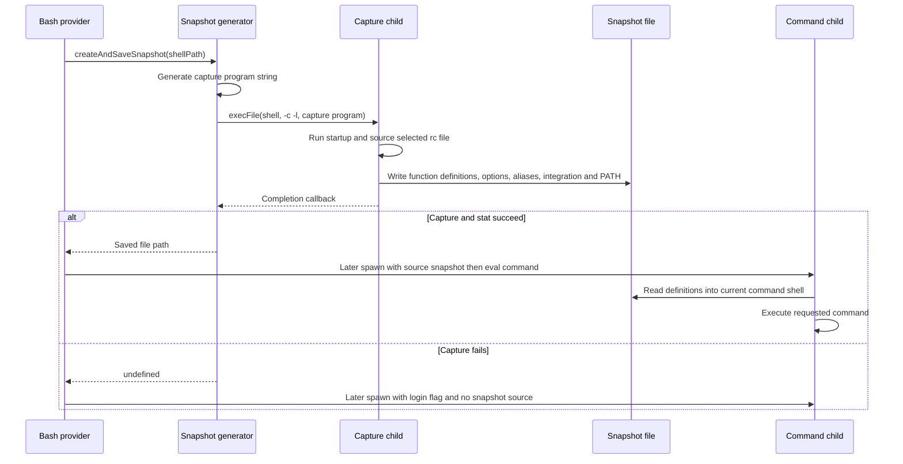

# Snapshots and environment replay

Sources: [ShellSnapshot.ts](../../../utils/bash/ShellSnapshot.ts), [bashProvider.ts](../../../utils/shell/bashProvider.ts), [sessionEnvironment.ts](../../../utils/sessionEnvironment.ts), [subprocessEnv.ts](../../../utils/subprocessEnv.ts), and [sessionEnvVars.ts](../../../utils/sessionEnvVars.ts).

## Three distinct objects

| Object | Lifetime and role |
|---|---|
| Capture script returned by `getSnapshotScript` | In-memory shell program that loads configuration and writes a snapshot file |
| Saved `snapshot-<shell>-<timestamp>-<random>.sh` | Replayable definitions and settings under the Claude config home's `shell-snapshots` directory |
| Command script returned by `buildExecCommand` | Per-invocation program that sources the saved snapshot and runs the requested command |

Generating the capture string alone does not capture anything: configuration must execute in a real shell before functions, aliases, and options can be serialized. The capture child exits after writing its file. Later command children source that file in their own shell, then execute their command in that same shell.

## Capture script construction

`getConfigFile` selects the home-directory `.zshrc`, `.bashrc`, or `.profile` based on the executable path. Unlike `utils/shellConfig.ts`, this function does not consult `ZDOTDIR`; do not assume those two configuration helpers are interchangeable.

`getSnapshotScript` sets `SNAPSHOT_FILE`, explicitly sources the selected configuration if it exists with stdin from `/dev/null`, then creates/truncates the destination. It first writes `unalias -a` to avoid alias expansion interfering with replayed function definitions.

`getUserSnapshotContent` emits the following capture operations:

| State | Capture/replay representation |
|---|---|
| zsh functions | Enumerate with `typeset +f`; append definitions using `typeset -f "$func"` |
| Bash functions | Enumerate with `declare -F`; Base64-encode each `declare -f` definition and write a decoding `eval` for replay |
| Function filtering | Exclude names starting with one underscore followed by a non-underscore; retain double-underscore helpers |
| zsh options | Serialize `setopt` output as `setopt ...` commands, capped at 1000 lines |
| Bash options | Serialize `shopt -p` and enabled `set -o` options; explicitly enable alias expansion |
| Aliases | Serialize aliases as `alias -- ...`, capped at 1000 lines; filter winpty aliases on Windows-like shells |

There is an initial `typeset -f`/`declare -f` command whose output is discarded. The source comments describe it as forcing autoload; the implementation itself only runs those builtins and does not explicitly invoke each autoloaded function.

`getClaudeCodeSnapshotContent` adds a conditional bundled-ripgrep integration and, where enabled, embedded find/grep functions. It appends an `export PATH=...` using the parent process PATH, with a Windows shell probe/fallback. This is not a dump of every variable produced by sourcing the user's configuration. Function definitions that depend on uncaptured shell variables may therefore need other environment setup.

## createAndSaveSnapshot, in source order

1. Classify the executable as zsh, bash, or sh; probe configuration existence.
2. Allocate a timestamp/random filename and ensure the snapshot directory exists.
3. Generate the capture string, including Claude-specific snippets.
4. Call `execFile(binShell, ['-c', '-l', snapshotScript], options, callback)`. The shell is a non-interactive login shell; explicit rc sourcing inside the script supplements its normal startup behavior.
5. Supply subprocess environment unless `CLAUDE_CODE_DONT_INHERIT_ENV` is set, then add `SHELL`, `GIT_EDITOR=true`, and `CLAUDECODE=1`. This inheritance switch applies to this capture child; it is not a global switch on `Shell.exec`.
6. Impose a ten-second timeout and 1 MiB captured-output buffer. These are capture limits, separate from command execution and task-output limits.
7. On callback error, log diagnostics/telemetry and resolve undefined. On success, stat the file; if present, register graceful-shutdown unlink cleanup and resolve its path. A zero-byte file still passes this existence/stat check; contents are not syntax-validated here.
8. Outer setup failures also resolve undefined. A failed capture does not prevent later shell commands; the provider falls back to login-shell execution.

## Per-command session scripts

`getSessionEnvironmentScript` returns null on Windows. Elsewhere, it reads the optional parent `CLAUDE_ENV_FILE` first, then matching files under `<config home>/session-env/<session ID>/`. Hook order is setup, sessionstart, cwdchanged, filechanged; numeric hook index orders files within each type. Trimmed nonempty contents are joined with newlines and inserted after snapshot sourcing.

Its cache has three states: undefined means unread/invalidated, null means no script found, and string means cached script. `invalidateSessionEnvCache` returns to undefined. `clearCwdEnvFiles` empties matching cwdchanged/filechanged files; it is a distinct operation from invalidating the cache. Cwd adoption in `Shell.exec` invalidates the script cache and notifies the hook layer.

The `/env` map is another channel: providers inject those key/value pairs into the child environment, separate from executable hook scripts. Neither mechanism means arbitrary `export` commands inside a previous Bash tool invocation persist automatically.

## Subprocess environment boundary

`subprocessEnv()` optionally overlays upstream proxy variables. With scrubbing disabled and no proxy additions, it returns `process.env` itself; despite the helper comment, it does not always allocate a copy. Callers such as `Shell.exec` spread it into a new object.

With `CLAUDE_CODE_SUBPROCESS_ENV_SCRUB` enabled, it copies the environment and removes the enumerated credential keys and corresponding `INPUT_` variants. GitHub tokens are intentionally outside that removal list. This is selective environment preparation, not proof that every possible secret or every subprocess path is scrubbed. Direct wrapper callers must choose their own environment.
