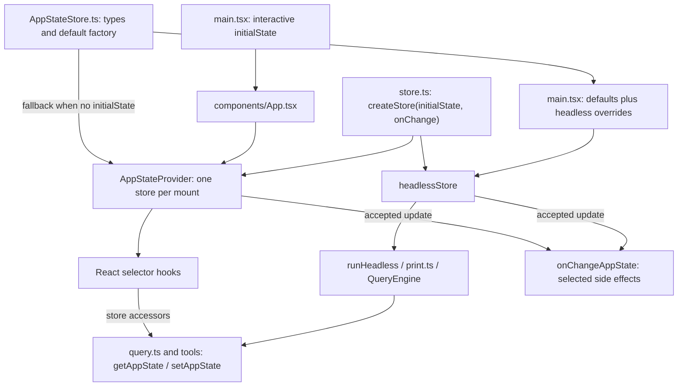
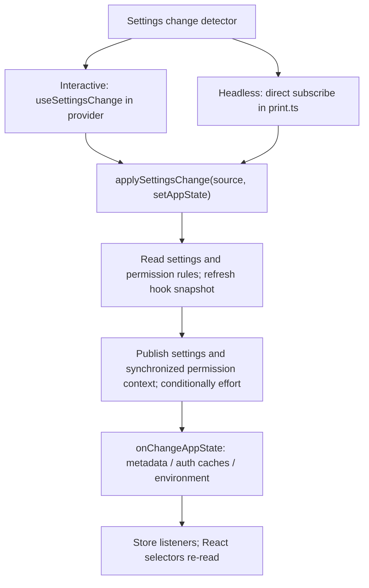

# AppStateStore — schema, initialization, and publication

Primary source: [`state/AppStateStore.ts`](../../../state/AppStateStore.ts).
Line references below describe the current recovered checkout. This document
explains existing behavior; diagrams simplify compiler-generated React cache
branches without changing their lifecycle meaning.

## 1. Responsibilities and caller map

`AppStateStore.ts` defines the shared `AppState` type, supporting speculation
types, the `AppStateStore = Store<AppState>` alias, and `getDefaultAppState()`.
It does **not** create a singleton store or implement subscriptions. A store is
created by a caller and holds one current state reference in a closure.

| Source | Responsibility |
|---|---|
| [`state/AppStateStore.ts`](../../../state/AppStateStore.ts):41–569 | State types and default factory; no React import. |
| [`state/store.ts`](../../../state/store.ts):1–34 | Generic `getState`, functional `setState`, and listener set. |
| [`state/AppState.tsx`](../../../state/AppState.tsx):21–199 | Compatibility re-exports, provider, selector hooks, settings-change integration. |
| [`state/onChangeAppState.ts`](../../../state/onChangeAppState.ts):23–171 | Metadata restoration updater and selected state-change side effects. |
| [`state/selectors.ts`](../../../state/selectors.ts):17–76 | Derived teammate lookup and input-routing selection. |
| [`components/App.tsx`](../../../components/App.tsx):19–29 | Main interactive wrapper passes initial state and the shared change callback to the provider. |
| [`main.tsx`](../../../main.tsx):2624–2654, 2830, 2927–3037 | Creates the headless store; separately constructs interactive initial state. |
| [`screens/REPL.tsx`](../../../screens/REPL.tsx):2438–2439 | Passes live state accessors into the tool-use context. |
| [`cli/print.ts`](../../../cli/print.ts):517–530, 1052–1079 | Applies headless settings updates and emits SDK permission-mode status events. |



The provider's `onChangeAppState` prop is optional. The main `App` supplies the
shared callback, but a standalone provider can omit it. Creating a generic
store does not automatically attach application side effects.

## 2. Source-order types in AppStateStore.ts

### Speculation and footer types (`:41–87`)

`CompletionBoundary` is a discriminated union describing completion, Bash,
edit, or denied-tool boundaries. `SpeculationResult` combines messages, an
optional boundary, and time saved.

`SpeculationState` is either `{ status: 'idle' }` or an active record containing
an ID, abort function, start time, mutable message/path/context refs, boundary,
suggestion length, tool-use count, pipeline flag, and optional pipelined
suggestion. The mutable refs are explicit: updating their contents does not by
itself publish a store update. `IDLE_SPECULATION_STATE` is a module-level object
reused by the default factory.

`FooterItem` enumerates the task, tmux, browser (`bagel`), team, bridge, and
companion footer selections.

### Shared state schema (`:89–452`)

The declaration has two parts:

```ts
type AppState = DeepImmutable<{
  // settings, model, permissions, presentation, remote/bridge flags
}> & {
  // tasks, integrations, runtime handles, coordination, optional features
}
```

Only the first object is wrapped in `DeepImmutable`. The second contains
function-bearing task state, integration objects, maps, refs, and callbacks.
The imported `types/utils.js` source is absent from this checkout, so the exact
mapped-type implementation cannot be established here. Neither this factory
nor `createStore()` performs runtime freezing, cloning, or validation.

| Source span | Fields / domain | Meaning |
|---|---|---|
| `:90–116` | `settings`, `verbose`, model fields, view/selection fields, `toolPermissionContext`, `agent`, `kairosEnabled` | Effective settings, session configuration, permission state, shared UI selection. |
| `:117–157` | `remoteSessionUrl`, remote status/count, `replBridge*`, `showRemoteCallout` | Remote viewer and bridge state. A remote background-task count represents tasks in another process. |
| `:160–171` | `tasks`, `agentNameRegistry`, foreground/viewed task IDs, companion fields | Task registry, name routing, viewed task, companion presentation. |
| `:173–216` | `mcp`, `plugins` | Live clients/tools/commands/resources; plugin load/install errors and refresh state. `pluginReconnectKey` is an effect invalidation counter. |
| `:217–231` | Agent definitions, file history, attribution, todos, remote suggestions, notifications, elicitation, thinking/suggestion flags, session hooks | Shared agent/runtime resources and UI queues. |
| `:232–299` | `tungsten*`, `bagel*`, `computerUseMcpState` | tmux/browser panels and computer-use grants/display metadata. The schema explicitly keeps full screenshot blobs outside AppState. |
| `:300–322` | `replContext` | VM context, registered tool handlers, and console capture functions. |
| `:323–384` | Team/standalone identity, inbox, worker permission queue, pending requests | Teammate routing and leader/worker coordination. |
| `:385–419` | Prompt suggestion, speculation, skill improvement, auth version, initial message, plan verification, denial tracking | Suggestion lifecycle and pending session actions. |
| `:420–451` | Overlays, fast/advisor/effort values, ultraplan fields, bridge/channel permission callbacks | Overlay coordination, model controls, remote planning, permission transports. |

These are runtime state fields, not a schema for one persisted JSON object.
Functions, VM contexts, connections, Maps, and Sets reinforce that distinction.
The main conversation history remains separately owned by the REPL or
QueryEngine, although specific AppState fields contain messages for their own
purposes (`initialMessage`, speculation, inbox, and task state).

### Store alias (`:454`)

`AppStateStore = Store<AppState>` adds no runtime behavior. The generic store
has exactly three operations:

```ts
type Store<T> = {
  getState: () => T
  setState: (updater: (prev: T) => T) => void
  subscribe: (listener: () => void) => () => void
}
```

## 3. Default construction (`:456–569`)

`getDefaultAppState()` performs these steps in source order:

1. Lazily requires `utils/teammate.ts` to avoid a circular dependency.
2. Selects `plan` only when both `isTeammate()` and `isPlanModeRequired()` are
   true; otherwise selects `default`.
3. Returns an object with settings, empty runtime collections, baseline UI and
   bridge flags, an empty tool permission context with the selected mode, and
   feature-derived thinking/suggestion defaults.

| Defaults | Initial values |
|---|---|
| Settings and models | `getInitialSettings()`; both model fields `null`; `verbose: false`. |
| Selection | Expanded/view-selection modes `none`; agent and coordinator indices `-1`; footer selection `null`. |
| Remote / bridge | Remote connection status `connecting`, task count `0`, bridge flags false, URLs/IDs/errors undefined. |
| Permissions | Spread `getEmptyToolPermissionContext()`, then replace `mode`. |
| Runtime collections | Empty tasks/todos/resources objects, client/tool/command/plugin arrays, queues, and inbox. New Maps for agent names and session hooks; new Sets for tracked files and overlays. |
| History / attribution | Empty history with sequence `0`; `createEmptyAttributionState()`. |
| Suggestions | Empty text/IDs, timestamps `0`, no skill-improvement suggestion, idle speculation, saved time `0`. |
| Other session controls | Pending worker/sandbox requests and initial message `null`; auth version `0`; effort undefined; fast mode false. |

Most containers are newly allocated per call. This is not a deep-copy guarantee:
the idle speculation object is shared and settings come from the settings
loader. Optional features such as team context, VM context, permission
callbacks, advisor model, and computer-use state are omitted until needed.

The factory is environment-dependent. `getInitialSettings()` returns effective
merged settings or `{}` (`utils/settings/settings.ts:812`). Thinking reads
`MAX_THINKING_TOKENS`, then the settings override, then defaults to enabled
(`utils/thinking.ts:146`). Prompt suggestion initialization delegates to
`shouldEnablePromptSuggestion()` (`services/PromptSuggestion/promptSuggestion.ts:37`),
which evaluates overrides/gates and emits initialization telemetry.

### Defaults versus actual session startup

The default factory is a baseline, not the complete startup policy:

- **Headless:** `main.tsx:2624–2654` spreads the defaults and replaces MCP
  clients/commands/tools and permission context, supplies effort, and applies
  gated fast/advisor/Kairos values. It then calls
  `createStore(headlessInitialState, onChangeAppState)` and passes live accessors
  to `runHeadless()` at `main.tsx:2830`.
- **Interactive:** `main.tsx:2927–3037` builds an explicit initial state instead
  of calling this factory. It resolves CLI/config values such as verbosity,
  model, expanded view, permission mode, initial prompt, and team context.
  `components/App.tsx:29` passes that state into `AppStateProvider`.
- **Provider fallback:** only a provider without `initialState` calls the
  default factory (`state/AppState.tsx:50`). A supplied initial state replaces
  the fallback entirely; the provider does not merge partial defaults.

Consequently, `verbose: false` or `mainLoopModel: null` in the factory does not
establish the value used by the main interactive session.

## 4. Store updates and subscription ordering

`state/store.ts:10–34` stores the supplied initial reference and an empty
`Set` of listeners. Initialization does not call `onChange` or notify listeners.
`getState()` returns the actual current object, without a copy.

```mermaid
sequenceDiagram
    participant Writer as UI / tool / background callback
    participant Store as createStore closure
    participant Effects as optional onChange
    participant Listener as each subscribed listener
    participant Reader as React getter / direct reader
    Writer->>Store: setState(updater)
    Store->>Store: prev = state; next = updater(prev)
    alt Object.is(next, prev)
        Store-->>Writer: return without publication
    else different root reference
        Store->>Store: state = next
        Store->>Effects: onChange({newState: next, oldState: prev})
        Effects-->>Store: return
        loop listener Set iteration
            Store->>Listener: listener() with zero arguments
            Listener->>Reader: request snapshot re-check
            Reader->>Store: getState()
            Store-->>Reader: current state reference
        end
        Store-->>Writer: return
    end
```

**The full old/new state pair goes only to `onChange`. Subscribers receive no
payload.** Consumers obtain content through `getState()` or a selector getter.
Unlike the command queue's frozen array snapshot, the AppState snapshot is
simply the stored root object reference.

An updater returns a complete next state, not a patch. The common pattern is:

```ts
setAppState(prev => ({ ...prev, verbose: !prev.verbose }))
```

Returning `prev` suppresses all callbacks. Returning a new root object triggers
all store listeners even if its field values compare equal. Nested references
must also change when selectors or side-effect comparisons depend on them.
In-place mutation followed by returning `prev` changes live data while bypassing
publication; mutating a nested object can also invalidate the old/new diff.

### Failure and reentrancy behavior

| Where execution fails | Result directly implied by `store.ts` |
|---|---|
| Updater throws | No root assignment or notification; any mutation already performed by the updater is not undone. |
| `onChange` throws | New root is already installed; listener loop is skipped; no rollback. |
| A listener throws | New root remains installed; later listeners are skipped for that invocation. |
| A callback calls `setState` again | Nested update runs immediately; there is no reentrancy queue, transaction, or batching layer in this store. |

Subscriptions add a callback to a Set and return a deletion function. Reusing
the same callback does not create a second entry. There is no immediate callback
on subscribe, history buffer, replay, or asynchronous acknowledgment. The store
does not await asynchronous work started by callbacks.

## 5. React integration and live access outside React

`AppStateProvider` rejects nesting under another provider and creates its store
through a `useState` initializer (`state/AppState.tsx:41–57`). That gives the
mounted provider one stable store. Later `initialState` or callback prop changes
do not recreate the store or replace its captured change callback.

On mount, an effect checks whether bypass permissions were disabled by policy
before mounting and corrects the stored permission context if necessary. The
provider also installs settings-change handling and wraps descendants with
mailbox and feature-dependent voice providers.

| Hook | Subscription and result |
|---|---|
| `useAppState(selector)` (`:142–163`) | Calls `useSyncExternalStore(store.subscribe, get, get)`; `get()` returns `selector(store.getState())`. |
| `useSetAppState()` (`:170–172`) | Returns the stable setter; does not subscribe to state. |
| `useAppStateStore()` (`:177–179`) | Returns the store for live `getState`/`setState` access; does not subscribe to state. |
| `useAppStateMaybeOutsideOfProvider(selector)` (`:186–199`) | Reads a selected value when a provider exists; otherwise returns undefined with a no-op subscription. |

Every accepted root update calls every listener. React's snapshot comparison
then determines whether the selected value changed, using `Object.is`. Thus a
component selecting `s.verbose` can avoid a state-driven render when only
`s.mcp` changes. Selecting a fresh object on every getter call defeats snapshot
stability; select existing references or primitive values instead. The source's
guard against selecting the entire state is disabled by `if (false && ...)`;
it is guidance rather than an enforced runtime restriction in this checkout.

The required hooks throw a `ReferenceError` without a provider. Headless code
uses the store accessors directly and requires no React context. The REPL also
passes `getAppState: () => store.getState()` and `setAppState` into tool-use
contexts (`screens/REPL.tsx:2438–2439`), allowing async code to read current
state rather than an earlier render's selected value. QueryEngine accepts the
same accessor contract (`QueryEngine.ts:137–138`).

`state/selectors.ts` supplies pure derived reads: it validates the viewed task
as an in-process teammate, then routes input to a viewed teammate, a viewed
local agent, or the leader. These functions do not subscribe or change state.

## 6. Change side effects and settings feedback

The shared `onChangeAppState()` runs synchronously after root assignment and
before store listeners. Its comparisons execute in source order:

| Source | Trigger | Action |
|---|---|---|
| `state/onChangeAppState.ts:65–92` | Raw permission mode changes | Externalize old/new modes; notify session metadata only if external mode changes; notify permission-mode channel with the raw new mode. |
| `:94–112` | `mainLoopModel` changes | Update user settings (`undefined` when reset to null) and bootstrap model override. |
| `:114–128` | `expandedView` changes | Persist legacy `showExpandedTodos` / `showSpinnerTree` flags if needed. |
| `:130–140` | `verbose` changes | Persist global verbosity if different. |
| `:142–152` | Internal-user tmux visibility changes to a defined value | Persist sticky tmux visibility if different. |
| `:154–170` | `settings` reference changes | Clear API-key/AWS/GCP credential caches; if `settings.env` reference changes, reapply config environment variables. This block catches and logs errors. |

Permission metadata includes `is_ultraplan_mode: true` only when entering the
external plan mode with a newly enabled ultraplan flag; otherwise the emitted
value is null. Changing the flag alone does not enter this mode-change branch.
`externalMetadataToAppState()` (`:23–41`) constructs a functional updater for
restoring a string permission mode and/or boolean ultraplan flag; it does not
itself call the store setter.

The SDK permission stream is another layer:

```text
setAppState(updater)
  -> createStore.setState
     -> onChangeAppState({newState, oldState})
        -> notifyPermissionModeChanged(rawMode)
           -> listener registered in cli/print.ts:1060
              -> filter SDK-exposed modes
              -> output.enqueue(system/status with permissionMode)
     -> store listeners receive listener()
```

That SDK status event is a constructed transport payload, not the payload of a
generic AppState subscription.

Settings updates flow in the opposite direction too:



`utils/settings/applySettingsChange.ts:33–92` reloads settings, permission rules,
and hook configuration; synchronizes the permission context; applies relevant
policy restrictions; and conditionally propagates a defined, changed effort
setting. `cli/print.ts:517–530` registers the direct headless subscription and
also synchronizes denormalized fast mode when enabled. Config environment
application is additive/overwriting; this callback does not delete variables
removed from settings.

Only selected fields are persisted by this callback. There is no automatic
serialization or recovery of the entire AppState through `createStore()`.
Transcript/session persistence is owned by other modules; see
[configuration storage](../storage-config-settings.md) and
[session storage](../storage-session.md).

## 7. Relationship to the command queue

| Property | AppState store | Command queue |
|---|---|---|
| Ownership | Caller-created store; interactive provider or headless owner. | Module-level singleton in `utils/messageQueueManager.ts`. |
| Data | Shared configuration, task/integration state, presentation, runtime handles. | Commands waiting to enter a conversation. |
| Publication | Install next root; call optional old/new hook; call listeners with no arguments. | Copy queue to a shallow frozen snapshot; emit signal with no arguments. |
| React read | `selector(store.getState())`. | `getCommandQueueSnapshot()`. |
| Non-React read | Injected `getAppState()`. | Direct queue read/drain APIs. |
| Execution | Updating state does not generically execute a prompt. | Consumers decide when to drain or interrupt. |

The AppState `notifications.queue`, `elicitation.queue`, worker permission
queue, and inbox are separate collections with their own consumers. They are
not aliases of `commandQueue`. Likewise, `initialMessage` is a pending session
action field, not the global command queue itself. For query-loop boundary
draining versus REPL/headless subscriptions, see
[command queue internals](../command-queue-internals.md).
