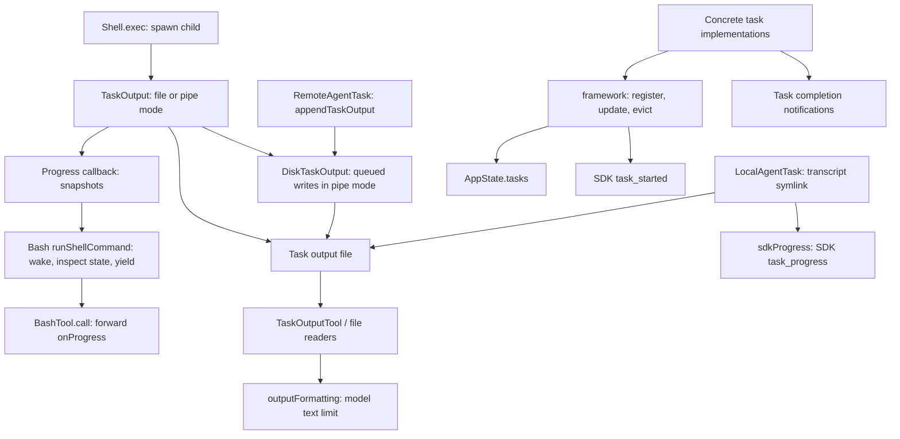

# Task utilities

This directory documents the five modules under `utils/task`, inspected on 2026-10-28. These utilities support runtime tasks: shell commands, agents, and other task implementations. They do not implement the separate model-facing task-list/Todo system.

The documents describe the recovered implementation, including its limitations. They do not prescribe a replacement architecture. Source symbols are the primary navigation anchors because line numbers can move.

## Reading map

| Document | Sources | Questions answered |
|---|---|---|
| [Framework and task state](./framework.md) | `framework.ts`, `Task.ts`, task callers | Who owns task state, how are updates merged, and when can a task be evicted? |
| [Output capture and progress](./task-output.md) | `TaskOutput.ts`, `Shell.ts`, `ShellCommand.ts`, Bash caller | Where do stdout/stderr go, how does polling work, and can progress snapshots be skipped? |
| [Disk storage and write queue](./disk-output.md) | `diskOutput.ts`, `fsOperations.ts` | How are paths chosen, writes serialized, flush promises resolved, and files read or removed? |
| [Formatting and event delivery](./delivery.md) | `outputFormatting.ts`, `sdkProgress.ts`, notification/SDK callers | How does output reach the model, UI, and SDK, and which limits apply? |

## Architecture and ownership

There are three separate lifetimes:

1. **Execution:** `ShellCommand` or a concrete agent/task implementation owns the running work, abort handling, and completion result.
2. **State:** `AppState.tasks` owns the task's visible status and notification bookkeeping. `framework.ts` mutates this map; it does not spawn or kill processes.
3. **Output:** `TaskOutput` and `diskOutput.ts` capture or locate data. Removing task state does not automatically unlink its output file.

`TaskOutput.taskId` also exists for foreground shell commands before they are necessarily registered in `AppState.tasks`. An output identifier is not proof of a registered background task.

## Entry points and callers

| Caller | Utility boundary |
|---|---|
| [Shell.exec](../../../utils/Shell.ts) | Creates `TaskOutput`; directs child fds into its path or uses pipes |
| [ShellCommandImpl](../../../utils/ShellCommand.ts) | Writes pipe data, obtains final output, spills on backgrounding, clears capture resources |
| [BashTool](../../../tools/BashTool/BashTool.tsx), [PowerShellTool](../../../tools/PowerShellTool/PowerShellTool.tsx) | Start/stop file polling; convert callbacks into generator progress |
| [LocalShellTask](../../../tasks/LocalShellTask/LocalShellTask.tsx) | Registers task state, adopts a running command, flushes capture output before cleanup, reports completion |
| [LocalAgentTask](../../../tasks/LocalAgentTask/LocalAgentTask.tsx) | Registers agent state; links output path to transcript; emits SDK progress |
| [RemoteAgentTask](../../../tasks/RemoteAgentTask/RemoteAgentTask.tsx) | Appends remote output using the module-level disk writer map |
| [getUnifiedTaskAttachments](../../../utils/attachments.ts) | Computes offset patches/eviction candidates, then applies them against fresh state |
| [TaskOutputTool](../../../tools/TaskOutputTool/TaskOutputTool.tsx) | Reads task output, waits on task status if requested, marks terminal results notified, formats model text |

## Important distinctions

- `TaskOutput`'s shared timer samples file tails. It is not a queue of all output events.
- `DiskTaskOutput` queues strings for disk writes. It is not an async iterator and does not deliver progress events.
- SDK events go through a separate queue with a capacity of 1,000 and oldest-event dropping.
- `generateTaskAttachments()` currently returns an empty `attachments` array. Its active responsibilities are output-offset tracking and identifying tasks eligible for eviction. Concrete task implementations own completion notification.
- The `POLL_INTERVAL_MS` export in `framework.ts` does not install a timer. `TaskOutput.ts` has its own private interval constant and timer.

## Related documentation

- [Shell utilities](../shell/README.md): process setup, providers, snapshots, and lifecycle.
- [Shell lifecycle and output](../shell/lifecycle-and-output.md): process ownership and completion promises.
- [Bash internals](../tools/shell-repl-internal-execution/BashTool/internals.md): tool-level backgrounding, semantic exit handling, and progress iteration.
- [Runtime storage artifacts](../storage-runtime-artifacts.md): task files in the larger storage system.
- [Tool invocation orchestration](../tools/orchestration-internals.md): callbacks and streams above individual tools.

## Source inventory

- [framework.ts](../../../utils/task/framework.ts)
- [TaskOutput.ts](../../../utils/task/TaskOutput.ts)
- [diskOutput.ts](../../../utils/task/diskOutput.ts)
- [outputFormatting.ts](../../../utils/task/outputFormatting.ts)
- [sdkProgress.ts](../../../utils/task/sdkProgress.ts)
