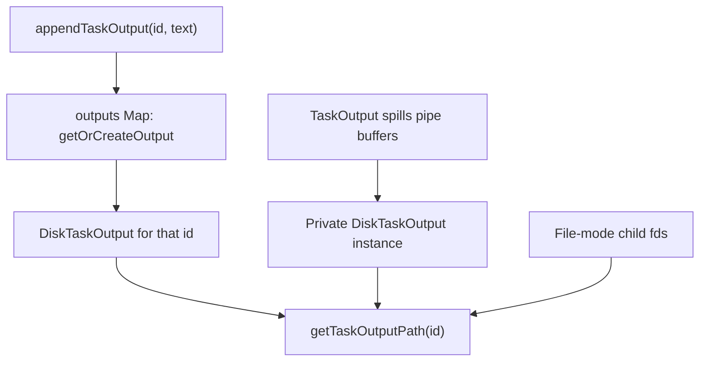

# Disk storage and write queue

Primary source: [diskOutput.ts](../../../utils/task/diskOutput.ts). Bounded readers are implemented in [fsOperations.ts](../../../utils/fsOperations.ts). This module supplies both a per-writer class and convenience functions backed by a module-level writer map.

## Output paths and initialization

`getTaskOutputDir()` memoizes this path on its first call:

```text
getProjectTempDir() / getSessionId() / tasks
```

`getTaskOutputPath(taskId)` appends `<taskId>.output`. The session component separates concurrent sessions, while first-call memoization keeps existing tasks' paths stable if `/clear` later changes the current session ID. `_resetTaskOutputDirForTest()` explicitly resets that memoization for tests.

Path calculation does not create a file. Directory creation happens in `ensureOutputDir()` or, for the direct shell-fd path, in `Shell.exec()`.

| Initializer | Behavior |
|---|---|
| `initTaskOutput(id)` | Ensure directory; exclusively create empty file; close handle; return path |
| `initTaskOutputAsSymlink(id, target)` | Ensure directory; create symlink; on first symlink failure, try unlinking destination and retrying; on outer failure, log and fall back to exclusive empty-file initialization |

Exclusive creation uses `O_WRONLY | O_CREAT | O_EXCL | O_NOFOLLOW` on Unix and `wx` on Windows. Writer appends use `O_APPEND` plus no-follow on Unix and `a` on Windows. `O_NOFOLLOW` protects writer opens from following a symlink; it is not a blanket prohibition on symlinks in this subsystem. Agent output deliberately uses a transcript symlink, and the readers open it for reading.

The symlink retry catches any first error, not only “already exists.” The fallback can itself reject; it is not guaranteed to succeed. Local agent callers launch this initialization without awaiting it, so task registration and file availability are separate events.

## Two writer ownership models



The map-backed writer and `TaskOutput.#disk` are not the same ownership mechanism. A private writer constructed during spill is not inserted into `outputs`.

Consequently, `flushTaskOutput(id)` only flushes the map entry. To flush a shell capture's private writer, call `shellCommand.taskOutput.flush()`. Neither operation flushes or waits for writes performed directly by a still-running child through its fd.

## `DiskTaskOutput.append`: enqueue without waiting

Each writer owns a path, optional open handle, string queue, coarse output counter, cap flag, and one Promise/resolver pair for the active drain.

`append(content)` performs these operations synchronously:

1. If already capped, ignore the chunk.
2. Add `content.length` to the coarse counter.
3. If the counter exceeds `5 * 1024 * 1024 * 1024`, set the cap flag and enqueue a truncation marker instead of this chunk. Otherwise enqueue the chunk.
4. If no drain is active, create `#flushPromise`, save its resolver, and start a tracked `#drain()` without awaiting it.

The cap is expressed as a byte constant but counts UTF-16 string code units on this path. It is a coarse disk-fill guard, not an exact UTF-8 byte limit. It does not measure existing file contents. The marker can add data beyond the nominal limit, and all later chunks are dropped.

The queue is not a bounded backpressure API: `append()` returns `void` and does not make producers wait for disk. The disk cap does not constitute a small memory-buffer limit when producers outrun writes.

## Drain, batching, and close races

`#drainAllChunks()` lazily creates the directory and opens the append handle. It repeatedly calls `#writeAllChunks()` until the queue is empty, closes the handle in `finally`, then checks the queue again. An append that arrives while `close()` is awaited causes another open/drain cycle instead of being stranded.

`#queueToBuffers()` removes the currently queued strings with `splice`, computes their UTF-8 size, and copies them into one `Buffer`. Chunks appended during the asynchronous write remain in the now-empty queue for the next batch. This preserves append order within one writer under normal successful writes.

`#writeAllChunks()` deliberately returns `appendFile(buffer)` directly. The source warns against making that method async with an internal `await`, to avoid retaining temporary data in an extra async frame. The caller awaits the write; there is still only one drain loop per writer.

```mermaid
sequenceDiagram
    participant P as Producer
    participant W as DiskTaskOutput
    participant D as Drain loop
    participant F as File
    P->>W: append(A)
    W->>W: Queue A; create flush Promise and save resolver
    W->>D: Start drain without waiting
    D->>F: Ensure directory and open
    P->>W: append(B) while drain active
    W->>W: Queue B; reuse active flush Promise
    D->>W: Splice queued strings into one Buffer
    D->>F: await appendFile(Buffer)
    P->>W: flush()
    Note over P,W: Caller waits on the saved drain Promise
    D->>D: Repeat if more chunks arrived
    D->>F: await close()
    D->>D: Recheck queue after close
    D->>W: Clear flush fields; call saved resolver
    W-->>P: flush() completes
```

The saved resolver is the same Promise pattern used by shell exit and progress signals, but its meaning is “this drain attempt has finished.” It carries no result value.

## Failure and flush semantics

`#drain()` logs the first error, retries once if the queue still contains chunks, and logs a retry failure. Its `finally` always clears `#flushPromise` / `#flushResolve` and calls the saved resolver.

Therefore **a fulfilled `flush()` is not proof that every byte was written successfully**. There is no rejection channel from the drain's write failures to its flush waiter.

The queue is intact if opening the file fails before batching. Once `#queueToBuffers()` has spliced a batch out, a failed append does not restore it to the queue. The retry applies only to strings still queued, not necessarily to the failed batch. These are observable limits of the implementation, not a durability guarantee.

`cancel()` clears queued strings. It neither aborts an in-flight append nor prevents future `append()` calls. Callers must separately stop their producer if they require permanent cancellation.

## Map-backed helpers and cleanup

| API | State/file behavior |
|---|---|
| `appendTaskOutput(id, text)` | Lazily get/create map writer, enqueue text |
| `flushTaskOutput(id)` | Await active drain if a map writer exists |
| `evictTaskOutput(id)` | Await map writer flush, delete map entry, preserve disk file |
| `cleanupTaskOutput(id)` | Cancel pending queue, delete map entry, attempt unlink |

`cleanupTaskOutput()` does not await in-flight writes before unlinking. A drain already opening or closing a file is not canceled by clearing its queue. This API is not a synchronization barrier for concurrent producers. `evictTaskOutput()` likewise relies on the owner having finished producing output; it has no writer-generation check around its await.

`_pendingOps` tracks initializer, eviction, and drain Promises for test teardown. `_clearOutputsForTest()` cancels map-backed queues, repeatedly awaits all tracked operations until the set is empty, then clears the map. The repeated wait matters because a failed symlink initializer can start a fallback initializer while settling. `Promise.allSettled()` prevents one rejection from abandoning the rest of teardown.

This tracking does not mean every public async operation is tracked: for example, reads and `cleanupTaskOutput()` are not wrapped in `track()`.

## Bounded reads

| API | Read strategy | Default limit | Missing/error result |
|---|---|---|---|
| `getTaskOutputDelta(id, offset, maxBytes)` | Forward range from byte offset | 8 MiB | Empty content, unchanged offset |
| `getTaskOutput(id, maxBytes)` | File tail | 8 MiB | Empty string |
| `getTaskOutputSize(id)` | `stat` | N/A | Zero |

For these helpers, `ENOENT` is silently treated as empty/missing; other errors are logged before returning the same fallback. They do not automatically call `flushTaskOutput()` before reading.

`getTaskOutputDelta()` advances by actual bytes read, not decoded string length. `getTaskOutput()` prefixes a notice reporting omitted earlier kilobytes if the file is larger than the read. It does not read the whole file and then truncate it.

`readFileRange()` and `tailFile()` allocate only the requested range and loop over reads until it is filled or EOF is reached. They decode each range independently as UTF-8. Arbitrary byte boundaries can split a multibyte character; there is no incremental decoder carried between delta calls.

## File-mode disk cap lives elsewhere

Direct shell fd writes bypass `DiskTaskOutput.append()`, so this class's cap cannot stop them. `ShellCommand.background()` starts a size watchdog for file mode. That watchdog compares file stat size to the configured maximum while status is `backgrounded`, and kills an oversized process. It is periodic, so overshoot is possible; it is not an exact write limit and is not a universal foreground cap.

Pipe-mode backgrounding instead calls `TaskOutput.spillToDisk()`, putting later writes through the queued writer. See [output capture](./task-output.md) for final reads and cleanup ownership.
