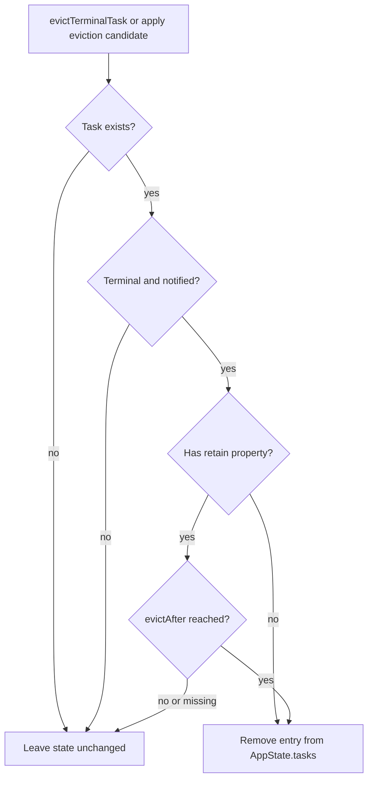
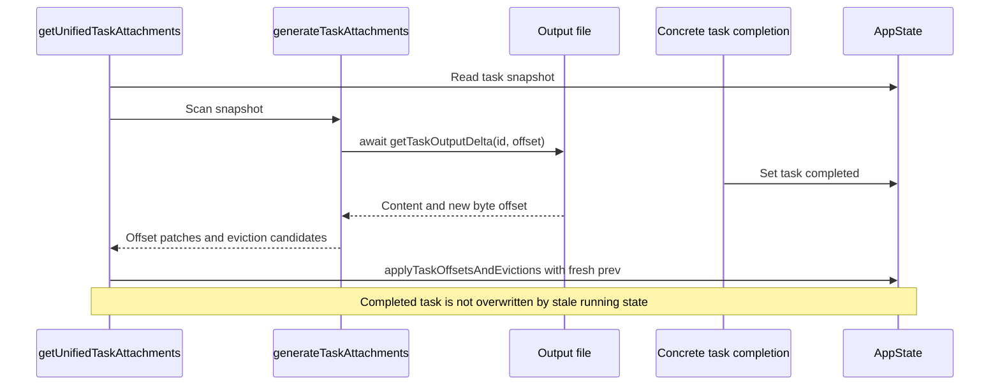

# Framework and task state

Primary sources: [framework.ts](../../../utils/task/framework.ts), [Task.ts](../../../Task.ts), and [tasks/types.ts](../../../tasks/types.ts). This document follows the framework's source order, then traces its callers.

## State contract

`TaskStateBase` supplies `id`, `type`, `status`, `description`, optional `toolUseId`, timestamps, `outputFile`, `outputOffset`, and `notified`. `createTaskStateBase()` starts at `pending`, offset zero, and `notified: false`; task implementations can override the initial status when constructing concrete state.

`TaskStatus` is `pending | running | completed | failed | killed`. `isTerminalTaskStatus()` recognizes the last three. The framework does not enforce a transition table: concrete task implementations choose transitions, and a resumed task can replace an earlier state under the same ID.

`TaskState` is the union of shell, local agent, remote agent, in-process teammate, workflow, monitor, and dream task states. The generic cast in `updateTaskState<T>()` is a TypeScript convenience, not runtime validation that an ID belongs to type `T`.

| Constant | Value | Meaning |
|---|---|---|
| `POLL_INTERVAL_MS` | 1,000 ms | Exported polling interval; this module does not start a timer |
| `STOPPED_DISPLAY_MS` | 3,000 ms | Used by an external stopped-task eviction scheduler, such as `spawnInProcess` |
| `PANEL_GRACE_MS` | 30,000 ms | Used by agent callers to establish panel grace deadlines |

## Updating and registering

`updateTaskState(taskId, setAppState, updater)` performs its lookup inside the state updater, against current `prev.tasks`. Missing tasks are a no-op. If the supplied updater returns the same task reference, the helper returns `prev` unchanged, avoiding a new tasks-map reference and unnecessary subscribers' work. Otherwise it copies the state and task map and replaces just that task.

`registerTask(task, setAppState)` inserts or replaces state. When an existing task has a `retain` property, it carries forward `retain`, `startTime`, `messages`, `diskLoaded`, and `pendingMessages`. This preserves the panel/transcript state across replacement; it does not merge every old field.

After the state update, a new ID emits SDK `task_started`; a replacement emits no second start event. Optional `workflowName` and `prompt` fields are copied into that event when present. Delivery then depends on `enqueueSdkEvent()`'s headless-session gate, described in [delivery](./delivery.md).

The local `isReplacement` flag is set inside the updater and read immediately afterward. This implementation assumes `setAppState` executes the updater synchronously; it should not be read as a generic helper for arbitrary deferred React setters.

## Eviction is guarded state removal

`evictTerminalTask()` removes an entry only if it exists, is terminal, and has `notified: true`. For states with a `retain` property, it additionally requires `(evictAfter ?? Infinity) <= Date.now()`.

The helper checks the presence of `retain`, not its Boolean value. A missing deadline on that kind of state prevents eviction. It does not itself schedule a future attempt or assign the deadline.

State eviction does not call `cleanupTaskOutput()`, stop the process, or evict a disk writer. Those are separate ownership decisions.

`getRunningTasks()` simply filters for status `running`. It does not include `pending` tasks or check `isBackgrounded`; use the distinct predicate in `tasks/types.ts` for background-task presentation.

## Attachment generation: current behavior

`generateTaskAttachments(state)` scans a snapshot of `state.tasks`:

| Snapshot condition | Action |
|---|---|
| Notified and terminal | Record ID as an eviction candidate; do not read output |
| Notified and pending | Skip |
| Running, whether notified or not | Read a bounded delta starting at `outputOffset`; record the new offset if content is nonempty |
| Other state | No offset patch or attachment |

Despite the name and older comments, **the function never pushes an attachment into its array**. It returns `{ attachments: [], updatedTaskOffsets, evictedTaskIds }`. The output delta is used to advance the cursor, not returned as progress text. Completion notifications are deliberately left to each task implementation to avoid duplicate delivery.

The reads are awaited sequentially across running tasks. Their offsets count bytes, using `getTaskOutputDelta()`, rather than string characters.

## Why generation and application are separate

Disk reads yield execution. A task may complete or be replaced while `generateTaskAttachments()` is reading its output. Applying the entire earlier task snapshot would risk overwriting the newer status with `running`.

`applyTaskOffsetsAndEvictions()` therefore receives only offset patches and candidate IDs, then rereads each task inside a fresh state updater:

- Applies an offset only if the current task still has status `running`.
- Removes a candidate only if it is still terminal, notified, and outside any panel grace period.
- Returns the original state when nothing actually changes.

These are status checks, not generation/version checks. If an ID has been replaced with another running task, the offset patch has no incarnation token to distinguish it. The code should not be described as protecting every possible same-ID replacement race.

## Entry points and notification boundary

The active attachment integration is [getUnifiedTaskAttachments()](../../../utils/attachments.ts): obtain state, await generation, apply patches, then map returned attachments. Because the generated array is empty, it currently produces no task-status attachments through this path.

`pollTasks()` also wraps generation and application. It then calls the private XML `enqueueTaskNotification()` for each attachment, but that loop has no elements with the current generator. No caller of `pollTasks()` was found in the inspected source. It is not the timer driving shell progress.

The concrete [LocalShellTask](../../../tasks/LocalShellTask/LocalShellTask.tsx) completion path instead:

1. Registers state through `registerTask()` when background ownership is established.
2. Subscribes to `shellCommand.result`.
3. Flushes `shellCommand.taskOutput`, then cleans up the shell wrapper.
4. Updates terminal status, preserving a prior `killed` state.
5. Calls its own notification helper and evicts the module-level disk writer if present.

Notification bookkeeping and eventual AppState eviction follow independently. See [delivery](./delivery.md) for the different notification channels.
