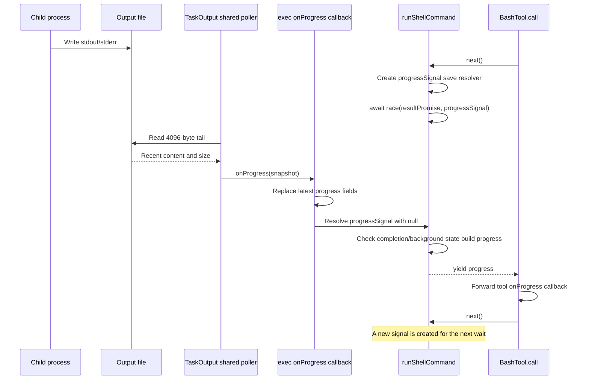

# Output capture and progress

Primary source: [TaskOutput.ts](../../../utils/task/TaskOutput.ts). Integration sources: [Shell.ts](../../../utils/Shell.ts), [ShellCommand.ts](../../../utils/ShellCommand.ts), and [BashTool.tsx](../../../tools/BashTool/BashTool.tsx).

## Construction and two capture modes

`TaskOutput(taskId, onProgress, stdoutToFile = false, maxMemory = 8 * 1024 * 1024)` records a stable output path and capture configuration. It owns in-memory stdout/stderr buffers, recent lines, counters, and optionally a `DiskTaskOutput` writer.

`Shell.exec()` selects pipe mode when `onStdout` is supplied. Otherwise it creates file-mode `TaskOutput`, opens its path, and passes the same fd as both stdout and stderr to `spawn()`. The child writes directly to disk without its output chunks passing through JavaScript. The parent closes its own output handle after spawning; the child has inherited its descriptors.

| Property | File mode | Pipe mode |
|---|---|---|
| Input | Child stdout/stderr share a file fd | `StreamWrapper` invokes `writeStdout` / `writeStderr` |
| Separation | stdout and stderr are merged | Separate in-memory buffers until spill |
| Progress | Shared timer reads file tail | `#updateProgress()` runs during each buffered write |
| Persistence | File exists from launch | Starts on overflow or explicit `spillToDisk()` |
| Final inline output | Bounded file prefix | Full stdout buffer, or short recent-line preview after spill |

The comment on `writeStderr()` says “always piped,” but the normal file-mode shell path merges stderr into the output fd. The spawn configuration determines actual behavior.

## File-mode registry and shared poller

Construction adds an instance to `#registry` only if it is in file mode and has a progress callback. Registration alone does not read the file.

`startPolling(taskId)` looks up the instance and adds it to `#activePolling`. The first active entry starts one shared 1,000 ms interval, with `unref()` so the timer alone does not keep the runtime alive(TODO). `stopPolling(taskId)` removes the entry and clears the interval when the active map becomes empty.

Comments describe React-driven visibility, but current Bash and PowerShell execution loops also explicitly call `startPolling()` and `stopPolling()`. These maps are keyed by task ID, not reference-counted by caller. Two callers starting the same ID do not acquire two independent subscriptions.

Each `#tick()` starts `tailFile(path, 4096)` for every active instance. On successful reads:

1. It rechecks that `#onProgress` is still present.
2. For empty content, it still invokes the callback, allowing backgrounding checks to proceed for quiet commands.
3. For nonempty content, it scans backward and selects recent slices targeting five and 100 lines.
4. If the whole file fits in the sample, it uses the sample's line count. Otherwise it estimates total lines from the sampled density and takes the maximum with the previous count.
5. It calls `onProgress(lastLines, allLines, totalLines, bytesTotal, bytesRead < bytesTotal)`.

`allLines` is a recent tail slice, not all historical output. `totalLines` is an estimate for files larger than the sample. Callback data is presentation state, not an exact log of writes.

Read failures are ignored by the tick's rejection handler. `stopPolling()` does not cancel reads already started; `clear()` additionally nulls the callback, which suppresses delivery from reads that finish afterward.

### Overlapping reads

The comment on `#tick()` says its non-async body avoids stacking. The body does not wait for reads, but it also has no per-task in-flight guard. If a read takes longer than the interval, later ticks can initiate another read before the first finishes. Completion ordering is therefore not guaranteed by the poller.

## Pipe-mode write path

`writeStdout()` and `writeStderr()` both enter `#writeBuffered(data, isStderr)`:

1. Increment `#totalBytes` by `data.length`.
2. Extract progress through `#updateProgress(data)`.
3. If already spilled, append to disk, prefixing stderr chunks with `[stderr] `.
4. Otherwise compare combined stdout/stderr string lengths plus this chunk with `#maxMemory`.
5. If the threshold is exceeded, spill existing buffers and the new chunk; otherwise append to the appropriate in-memory buffer.

These pipe-mode size counters are JavaScript string lengths, not exact UTF-8 byte counts. The default threshold is numerically 8 MiB, but the enforcement unit is UTF-16 code units.

`#updateProgress()` counts newlines backward and extracts a bounded set of nonblank line fragments. It stores recent lines in a 1,000-entry `CircularBuffer`, emitting five-line and 100-line views when it extracted at least one line. This is not a streaming line decoder: it does not preserve an unfinished-line accumulator across chunks, and does not emit a callback for every arbitrary chunk.

Progress extraction occurs before the write is buffered or spills. The callback's `isIncomplete` argument reflects whether disk spill had already happened at that point; the chunk that first causes overflow may still report `false`.

`#spillToDisk()` creates a private `DiskTaskOutput` instance, appends the existing stdout buffer, then stderr with a marker, then the triggering chunk, and clears the old buffers. This initial spill groups stdout before stderr; it does not reconstruct their original interleaving. Subsequent chunks are appended in arrival order.

## Promise handoff into the Bash generator

The file progress callback does not directly yield a tool event. Bash's `runShellCommand()` stores the latest fields and resolves a one-shot progress Promise:

```ts
let resolveProgress: (() => void) | null = null;
function createProgressSignal(): Promise<null> {
  return new Promise(resolve => {
    resolveProgress = () => resolve(null);
  });
}
```

The Promise constructor immediately supplies `resolve`; the wrapper saves a no-argument function that will later complete that Promise with `null`. Creating the signal does not itself resolve it.



This is latest-state signaling, not event queuing. Multiple callbacks before the generator reads the fields can overwrite intermediate snapshots. The first resolves the signal; subsequent callbacks update the fields even if no resolver is stored. Updates can also arrive while the generator is suspended at `yield`. If completion wins the race, the loop returns the final result without yielding another progress snapshot.

The same signal is used to wake the loop after a background transfer. It is therefore also a lifecycle notification, not just a data-ready notification. The loop checks background state, task registration, and UI updates before yielding. Its `finally` stops polling.

`BashTool.call()` manually calls `.next()` to receive both progress values and the generator's final `return ExecResult`. It forwards progress synchronously to its own callback. This generator boundary is not necessary merely to call a callback; it is the interface chosen by the current implementation. It does not apply backpressure to the independently running child process.

## Final output and cleanup

`getStdout()` selects the following paths:

| Condition | Result |
|---|---|
| File mode | `readFileRange(path, 0, getMaxOutputLength())`: bounded prefix, not tail |
| Pipe mode, not spilled | In-memory stdout buffer |
| Pipe mode, spilled | Last five retained lines plus notice pointing to the disk path |

For a successful file read, `outputFileSize` records the stat size and `outputFileRedundant` records whether all bytes fit inline. An empty range marks the file redundant. A read exception is logged and converted to a diagnostic string rather than an empty successful result; the diagnostic's suggested cause is not proof of what caused that exception.

`ShellCommand.#handleExit()` awaits `getStdout()`. For foreground file output it deletes a redundant small file or attaches the path/size metadata for larger output. Background file output is kept for the task's later consumption. Bash can then copy/link large output into tool-result storage; that downstream retention is outside `utils/task`.

`getStderr()` returns the separate stderr buffer before spill and `''` after spill. Normal file mode also returns `''` because stderr was never written into that buffer.

| Method | Effect |
|---|---|
| `spillToDisk()` | Creates the private writer if absent and appends buffered content |
| `flush()` | Awaits that private writer's current flush; does not control child fd writes |
| `deleteOutputFile()` | Attempts unlink; suppresses errors |
| `clear()` | Clears buffers/recent lines, nulls callback, cancels queued private writes, stops polling, removes registry entry |

`clear()` is resource cleanup, not a reset for reuse: it does not reset every counter or remove the disk file. It also does not wait for writes already in flight. Background shell completion explicitly flushes before calling cleanup; see [LocalShellTask](../../../tasks/LocalShellTask/LocalShellTask.tsx).
