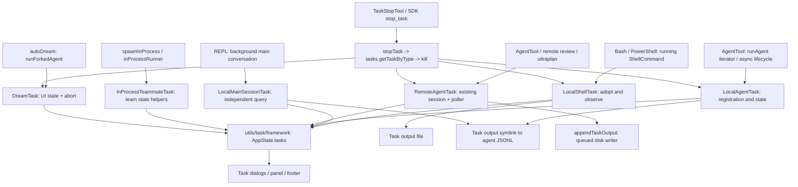

# Runtime task implementations

## IMHO - Comprehensive task design approach

**The task management includes:**

- **Register a task (foreground or background)**
- **transit a foreground task to a background if applicable**
- **Enable a watchdog to monitor the liveness of the associated task**
- **Notify completeness of a specific task**
- **Notify the progressive events of a specific task**
- **Kill a specific task**

## Purpose and reading model

This collection documents root-level `Task.ts`, `tasks.ts`, and the recovered
source under `tasks/`, inspected on
2026-11-11. It complements [task utilities](../task/README.md), which covers
`utils/task/`, rather than replacing those documents. These are runtime execution
records for shells, agents, teammates, and memory consolidation; they are
separate from the model-facing task-list/Todo tools.

Following [Query Loop Internals](../query-loop-internals.md), each implementation
has a caller boundary, function contracts, state model, lifecycle overview,
source-order executable-region walkthrough, transition table, and ordering and
failure invariants. Instrumentation is grouped with the operation it measures.
Line ranges identify this snapshot; source symbols remain the navigation anchors.
The walkthroughs describe current behavior, including asymmetries between paths.

## Reading map and complete source inventory

| Document | Source (paths relative to `tasks/` unless noted) | Main responsibility |
|---|---|---|
| [Root task contract internals](./task-contract-internals.md) | Root `Task.ts` | Base types, status predicate, handles/context, kill contract, ID generation, initial state |
| [Root task registry internals](./task-registry-internals.md) | Root `tasks.ts` | Static/feature-gated implementation selection, kill lookup, dispatch coverage and missing entries |
| [Shared stopping and presentation](./contracts-and-dispatch.md) | `types.ts`, `stopTask.ts`, `pillLabel.ts` | Type union, background selection, kill dispatch, notification suppression, footer labels |
| [Local shell internals](./local-shell-internals.md) | `LocalShellTask/LocalShellTask.tsx`, `guards.ts`, `killShellTasks.ts` | Adopt existing subprocess, foreground transfer, watchdogs, completion, owner-scoped killing |
| [Local agent internals](./local-agent-internals.md) | `LocalAgentTask/LocalAgentTask.tsx` | Progress accounting, task registration, messaging, handoff signal, terminal bookkeeping |
| [Main-session internals](./main-session-internals.md) | `LocalMainSessionTask.ts` | Main-query background task, isolated transcript, foreground display, completion |
| [Remote agent internals](./remote-agent-internals.md) | `RemoteAgentTask/RemoteAgentTask.tsx` | Register existing cloud session, restore metadata, event polling, review-specific completion |
| [In-process teammate internals](./in-process-teammate-internals.md) | `InProcessTeammateTask/InProcessTeammateTask.tsx`, `types.ts` | Team identity, user-message injection, bounded UI transcript, shutdown request |
| [Dream task internals](./dream-internals.md) | `DreamTask/DreamTask.ts` | UI task for memory-consolidation agent, observed edits, cancellation and lock rollback |

All twelve files currently present under `tasks/` are covered above. Source
references also mention `LocalWorkflowTask/LocalWorkflowTask.ts` and
`MonitorMcpTask/MonitorMcpTask.ts`, but neither module is present in this checkout.
Their type imports and feature-gated registry entries are documented as recovered
boundaries, not as available implementations.

## Caller and ownership boundaries

`Task` polymorphism covers **kill only**. Registration and execution are
implementation-specific functions. `LocalMainSessionTask` is a `local_agent`
subtype distinguished by `agentType: 'main-session'`, not a separate `TaskType`.
The in-process teammate exports a `Task` object but the current `getAllTasks()`
does not include it, so generic stop dispatch cannot reach it. Its backend can
call its kill implementation through the swarm path.

## State, execution, output, and delivery are separate

| Lifetime | Owner and consequence |
|---|---|
| Work execution | Existing `ShellCommand`, AgentTool runner, main `query()`, remote server, swarm runner, or forked dream agent |
| Task record | `AppState.tasks`, updated through `registerTask` / `updateTaskState`; no universal transition enforcement |
| Output | Shell file, remote append queue, agent transcript symlink, or UI-only dream turns |
| Notifications | Concrete task helpers plus external lifecycle owners; a queued notification is not proof of delivery |
| UI retention | Agent `retain` / `evictAfter`, teammate transcript cap, dream turn cap, and generic eviction guards |

`evictTaskOutput()` flushes and removes a map-backed writer; it preserves the
file. `evictTerminalTask()` removes eligible state; it does not kill work or
unlink output. A base `outputFile` field is derived for every task, but that does
not establish that an output file has been created (notably for dream tasks).

## Related documents

- [Framework and state](../task/framework.md), [disk output](../task/disk-output.md),
  and [delivery](../task/delivery.md).
- [Shell lifecycle](../shell/lifecycle-and-output.md) and
  [Bash internals](../tools/shell-repl-internal-execution/BashTool/internals.md).
- [Query loop](../query-loop-internals.md), [coordinator](../coordinator.md), and
  [auto-dream](../autodream.md).
