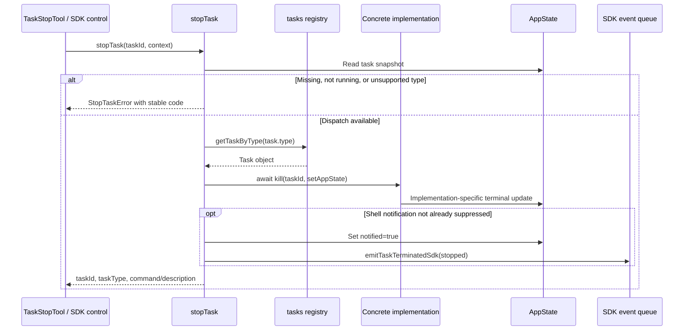

# Task contracts, stopping, and presentation

Sources: [Task.ts](../../../Task.ts), [tasks.ts](../../../tasks.ts),
[types.ts](../../../tasks/types.ts), [stopTask.ts](../../../tasks/stopTask.ts),
and [pillLabel.ts](../../../tasks/pillLabel.ts).

## Purpose and reading model

This is the source-order walkthrough of the shared boundaries surrounding the
concrete task implementations. These modules define data, select runtime tasks
for display, dispatch a stop request, and compute labels. They do not implement
a common spawn loop or enforce a common terminal-state protocol.

## Caller boundary

| Caller | Boundary |
|---|---|
| Concrete registrations | `createTaskStateBase`, `generateTaskId`, `registerTask` |
| `TaskStopTool.call()` | `stopTask(id, { getAppState, setAppState })` |
| SDK `stop_task` in `cli/print.ts` | Same `stopTask` helper and error codes |
| `BackgroundTasksDialog`, task navigation/status helpers | `isBackgroundTask` |
| `BackgroundTaskStatus` | `getPillLabel`, `pillNeedsCta` |
| Type-specific dialogs/backends | Can bypass generic kill dispatch and use concrete helpers |

## Function contracts and state model

`Task.kill(taskId, setAppState): Promise<void>` is the entire common task behavior
interface. It does not require a returned process result or a notification.
`TaskHandle` supplies an ID and optional cleanup function; the meaning of cleanup
is chosen by its producer. `TaskContext` supplies an abort controller and state
accessors, but implementations need not use all three.

| Base field | Initial value from `createTaskStateBase` | Role |
|---|---|---|
| `id`, `type`, `description`, `toolUseId` | Caller inputs | Identity and originating tool correlation |
| `status` | `pending` | Concrete registration usually overrides to `running` |
| `startTime` | `Date.now()` | Registration time unless a restore overrides it |
| `outputFile` | `getTaskOutputPath(id)` | Derived location, not file creation |
| `outputOffset` | `0` | Incremental output observation |
| `notified` | `false` | Notification/retrieval deduplication and eviction eligibility |
| `endTime`, `totalPausedMs` | Absent | Added by specific lifecycle owners |

## Lifecycle overview

## 1. Root contract boundary (`Task.ts`)

The full source-order walkthrough is in [Root task contract internals](./task-contract-internals.md).
It covers every type and helper, base field initialization, prefix generation,
and the distinction between instance state, handles, context, and kill objects.
This shared document retains the overview above for the stop/presentation path.

## 2. Root registry boundary (`tasks.ts`)

[Root task registry internals](./task-registry-internals.md) covers module-load
feature selection, ordered array construction, exact lookup, and current dispatch
coverage. `stopTask()` is the current direct lookup consumer; union membership
alone does not guarantee a kill implementation is available.

## 3. Union and background predicate (`types.ts:1-46`)

`TaskState` and `BackgroundTaskState` enumerate the same seven concrete state
types. Their different names express consumer intent, not different membership.
Workflow/monitor type imports point at absent files.

`isBackgroundTask(task)` first rejects every state except `running` or `pending`.
It then rejects an object that has `isBackgrounded === false`. If that property
is absent, it passes. Thus remote, teammate, and dream state can appear without
an explicit background flag. Terminal tasks are excluded even when unread.
Presentation layers may apply further filtering; this predicate is not a kill
eligibility or execution-status validator.

## 4. Stop errors and contract (`stopTask.ts:10-36`)

`StopTaskError` carries `not_found`, `not_running`, or `unsupported_type` and sets
its name explicitly. The result contains `taskId`, `taskType`, and `command`.
The comment describing the function as marking every task notified is broader
than the body: its own post-kill notification suppression is shell-specific.

## 5. Validate, dispatch, and suppress (`stopTask.ts:38-100`)

1. Read one snapshot through `getAppState()` and look up the ID.
2. Throw `not_found` if absent.
3. Throw `not_running` unless status is exactly `running`; `pending` is rejected.
4. Resolve the `Task` object; throw `unsupported_type` if absent.
5. Await that implementation's `kill()`; unexpected errors propagate.
6. For shell tasks only, use a fresh state updater to set `notified` if needed.
7. Only if step 6 actually changed the flag, emit a direct SDK `stopped` event,
   because suppressing XML would otherwise suppress the parsed SDK event too.
8. Return the original snapshot's command for a shell, otherwise its description.

The shell `killTask()` itself currently sets `notified: true`. Consequently the
post-kill updater often makes no change and the `suppressed` branch does not
emit a direct SDK termination here. This is an implementation asymmetry: do not
infer an unconditional SDK bookend from the comments.

Agents deliberately keep their lifecycle notification path available so an
abort handler can include partial results. Remote killing emits its own SDK
termination. A successful `stopTask()` means the concrete kill call returned;
it does not universally mean an OS process has exited or cloud archiving was
acknowledged. The snapshot validation is not a lock: work can finish before kill.

## 6. Footer labels (`pillLabel.ts:10-69`)

`getPillLabel(tasks)` assumes a nonempty array: the homogeneous-type test later
reads `tasks[0]!.type`. Callers must enforce this precondition.

| Homogeneous input | Label policy |
|---|---|
| Shell | Count `kind === 'monitor'` separately from shells |
| Teammates | Count distinct `identity.teamName` values, not teammate records |
| Local agents | Count local agents |
| Remote | Cloud-session count with open diamond; a single ultraplan gets phase-specific text |
| Workflow | Background-workflow count |
| MCP monitor | Monitor count |
| Dream | `dreaming` |
| Mixed types | Total background-task count |

For a single ultraplan, `plan_ready` uses the filled diamond and `needs_input`
uses the open diamond with an input prompt. Other/absent phases show the generic
ultraplan label. No execution or notification state is changed here.

## 7. Attention affordance (`pillLabel.ts:74-82`)

`pillNeedsCta()` accepts exactly one remote task with `isUltraplan === true`
and a defined `ultraplanPhase`. This matches the declared phase union's two
attention states. It does not independently check status or validate a runtime
phase string; upstream filtering and typed state supply those assumptions.

## Transition and failure table

| Observation | Result |
|---|---|
| Running/pending with no explicit foreground flag | Background predicate passes |
| Any terminal state | Background predicate fails |
| Stop lookup missing | `not_found` |
| Stop sees pending/terminal | `not_running` |
| Running teammate through current generic registry | `unsupported_type` |
| Concrete kill throws | Propagated error, no universal rollback |
| State changes during awaited kill | Return still describes initial snapshot |

## Critical ordering invariants

- Dispatch availability is narrower than the state union.
- Notification bookkeeping and execution termination are separate operations.
- Read state afresh inside post-kill updates; do not overwrite newer state with
  the initial snapshot.
- Derived output paths do not prove file existence, and state eviction does not
  remove output.
- Footer labels assume their caller has already selected eligible records.

## Related documents

[Task framework](../task/framework.md) explains registration merging and guarded
state eviction. [Local shell](./local-shell-internals.md),
[local agent](./local-agent-internals.md), [remote agent](./remote-agent-internals.md),
and [teammate](./in-process-teammate-internals.md) describe the dispatched or
backend-specific termination bodies.
