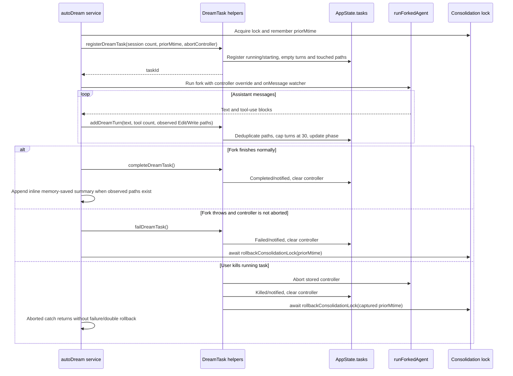

# Dream task internals

Source: [DreamTask.ts](../../../tasks/DreamTask/DreamTask.ts).

## Purpose and reading model

This module exposes the automatic memory-consolidation agent as a runtime task
in the footer and task dialog. It is a UI/state adapter around an externally
executed forked agent. This walkthrough follows its types, registration,
progress, completion/failure, and kill definitions in source order.

## Caller boundary

`services/autoDream/autoDream.ts` owns the gates, consolidation lock, prompt,
permissions, and `runForkedAgent()` call. After acquiring eligibility/lock state,
it registers a task with a new abort controller, runs the fork with that
controller override and a progress watcher, and completes or fails the task.
`tasks.ts` includes `DreamTask` in generic kill dispatch.

`makeDreamProgressWatcher()` in the service ignores non-assistant messages,
concatenates text, counts tool uses, and extracts string `file_path` values only
from Edit/Write tool-use blocks before calling `addDreamTurn()`.

## Function contracts and state model

| Field | Meaning |
|---|---|
| `phase` | `starting` until a new observed touched path, then `updating` |
| `sessionsReviewing` | Number of sessions selected by the service |
| `filesTouched` | Deduplicated observed Edit/Write paths, not verified completed modifications |
| `turns` | Up to 30 assistant summaries with tool-use counts |
| `abortController` | Fork's cancellation controller |
| `priorMtime` | Previous consolidation-lock timestamp for rollback |

The state extends base fields with type `dream`. Registration returns an ID;
progress/complete/fail are synchronous state-helper APIs. `DreamTask.kill()` is
asynchronous because it awaits lock rollback after state mutation.

## Lifecycle overview

## 1. Types and limits (`12-49`)

`MAX_TURNS` is 30. A `DreamTurn` contains text and tool-use count, not a full
message or tool result. The phase union deliberately does not model the prompt's
four consolidation stages. `isDreamTask()` is a shallow discriminator guard.
The `filesTouched` field is an incomplete observational list: attempted Edit or
Write calls may fail, and other mechanisms such as Bash writes are not captured.

## 2. Registration (`52-74`)

`registerDreamTask()` generates a `d`-prefixed ID, creates base state, overrides
status to running, sets phase starting, installs empty progress arrays, and stores
controller/lock metadata. It registers through the framework and returns the ID.

It does not create a task output file, initialize a symlink, register shutdown
cleanup, or start the fork. Although the base state derives `outputFile`, no
output producer is attached here. The fork is invoked externally with
`skipTranscript: true`; the visible turns are supplied through `onMessage`.

## 3. Progress update (`76-104`)

The updater builds a set from existing touched paths, filters newly observed
paths while adding them to that set (deduplicating within the current input too),
and skips the update only if text is exactly empty, tool-use count is zero, and
there are no new paths.

Otherwise it retains the last 29 turns and appends the new turn. New paths are
appended once, and any such addition changes phase to updating. A turn with only
tool uses still appears. The helper itself does not trim text, validate counts,
check running status, or confirm a tool call succeeded; its service watcher
normalizes text before invoking it.

## 4. Normal completion and failure (`106-130`)

`completeDreamTask()` and `failDreamTask()` set completed/failed, end time,
`notified: true`, and remove the abort-controller reference. Neither checks that
status was running, so these functions alone do not preserve a previous kill.
Neither queues a model-facing notification or an explicit SDK terminal event.

The comment's reason for notified=true is eviction eligibility for this UI-only
task. The service can append a user-visible memory-saved system message when
observed paths exist. State progress is retained for display until eviction;
these helpers do not clear the paths or turn history.

## 5. Kill and lock rollback (`132-157`)

The kill updater accepts only running records. It aborts the stored controller,
captures `priorMtime`, marks killed/notified, records end time, and clears the
controller. After state mutation, it awaits `rollbackConsolidationLock()` only
when capture succeeded. Timestamp zero is a valid captured value because the
check is against undefined.

Already-terminal/missing tasks do not rollback through this path. Rollback is
outside the updater because it performs asynchronous lock work. If rollback
rejects, kill rejects after the task was already marked killed; there is no
state rollback or local catch in this module.

## 6. Service-side ordering and cancellation boundary

After successful fork resolution, autoDream calls completion and may append a
system summary. On a thrown fork error, it checks the controller first: an
aborted controller returns without calling failure or rolling back twice. Other
errors call failure and then await lock rollback.

This external catch is the current kill-preservation mechanism. The state
helpers themselves do not enforce terminal guards on progress/complete/fail;
a late successful fork return would still reach the unguarded completion helper.
Cancellation is cooperative through the fork controller, not process killing in
this task module.

## Transition and failure table

| Trigger | Outcome |
|---|---|
| Register | Running/starting |
| First new observed Edit/Write path | Phase updating; status unchanged |
| Empty text, zero uses, no new paths | State reference unchanged |
| More than 30 turns | Drop oldest UI turns |
| Normal fork return | Completed/notified |
| Non-abort exception | Failed/notified; service rolls back lock |
| Kill while running | Killed/notified, abort, rollback once from kill path |
| Kill after terminal | No new abort or rollback |
| Rollback rejects | Caller sees rejection after terminal state mutation |

## Critical ordering invariants

- Registration is UI surfacing; the service owns actual consolidation execution.
- Observed paths are not a complete change audit or proof of successful edits.
- Kill captures lock metadata before removing controller state, then performs
  rollback outside the updater.
- This task has no model-notification delivery path; notified=true is not proof
  of a sent message.
- Terminal helper guards differ from local-agent helpers. Caller cancellation
  handling matters for preserving the final state.

## Related documents

[Auto-dream subsystem](../autodream.md), [task framework](../task/framework.md),
[shared task dispatch](./contracts-and-dispatch.md), and [local agents](./local-agent-internals.md).
