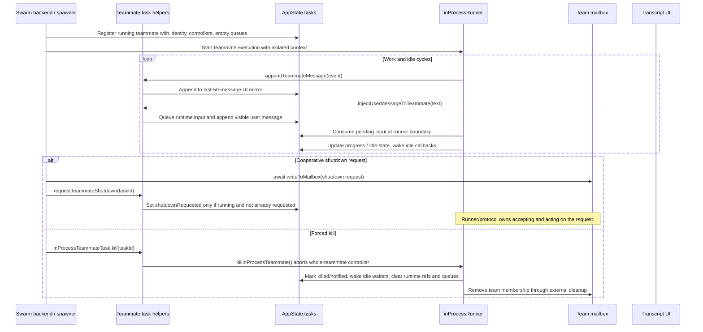

# In-process teammate task internals

Sources: [InProcessTeammateTask.tsx](../../../tasks/InProcessTeammateTask/InProcessTeammateTask.tsx)
and [types.ts](../../../tasks/InProcessTeammateTask/types.ts).

## Purpose and reading model

The task module supplies a kill adapter, state mutation helpers, and identity/UI
selectors. It does not contain the teammate execution loop. This document follows
those definitions in source order, then traces the necessary registration, input,
shutdown, and kill boundaries in `utils/swarm/`.

## Caller boundary

| Caller | Responsibility |
|---|---|
| `spawnInProcessTeammate` in `utils/swarm/spawnInProcess.ts` | Build identity/controllers, register state and shutdown cleanup |
| `utils/swarm/inProcessRunner.ts` | Own query/work/idle cycles and full conversation |
| `InProcessBackend.terminate` | Send mailbox shutdown request, then set shutdownRequested |
| Teammate transcript UI | Inject user text into pending input and bounded visible history |
| Navigation/spinner/footer | Use common running-teammate sort order |
| `InProcessTeammateTask.kill` | Delegate forced termination to `killInProcessTeammate` |

The module comment's process contrast is not a guarantee that LocalAgentTask
uses another OS process. Both can execute locally; team identity, idle/repeated
work cycles, mailbox protocol, and plan approval distinguish this task state.

## Function contract and state model

`requestTeammateShutdown`, `appendTeammateMessage`, and
`injectUserMessageToTeammate` return void after arranging state updates. They
neither await query progress nor report message delivery acknowledgment.
`findTeammateTaskByAgentId` returns the first running identity match, otherwise
the first non-running match. Task ID and `identity.agentId` are separate keys.

| State group | Fields |
|---|---|
| Identity | Agent ID/name, team name, color, required plan mode, parent session |
| Execution | Prompt/model/definition, whole-teammate abort controller, current-work controller, shutdown-removal function |
| Permissions | `permissionMode`, `awaitingPlanApproval`, identity's `planModeRequired` |
| Lifecycle | `isIdle`, `shutdownRequested`, terminal status/error/result, idle wait callbacks |
| Input | `pendingUserMessages`; team mailbox messages are separate |
| UI | Bounded `messages`, in-progress tool IDs, spinner verbs, progress/reporting counters |

`isIdle: true` can coexist with `status: 'running'`: idle means waiting for work,
not completed. Controller/callback fields are live runtime capabilities, not
serialized data handles. `messages` is an AppState display mirror; the runner's
full `allMessages` array and transcript on disk are separate.

## Lifecycle overview

## 1. Identity and execution state (`types.ts:13-76`)

`TeammateIdentity` is plain data mirroring the AsyncLocalStorage context shape.
It is not a reference to that context. The state contains two cancellation
scopes: `abortController` for the entire teammate, and
`currentWorkAbortController` for a current turn. Stopping a turn need not destroy
a reusable teammate, while forced kill targets the whole controller.

Permission mode can be changed independently when viewing that teammate.
Plan-required identity and current approval state are separate fields; these
types do not implement approval behavior themselves.

## 2. Guard and bounded append (`types.ts:78-121`)

`isInProcessTeammateTask()` checks object/non-null/type only.
`TEAMMATE_MESSAGES_UI_CAP` is 50. `appendCappedMessage(prev, item)` returns:

- `[item]` for undefined/empty history;
- a new copy of the last 49 entries plus item if the old length is at least 50;
- a copied append otherwise.

It drops oldest UI entries, not transcript records. Even an oversized input
array is reduced to 50. This helper neither mutates the old array nor deduplicates
messages, and the cap does not apply to pending user-input queues.

## 3. Task kill adapter (`InProcessTeammateTask.tsx:24-30`)

The exported `Task` object has type `in_process_teammate` and delegates kill to
`killInProcessTeammate`. However, the current `tasks.ts` registry does not include
it. Generic `stopTask()` therefore reports unsupported type for this state;
backend/UI code can still reach the concrete swarm kill path.

## 4. Cooperative shutdown flag (`35-46`)

`requestTeammateShutdown()` updates a running record only when shutdown is not
already requested. It sets a Boolean and nothing else: no mailbox message, abort,
terminal status, or notification is produced here.

The backend's `terminate()` first resolves the task by agent identity and treats
an existing request as success. Otherwise it constructs a request ID/message,
awaits writing to that teammate's team mailbox, then marks this flag. Failure
before mailbox completion does not mark the state as requested through this
helper. The flag represents a request, not confirmation the teammate has exited.

## 5. Append observed conversation (`51-62`)

`appendTeammateMessage()` accepts running state only and uses the capped append.
It accepts a preconstructed `Message`; it does not convert arbitrary runner
protocol events or persist the transcript. The runner owns those operations.

## 6. Inject user input (`68-85`)

`injectUserMessageToTeammate()` rejects `completed`, `failed`, and `killed`, logs
the dropped input, and preserves state. Other statuses, including `pending`,
pass this guard. It appends the string to `pendingUserMessages` and constructs
a visible user message through `createUserMessage`, using the same bounded UI
append. Thus immediate display does not imply the model has consumed input.

`inProcessRunner` drains pending user messages at its input boundary and removes
consumed entries in state. Team mailbox communication follows another route;
the two queues should not be conflated.

## 7. Identity lookup and presentation selectors (`92-125`)

`findTeammateTaskByAgentId()` scans task values, checks the discriminator and
identity ID, returns a running match immediately, and otherwise retains the first
match as fallback. It does not choose newest terminal state or prefer pending
over completed.

`getAllInProcessTeammateTasks()` filters by guard.
`getRunningTeammatesSorted()` filters to running and sorts by
`identity.agentName.localeCompare`. Idle running teammates are included. Spinner,
footer selection, and navigation share the ordering so index-based selection
addresses the same teammate on all surfaces.

## 8. External registration and forced termination boundary

`spawnInProcessTeammate()` creates running state with plan/default permission
mode, no pending input, empty UI history, no approval wait, active/non-idle state,
and no shutdown request. Shutdown cleanup aborts the whole controller and leaves
the runner to observe cancellation.

`killInProcessTeammate()` guards running state, captures team identity, aborts,
unregisters cleanup, and invokes pending idle callbacks. It removes live team
membership from AppState, sets killed/notified/endTime, retains only the last
visible message, clears input/in-progress IDs/controllers/callbacks, and removes
membership from the team file outside the updater. On a real kill it evicts the
writer, emits direct SDK stopped, and schedules guarded state eviction after
`STOPPED_DISPLAY_MS` (three seconds). It also releases the trace registry entry.
The task module does not duplicate this sequence.

## Transition table

| Trigger | State | Execution meaning |
|---|---|---|
| Spawn | Running, isIdle=false | Runner can process work |
| Runner reaches idle | Running, isIdle=true | Reusable teammate waiting, not terminal |
| Inject input | Queue grows, UI history capped | Delivery occurs later |
| Shutdown request | shutdownRequested=true | Request issued, work may still run |
| Forced kill | Killed/notified, runtime refs cleared | Whole-teammate cancellation requested |
| Late UI message append | Ignored unless running | Terminal UI history preserved |
| Identity lookup after old task ends | Running match preferred | Old terminal state can remain fallback |

## Critical ordering invariants

- Task identity, team identity, runtime context, and selected UI index are distinct.
- A shutdown flag alone does not send or execute the cooperative protocol.
- Runtime input queue and UI mirror are updated together, but consumption is later.
- Idle callbacks must be released on terminal paths to avoid stranded waiters.
- UI history cap does not cap model context or durable transcript.
- Generic registry omission is a recovered integration boundary, not a reason to
  invent a working stopTask dispatch path.

## Related documents

[Shared stop dispatch](./contracts-and-dispatch.md), [local agents](./local-agent-internals.md),
[coordinator](../coordinator.md), and [task framework](../task/framework.md).
