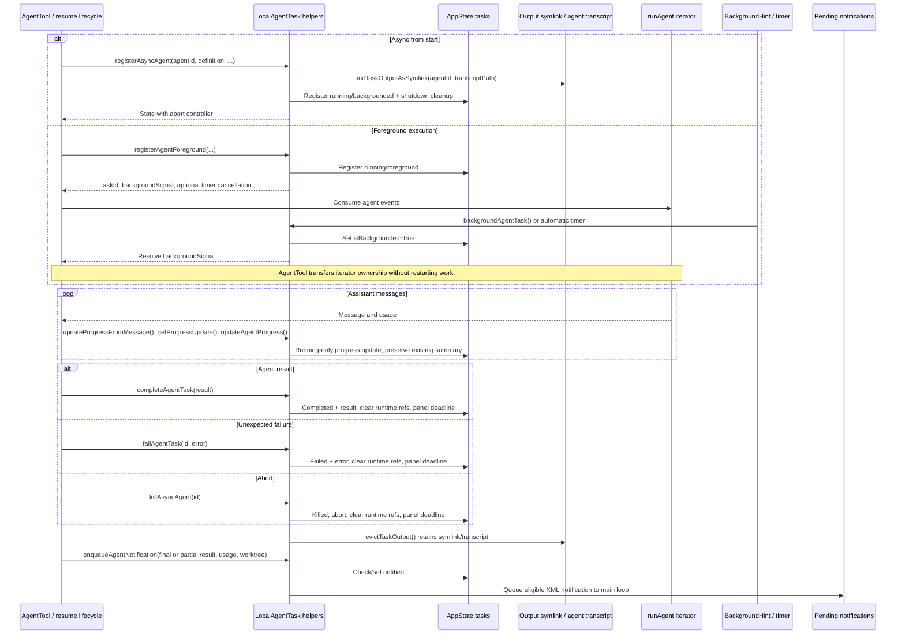

# Local agent task internals

Source: [LocalAgentTask.tsx](../../../tasks/LocalAgentTask/LocalAgentTask.tsx).

## Purpose and reading model

This walkthrough follows the module's source order: progress measurement, state
and messaging, notifications, kill/completion bookkeeping, then foreground and
background registration. The module registers and observes an agent; AgentTool
and its lifecycle runner execute the query iterator. Local agents are not
necessarily separate OS processes.

## Caller boundary

| Caller | Boundary |
|---|---|
| `AgentTool.call()` async path | `registerAsyncAgent`, then detached `runAsyncAgentLifecycle` |
| `AgentTool.call()` foreground path | `registerAgentForeground`, race iterator work against `backgroundSignal` |
| `agentToolUtils.ts` | Reexports completion/failure helpers as `completeAsyncAgent` / `failAsyncAgent`; lifecycle calls notification helper |
| `resumeAgent.ts` | Reuses async lifecycle and task identity |
| `runAgent`/AgentTool and teammate runner | Update progress tracker from assistant messages |
| SendMessage / REPL viewed transcript | Queue runtime input separately from appending display messages |
| `utils/attachments.ts` | Drain pending messages at agent tool-round boundaries |
| Shell bulk background helper | `backgroundAgentTask` |
| Coordinator bulk cancellation | `killAllRunningAgentTasks`, `markAgentsNotified` |

## Function contracts

`registerAsyncAgent()` returns running/backgrounded state with an abort
controller, not a result Promise. `registerAgentForeground()` returns a task ID,
a `Promise<void>` background signal, and optional timer-cancel callback. That
signal means foreground handoff, not agent completion or cancellation.

`completeAgentTask(result)` identifies the record by `result.agentId`.
`failAgentTask(id, error)` and `killAsyncAgent(id)` update running records only.
These helpers do not themselves enqueue the final model notification.

## State model

| Group | Fields and owner |
|---|---|
| Identity | Base ID, `agentId`, prompt, agent type/definition, optional model |
| Runtime control | Abort controller and shutdown-removal function |
| Outcome | `result`, `error`, status/end time, `retrieved` |
| Progress | Tool/token counts, recent/last activity, optional asynchronous summary |
| Messaging | `pendingMessages` for model input, optional `messages` for displayed transcript |
| Display ownership | `isBackgrounded`, `retain`, `diskLoaded`, `evictAfter` |
| Reporting | Last-reported tool and token counts |

`retain` means the UI is holding the task, not just looking at it. `diskLoaded`
marks transcript bootstrap for a retention cycle; registration initializes both
false. Terminal helpers preserve retained tasks by leaving `evictAfter`
undefined; unretained tasks get the framework's 30-second panel deadline.
Framework eviction tests the existence of the `retain` property and the deadline.

## Lifecycle overview

## 1. Progress tracker and activity resolution (`23-115`)

`createProgressTracker()` initializes tool-use count, latest input tokens,
cumulative output tokens, and recent activity list. `getTokenCountFromTracker()`
returns latest input plus cumulative output.

`updateProgressFromMessage()` ignores non-assistant messages. For each assistant
message it replaces input count with input + cache-creation + cache-read usage,
adds output tokens, and walks `tool_use` blocks. Every tool use increments the
count, including the synthetic structured-output tool; that tool alone is
excluded from activity previews. Other uses capture input, precomputed activity
description, and optional search/read classification. The list is trimmed to
five entries.

This is accounting over supplied messages, not UUID-deduplicated accounting.
Callers must decide which assistant messages to feed and avoid replaying the
same usage unintentionally. `getProgressUpdate()` copies the activity array and
selects its final entry as `lastActivity`. `createActivityDescriptionResolver()`
looks up a tool and calls its optional description method.

## 2. State guards and pending messages (`116-195`)

`isLocalAgentTask()` checks only the discriminator. `isPanelAgentTask()` excludes
`agentType === 'main-session'`; consumers use this shared distinction for panel
versus footer presentation.

`queuePendingMessage()` appends runtime input without changing visible messages.
`appendMessageToLocalAgent()` appends the UI history without delivering model
input. Neither updater checks terminal status in this module.

`drainPendingMessages()` reads a snapshot, returns empty for wrong type/empty
queue, captures the existing array, clears the queue through a fresh updater,
and returns the captured strings. This relies on synchronous state updates;
it is not an independent concurrent mailbox protocol.

## 3. Completion notification (`197-260`)

`enqueueAgentNotification()` deduplicates by checking and setting `notified` in
task state. Missing/already-notified records skip enqueueing. It then aborts
speculation and constructs summary + output-path XML, optional tool-use ID,
optional inline `<result>`, usage, and worktree path/branch.

Unlike shell notifications, an agent notification may contain the final answer
or partial answer inline. The output path remains a symlink to the agent JSONL,
not a file containing only the final answer. The helper supplies no `agentId`
queue address, so this notification targets the main loop. It does not escape
all interpolated sections or parse/validate their content here.

## 4. Kill operations and notification suppression (`270-333`)

`LocalAgentTask.kill()` delegates to `killAsyncAgent()`. That helper updates only
running records, aborts the controller, removes shutdown cleanup, marks killed,
sets end time/deadline, and clears controller/cleanup/selected-definition refs.
Only an actual kill triggers writer eviction. The notification flag is not
changed here: the outer lifecycle can still send partial-result notification.

`killAllRunningAgentTasks()` visits running `local_agent` entries in the supplied
snapshot, including main-session subtypes. `markAgentsNotified()` independently
sets the flag for aggregate cancellation paths that suppress individual notices.

## 5. Progress and summary state (`339-406`)

`updateAgentProgress()` accepts running tasks only and preserves an existing
truthy summary when replacing measured progress. It avoids letting frequent
message updates erase an independently generated summary.

`updateAgentSummary()` captures current counts, start time, and tool-use ID
inside a running-only update, supplies zero counts if absent, and installs the
summary. After the update it emits SDK progress only when capture succeeded and
`getSdkAgentProgressSummariesEnabled()` is true. Actual SDK queue delivery has
its own gate in `emitTaskProgress`; this helper does not run summarization.

## 6. Complete and fail (`412-457`)

Both terminal helpers reject non-running records. Each unregisters shutdown
cleanup, records terminal state and time, establishes panel retention, clears
runtime references, and schedules writer eviction. Completion stores the full
`AgentToolResult`; failure stores its error string. Neither sets `notified` or
sends XML; outer AgentTool lifecycle owns those steps after result/worktree work.

The state transition is synchronous and precedes potentially slow outer cleanup,
allowing TaskOutput waiters to observe termination before notification delivery.

## 7. Async registration (`466-514`)

`registerAsyncAgent()` starts transcript-symlink initialization without awaiting
it. A supplied parent abort controller produces a linked child; otherwise the
controller is independent. State is running/backgrounded, message queue empty,
reporting counts zero, retrieved false, and panel retention uninitialized.
Shutdown cleanup calls `killAsyncAgent()`; registration inserts/replaces the
record and returns it.

The API supports parent linking, but AgentTool's async-from-start call
intentionally does not supply the main foreground controller so Escape on the
main turn does not automatically abort the detached agent. Do not infer parent
linkage merely from a subagent relationship.

## 8. Foreground registration and timer (`519-614`)

The module-level `backgroundSignalResolvers` map holds one resolver per task ID.
`registerAgentForeground()` initializes the same output link, independent
controller, cleanup, and state with `isBackgrounded: false`. It creates the
signal, saves its resolver before registering state, and optionally starts a
positive-duration auto-background timer.

The timer updates an eligible local-agent record not already backgrounded, then
resolves/deletes the saved resolver. Its updater does not check status
`running`; resolver handling proceeds even if the state update was a no-op.
The returned cancel function clears only that timer, not the map entry. The
caller must coordinate cancellation/unregistration on ordinary completion.

## 9. Manual handoff and foreground removal (`620-682`)

`backgroundAgentTask()` rejects wrong type or already-backgrounded state, updates
the existing record, resolves/deletes its handoff resolver if present, and
returns true. It does not itself abort, resume, or restart a query and does not
require a resolver to return success. No status-running check is made here.

`unregisterAgentForeground()` first removes the resolver. It then removes only
an existing local-agent record still foregrounded, captures shutdown cleanup,
and invokes that removal outside the updater. A backgrounded record is left
for its lifecycle owner. Deleting the resolver does not settle a pending signal.

## Transition table

| Trigger | State | Additional ownership work |
|---|---|---|
| Async registration | Running/backgrounded | Independent or parent-linked controller |
| Foreground registration | Running/foreground | Pending handoff signal, optional timer |
| Timer/Ctrl+B | Flag becomes backgrounded | Resolve signal, caller transfers iterator |
| Normal foreground completion | Record may be removed | Caller cancels timer and unregisters foreground |
| Background result/failure | Completed/failed | Store outcome, clear runtime refs, later notification |
| Explicit abort | Killed if running | Lifecycle can report partial answer |
| UI retains terminal task | No eviction deadline | Retention/unselection consumer controls later deadline |

## Critical ordering invariants

- Handoff signaling is separate from result completion and from controller abort.
- Progress token counts are a latest-input/summed-output estimate, not a sum of
  complete request totals.
- Runtime input and visible transcript are separate channels.
- Terminal helpers guard running state; manual/timer background flag changes
  have weaker guards and rely on caller lifecycle ordering.
- AgentTool owns execution and final notification; this module alone does not
  provide an end-to-end agent runner.
- Output symlink setup is asynchronous. Registration does not guarantee it is
  already readable, and eviction preserves it.

## Related documents

[Main-session subtype](./main-session-internals.md),
[task framework retention](../task/framework.md),
[task output delivery](../task/delivery.md), and
[AgentTool docs](../tools/README.md).
