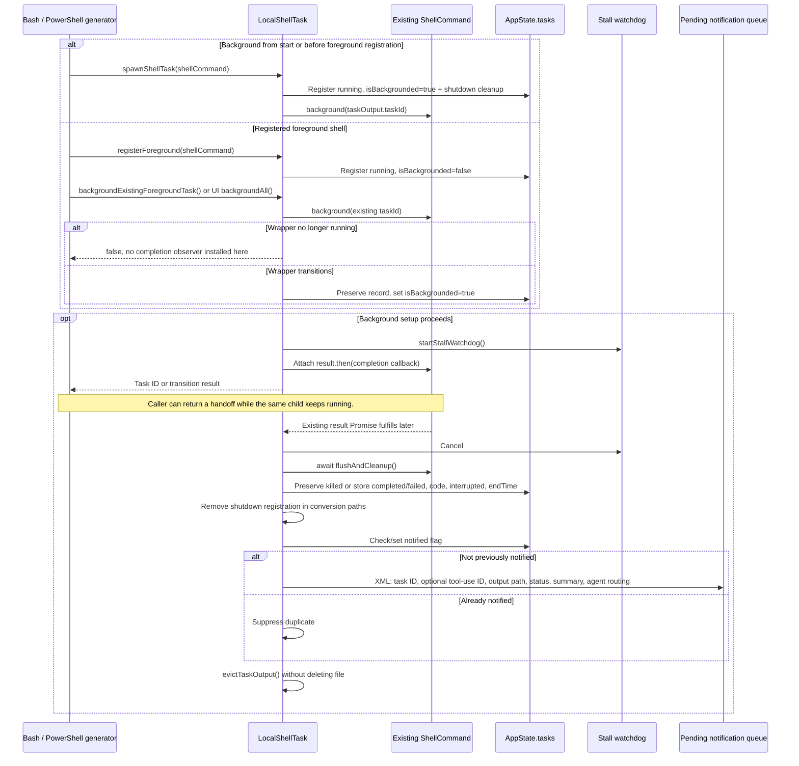

# Local shell task internals

Sources: [LocalShellTask.tsx](../../../tasks/LocalShellTask/LocalShellTask.tsx),
[guards.ts](../../../tasks/LocalShellTask/guards.ts), and
[killShellTasks.ts](../../../tasks/LocalShellTask/killShellTasks.ts).

## Purpose and reading model

This document follows the executable regions of the shell task implementation
in source order, including its two companion modules. The task layer adopts an
already-running `ShellCommand`; it does not spawn a second OS process. Read
[Bash internals](../tools/shell-repl-internal-execution/BashTool/internals.md)
for command launch and the generator's result/progress race, and
[TaskOutput](../task/task-output.md) for capture and file polling.

## Caller boundary

| Caller | Entry point and effect |
|---|---|
| Bash / PowerShell execution helper | `spawnShellTask` for direct background registration |
| Their progress/background orchestration | `registerForeground`, `backgroundExistingForegroundTask`, `unregisterForeground` |
| `BackgroundHint` in `tools/BashTool/UI.tsx` | `task:background` keybinding calls `backgroundAll` |
| Session backgrounding selector | `hasForegroundTasks` decides task handoff versus session handoff |
| Generic task stop | `LocalShellTask.kill` delegates to `killTask` |
| `tools/AgentTool/runAgent.ts` finalization | `killShellTasksForAgent` removes orphaned owned shells |
| Bash completion/handoff race | `markTaskNotified` suppresses a redundant task notification |

## Function contracts

| Function | Return boundary |
|---|---|
| `spawnShellTask(input, context)` | `Promise<TaskHandle>` after registration and observer setup, not process completion |
| `registerForeground(input, setAppState, toolUseId)` | Existing output task ID after foreground registration |
| `backgroundExistingForegroundTask(...)` | Boolean confirming wrapper transition, not independent task-record validation |
| Private `backgroundTask(...)` | Boolean after lookup, wrapper transition, and completion setup |
| `backgroundAll(...)` | `void`; attempts each selected shell and agent |
| `killTask(...)` | `void`; requests termination and updates state without awaiting OS exit |

## State model

`LocalShellTaskState` extends the base state with the following fields:

| Field | Meaning |
|---|---|
| `type: 'local_bash'`, `command` | Stable discriminator and original command |
| `shellCommand` | Live wrapper, cleared on completion or kill |
| `result` | Optional `{ code, interrupted }`; output stays in capture/file storage |
| `isBackgrounded` | Foreground registration versus background ownership; independent of `status` |
| `agentId` | Optional owner for notification routing and orphan killing |
| `kind` | `bash` or `monitor` display/watchdog variant |
| `unregisterCleanup`, `cleanupTimeoutId` | Shutdown-hook removal and optional timer bookkeeping |
| `completionStatusSentInAttachment`, `lastReportedTotalLines` | Additional reporting fields; initialized on registration |

`isLocalShellTask()` checks only non-null object plus the type discriminator; it
does not validate every field. The output task ID exists before task registration.
A command can therefore have capture state but no entry in `AppState.tasks` yet.

## Lifecycle overview

## 1. Shell Prompt recognition (`LocalShellTask.tsx:23-43`)

Constants set a five-second stall check, 45-second inactivity threshold, and
1,024-byte tail sample. `looksLikePrompt()` trims trailing whitespace, selects
the final line, and tests a fixed set of interactive-prompt patterns: yes/no,
confirmation questions, key/Enter prompts, continue, and overwrite.
This is a heuristic on the last line, not a parser or stdin-read detector.

## 2. Interactive-stall watchdog (`46-104`)

`startStallWatchdog()` returns a no-op cancellation function for `kind ===
'monitor'`. Otherwise it derives the output path and starts an unreferenced timer.

For each tick:

1. Asynchronously stat the file; errors are ignored.
2. If size increased, save size and reset the last-growth timestamp.
3. If less than 45 seconds elapsed since growth, stop this tick.
4. Otherwise read the tail. A canceled watcher ignores the result.
5. If the final line is not prompt-like, reset the timestamp to defer another
   tail inspection for approximately 45 seconds.
6. If prompt-like, latch cancellation and clear the interval before enqueueing.
7. Queue a priority-`next`, owner-addressed notification with last output and
   advice to kill/retry noninteractively.

The notification intentionally omits `<status>` so SDK consumers do not mistake
it for terminal completion. The watcher neither kills the process nor sets the
terminal notification flag. A later completion notification is still possible.
Overlapping asynchronous ticks are possible; the latch prevents duplicate stall
messages once one tail read has confirmed a prompt. Size shrinkage does not
reset `lastSize` through the growth branch.

## 3. Completion notification (`105-172`)

`enqueueShellNotification()` first uses `updateTaskState()` to atomically check
and set `notified`. Missing/already-notified state prevents enqueueing. The
implementation assumes state updaters execute synchronously before the helper
reads its captured `shouldEnqueue` variable.

It aborts active speculation, chooses a shell or feature-gated monitor summary,
and derives the file path from the task ID. The queued XML includes task ID,
optional tool-use ID, output path, status, and escaped summary. Exit code appears
in the summary when applicable; stdout/stderr is not embedded. `agentId` routes
to the owning agent, and absence targets the main loop. Priority is `next` when
`MONITOR_TOOL` is compiled in, otherwise `later`.

This sets notification bookkeeping before delivery. The queue's consumer must
still drain the message. `TaskOutput` can retrieve the stored exit code and read
the retained file; the SDK parser extracts the XML output path.

## 4. Task object and direct background registration (`173-252`)

`LocalShellTask.kill()` delegates to the pure kill helper.
`spawnShellTask()` obtains the ID from `shellCommand.taskOutput.taskId`, registers
a shutdown callback calling `killTask`, builds a running/backgrounded state, and
registers it. It then calls `shellCommand.background(taskId)` without checking
the Boolean, starts the stall watchdog, and attaches an asynchronous result
observer. There is no internal await before returning the handle.

The observer cancels the watcher and awaits `flushAndCleanup()` before updating
state. A task already `killed` is preserved; otherwise exit code zero becomes
`completed`, nonzero becomes `failed`, `result` is stored, the wrapper/reference
to shutdown cleanup is cleared, and `endTime` is recorded. It then attempts the
notification and schedules output-writer eviction without awaiting it.

Unlike the conversion paths, this observer clears `unregisterCleanup` in state
without invoking the saved removal function. The returned `TaskHandle.cleanup`
closes over the original registration and removes it when called. Do not assume
normal direct-spawn completion itself unregisters that shutdown callback.

## 5. Register foreground ownership (`259-287`)

`registerForeground()` also reuses the output task ID and registers shutdown
killing, but sets `isBackgrounded: false`. It does not transition the wrapper,
start a stall watcher, or install background completion handling. Ordinary
foreground completion is owned by the tool's generator.

## 6. UI conversion (`293-368`)

Private `backgroundTask()` reads fresh state and rejects non-shell, already
backgrounded, or wrapper-less records. It captures the wrapper, description,
tool-use ID, kind, and owner, then attempts `background(taskId)`. Wrapper failure
returns `false` before further setup.

After success, the task updater preserves all fields and flips the flag when
eligible. It starts a kind-aware stall watcher and attaches completion handling.
This observer mirrors direct-spawn finalization but captures and invokes the
shutdown-removal callback outside the updater. The already-killed branch returns
before capture, relying on kill-path cleanup. Setup returns `true` immediately.

## 7. Foreground selection and bulk handoff (`378-410`)

`hasForegroundTasks()` recognizes foreground shells with wrappers and foreground
local agents except main-session tasks. It does not explicitly require status
`running` in those predicate branches.

`backgroundAll()` snapshots task IDs, converts shells first, then calls
`backgroundAgentTask()` for foreground local agents. Its agent selection does
not repeat the main-session exclusion used by `hasForegroundTasks()`. Each
concrete helper rereads state as needed. A failed individual conversion does
not stop the loop or produce an aggregate failure result.

The Ctrl+B handler reaches this helper through `BackgroundHint`; it does not
call Bash's `startBackgrounding()` or directly resolve Bash's progress signal.
The generator normally wakes on output polling and observes wrapper status.

## 8. Automatic conversion of an existing foreground task(`420-473`)

`backgroundExistingForegroundTask()` attempts the wrapper transition first and
returns `false` if it fails. Only afterward does it update application state,
capturing `agentId` from an eligible record. Missing/non-shell/already-background
state makes that updater a no-op but does not turn the return value into failure.

It uses `undefined` for the watchdog/notification kind, then installs the same
flush, terminal-state, shutdown-removal, notification, and eviction sequence as
the UI conversion. Thus `true` confirms wrapper transition; it is not a separate
validation of task registration or owner capture. It also does not wake the
Bash generator; the caller handles handoff signaling.

## 9. Notification suppression and foreground removal (`481-522`)

`markTaskNotified()` idempotently sets the notification flag without enqueueing.
The Bash completion race uses this before returning an actual completed result.

`unregisterForeground()` removes only a shell record still marked foreground,
captures its shutdown-removal callback, and invokes it outside the updater. It
does not delete output or clean the wrapper; the foreground owner handles that.

`flushAndCleanup()` awaits capture flush and calls wrapper cleanup in one try.
Errors are logged and swallowed. If flush throws, cleanup is skipped because
both operations are in the same try block. The caller still proceeds with task
finalization after this helper resolves.

## 10. Kill and owner cleanup (`killShellTasks.ts:16-76`)

`killTask()` updates only a running shell record. In a try block it logs, calls
wrapper `kill()`, then `cleanup()`. It logs errors but continues bookkeeping.
It removes the shutdown callback, clears an optional cleanup timer, sets
`killed`, `notified: true`, `endTime`, and clears runtime references. It schedules
writer eviction even when the state updater was a no-op. It does not store a
new `{ code, interrupted }` result in the killed record.

`killShellTasksForAgent()` snapshots tasks, selects running shell tasks with an
exact matching `agentId`, and calls `killTask()` for each. It then removes queued
commands addressed to that agent. It cannot prevent every asynchronously
arriving later notification; a dead agent has no matching queue consumer.

## Transition and failure table

| Trigger | Wrapper / task transition | Return or delivery |
|---|---|---|
| Foreground registration | Wrapper unchanged, task running/foreground | Existing output ID |
| Successful conversion | Wrapper backgrounded, task remains running | Boolean/ID, eventual task notification |
| Conversion after wrapper stopped | No transition | `false` |
| Code zero | Task completed after flush | Completion summary + output path |
| Nonzero code | Task failed after flush | Failure summary + exit code |
| Explicit kill | Task killed/notified, wrapper cleared | Normal completion observer cannot overwrite killed |
| Stalled prompt | Execution remains running | One nonterminal notification |
| Already notified | Terminal state can still update | No duplicate queued terminal message |

## Critical ordering invariants

- Wrapper transition and task-state update are distinct operations, not a single
  atomic transaction.
- Conversion preserves registration and avoids a duplicate SDK `task_started`.
- The selected completion observer watches an existing Promise. It coexists
  with `Shell.exec()`'s cwd cleanup observer; it does not replace it.
- Flush precedes final task state and notification. The task notification names
  a retained file, not inline output.
- The stall watchdog differs from `ShellCommandImpl`'s five-GiB size watchdog:
  one warns about input, the other can terminate execution.
- Process completion, notification, state eviction, and output deletion have
  separate lifetimes. No helper here deletes the task output file on completion.

## Related documents

[Shared stop dispatch](./contracts-and-dispatch.md),
[shell lifecycle](../shell/lifecycle-and-output.md),
[task output storage](../task/disk-output.md), and
[local agents](./local-agent-internals.md).
