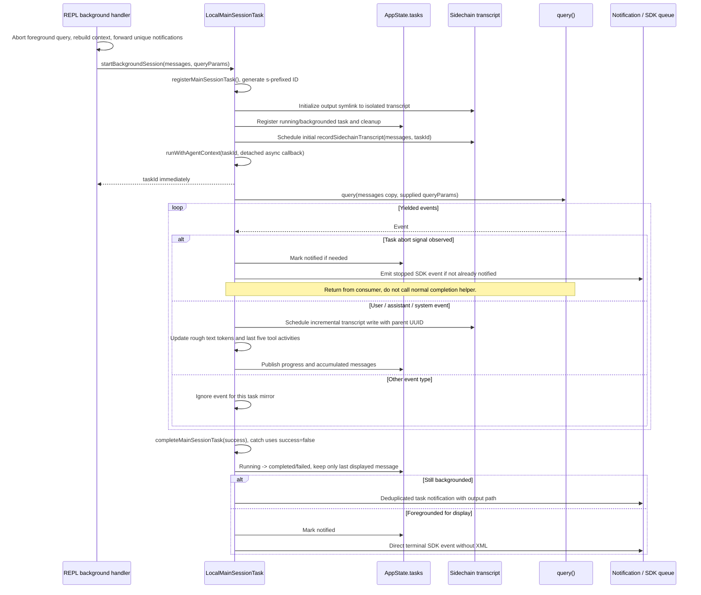

# Background main-session task internals

Source: [LocalMainSessionTask.ts](../../../tasks/LocalMainSessionTask.ts).

## Purpose and reading model

This source-order walkthrough covers registration, completion, foreground
presentation, and a fresh background `query()` invocation. Main-session tasks
reuse `LocalAgentTaskState` with `agentType: 'main-session'`. They do not add a
new `TaskType` or a separate kill object to the registry.

The opening source comment describes backgrounding an active session. The
current REPL caller aborts the old foreground query and starts an independent
query from accumulated messages; this is not a transfer of a live generator.

## Caller boundary

`handleBackgroundQuery` in `screens/REPL.tsx` aborts its foreground controller
with reason `background`, collects pending task notifications, builds a new
ToolUseContext and prompts, deduplicates forwarded notifications, and invokes
`startBackgroundSession()`.

The task module exposes lower-level registration, completion, foregrounding,
and a main-session guard. The current source search finds the REPL calling the
high-level starter; its internal registration/completion calls own that route.
The optional existing-controller parameter is an API capability, not evidence
that the current high-level starter uses it.

## Function contract and state model

| Function | Contract |
|---|---|
| `registerMainSessionTask` | Register running task, return `{ taskId, abortSignal }` |
| `completeMainSessionTask` | Attempt terminal update, then notification or SDK completion |
| `foregroundMainSessionTask` | Switch display ownership and return accumulated messages |
| `isMainSessionTask` | Check local-agent type plus main-session agent type |
| `startBackgroundSession` | Start detached async work and return ID without waiting for query completion |

The `s`-prefixed ID is also `agentId`. State initializes running/backgrounded,
retrieval false, pending messages empty, counters zero, `retain: false`, and
`diskLoaded: false`. The selected definition is caller-provided or a default
main-session definition, but `agentType` is explicitly main-session in either
case. `outputFile` points to a symlink targeting an isolated per-task transcript.

## Lifecycle overview

## 1. Subtype, default definition, and ID (`55-83`)

`LocalMainSessionTaskState` narrows local-agent `agentType`. The default custom
agent has an empty system-prompt function; actual query parameters are assembled
by the caller. `generateMainSessionTaskId()` maps eight random bytes into the
same lowercase/digit alphabet used for other IDs, with prefix `s`.

## 2. Registration (`94-162`)

Registration begins output symlink initialization without awaiting it. Its target
is `getAgentTranscriptPath(asAgentId(taskId))`, not the main transcript, so later
background writes do not mix into a newly cleared foreground conversation.

It reuses an explicitly supplied abort controller or creates a new one. Shutdown
cleanup removes this task from state; that callback does not abort the controller
or await the query. The function builds local-agent state, registers it, performs
a diagnostic state read through a no-op updater, and returns the controller's
signal. This setup does not begin `query()` by itself.

## 3. Terminal state and notification choice (`168-217`)

`completeMainSessionTask()` initializes captured `wasBackgrounded` to true. Its
updater acts only on a running record, captures background flag and tool-use ID,
invokes shutdown-removal, sets completed/failed plus end time, and shrinks
`messages` to the last entry or undefined. It does not populate an
`AgentToolResult`, clear the controller/cleanup fields, or assign `evictAfter`.

It schedules writer eviction. If captured backgrounded, it queues a main-session
notification. If foregrounded, it sets `notified` and emits a direct terminal SDK
event, avoiding XML for a user already viewing the work.

Because capture defaults to true, a non-running updater no-op does not itself
stop the subsequent notification attempt. Deduplication inside the notification
helper is a separate guard. Missing state cannot flip `notified`, so no XML is
queued for a missing task.

## 4. Notification construction (`224-264`)

The helper checks/sets `notified`, then derives the task output path and queues
status/summary XML with optional tool-use ID. It carries no inline final answer.
There is no `agentId` queue address, so the main loop is the recipient. This
helper does not abort speculation, unlike local shell/agent notification helpers.

## 5. Foreground display and guard (`270-321`)

`foregroundMainSessionTask()` looks up a `local_agent` record but does not enforce
`agentType === 'main-session'` or running status. It captures that task's messages,
sets `foregroundedTaskId`, marks the selected task foregrounded, and restores a
different previously foregrounded local-agent task to background.

The query keeps running. This function returns messages and updates display
selection; it does not merge transcripts, cancel work, or switch execution
controllers. `isMainSessionTask()` separately checks object, local-agent type,
and main-session agent type.

## 6. Start independent work and transcript seed (`338-379`)

`startBackgroundSession()` registers a new task without an existing controller,
schedules initial sidechain persistence with logged write failures, and builds
an AsyncLocalStorage agent context keyed by task ID. This scopes skill tracking
for the detached task and helps `/clear` preserve the correct agent state.

The async callback copies the starting messages and initializes recent activity,
rough token/tool counts, and the last persisted UUID. The exported function
returns the task ID after scheduling this callback, not its eventual result.

## 7. Query consumption, cancellation, and persistence (`380-424`)

The consumer invokes `query({ messages: bgMessages, ...queryParams })`. The
`queryParams.toolUseContext` is supplied by the caller; this body does not
replace its controller with the newly registered task controller.

On each yielded event, before event-type filtering, it checks the task's
`abortSignal`. If aborted, it marks notification bookkeeping, emits `stopped`
only if needed, and returns. This is a between-events observation point; the
new controller alone is not wired here to interrupt an in-flight API wait.
Generic kill dispatch still marks the local-agent task killed synchronously.

Only user, assistant, and system events are appended to `bgMessages` and written
incrementally to the isolated transcript. Each fire-and-forget write uses the
previous UUID as parent and logs failures; the local parent UUID advances
immediately. Other yielded events are not mirrored here.

## 8. Progress publication and termination (`426-479`)

For assistant text blocks, token count grows through rough text estimation;
tool-use blocks increment count and maintain the last five activities. These
counts differ from LocalAgentTask's usage-based tracker and exclude many token
categories.

The state updater checks record existence/type and avoids replacement if counts
and message-array identity already match. It preserves recent-activity array
identity when tool count has not changed. It publishes the same mutable
`bgMessages` array as the task's message mirror, not a new array per event; other
state replacement controls subscriber updates.

Normal iterator exhaustion calls completion with success true. A thrown error
is logged and calls completion with false. The task helpers do not interpret the
`Terminal` generator return as a separate result, because `for await` consumes
yields and discards that return value.

## Transition table

| Trigger | Effect |
|---|---|
| Register/start | New running/backgrounded local-agent subtype |
| Foreground view | `isBackgrounded=false`, update foreground selection; work continues |
| Successful iterator exhaustion | Completed, last displayed message retained |
| Thrown query error | Failed, normal failure notification route |
| Observed task abort | SDK stopped bookkeeping, return without normal completion |
| Generic stop | LocalAgentTask kill path aborts stored controller and marks killed |
| Terminal state eviction | Framework still requires notified and agent retention deadline |

## Critical ordering invariants and limitations

- Task output uses its own sidechain transcript rather than the main JSONL.
- Initial and per-event persistence are scheduled, not awaited by the consumer.
- Foreground display is separate from execution and completion ownership.
- Registered cancellation signal and supplied query context are distinct objects
  unless the caller explicitly arranges linkage; do not infer direct API abort.
- Completion does not assign the local-agent panel deadline. Since this subtype
  has `retain`, framework eviction can remain blocked by a missing deadline.
- Trimming messages releases task-held history, not the durable transcript or
  another owner's references to the same history.

## Related documents

[Local agent state](./local-agent-internals.md), [query loop](../query-loop-internals.md),
[session storage](../storage-session.md), and [task framework](../task/framework.md).
