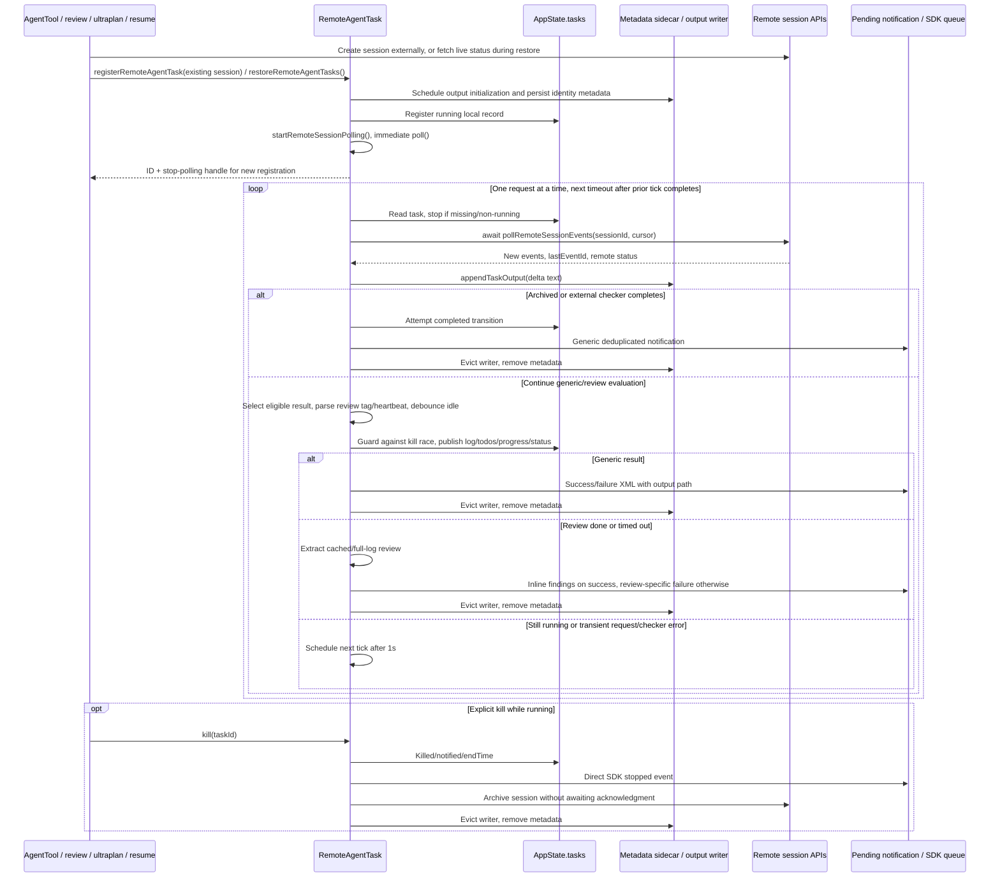

# Remote agent task internals

Source: [RemoteAgentTask.tsx](../../../tasks/RemoteAgentTask/RemoteAgentTask.tsx).

## Purpose and reading model

This source-order walkthrough covers local tracking of an already-created cloud
session: eligibility, notification/extraction helpers, registration, restoration,
the polling state machine, and kill. It does not describe cloud session creation
as though it occurred in this module. Callers own repository upload, launch
options, and remote-session provisioning before registration.

## Caller boundary

| Caller | Entry point |
|---|---|
| AgentTool remote execution | `checkRemoteAgentEligibility`, `registerRemoteAgentTask` |
| `commands/review/reviewRemote.ts` | Register teleported review with review-specific flag |
| `commands/ultraplan.tsx` | Register ultraplan; detached plan scanner separately owns its completion |
| REPL mount/resume paths | `restoreRemoteAgentTasks` after active session selection |
| Optional type-specific integration | `registerCompletionChecker` for external completion criteria |
| Generic TaskStopTool / SDK stop | `RemoteAgentTask.kill` |
| Detail UI and failure helpers | `getRemoteTaskSessionUrl` |

## Function contracts

`registerRemoteAgentTask(options)` returns `{ taskId, sessionId, cleanup }`
synchronously after local setup and scheduling an immediate poll. `cleanup`
stops future scheduling; it is not a remote kill or abort of an in-flight request.
`restoreRemoteAgentTasks(context)` resolves after its restore scan, not after the
restored tasks finish. `RemoteTaskCompletionChecker(metadata)` returns a Promise
of null (continue) or a string (complete, using that string as notification title).
Checkers are process-local registrations and must implement their own throttling.

## State model

| State | Meaning |
|---|---|
| Base task ID and remote `sessionId` | Local record/output identity versus API identity |
| `remoteTaskType`, metadata | Remote-agent, ultraplan, ultrareview, autofix-pr, background-pr discriminator and external-check metadata |
| Command/title | Original task intent and display title |
| `log`, `todoList` | Accumulated SDK events and newest valid TodoWrite snapshot |
| `isLongRunning` | Ignore per-cycle result events as terminal completion |
| `isUltraplan`, `ultraplanPhase` | Plan lifecycle belongs to detached scanner; phase is attention/display state |
| `isRemoteReview`, `reviewProgress` | Review output/heartbeat protocol |
| `pollStartedAt` | Local polling start, reset on restore for review timeout |

The poller also owns local variables: `isRunning`, cursor `lastEventId`,
`accumulatedLog`, consecutive idle count, and cached tagged review text. These
are not persisted in the metadata sidecar. The state has no local process
controller because cloud execution is addressed through remote APIs.

## Lifecycle overview

The arrows summarize terminal alternatives, not repeated actions after a terminal
return. Every terminal branch returns without scheduling the next poll. Remote
session execution can outlive the local tracking task after normal completion;
explicit kill requests archiving.

## Limits and cadence

| Limit | Behavior |
|---|---|
| Poll delay | 1,000 ms after a tick finishes, not fixed-rate overlapping requests |
| Stable idle | At least five consecutive idle responses with no new events and prior qualifying output |
| Review timeout | More than 30 minutes since `pollStartedAt`, checked in normal and error paths |
| Remote event history | Append-only accumulated log; no cap in this module |
| Disk output | `appendTaskOutput` / DiskTaskOutput limits and queue semantics apply separately |
| Completion checker | Called each eligible tick; no local throttle around it |

## 1. Types and external completion map (`22-86`)

The task type and `REMOTE_TASK_TYPES` enumerate the supported strings.
`isRemoteTaskType` validates a restored string; unknown values fall back to
remote-agent on restore. Metadata currently has the autofix-PR shape.
`registerCompletionChecker()` replaces any prior map value for that type. Its
registration is not serialized, though metadata identifying which checker to use
survives resume. A new process still needs to register the implementation.

## 2. Metadata persistence helpers (`92-112`)

`persistRemoteAgentMetadata` and `removeRemoteAgentMetadata` await their storage
operations inside try/catch, log failures, and resolve normally. Most callers
invoke them with `void`, so neither persistence nor deletion blocks local state
progress. Failure can therefore leave missing or stale restoration metadata.

## 3. Eligibility and readable failures (`124-161`)

`checkRemoteAgentEligibility({ skipBundle=false })` delegates to
`checkBackgroundRemoteSessionEligibility`, returning eligible or its error list.
`formatPreconditionError()` maps login, environment, git repository/remote,
GitHub-app installation, and organization policy failures to user-facing text.
The helper does not itself create sessions, repair prerequisites, or show a dialog.

## 4. Generic notifications and deduplication (`166-201`)

`enqueueRemoteNotification()` calls `markTaskNotified` first. Only a successful
flag flip proceeds. It derives the local output path and queues task ID,
optional tool-use ID, explicit task-type tag, output-file tag, status, and summary.
No full cloud transcript is embedded, and no owner `agentId` is attached.

`markTaskNotified()` depends on synchronous `updateTaskState` behavior: missing
or already-notified records return false. It does not require terminal status.
Normal notifications default to queue priority later through the queue manager.

## 5. Plan extraction and failure message (`208-242`)

`extractPlanFromLog()` scans assistant messages newest-first, extracts text,
and returns the newest nonempty trimmed `<ultraplan>` content. Other event types
and untagged text do not qualify. It returns null if absent.

`enqueueUltraplanFailureNotification()` uses shared deduplication but omits raw
output-file indirection, supplies a browser session URL, and advises retrying
locally. The generic poller does not turn successful per-turn result events into
ultraplan completion; the external detached scanner owns that lifecycle.

## 6. Review extraction and messages (`254-359`)

`extractReviewFromLog()` follows this precedence:

1. Newest hook-progress/hook-response event containing a nonempty review tag.
2. Newest assistant message containing that tag.
3. Chronologically concatenated hook stdout, allowing split tags across events.
4. All assistant text concatenated and trimmed, even without a review tag.

`extractReviewTagFromLog()` uses the first three approaches only, returning null
instead of untagged assistant text. This stricter variant is used for incremental
completion detection so early analysis prose cannot finish the review.

The delta scan passes only `response.newEvents`. Its split-tag fallback joins
hook stdout within that supplied delta; it does not retain a separate pending
fragment across ticks. Full-log extraction at terminal handling can recover
more cases.

`enqueueRemoteReviewNotification()` injects the actual review after a compact
completed notification. The failure helper injects a reason and retry guidance.
Both use shared deduplication, omit output-file indirection, and leave the
remote session alive on normal review completion for later browser inspection.

## 7. Todo extraction (`365-380`)

`extractTodoListFromLog()` selects the last assistant message containing a
TodoWrite call, then the first matching block in that message. It schema-parses
the input and returns todos only on success, otherwise empty. It does not search
backward for an earlier valid call when the selected call is malformed.

## 8. New task registration (`386-466`)

Registration generates an `r`-prefixed task ID and starts `initTaskOutput()` with
`void`. Although the comment says to create the file before registration, the
operation is not awaited: reader-visible existence is not guaranteed when the
function returns.

It constructs running state with empty log/todos, current `pollStartedAt`, and
caller-supplied flags/metadata, then registers it. It schedules identity sidecar
persistence, including original spawn timestamp but not current task status.
Finally it starts generic polling and returns IDs plus its stop function.

For ultraplan the poller still populates logs/todos for detail views; the result
selection guard prevents generic per-turn results from completing the task.
No cloud subprocess or session is created by this registration function.

## 9. Restore existing sessions (`477-531`)

The exported wrapper logs and contains unexpected restore failures. The inner
routine lists metadata and processes entries sequentially:

1. Fetch live remote status for each session.
2. On an error whose message starts `Session not found:`, schedule metadata
   removal; on other fetch errors retain metadata for later recovery and skip.
3. For archived sessions, remove metadata and do not resurrect local state.
4. Otherwise rebuild running state under the original local ID/session ID.
5. Restore original `startTime` from `spawnedAt`, but reset `pollStartedAt` now.
6. Register state, initialize output without awaiting, and start a fresh poller.

No cursor or log is restored from the sidecar. The remote API is polled from the
new poller's null cursor. Restoration trusts metadata flags except the
remote-task-type validation and casts task-specific metadata. Errors in steps
outside the per-entry fetch catch can stop the remaining scan and reach the
outer catch. There is no deduplication map of active pollers in this module.

## 10. Poller registers and admission (`538-568`)

`startRemoteSessionPolling()` creates a local running flag and an async `poll`
closure, calls it immediately with `void`, and returns a cleanup closure that
only sets the flag false. Each poll returns immediately when canceled, missing,
or non-running before requesting events.

A normal nonterminal tick schedules `setTimeout(poll, 1000)` at its tail, after
all awaits. Thus the poller does not overlap its own requests. Cleanup neither
clears a timer handle nor cancels in-flight fetch/checker work; a scheduled tick
will notice the flag, but an already-running tick may still update state.

## 11. Fetch, output append, and early terminal branches (`569-612`)

The poller awaits events since `lastEventId`, advances the cursor, and appends
new events to its log. Assistant text blocks become plain text in the output
file; non-assistant events become serialized JSON. Non-text assistant blocks
remain in the in-memory log but are not rendered into this output delta.

Archived remote status is checked first: attempt completed transition, queue
generic completion, evict writer, remove metadata, return. A registered external
completion checker runs next; a non-null result follows the same finalization,
using that string as notification title.

These two early branches guard the status mutation but do not carry the later
`raceTerminated` guard around all side effects. Notification deduplication is
still separate. They also return before publishing the latest accumulated log
into the task record through the common update below.

## 12. Per-turn result eligibility (`614-621`)

For ordinary tasks, the newest SDK `result` event determines completed versus
failed from its subtype. Ultraplan and long-running tasks deliberately ignore
all such results because a single cloud turn/notification cycle is not the
whole task. They can still finish through archive/checker/external ownership.

## 13. Review delta, heartbeat, and idle logic (`623-693`)

When a review delta grows and no content is cached, the strict extractor scans
that delta. Heartbeat parsing examines hook-progress/response stdout, finds the
last complete `<remote-review-progress>` pair per event, JSON-parses it, and
maps stage/found/verified/refuted fields with zero defaults. Malformed values
are ignored through catch; there is no full runtime schema validation.

Idle count grows only for an idle response with no log growth and prior
qualifying output. Any other response resets it. Generic output qualification
requires assistant events; review also accepts hook progress/response.

Review completion is either cached explicit review content or stable idle plus
assistant output **without** a SessionStart hook event. This exception matters:
a hook-driven review can remain remotely idle while its orchestrator still runs,
so idle alone cannot complete it. Timeout measures from local polling start.
The provisional status is success/failure for an eligible result, completed for
review completion/timeout, otherwise running or internal starting.

## 14. Publish state with kill-race guard (`695-720`)

The updater refuses to overwrite a task no longer running and captures
`raceTerminated` so subsequent terminal side effects are skipped. If no log grew
and status is still starting/running, it returns the same reference, avoiding
subscriber work. Otherwise it publishes accumulated log, refreshed todos only
on log growth, newest valid review progress, and terminal end time. Internal
starting maps to the public running status.

The guard is after awaited I/O, unlike the admission snapshot. It protects the
common terminal path when a kill happened during the request. If the task entry
was removed entirely, `updateTaskState` skips its callback, so this captured flag
alone is not a universal removed-task guard.

## 15. Terminal notification dispatch (`722-763`)

An eligible result, review completion, or review timeout enters finalization.
A result subtype other than success makes finalStatus failed; other signals
initially select completed.

For reviews, cached tagged content or full-log extraction is used. Nonempty
content plus completed status sends inline findings. Otherwise a second update
marks failed and selects remote-error, timeout, or missing-output guidance.
Consequently timeout is not unconditionally failure: recoverable review content
can still produce a successful completion. Generic tasks receive normal
file-reference notifications. Each route evicts writer, removes metadata, and
returns without rescheduling.

## 16. Error recovery and timeout during API failures (`764-798`)

The catch logs errors and resets consecutive idle count. It then rereads state
and checks review timeout again. If a running review exceeded its limit, it marks
failed/endTime, sends timeout failure, evicts output writer, removes metadata,
and returns. Errors in this best-effort timeout handling are swallowed.
Otherwise it reaches delayed retry. Ordinary tasks have no analogous overall
timeout in this module. Request failures do not roll back the previously updated
cursor or accumulated output state.

## 17. Explicit kill and session URL (`808-855`)

Kill captures identity only for a running task, marks killed/notified/endTime,
and emits direct SDK stopped when a transition occurred. It starts archiving
without awaiting acknowledgment, logging archive errors. Writer eviction and
metadata removal are scheduled even if no state transition occurred.

The next poll observes terminal state and stops. An in-flight common update uses
its race guard; the cleanup handle's flag is not changed by kill. The URL helper
delegates to `getRemoteSessionUrl` with optional ingress override.

## Transition table

| Trigger | Local result | Remote/session and output effects |
|---|---|---|
| Register | Running, empty log | Track existing session, persist metadata |
| Restore archived/404 | No restored task | Delete stale metadata |
| Restore recoverable fetch error | Skip entry | Keep metadata |
| New events, no completion | Running | Append output, update log/todos/progress |
| Generic result success/error | Completed/failed | Notify, retain file, remove metadata |
| Review tag / qualified stable idle | Completed if usable findings | Inline review, keep remote session alive |
| Review timeout | Completed with usable findings, otherwise failed | Review-specific message |
| External checker non-null | Completed | Generic summary, stop local polling |
| Kill | Killed/notified | Direct SDK stopped, request archive, remove metadata |
| Transient poll error | Running | Reset idle debounce, retry |
| Cleanup handle | State unchanged | Stop future polling admission only |

## Critical ordering invariants

- Local task ID, remote session ID, persisted identity, and event cursor differ.
- Persist metadata to reconnect; fetch status to decide whether restoration is
  valid. Do not trust stale status as durable truth.
- Never use ordinary per-turn results to finish ultraplan/long-running work.
- Explicit review tags may complete work before stable idle; initial prose must
  not do so through the delta extractor's untagged-text fallback.
- Poll output appends and metadata operations are not synchronous delivery or
  durability acknowledgments.
- Normal completion retains a browser record; explicit kill requests archive.
- Local log growth is uncapped here, even though disk output has its own cap.

## Related documents

[Task disk output](../task/disk-output.md), [notification delivery](../task/delivery.md),
[session storage](../storage-session.md), and [shared stopping](./contracts-and-dispatch.md).
