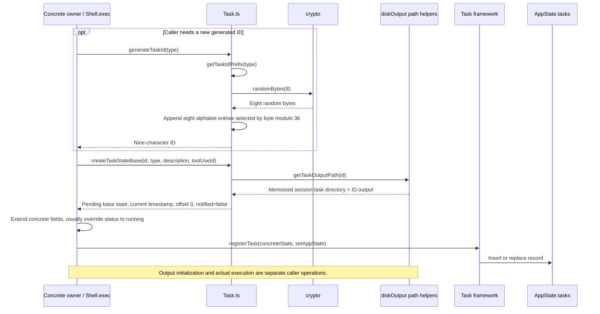

# Root task contract internals

Source: [Task.ts](../../../Task.ts), lines 1–125.

## Purpose and reading model

`Task.ts` defines the common runtime task vocabulary, the narrow implementation
interface, and helpers for identity and initial state. This walkthrough covers
all definitions in source order. The module does not contain task registration,
execution, result polling, notification delivery, or a transition-enforcing
state machine. Those responsibilities live in concrete implementations and
[the task framework](../task/framework.md).

## Caller boundary

| Caller | Definition used |
|---|---|
| `Shell.exec()` | `generateTaskId('local_bash')` before constructing output capture |
| Remote task registration and DreamTask | Type-specific ID generation and base state creation |
| `spawnInProcessTeammate()` | Teammate ID generation and base state |
| Shell/local-agent/main-session registration and remote restore | `createTaskStateBase()` with an already-selected ID |
| Framework eviction | `isTerminalTaskStatus()` before state removal |
| Teammate message injection | Terminal predicate before accepting input |
| `tasks.ts` and concrete Task objects | `Task` / `TaskType` contracts for kill dispatch |

ID generation and state creation are separate. Local agents use their externally
selected agent ID; shells reuse the capture ID generated in `Shell.exec()`;
restored remote tasks reuse persisted IDs. Main-session registration has a local
`s`-prefixed generator rather than adding another member to `TaskType`.

## Function contracts

| Function | Inputs | Output and side effects |
|---|---|---|
| `isTerminalTaskStatus(status)` | Typed status | Boolean; no state mutation |
| Private `getTaskIdPrefix(type)` | Typed task discriminator | Prefix string, default `x` for an unmatched runtime value |
| `generateTaskId(type)` | Typed discriminator | New string using `crypto.randomBytes(8)`; no registration |
| `createTaskStateBase(id, type, description, toolUseId?)` | Caller-selected identity and description | Fresh pending-state object with timestamp and derived output path |

## State model

The exported type aliases describe three distinct things:

| Contract | Meaning |
|---|---|
| `TaskStateBase` | Common data in `AppState.tasks` |
| `Task` | Implementation object selected by type for `kill()` |
| `TaskHandle` | Caller-facing task ID plus optional producer-defined cleanup |
| `TaskContext` | Runtime capabilities supplied to implementations |

An implementation object is not a task instance. Many task instances can share
one `Task` kill object. `TaskState` in `tasks/types.ts` separately defines the
union of concrete instance-state extensions.

## Construction overview

## 1. Imports and runtime dependencies (`1-4`)

`randomBytes` and `getTaskOutputPath` are runtime dependencies. AppState and
AgentId imports are type-only. Calling the ID generator consumes randomness;
calling the base-state factory obtains time and derives a path. Merely using a
TypeScript type from this module does not instantiate a runtime task.

## 2. Task and status discriminators (`6-29`)

`TaskType` includes `local_bash`, `local_agent`, `remote_agent`,
`in_process_teammate`, `local_workflow`, `monitor_mcp`, and `dream`.
It is a compile-time union, not a guarantee that the registry contains every
implementation or that every referenced source module exists.

`TaskStatus` includes pending, running, completed, failed, and killed.
`isTerminalTaskStatus()` uses three equality checks for the final three. It does
not inspect an instance, wait for a process, or verify a notification. The
comment's terminal-state expectation is not enforced against future concrete
updates; some helpers elsewhere have stronger status guards than others.

## 3. Handle and context capabilities (`31-42`)

`TaskHandle` requires only `taskId`. Its optional `cleanup` is a synchronous
zero-argument function with no uniform lifecycle meaning: a shell handle can
remove a shutdown registration, whereas remote registration returns its own
handle shape whose cleanup stops polling. Callers cannot infer kill from the
name cleanup.

`SetAppState` receives an updater from previous AppState to next AppState.
`TaskContext` includes this setter, a getter, and an AbortController. The alias
does not specify automatic controller linkage or when an updater executes.
Framework/task helpers that capture values inside an updater and inspect them
immediately rely on the actual store's synchronous updater behavior.

## 4. Common instance fields (`45-57`)

| Field | Contract |
|---|---|
| `id`, `type` | Local instance identity and discriminator |
| `status`, `description` | Current lifecycle label and human-readable intent |
| `toolUseId?` | Correlation to originating model tool invocation |
| `startTime`, `endTime?` | Millisecond timestamps; base construction supplies only start |
| `totalPausedMs?` | Optional accumulated pause accounting; not initialized here |
| `outputFile` | Expected local output location |
| `outputOffset` | Consumer progress through output |
| `notified` | Shared notification/retrieval bookkeeping |

The base contract has no subprocess, abort controller, result, error, background
flag, or message history. Concrete states add those selectively. `notified` is
not a delivery acknowledgment: some UI-only tasks set it without sending XML.

## 5. Shell creation input (`59-67`)

`LocalShellSpawnInput` requires command and description, with optional timeout,
tool-use ID, owner AgentId, and kind (`bash` or `monitor`). This is a shared input
type, not an instruction to spawn a process. `spawnShellTask` additionally
requires an existing ShellCommand and uses only the fields its body consumes.
A timeout field's presence here does not establish that the task registration
helper installs a timeout; ShellCommand owns foreground execution timing.

## 6. Polymorphic implementation object (`69-76`)

`Task` requires `name`, `type`, and asynchronous
`kill(taskId, setAppState): Promise<void>`. The source comment explains that spawn
and rendering are not polymorphic members. The common interface supplies no
state getter or controller because each implementation's kill body uses the
setter and state it can access through that update.

The signature does not promise a terminal SDK event, notification, process-exit
acknowledgment, output deletion, or a returned command result. Those differences
are documented in each concrete implementation.

## 7. Prefix and alphabet (`79-96`)

| Type | Prefix |
|---|---|
| local_bash | b |
| local_agent | a |
| remote_agent | r |
| in_process_teammate | t |
| local_workflow | w |
| monitor_mcp | m |
| dream | d |

`getTaskIdPrefix` falls back to `x`. Valid typed inputs use the named entries;
the fallback does not reject or validate an unexpected runtime string. The
alphabet is digits followed by lowercase letters, avoiding case-only ID
collisions on case-insensitive filesystems.

## 8. Generate an ID (`98-106`)

The generator selects the prefix, requests eight random bytes, and appends one
alphabet character per byte using `byte % alphabet.length`. The return length
is nine. Modulo selection is not perfectly uniform because 256 is not divisible
by 36. There is no collision lookup, filesystem reservation, or retry loop in
this function; random-source exceptions propagate to the caller.

## 9. Construct base state (`108-125`)

The factory returns a fresh object with input identity/description/correlation,
status pending, `Date.now()` start time, `getTaskOutputPath(id)`, zero offset, and
notified false. It omits end time and pause accounting.

The output helper joins the task ID into the task-output directory, whose
session path is memoized on first use. This factory does not create the directory
or file, open a writer, or validate that the supplied ID matches the type prefix.
Concrete owners override status and add fields before registering. Remote restore
also overrides the new start timestamp with persisted spawn time.

## Transition and failure table

| Operation | Result |
|---|---|
| Construct base | New pending object, not inserted into AppState |
| Test terminal status | Boolean only, no transition |
| Extend base with running status | Caller-created running object |
| Generate ID | New candidate string, not reserved identity |
| Randomness or path derivation throws | Exception propagates; no registration rollback here |
| Base output path exists as a string | Does not prove file existence or readable content |

## Critical ordering invariants

- Generate/reuse identity before creating capture and task state so both agree.
- Extend/override base fields deliberately; base creation always starts pending.
- Registering state, creating output, and launching work remain separate steps.
- Terminal status, notification bookkeeping, and resource cleanup are independent.
- Declared types and implemented dispatch coverage are separate contracts.

## Related documents

[Root kill registry](./task-registry-internals.md),
[shared stopping/presentation](./contracts-and-dispatch.md),
[task framework](../task/framework.md), and [disk output](../task/disk-output.md).
