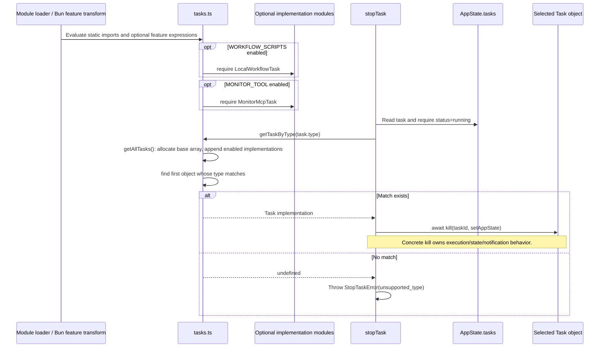

# Root task registry internals

Source: [tasks.ts](../../../tasks.ts), lines 1–39.

## Purpose and reading model

`tasks.ts` selects a concrete runtime task implementation by discriminator.
It provides kill dispatch, not a registry of live task instances. This source-order
walkthrough separates module-load feature selection, per-call array construction,
and lookup from the actual stop operation in `tasks/stopTask.ts`.

## Caller boundary

The current direct call chain is:

```text
TaskStopTool.call() ────────┐
SDK stop_task control ──────┴─> stopTask() -> getTaskByType()
                                               -> getAllTasks()
                              stopTask() awaits selected Task.kill()
```

Source search finds `stopTask()` as the direct consumer of `getTaskByType()` and
`getTaskByType()` as the direct consumer of `getAllTasks()`. UI selection and
running-task queries operate on AppState, not on this array.

## Function contract and state model

| Function | Input | Return |
|---|---|---|
| `getAllTasks()` | None | Fresh mutable array of Task implementation objects |
| `getTaskByType(type)` | TaskType discriminator | First matching Task object, or undefined |

The module stores two optional implementation references selected during module
evaluation: `LocalWorkflowTask` and `MonitorMcpTask`, each object or null. It stores
no task IDs, statuses, output paths, callbacks, controllers, or live-task map.
The statically imported Task objects are shared even though each returned array
is new. Array mutation does not change later arrays; mutating an implementation
object could affect subsequent consumers of that shared object.

## Dispatch overview



The optional source modules referenced above are absent in this checkout. The
feature expressions describe the recovered branch structure; the diagram does
not imply those enabled branches can load successfully here.

## 1. Static imports (`1-6`)

The module imports Bun's `feature()` function and four concrete runtime objects:
DreamTask, LocalAgentTask, LocalShellTask, and RemoteAgentTask. `Task` and
`TaskType` imports are type-only. There is no filesystem discovery or dynamic
scan of the `tasks/` directory.

Static imports establish module dependencies before `getAllTasks()` is called.
Deferring array construction does not defer those imports. Import/setup failures
are not caught in this module and can prevent consumers from loading at all.

## 2. Optional implementations (`8-15`)

Two top-level conditional expressions use feature-gated `require()`:

| Feature | True branch | False branch |
|---|---|---|
| WORKFLOW_SCRIPTS | Load LocalWorkflowTask export | null |
| MONITOR_TOOL | Load MonitorMcpTask export | null |

These are compile-time/build feature checks from `bun:bundle`, not per-request
permission modes or a user-editable registry. Within the evaluated module the
optional references remain fixed; `getAllTasks()` does not rerun either require.
The require form permits feature-dependent inclusion in the recovered code.
There is no catch or fallback if an enabled require fails.

`tasks/LocalWorkflowTask/LocalWorkflowTask.ts` and
`tasks/MonitorMcpTask/MonitorMcpTask.ts` are missing from the current source tree.
Their TaskType entries and type imports elsewhere do not supply implementations.
A disabled branch avoids requiring its module; enabled behavior requires source
or a compatible runtime implementation beyond what this archive contains.

## 3. Construct the implementation list (`22-32`)

`getAllTasks()` allocates the array in this order:

1. LocalShellTask.
2. LocalAgentTask.
3. RemoteAgentTask.
4. DreamTask.
5. LocalWorkflowTask when its reference is truthy.
6. MonitorMcpTask when its reference is truthy.

The source comment identifies circular-dependency avoidance as the reason for
constructing the array inside the function rather than at module top level.
The implementation performs no deduplication or shape validation. It does not
register AppState, emit task_started, initialize output, or launch any work.

## 4. Lookup by type (`37-39`)

`getTaskByType()` constructs the current array and calls `.find(t => t.type ===
type)`. Equality is exact; the first match wins. It does not inspect task IDs,
status, agent subtype, feature names, or requested operation.

Lookup is linear over four to six objects, with a new array for each call.
Absence returns undefined rather than throwing. The caller decides whether that
means unsupported operation; `stopTask()` checks missing/non-running records
before lookup and turns an absent implementation into `unsupported_type`.

## Registry coverage

| TaskType / subtype | Current dispatch |
|---|---|
| local_bash | LocalShellTask.kill -> killTask |
| local_agent | LocalAgentTask.kill -> killAsyncAgent |
| local_agent with main-session agentType | Same LocalAgentTask kill object; no subtype-specific dispatch |
| remote_agent | RemoteAgentTask.kill |
| dream | DreamTask.kill |
| local_workflow | Conditional reference to absent source module |
| monitor_mcp | Conditional reference to absent source module |
| in_process_teammate | No entry despite an exported concrete Task object elsewhere |

The teammate omission is visible in the imported and constructed list. Generic
stop therefore cannot reach that implementation; swarm/backend code can invoke
`killInProcessTeammate()` through its own path. Registration support and union
membership are broader than this kill registry's current coverage.

## Failure and transition table

| Situation | Behavior |
|---|---|
| Supported type | Return implementation, leave live task unchanged |
| No type match | Return undefined |
| Optional feature disabled | Omit its object |
| Enabled optional module fails loading | Module evaluation throws; no local recovery |
| Caller passes main-session local agent | Dispatch by local_agent only |
| Caller mutates returned array | Later getAllTasks builds another array |
| Caller invokes returned kill | Concrete implementation performs lifecycle changes |

## Critical ordering invariants

- Module-load implementation selection precedes per-call lookup.
- This registry contains behavior objects, while AppState.tasks contains instances.
- Lookup alone performs no stop, status validation, or notification suppression.
- TaskType membership does not guarantee a dispatch entry.
- Common kill signatures do not establish common cancellation timing or delivery.

## Related documents

[Root task contract](./task-contract-internals.md),
[stopTask and presentation](./contracts-and-dispatch.md),
[local shell](./local-shell-internals.md), [local agents](./local-agent-internals.md),
[remote agents](./remote-agent-internals.md), and [dream](./dream-internals.md).
