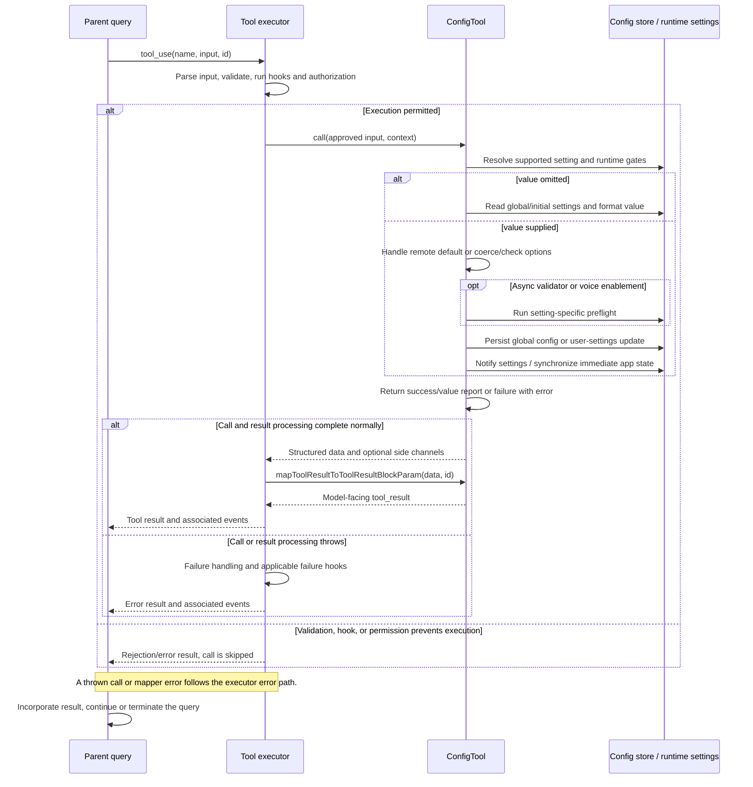

# ConfigTool Internals

Source: [tools/ConfigTool/ConfigTool.ts](../../../../../tools/ConfigTool/ConfigTool.ts). Line ranges refer to this recovered source snapshot; symbols are the stable navigation handles.

## Purpose and caller boundary

Reads or writes an allowlisted setting. Strict input requires setting and optionally a string/boolean/number value; omission means get. It is deferred and concurrency-safe, read-only only for get, and internally registered for USER_TYPE ant. Output distinguishes get/set, success, values, and error.

The [shared invocation lifecycle](../../invocation-lifecycle.md) explains registry selection, schema validation, authorization, hooks, result mapping, and exception handling. The sequence below begins with a model tool request and ends at the parent conversation boundary; external services and background workers retain their own lifecycles.

## Source-order walkthrough

### 1. Schemas and permissions (1–111)

SUPPORTED_SETTINGS supplies storage source, type, options, path, optional formatting/async validator, and immediate app-state key. Tool-level reads allow; writes ask with the proposed value. UI helpers are imported. Input numeric acceptance is broader than supported setting types; generic write validation only explicitly enforces booleans/options.

### 2. Supported-setting gate and get (113–146)

Voice runtime kill-switch can make voiceEnabled unknown despite build-time registration. Unsupported keys return success false. Supported reads use getValue(source,path), optionally formatOnRead, and return operation get; they do not expose arbitrary configuration paths.

### 3. Remote-control default special case (148–182)

For remoteControlAtStartup and normalized string default, remove the global override, resolve the effective default, and sync bridge-enabled/outbound-only state. This returns early outside the later write try/catch, with result field value rather than newValue. The common set mapper reads newValue, so this special-case confirmation can format undefined even though the state change succeeded.

### 4. Coercion, options, async validation (184–234)

Boolean strings true/false are trimmed and case-folded; other types fail. Options compare String(finalValue). An optional validateOnWrite (such as model validation) can return a normal failure. Thrown validation errors occur outside the write catch and propagate.

### 5. Voice preflight (236–312)

Enabling voice checks runtime availability/auth guidance, recording support, stream availability, audio dependencies, then microphone permission. Each negative check returns a tailored failure before persistence. Microphone denial guidance depends on platform. These checks may themselves interact with the environment before the config write.

### 6. Storage write (314–350)

Read previous value, then enter try. Global settings use the first path key and saveGlobalConfig, avoiding an equal-value rewrite. Settings-source keys build a nested update and call updateSettingsForSource(userSettings); reported write errors return failure. Empty global path is rejected.

### 7. Apply live effects and report (352–411)

Voice writes notify settingsChangeDetector. A configured appStateKey is updated when changed. Remote control additionally resolves effective startup state and clears outbound-only. Log setting/value telemetry and return previous/new values. Any exception inside this write/effects region is logged and converted to failure, without rolling back already persisted state.

### 8. Mapper and helpers (413–468)

Successful gets serialize value; successful sets serialize newValue. Failed reports set is_error true. getValue reads the first global key or traverses initial settings defensively, returning undefined when absent. buildNestedObject recursively constructs a path-shaped update, with {} for an empty path.

## End-to-end sequence

The success arrows after `call` describe normal completion. An exception skips normal result mapping; see the failure boundaries below. Query continuation remains subject to cancellation and turn/budget limits.

## State, failure, and cancellation boundaries

Writes and live-state synchronization are not transactional. A failure result can follow a successful persisted write. Unsupported/validation failures are data until the mapper sets is_error; unexpected exceptions outside the write try propagate. The special default path’s value/newValue mismatch is documented as recovered behavior, not corrected. This function does not thread a context abort signal into validators or persistence.
