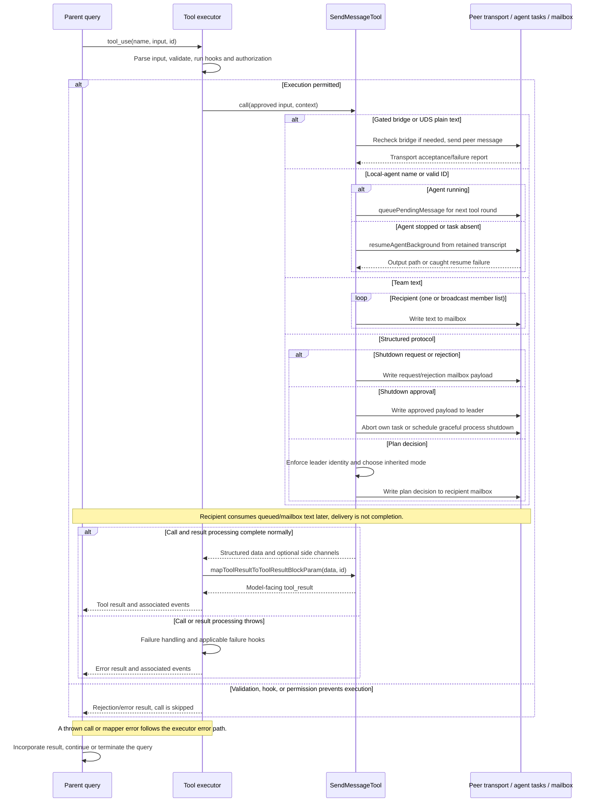

# SendMessageTool Internals

Source: [tools/SendMessageTool/SendMessageTool.ts](../../../../../tools/SendMessageTool/SendMessageTool.ts). Line ranges refer to this recovered source snapshot; symbols are the stable navigation handles.

## Purpose and caller boundary

Routes plain text or structured shutdown/plan responses to teammates, subagents, or gated cross-session peers. Input is a non-strict object with to, optional summary, and message string or discriminated structured object. Output is a success/message report with optional routing, recipient, and request metadata. Deferred and swarms-enabled, it marks strings read-only despite delivery/resumption effects and retains default serial scheduling.

The [shared invocation lifecycle](../../invocation-lifecycle.md) explains registry selection, schema validation, authorization, hooks, result mapping, and exception handling. The sequence below begins with a model tool request and ends at the parent conversation boundary; external services and background workers retain their own lifecycles.

## Source-order walkthrough

### 1. Contracts and color lookup (1–147)

Structured types are shutdown_request(reason?), shutdown_response(request_id, approve, reason?), and plan_approval_response(request_id, approve, feedback?). approve uses semanticBoolean. to describes UDS/bridge addresses only when UDS_INBOX is built. findTeammateColor scans AppState teammate names for presentation metadata.

### 2. Direct mailbox delivery (149–189)

handleMessage resolves ambient team, sender name with teammate/team-lead fallback, and sender color; awaits a mailbox write containing text/summary/timestamp. Then return routing data and inbox-delivery confirmation. It does not synchronously run the recipient or check membership here.

### 3. Broadcast (191–266)

Require team context and readable team file. Select all members except case-insensitive sender name. Empty recipients return success without writes. Otherwise write sequentially to each mailbox and then return recipients/routing. There is no rollback if a later recipient write fails.

### 4. Shutdown request (268–303)

Generate a target-specific request ID, construct a shutdown_request payload, and write it to the target mailbox with sender metadata. Return ID and target immediately. This request does not kill the target.

### 5. Shutdown approval (305–399)

Look up current agent’s pane/backend metadata when possible, then send shutdown_approved to team-lead BEFORE termination. For in-process backend, find and abort the task controller, logging if absent. Otherwise try an AppState in-process fallback and return if aborted; if none exists schedule gracefulShutdown with setImmediate. The return confirms approval, while process teardown can occur afterward.

### 6. Shutdown rejection (401–432)

Construct shutdown_rejected with reason and write it to the leader mailbox. Return a continuing-work confirmation. There is no task abort in this branch.

### 7. Plan approval/rejection (434–518)

Both helpers enforce isTeamLead against AppState and throw otherwise. Approval sends approved true plus permissionMode inherited from leader, substituting default when leader is in plan. Rejection sends approved false and feedback. Both await mailbox delivery and return request_id; recipient mode changes are handled later by inbox consumers.

### 8. Registration and compatibility projection (520–583)

Metadata marks plain strings read-only. backfillObservableInput mutates the observable input into legacy type/recipient/content/request fields when type is absent: broadcast for *, message for plain text, structured type otherwise. It is for transcript/hook compatibility, not alternate execution parsing. Classifier text reflects message/protocol action.

### 9. Cross-machine permission decision (585–602)

For UDS_INBOX bridge addresses return ask with a safetyCheck decision and classifierApprovable false. This explicit consent requirement is intended to survive permissive modes. Other routes return tool-specific allow; central policy still applies.

### 10. Address and plain-text validation (604–674)

Reject blank to, blank UDS/bridge target, and any @ in to. Bridge routes reject structured messages first, then require a live handle and active two-way bridge; valid bridge text returns early without summary. UDS plain text also skips summary. Ordinary text requires a nonblank summary. All failures use code 9.

### 11. Structured validation and mapper (676–739)

Reject broadcast structured messages and gated cross-session structured routes. shutdown_response must target team-lead, and rejection requires a nonblank reason. Other structured fields rely on the schema. Description/prompt/UI are imported; JSON output is a text block and success false remains a normal tool result.

### 12. Bridge and UDS call routes (741–802)

Route gated plain text by parsed address first. Recheck bridge connectivity after the potentially long consent wait; disconnection returns failure. postInterClaudeMessage returns an ok/error report formatted with summary or a 50-character preview. UDS sends are caught into success/failure reports. These calls do not receive the context abort signal here.

### 13. Local-agent routing before team fallback (804–878)

For nonbroadcast strings, resolve agentNameRegistry or a validated raw agent ID. A running local agent excluding main-session tasks gets queuePendingMessage using the task-specific setter when available; delivery is deferred to its next tool round. Stopped local agents invoke resumeAgentBackground. Missing/nonmatching task state for a valid ID attempts transcript resumption too. Both resume paths pass canUseTool and invoking request ID and catch failures into normal reports.

### 14. Ambient team and structured dispatch (880–918)

Remaining strings go to broadcast or direct mailbox helpers. Defensively throw on structured broadcast at call time. Dispatch shutdown requests, approving/rejecting shutdown responses, and approving/rejecting plans; missing plan feedback defaults to Plan needs revision. Recipient protocol handlers run outside this call.

## End-to-end sequence

The success arrows after `call` describe normal completion. An exception skips normal result mapping; see the failure boundaries below. Query continuation remains subject to cancellation and turn/budget limits.

## State, failure, and cancellation boundaries

Mailbox writes can partially complete during broadcast. Plain-text read-only metadata does not imply absence of side effects: a stopped agent may be restarted. Bridge/UDS and resume failures are often normal success-false data, while uncaught mailbox/authorization errors throw. A shutdown approval is sent before the task abort/process exit, so the sender may stop before its normal tool result is consumed. Request IDs correlate protocol messages; this module does not validate them against a persisted pending-request ledger.

## Related design

[Agent internals](../agenttool/agent-tool-internals.md) covers the resumed/background worker lifecycle; [ExitPlanMode](../../planning-todos-worktrees/ExitPlanModeTool/internals.md) covers plan submission.
