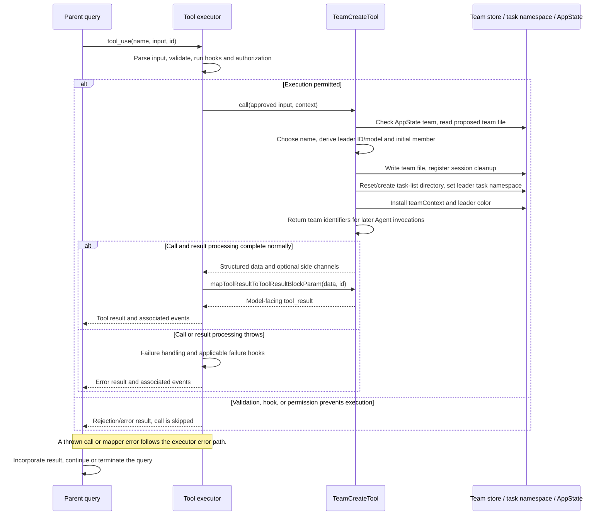

# TeamCreateTool Internals

Source: [tools/TeamCreateTool/TeamCreateTool.ts](../../../../../tools/TeamCreateTool/TeamCreateTool.ts). Line ranges refer to this recovered source snapshot; symbols are the stable navigation handles.

## Purpose and caller boundary

Creates team metadata and the corresponding persistent task-list namespace, then installs leader context in AppState. Strict input requires team_name and optionally description/agent_type. Output contains final team name, file path, and leader agent ID. The swarms-gated deferred tool is mutating and retains serial scheduling by default.

The [shared invocation lifecycle](../../invocation-lifecycle.md) explains registry selection, schema validation, authorization, hooks, result mapping, and exception handling. The sequence below begins with a model tool request and ends at the parent conversation boundary; external services and background workers retain their own lifecycles.

## Source-order walkthrough

### 1. Dependencies and contract (1–58)

Team-file helpers, task-list reset, color assignment, model parsing, and session identity underpin creation. No output schema is declared. Input’s plain string team_name is further checked in validateInput.

### 2. Name selection (60–72)

generateUniqueTeamName synchronously reads the proposed team file. If absent, use the supplied name; otherwise generate one word slug. There is no loop rechecking the generated replacement and no atomic reservation in this helper.

### 3. Registration and mapper (74–128)

Enablement checks isAgentSwarmsEnabled. Empty/whitespace team names fail validation code 9. Classifier uses name, prompt explains team setup, and the mapper emits JSON in a text content block.

### 4. Existing-team guard and leader identity (130–155)

Read AppState and throw if teamContext already has a team name. Select final name, derive deterministic team-lead ID, default agent type to team-lead, and parse the session model override, app model, or default model in that order.

### 5. Team-file creation (157–181)

Build metadata with description, timestamps, leader/session IDs, and a single leader member including model, cwd, empty pane ID, and subscriptions. Await writeTeamFileAsync before registering the team for session-end cleanup.

### 6. Task namespace initialization (183–194)

Sanitize the final name, reset its task list, ensure the tasks directory, and setLeaderTeamName to the sanitized value. Subsequent leader Task CRUD calls now resolve this namespace. Reset occurs after the team file is written and can remove an existing task list for that namespace.

### 7. AppState and result (196–241)

Install teamContext and a leader teammate entry with assigned color/cwd/timestamp. Log creation mode/type/count. Deliberately do not set process teammate identity for the leader; that would change inbox semantics. Return metadata only; no teammates are spawned by this call.

## End-to-end sequence

The success arrows after `call` describe normal completion. An exception skips normal result mapping; see the failure boundaries below. Query continuation remains subject to cancellation and turn/budget limits.

## State, failure, and cancellation boundaries

File write, task reset, namespace selection, and AppState update are separate mutations without rollback. A later failure can leave a team file or reset task directory. Name checking is not a cross-process uniqueness transaction. Team creation allocates coordination state; it does not prove any worker exists or has begun work. No abort signal is forwarded by this entry point.
