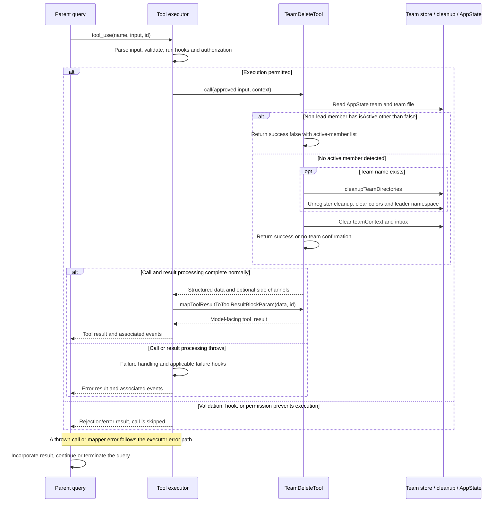

# TeamDeleteTool Internals

Source: [tools/TeamDeleteTool/TeamDeleteTool.ts](../../../../../tools/TeamDeleteTool/TeamDeleteTool.ts). Line ranges refer to this recovered source snapshot; symbols are the stable navigation handles.

## Purpose and caller boundary

Removes the current leader team’s directories and clears coordination state once no member is considered active. Strict input is empty; output reports success/message/optional team_name. It is swarms-gated, deferred, mutating, and serial by default.

The [shared invocation lifecycle](../../invocation-lifecycle.md) explains registry selection, schema validation, authorization, hooks, result mapping, and exception handling. The sequence below begins with a model tool request and ends at the parent conversation boundary; external services and background workers retain their own lifecycles.

## Source-order walkthrough

### 1. Registration and mapper (1–69)

Imports directory cleanup, cleanup-registration removal, color/leader-namespace reset, and team-file reads. Prompt/UI support team cleanup. The mapper returns JSON in a text block without translating success false to is_error.

### 2. Active-member gate (71–99)

Read team name from AppState, then read the team file if a name exists. Exclude members named team-lead; treat every remaining member with isActive !== false as active, including undefined. If any remain, return a normal failure report listing names. A missing/unreadable team file bypasses this membership check.

### 3. Cleanup sequence (101–117)

Await cleanupTeamDirectories, then unregister session-end cleanup, clear color assignments, and clear the leader task-list name. Emit deletion telemetry. This tool does not send shutdown requests or call task kill itself.

### 4. Clear state and return (119–140)

Regardless of whether a team name existed, clear teamContext and replace inbox messages with an empty array. Return success and either cleanup text or a no-team message. Without a team name, the preceding color/namespace cleanup branch does not run.

## End-to-end sequence

The success arrows after `call` describe normal completion. An exception skips normal result mapping; see the failure boundaries below. Query continuation remains subject to cancellation and turn/budget limits.

## State, failure, and cancellation boundaries

The membership check is a snapshot and does not lock against later activity. isActive false is accepted as inactive; the tool does not independently prove process termination. Cleanup exceptions throw before subsequent state clearing and can follow partial utility effects. Shutdown negotiation belongs to SendMessage, not this tool. The result’s worktree-cleanup wording is generated after the utility resolves, without an independent resource audit.
