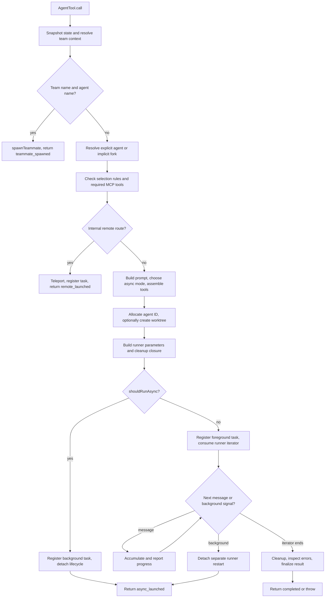
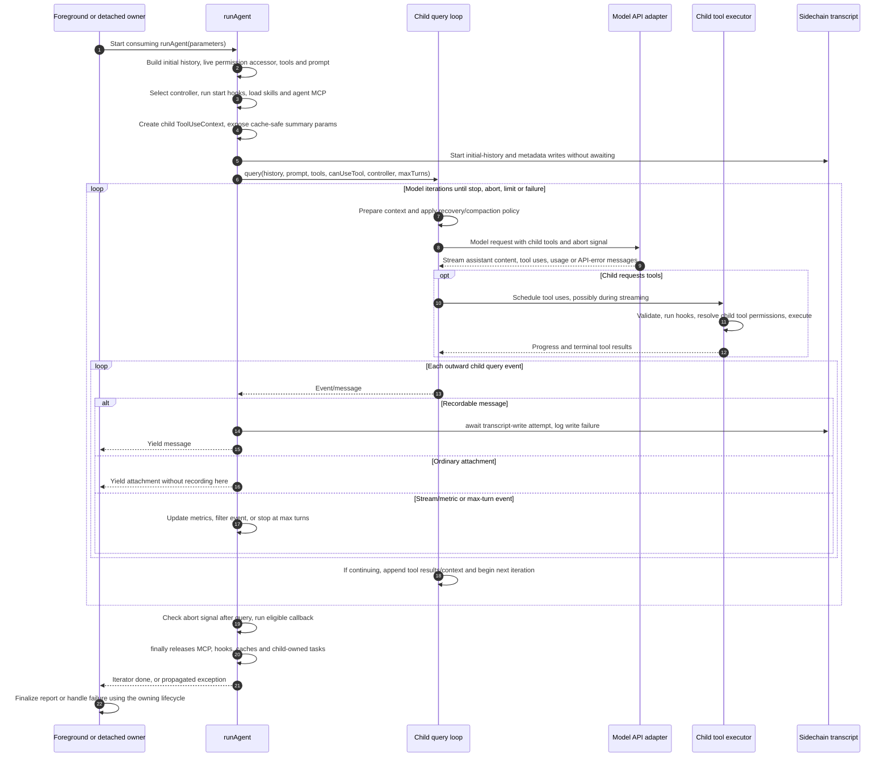
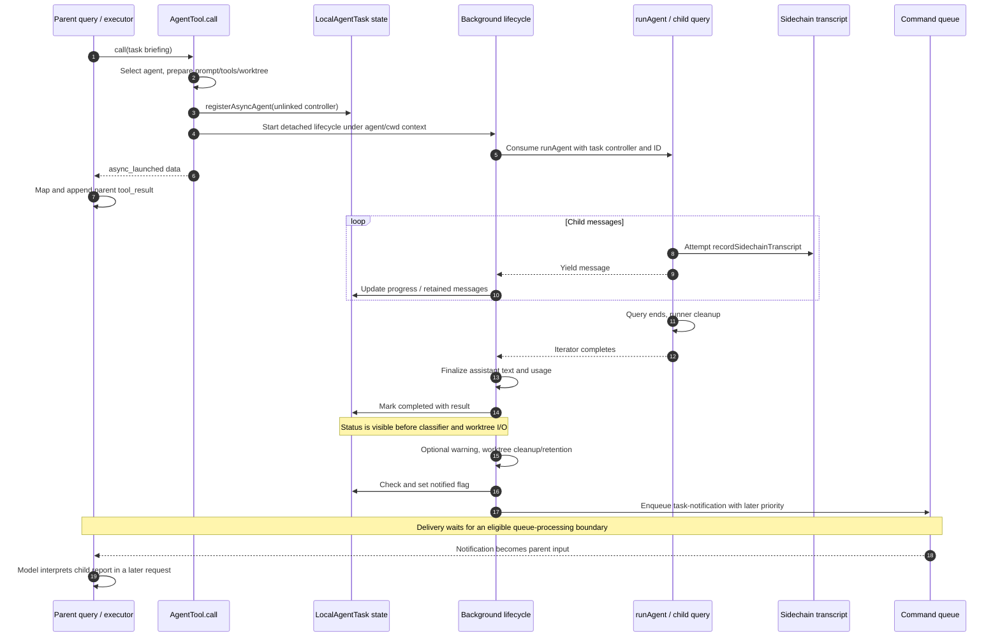

# Agent Tool Internals

Source: [`tools/AgentTool/AgentTool.tsx`](../../../../../tools/AgentTool/AgentTool.tsx),
lines 1–1397; `AgentTool.call()` is at lines 239–1263.

---

## Purpose and reading model

This document follows `AgentTool.tsx` in source order, at the executable-region
and control-flow-branch granularity of
[Query Loop Internals](../../../query-loop-internals.md). The shorter
[agent-tool.md](./agent-tool.md) describes the delegation subsystem; this
document explains the inputs, state mutations, awaited operations, detached
work, result conversion, and cleanup ordering of the tool implementation.

Imports and instrumentation are grouped by the operations they support. Line
numbers identify the current recovered source; function and variable names are
the durable retrieval handles. Dependency implementations are traced where
they determine this file's observable behavior, rather than reproducing the
entire subagent runner or team runtime.

The source contains literal `"external" === 'ant'` guards. Their bodies describe
internal-build branches but are unreachable under those literals in this
checkout. Compile-time `feature()` checks and runtime state checks are separate
gates. A branch's presence in this archive does not establish that it is enabled
in a running installation.

---

## Caller boundary

`tools.ts:195` includes `AgentTool` in the base tool registry. The public wire
name is `Agent`, with `Task` retained as a legacy alias
(`tools/AgentTool/constants.ts:1-3`). Registry assembly and permission filtering
determine whether a particular caller receives the tool.

```text
parent query()
  -> StreamingToolExecutor or runTools()
  -> runToolUse() / shared tool-execution pipeline
       -> schema parsing, optional validation, hooks, permission resolution
       -> AgentTool.call(input, context, canUseTool, assistantMessage, onProgress)
            -> spawnTeammate()                 [team route]
            -> teleportToRemote()              [internal remote route]
            -> runAgent() -> child query()     [local route]
       -> mapToolResultToToolResultBlockParam(data, parentToolUseId)
  -> parent user/tool_result message
  -> next parent model request
```

The executor parses `tool.inputSchema` at
`services/tools/toolExecution.ts:615`, invokes optional validation at line 683,
and awaits `tool.call()` at lines 1207–1222. It supplies the parent tool-use ID
on `toolUseContext.toolUseId` and adapts the progress callback. Mapping back to
API content occurs at lines 1292–1295. Exceptions reaching the executor produce
failure-hook messages and an error `tool_result`
(`services/tools/toolExecution.ts:1589-1734`).

These are two nested protocols:

| Layer | Contract | What completion means |
|---|---|---|
| `AgentTool.call()` | `Promise<{ data: Output }>` with an optional progress callback | One parent tool invocation has returned a result or thrown. |
| `runAgent()` | `AsyncGenerator<Message, void>` | A local child query has ended or thrown, with runner cleanup. |
| Background lifecycle | Detached `Promise<void>` plus AppState task updates and queued notifications | The task reaches a terminal state; notification delivery is a later operation. |

`AgentTool.call()` is not an async generator. It reports progress through
`onProgress`, and returns one result. On background launch, that result closes
the parent's tool-use pair while the child continues independently. The parent
executor does not wait for the eventual background report.

There is no `resume` input or direct `resumeAgentBackground()` call in this
file. Result text advertises continuation through `SendMessage`; transcript
resume belongs to [Fork and Resume](./agent-fork-resume.md).

---

## State and ownership model

The implementation has launch branches and a foreground iterator loop, rather
than the single explicit `State` register used by `queryLoop()`.

### Inputs and derived configuration

| Value | Source | Lifetime / use |
|---|---|---|
| `prompt`, `description` | Parsed tool input | Task briefing and display label; also retained in output and metadata. |
| `toolUseContext` | Parent executor | Parent messages, tools, state accessors, abort controller, and UI callbacks. |
| `canUseTool` | Parent authorization callback | Passed to `runAgent()` for the child's tool-execution pipeline. |
| `assistantMessage` | Parent response containing this tool call | Request attribution, progress correlation, and fork-prefix construction. |
| `appState` | One `getAppState()` call near launch | Initial permissions, MCP tools, team context, agent definitions, and mode flags. |
| `rootSetAppState` | `setAppStateForTasks ?? setAppState` | Task writes must reach the root store even when the parent has an isolated/no-op setter. |
| `selectedAgent` | Active definition or synthetic `FORK_AGENT` | Prompt, tool restrictions, model, background preference, and isolation default. |
| `runAgentParams` | Launch-time assembly | Shared starting configuration for foreground, initial background, and later background restart. |

### Mutable execution state

| State | Owner | Mutation |
|---|---|---|
| `worktreeInfo` | Closure inside `call()` | Set after creation; cleared before cleanup I/O to prevent a second attempt. |
| `earlyAgentId` | `call()` | Stable identity used by task registration, runner override, transcript, and worktree slug. |
| `agentMessages` | Foreground closure, then shared with its background closure | Appends consumed child messages; used for progress replay and result extraction. |
| `syncTracker` | Foreground closure | Updates counts and recent activity as child messages arrive. |
| `backgroundPromise` | Foreground closure | One promise derived from the registered task's background signal. |
| `wasBackgrounded` | Foreground closure | Transfers worktree/dump cleanup responsibility to detached work. |
| `syncAgentError`, `wasAborted` | Foreground closure | Record iterator failure for SDK notification and result/throw selection. |
| `stopForegroundSummarization` / `stopBackgroundedSummarization` | Separate scopes | Each execution scope stops only its own summarizer. |
| `AppState.tasks[id]` | LocalAgentTask framework | Running/backgrounded status, controller, progress, retained messages, and final result. |
| `AppState.agentNameRegistry` | Initial-background branch | Optional `name -> agentId` mapping for `SendMessage`. |

Initial `appState` is a snapshot. Some operations deliberately re-read live
state: MCP connection polling, the foreground/background race, the runner's
permission accessor, and handoff classification. The initial snapshot is not
replaced globally after any of those reads.

### Identities must remain distinct

```text
parent assistant message.message.id
  -> agent_<message id> progress grouping key

parent tool_use block.id
  -> toolUseContext.toolUseId
  -> tool_result.tool_use_id and SDK task/tool correlation

earlyAgentId
  -> local agentId and taskId
  -> sidechain transcript and worktree slug

optional name
  -> addressable alias, or teammate name when team routing applies
```

Several Agent calls in one parent assistant message can share the progress
grouping key. The child `agentId` and parent `tool_use_id` carry their separate
identities.

---

## Launch and result overview



Errors can escape at any awaited setup operation; the diagram groups those
exits into the surrounding executor's error handling. The foreground race and
detached lifecycle have additional local catches described below.

### End-to-end workflow sequence

This sequence follows a parent request through Agent dispatch and back to the
parent model. It includes all launch routes, the foreground/background
ownership change, and the later notification boundary. The child model/tool
cycle is expanded in the next diagram. Team and remote execution are shown at
their helper boundaries; their independent runtimes are outside this file.

`Life` represents either `runAsyncAgentLifecycle()` for an initial background
launch or the separate inline closure for mid-flight backgrounding. The
detached-lifetime block is drawn below the parent result for readability; its
work can overlap parent result mapping and subsequent parent activity. A launch
result does not wait for that block to finish.

```mermaid
sequenceDiagram
    autonumber
    actor User
    participant Parent as Parent query / model
    participant Exec as Tool executor
    participant Agent as AgentTool.call
    participant Task as Task state / SDK events
    participant Runner as runAgent / child query
    participant Life as Detached local lifecycle
    participant Backend as Team / remote helper
    participant Queue as Notification queue

    User->>Parent: Submit a request
    Parent->>Exec: Agent tool_use with briefing and parent tool-use ID
    Exec->>Exec: Parse schema, run hooks and permission resolution
    alt Validation fails or invocation is denied
        Exec-->>Parent: Error tool_result, AgentTool.call does not run
    else Invocation allowed
        Exec->>Agent: call(input, context, canUseTool, assistantMessage, onProgress)
        Agent->>Agent: Snapshot state, resolve team, validate teammate constraints
        alt Effective team and name supplied
            Agent->>Backend: await spawnTeammate(briefing, model, plan requirement)
            Backend-->>Agent: Teammate identity and routing data
            Agent-->>Exec: teammate_spawned data
        else Local-agent selection route
            Agent->>Agent: Select explicit/default agent or implicit fork
            Agent->>Agent: Check type restrictions and recursive-fork guard
            opt Required MCP servers
                Agent->>Agent: Poll pending clients, require matching exposed tools
            end
            Agent->>Agent: Resolve model and effective isolation
            alt Internal remote branch enabled
                Agent->>Backend: Check eligibility, await teleportToRemote
                Backend-->>Agent: Remote session or failure
                Agent->>Task: Register remote task on successful launch
                Agent-->>Exec: remote_launched data
                Note over Agent,Backend: Unreachable under this checkout's literal external guard
            else Local execution
                alt Implicit fork
                    Agent->>Agent: Parent system prompt and history, placeholders and directive
                else Normal agent
                    Agent->>Agent: Definition prompt plus environment, task user message
                end
                Agent->>Agent: Compute shouldRunAsync, assemble worker tools, allocate stable ID
                opt Worktree isolation
                    Agent->>Agent: await createAgentWorktree, append fork path notice if needed
                end
                Agent->>Agent: Build runner parameters and cwd/cleanup closures
                alt Start in background
                    Agent->>Task: registerAsyncAgent with unlinked task controller
                    opt Name without team route
                        Agent->>Task: Register name-to-agent-ID mapping
                    end
                    Agent->>Life: Detach shared lifecycle inside agent/cwd context
                    Agent-->>Exec: async_launched data
                else Start in foreground
                    Agent-->>Exec: Initial prompt/agent progress callback
                    opt Backgrounding enabled
                        Agent->>Task: Register foreground task, signal, optional timer
                    end
                    Agent->>Runner: Start iterator with parent execution controller
                    loop While foreground consumes child messages
                        Agent->>Runner: next(), race against background signal
                        Runner-->>Agent: Child message when next() wins
                        Agent->>Agent: Retain message, update counts
                        Agent-->>Exec: Agent or shell progress callbacks
                        Agent->>Task: SDK task progress when eligible
                    end
                    alt Background signal wins and task state confirms transfer
                        Task-->>Agent: Background signal with isBackgrounded true
                        Agent->>Agent: Transfer cleanup ownership, stop foreground summarizer
                        Agent->>Life: Detach inline continuation with old iterator and collected messages
                        Agent->>Agent: Foreground finally, retain task and worktree
                        Agent-->>Exec: async_launched data with same ID
                    else Iterator ends or throws without transfer
                        Runner-->>Agent: Done or exception
                        Agent->>Agent: finally clears UI, summarizer, scoped state and timer
                        opt Foreground task registered
                            Agent->>Task: Unregister, enqueue SDK-only terminal notification
                        end
                        Agent->>Agent: await worktree cleanup, inspect abort or saved error
                        Agent->>Agent: Finalize available assistant text, optional handoff warning
                        Agent-->>Exec: completed data, or throw when recovery is unavailable
                    end
                end
            end
        end
        alt call returned data and mapping succeeds
            Exec->>Exec: mapToolResultToToolResultBlockParam(data, parentToolUseId)
            Exec-->>Parent: Parent tool_result with report or launch handle
        else call or mapping throws
            Exec->>Exec: Run failure hooks and format error
            Exec-->>Parent: Error tool_result
        end
    end
    Parent->>Parent: After current tool batch closes, interpret results in next model request
    Parent-->>User: Report result or launch status as appropriate

    opt A local detached lifecycle was started
        alt Initial-background path
            Life->>Runner: runAgent(original inputs, stable ID, task controller)
        else Mid-flight background path
            Life->>Runner: Request old iterator.return, wait at most one second
            Life->>Life: Replay collected messages into progress tracker
            Life->>Runner: New runAgent(original inputs, same ID, task controller)
            Note over Life,Runner: Collected output is not supplied as new model history
        end
        loop Child execution until done or exception
            Runner-->>Life: Child messages after transcript-write attempts
            Life->>Task: Update progress and optional SDK summaries
        end
        alt Child completes and finalization succeeds
            Life->>Task: Mark completed with result before postprocessing
            Life->>Life: Optional handoff warning, await worktree cleanup/retention
        else Child aborts or another exception is caught
            Life->>Task: Attempt killed/failed transition
            Life->>Life: await cleanup, select partial text or failure summary
        end
        opt Postprocessing reaches notification and task is not already notified
            Life->>Task: Check and set notified flag
            Life->>Queue: Enqueue XML task-notification with later priority
            Queue-->>Parent: Deliver at eligible post-tool or between-turn boundary
            Parent->>Parent: Add report as new context and run model
            Parent-->>User: Interpret and report background outcome
        end
        Life->>Life: finally clears remaining lifecycle-owned state
    end
```



The foreground message loop represents successful iterations before an ending
message, exception, or background signal wins. A signal can interrupt the first
wait, so there need not be any child progress first. Setup exceptions bypass
the remaining launch steps and go to the executor error branch. The parent's
post-tool model request remains subject to query-loop abort/stop/limit checks;
the diagram does not override those exits.

The detached status/notification steps are deliberately separate: cleanup can
fail after a task becomes terminal, and notification consumption occurs later.
The lifecycle's `finally` follows enqueueing in its own execution, while queue
consumption may occur before or after that cleanup; it does not await parent
model interpretation. The detailed failure table below covers these limits.

### Child model/tool cycle inside `runAgent()`

Both foreground and background owners consume this same runner. This diagram
expands the local execution box without implying that AgentTool directly calls
the model API or executes child tools itself.



The event projection is shown as a grouped phase to keep the diagram readable;
it actually runs incrementally while model/tool events are produced. Tool
authorization uses the injected callback with the child's context. Yielded
API-error messages can reach finalization without being thrown exceptions, and
the runner does not expose the query's `Terminal` return value to its owner.
Runner setup and cleanup exceptions can also propagate; the detailed sections
describe where its `try/finally` begins and which releases are awaited.

---

## 1. Module configuration (`AgentTool.tsx:1-77`)

Imports connect five responsibilities: tool/schema/UI registration, agent
selection and prompts, local/remote task management, authorization and
telemetry, and working-directory/worktree isolation.

`proactiveModule` is conditionally required when either `PROACTIVE` or `KAIROS`
is compiled in. Otherwise it is `null`, and optional chaining makes the later
proactive-mode async test false.

Two timing controls have different effects:

| Control | Value | Effect |
|---|---|---|
| `PROGRESS_THRESHOLD_MS` | 2,000 ms | Makes the foreground backgrounding hint eligible at the next iterator-loop boundary. |
| `getAutoBackgroundMs()` | 120,000 ms or zero | Configures a task-framework timer that actually requests backgrounding. |

`CLAUDE_CODE_DISABLE_BACKGROUND_TASKS` is sampled once at module initialization.
It affects both schema exposure and execution. Changing that environment value
later does not change this captured boolean.

`getAutoBackgroundMs()` evaluates `CLAUDE_AUTO_BACKGROUND_TASKS` or the cached
`tengu_auto_background_agents` flag when foreground registration occurs. A true
gate selects the fixed two-minute timeout; the environment variable is a
truthiness switch, not a numeric duration parser.

---

## 2. Input schema and feature exposure (`AgentTool.tsx:81-138`)

`baseInputSchema`, `fullInputSchema`, and exported `inputSchema` are lazy
factories. `utils/lazySchema.ts` memoizes each factory's first result. Schema
gates are therefore sampled at first access, rather than recomputed for every
call.

| Field | Validation | Actual role / boundary |
|---|---|---|
| `description` | Required string | UI/task label. The suggested 3–5 words are descriptive text, not a schema length constraint. |
| `prompt` | Required string | Task instructions. No non-empty refinement is declared here. |
| `subagent_type` | Optional string | Explicit type wins; omission selects general-purpose or the implicit fork. |
| `model` | Optional `sonnet`, `opus`, or `haiku` | Normal local-agent model override; ignored as a tool override in coordinator or fork routing. |
| `run_in_background` | Optional boolean when exposed | One input to the async decision, not its sole authority. |
| `name` | Optional string | Teammate routing when a team exists; otherwise an initial-background name alias. |
| `team_name` | Optional string | Explicit team context; checked against agent-team availability. |
| `mode` | Optional `permissionModeSchema()` value | Only `mode === 'plan'` becomes `plan_mode_required` in the teammate route. Normal local spawning does not apply this input as a permission-mode override. |
| `isolation` | Optional `worktree` in this recovered build | Overrides the definition's isolation setting. The dead internal schema branch also lists `remote`. |
| `cwd` | Optional string, exposed only with `KAIROS` | Working-directory override; described as absolute and mutually exclusive with worktree isolation. |

The schema first merges the base and team fields, then adds isolation/cwd. The
exported schema omits `cwd` without `KAIROS`, and omits `run_in_background` when
background tasks are disabled or fork mode is enabled. Team fields are not
conditionally omitted here; call-time routing checks availability.

`AgentToolInput` explicitly widens the inferred input type to include gated
optional fields, allowing a single destructure in `call()`. This TypeScript
type does not expose fields hidden by the actual runtime schema.

Two implementation details differ from the field descriptions:

1. `cwd` has no absolute-path validator or mutual-exclusion refinement, and
   `AgentTool` supplies no custom `validateInput()`. If both `cwd` and worktree
   isolation reach `call()`, the worktree is still created and explicit `cwd`
   wins for execution.
2. `subagent_type` is optional regardless of the fork gate. Comments describing
   an experiment that makes it optional are older than the current schema.

Hiding `run_in_background` does not by itself mean synchronous execution: fork
mode hides the field precisely because it normally forces every local spawn
into the background. The captured disable flag still wins at execution time.

---

## 3. Output and progress contracts (`AgentTool.tsx:140-195`)

The exported output schema is a union of only two statuses:

| Status | Required fields |
|---|---|
| `completed` | `prompt`, `agentId`, text-block `content`, `totalToolUseCount`, `totalDurationMs`, `totalTokens`, and `usage`; `agentType` is optional. |
| `async_launched` | `agentId`, `description`, `prompt`, `outputFile`; `canReadOutputFile` is optional. |

The completed fields come from
`agentToolResultSchema()` (`tools/AgentTool/agentToolUtils.ts:227-257`). Its usage
object includes input/output tokens, nullable cache counts, nullable server
tool usage, service tier, and cache-creation breakdown.

The implementation also returns fields/statuses outside this exported schema:

- Local launch results include `isAsync: true`.
- Completed isolated runs can add `worktreePath` and `worktreeBranch`.
- `TeammateSpawnedOutput` contains `teammate_spawned` plus teammate identity,
  routing, model/display, tmux, and plan-mode metadata.
- `RemoteLaunchedOutput` contains `remote_launched` plus task ID, URL, briefing,
  and output path.

`InternalOutput` combines the public and private variants for rendering. The
team and remote call branches cast through `unknown` when returning them. The
actual `outputSchema()` never dynamically adds those statuses, despite the
comment at line 140. The inspected executor maps returned `data` directly; it
does not parse it through `outputSchema` at that boundary.

`Progress` is `AgentToolProgress | ShellProgress`. Agent progress carries child
identity and normalized messages. Shell progress preserves Bash/PowerShell
operation identity so SDK consumers can observe a child shell still running.

---

## 4. Tool prompt and registration (`AgentTool.tsx:196-238`)

`prompt()` obtains the caller's permission context asynchronously, then builds
the model-facing agent catalog:

```text
supplied tools
  -> extract unique server names from mcp__<server>__<tool>
supplied agents
  -> filterAgentsByMcpRequirements(servers with tools)
  -> filterDeniedAgents(permission context, Agent)
  -> getPrompt(filtered agents, coordinator flag, allowedAgentTypes)
```

`getPrompt()` applies the allowed-type restriction itself
(`tools/AgentTool/prompt.ts:66-74`). This is catalog filtering; execution later
performs its own selection checks. An MCP server's mere connection entry does
not make it eligible here: a tool must be present in the supplied tool list.

Coordinator detection uses an inline compile-time feature plus environment
check, with comments explaining that this avoids circular module loading in
tests. Tool metadata then declares:

- name `Agent`, alias `Task`, and search hint `delegate work to a subagent`;
- `maxResultSizeChars: 100_000`, a tool-result size policy rather than a child
  token or execution budget;
- description `Launch a new agent`;
- lazy schema getters.

---

## 5. Enter `call()` and route teammates (`AgentTool.tsx:239-316`)

### Capture execution context (`239-259`)

`startTime` starts before validation, MCP waiting, prompt construction, and
worktree setup. Final duration derived from this timestamp includes those
costs. `modelParam` is discarded when `isCoordinatorMode()` is true.

The initial AppState read captures the permission mode used for model
resolution and agent filtering. `rootSetAppState` selects the setter capable
of changing shared task state; ordinary subagent setters may be no-ops.

### Team validation (`261-280`)

The checks run before ordinary agent selection:

1. A truthy explicit `team_name` throws if agent swarms are unavailable.
2. `resolveTeamName()` obtains the effective team from the input or AppState.
3. A teammate with an effective team and truthy `name` cannot spawn another
   teammate; the roster is flat.
4. An in-process teammate with an effective team cannot explicitly request
   `run_in_background: true`.

The fourth check is narrower than a universal prohibition on all async causes.
A later check rejects `selectedAgent.background`; the final async formula also
has other force-async causes. The document preserves these exact predicates.

### Teammate dispatch (`282-316`)

`teamName && name` selects the teammate branch. The optional explicit agent
definition is looked up only to obtain its color and model default here. The
call forwards:

| Argument | Value |
|---|---|
| `name`, `prompt`, `description` | Tool input. |
| `team_name` | Resolved team name. |
| `use_splitpane` | Always `true`. |
| `plan_mode_required` | Whether input `mode` equals `plan`. |
| `model` | Unsuppressed tool model, otherwise the matched definition's model. |
| `agent_type` | Original `subagent_type`. |
| `invokingRequestId` | Parent assistant request ID. |

`spawnTeammate()` is awaited. Its data is merged with `status:
'teammate_spawned'` and the original prompt, then returned immediately.

This early return precedes local-agent filtering, required-MCP polling, local
prompt construction, and isolation handling. It does not forward `cwd`,
`isolation`, or `run_in_background` to the teammate helper. Authorization and
backend behavior inside `spawnTeammate()` belong to the team runtime; the later
local checks must not be described as checks on this earlier branch.

---

## 6. Select a local agent (`AgentTool.tsx:318-363`)

The effective-type expression is:

```ts
const effectiveType = subagent_type ?? (
  isForkSubagentEnabled() ? undefined : GENERAL_PURPOSE_AGENT.agentType
)
const isForkPath = effectiveType === undefined
```

| Input / gate | Selection |
|---|---|
| Explicit `subagent_type` | Look up that exact type. |
| Omitted type, fork disabled | Look up `general-purpose`. |
| Omitted type, fork enabled | Use synthetic `FORK_AGENT`. |

An empty string counts as explicit under `??`, so it goes through lookup rather
than defaulting. `isForkSubagentEnabled()` checks `FORK_SUBAGENT`, rejects
coordinator mode, and rejects a globally non-interactive session
(`tools/AgentTool/forkSubagent.ts:32-39`). Its current implementation does not
read GrowthBook, although schema comments discuss an older runtime-gate design.

### Implicit fork (`325-335`)

The guard rejects when either:

- `toolUseContext.options.querySource === 'agent:builtin:fork'`; or
- `isInForkChild(messages)` finds the fork boilerplate in a user text block.

Only this implicit-fork branch performs that check. It does not generally
reject every explicit Agent call made by a fork child.

`FORK_AGENT` is a synthetic built-in with all tools, `maxTurns: 200`, model
`inherit`, permission mode `bubble`, and an empty prompt factory. Its actual
system prompt comes from the parent override. It is not selected by simply
passing the string `fork` unless an active definition separately supplies it.

The intended durable guard is the query-source check, since compaction can
remove boilerplate. Its actual effectiveness also depends on the query-source
precedence described in section 10.

### Explicit/default definition (`336-356`)

The search pipeline is:

```text
options.agentDefinitions.activeAgents
  -> restrict to allowedAgentTypes when supplied
  -> filterDeniedAgents(..., initial permission context, Agent)
  -> exact agentType match
```

If no match remains, the code searches the original active list. Finding the
type there produces a denied-agent error with a rule source, defaulting to
`settings`. Consequently, exclusion by `allowedAgentTypes` can also produce
this denied-rule wording even when no explicit deny rule exists. A truly
unknown type reports the remaining available types.

The implicit fork bypasses this named-agent filtering block. Outer tool
authorization still precedes `call()`, and child tool authorization still
applies; these are distinct boundaries.

Finally, an in-process teammate with a team throws if the selected definition
has `background: true`. This complements the earlier explicit-input check.

---

## 7. Required MCP readiness (`AgentTool.tsx:365-410`)

`requiredMcpServers` is captured after selection for TypeScript narrowing. If
empty or absent, the entire readiness check is skipped.

When a required server pattern matches a pending client in the initial AppState
snapshot, the tool waits in 500 ms increments for up to roughly 30 seconds:

```text
deadline := now + 30,000 ms
while now < deadline:
    await sleep(500)
    currentAppState := getAppState()
    if any required client failed: break
    if no required client remains pending: break
```

Names match by case-insensitive substring. A failed required client stops the
wait early, but final acceptance is based on tool availability, not the client
status alone. After waiting, the code extracts unique server names from
`currentAppState.mcp.tools` and applies `hasRequiredMcpServers()`.

Failure reports missing patterns, the servers that actually expose tools, and
configuration/authentication guidance. No child runner or local task has been
created at this point.

Three timing boundaries matter:

- No pending match in the initial snapshot means no wait and no fresh state
  read in this block.
- The polling loop has no explicit abort-signal check or abort-aware sleep.
- `currentAppState` is local to this block. Later worker-tool assembly still
  uses the original `appState.mcp.tools`; passing this readiness check does not
  itself refresh that launch-time tool array.

---

## 8. Model resolution and remote isolation (`AgentTool.tsx:412-482`)

The selected definition's color is registered before execution. Model
resolution then calls `getAgentModel()` using the definition, parent's model,
tool override unless forked, and the captured permission mode.

`utils/model/agent.ts:37-95` resolves models in this order:

1. `CLAUDE_CODE_SUBAGENT_MODEL`, when present.
2. Tool-specified model, when retained by this route.
3. Definition model, defaulting to `inherit`.
4. For `inherit`, the runtime parent-model resolution for the permission mode.

A bare family alias matching the parent preserves the exact parent model.
For Bedrock resolution, aliases can inherit the parent's regional prefix while
an explicitly regional model specification retains its own prefix. These are
local resolver semantics, not claims about current provider availability.

The selection event and later `metadata.isAsync` count only explicit or
definition-requested backgrounding, with the disable flag applied. They omit
coordinator, fork, assistant, and proactive force-async causes. Their telemetry
value can therefore differ from actual `shouldRunAsync`.

`effectiveIsolation = isolation ?? selectedAgent.isolation` gives input
precedence. Under the internal-only remote guard:

1. Await eligibility checks; join formatted failures and throw if ineligible.
2. Call `teleportToRemote()` with the task prompt, description, parent's abort
   signal, and a callback retaining a bundle-failure hint.
3. If no session is returned, throw the specific hint or generic failure.
4. Register a `remote-agent` task with the parent tool-use ID.
5. Return `remote_launched`, task ID, session URL, briefing, and output path.

This branch returns before local prompt/worktree/runner setup and before
`shouldRunAsync`. It is unreachable under this file's literal external-build
guard; documenting its code does not establish remote availability here.

---

## 9. Construct prompt inputs (`AgentTool.tsx:483-549`)

### Fork system prompt and message suffix (`495-512`)

If `toolUseContext.renderedSystemPrompt` exists, the fork takes those already
rendered bytes. Otherwise it reconstructs the parent prompt:

1. Resolve the main-thread agent definition from `appState.agent`, if set.
2. Collect additional working-directory keys from the permission context.
3. Await `getSystemPrompt()` using the parent's tools, model, and MCP clients.
4. Apply `buildEffectiveSystemPrompt()` with the main agent, custom prompt,
   default prompt, and appended prompt.

The fallback is not guaranteed to reproduce the parent's cached bytes if
runtime configuration has changed. This path has no local catch.

`buildForkedMessages(prompt, assistantMessage)` creates the child-specific
suffix. The parent history is passed separately later. The helper
(`tools/AgentTool/forkSubagent.ts:104-174`) performs:

```text
clone the full current assistant message with a new internal UUID
collect every tool_use block in that assistant message

if no tool_use blocks:
    return one user message containing the wrapped directive
else:
    return [
        assistant clone,
        user message containing:
            identical placeholder result for each tool_use ID
            wrapped child directive as the last text block
    ]
```

The helper covers every tool-use block, not just this child's Agent call. Each
placeholder says `Fork started — processing in background`, allowing sibling
forks to share a prefix until their directives diverge. Placeholders close the
child's inherited API protocol; they are not real execution results returned
to the parent.

At the runner boundary the initial conversation becomes:

```text
filterIncompleteToolCalls(parent history)
  + current assistant clone
  + placeholder tool results and this child's directive
  + optional worktree notice
  + runner-added hook/skill context
```

`filterIncompleteToolCalls()` removes an entire assistant message if it
contains any tool use without a matching result in the supplied history
(`runAgent.ts:866-903`). It does not merely remove the unmatched block.

### Normal agent prompt (`513-541`)

The normal path calls the definition's synchronous `getSystemPrompt()` with
the parent tool context, optionally logs memory loading, and awaits
`enhanceSystemPromptWithEnvDetails()`. The memory event itself does not read
memory; loading behavior belongs to the selected definition's prompt factory.

If prompt generation or enhancement throws, this block logs the error and
continues with `enhancedSystemPrompt` unset. The prompt-message array still
contains one new user message holding the original task text.

That failure is recoverable because `runAgent()` rebuilds the prompt when no
override is supplied. Its `getAgentSystemPrompt()` retries the definition
factory and falls back to `DEFAULT_AGENT_PROMPT` if necessary
(`runAgent.ts:906-931`). This is a prompt fallback, not an agent-type fallback.

### Metadata snapshot (`542-549`)

`metadata` stores the original prompt, resolved model, built-in flag, initial
start time, type, and the narrower requested-background flag. Finalizers and
termination telemetry reuse it even if a foreground agent later backgrounds.
It is not a live reflection of task status.

---

## 10. Choose execution mode and runner configuration (`AgentTool.tsx:551-641`)

### Async decision (`551-567`)

The complete predicate is:

```text
shouldRunAsync =
    NOT isBackgroundTasksDisabled
    AND (
        run_in_background === true
        OR selectedAgent.background === true
        OR isCoordinator
        OR isForkSubagentEnabled()
        OR (KAIROS compiled AND appState.kairosEnabled)
        OR proactiveModule.isProactiveActive()
    )
```

| Situation | Result |
|---|---|
| Background tasks disabled | Local execution is foreground regardless of the other causes. |
| Fork gate enabled, explicit normal agent selected | Still async: the gate forces all local spawns, not only implicit forks. |
| Input explicitly says `run_in_background: false` | Can still be async because a different term is true. |
| No async term true | Foreground runner with possible later backgrounding. |

Assistant/proactive modes force async so long-running delegated work does not
hold the main input loop open. Here, async means detached execution in the
local runtime, not an operating-system process per child.

### Worker tool pool and effective permissions (`568-577`)

The tool constructs:

```ts
const workerPermissionContext = {
  ...appState.toolPermissionContext,
  mode: selectedAgent.permissionMode ?? 'acceptEdits',
}
const workerTools = assembleToolPool(workerPermissionContext, appState.mcp.tools)
```

This separates **pool construction** from the parent's currently exposed tool
array. It does not clear the copied deny/ask/allow rules, and it does not set
the runtime child's permission mode to `acceptEdits` unconditionally.

The runner's live `agentGetAppState()` independently applies permission mode
(`runAgent.ts:412-498`):

- If the definition has no mode, inherit the parent's live mode.
- If the definition has a mode, apply it unless the parent's live mode is
  `bypassPermissions`, `acceptEdits`, or feature-gated `auto`.
- Ordinary async agents set `shouldAvoidPermissionPrompts: true`.
- A definition declaring `bubble` does not request that suppression; async
  prompt-capable runs instead set `awaitAutomatedChecksBeforeDialog: true`.

These conditions add flags to the inherited context; they do not necessarily
clear pre-existing prompt-suppression flags. The call does not supply the
runner's optional `allowedTools` or `canShowPermissionPrompts` overrides.

Normal agents then pass the assembled pool through `resolveAgentTools()`:
global/custom/async restrictions, the definition's `disallowedTools`, and its
declared tool list are applied. Forks set `useExactTools` and bypass that
filtering, using the exact parent array instead
(`runAgent.ts:500-502`, `agentToolUtils.ts:70-224`). An exact tool array preserves
definitions; it does not bypass the authorization callback for calls made with
those tools.

### Worktree creation and fork notice (`579-602`)

`earlyAgentId` is allocated before worktree creation. For effective worktree
isolation, the slug is `agent-${earlyAgentId.slice(0, 8)}` and
`createAgentWorktree()` is awaited.

The helper first supports a configured WorktreeCreate hook; otherwise it finds
the canonical Git root, creates/reuses the worktree, performs initial setup for
a new checkout, or touches an existing checkout's mtime
(`utils/worktree.ts:902-951`). Creation failures escape before task registration.

A fork with a worktree appends a user message explaining how inherited paths
map to the isolated directory and why files may need re-reading. The notice is
after the directive, making it the newest fork-specific context.

### Runner parameters (`603-636`)

| Parameter | Normal local agent | Implicit fork |
|---|---|---|
| `agentDefinition` | Selected active definition | `FORK_AGENT` |
| `promptMessages` | One task user message | Assistant clone, placeholder results, directive, optional worktree notice |
| `isAsync` | `shouldRunAsync` | `shouldRunAsync` |
| `model` | Retained tool model override | `undefined` |
| `override.systemPrompt` | Prebuilt enhanced prompt only without `worktreeInfo` and without truthy `cwd` | Parent rendered/reconstructed prompt |
| `availableTools` | Reassembled worker pool | Parent's exact tools |
| `forkContextMessages` | `undefined` | Parent conversation |
| `useExactTools` | Omitted | `true` |
| `worktreePath` | Created path, if any | Created path, if any |
| `description` | Original label | Original label |

Normal cwd/worktree runs omit the prebuilt system-prompt override so the
runner builds environment details inside the overridden cwd. The nearby source
comment calls this `buildAgentSystemPrompt()`; the actual helper in this
checkout is `getAgentSystemPrompt()`.

Both routes pass the original parent context and `canUseTool`. The runner
constructs a child context; `AgentTool` does not mutate the parent's messages
into the child conversation.

The query-source expression is particularly important:

```ts
querySource: toolUseContext.options.querySource ??
  getQuerySourceForAgent(selectedAgent.agentType, isBuiltInAgent(selectedAgent))
```

It preserves an existing parent option before deriving `agent:builtin:fork`.
`runAgent.ts:694` then propagates that value to options for exact-tool forks.
Consequently, the durable recursive-fork guard is reliable only when the value
actually identifies the fork. If a different parent source is inherited, the
message-scan fallback carries the detection until compaction can remove it.
This is a source-level limitation; the assignment does not guarantee a fresh
fork-specific source in every calling context.

### Working-directory scope (`638-641`)

```ts
const cwdOverridePath = cwd ?? worktreeInfo?.worktreePath
const wrapWithCwd = fn => cwdOverridePath
  ? runWithCwdOverride(cwdOverridePath, fn)
  : fn()
```

`utils/cwd.ts` uses `AsyncLocalStorage`. Calls to the repository's
`getCwd()`/`pwd()` within the wrapped async descendants see the override without
changing the process-wide cwd. Code using unrelated cwd mechanisms is outside
that guarantee.

The async lifecycle or full foreground closure runs inside this scope. The
mid-flight detached closure is invoked from inside it and inherits the async
context. Explicit cwd takes precedence over the worktree path, despite their
documented mutual exclusion. An empty-string cwd is another edge: `??` selects
it, but the wrapper's truthiness test does not apply an override.

---

## 11. Worktree cleanup ownership (`AgentTool.tsx:643-685`)

The cleanup closure returns optional worktree metadata for the parent result
or notification. It is not an unconditional delete:

```text
if worktreeInfo is null: return {}
capture worktreeInfo locally
set worktreeInfo = null before any await

if hookBased:
    retain directory; return { worktreePath }

if headCommit exists:
    changed := await hasWorktreeChanges(path, headCommit)
    if not changed:
        await removeAgentWorktree(path, branch, gitRoot)
        detach metadata rewrite without worktreePath
        return {}

retain directory; return { worktreePath, worktreeBranch }
```

`hasWorktreeChanges()` checks dirty/untracked state and commits reachable since
the captured head. A Git-command failure returns true, preserving the
worktree (`utils/worktree.ts:1144-1173`). A clean checkout with new commits is
therefore retained. Missing `headCommit` also falls through to retention.

The early null assignment prevents duplicate cleanup attempts if later code
throws. This provides at-most-one-attempt behavior, not retryable cleanup: a
failure after the assignment leaves later calls returning `{}`.

Two additional limits are visible:

- `removeAgentWorktree()` returns a boolean, including false on removal
  failure, but this caller does not inspect it. The caller can clear metadata
  and return no worktree path even when removal reported failure.
- The metadata rewrite is detached and caught only for logging. Cleanup does
  not wait for resume metadata to be durable.

The closure is invoked from the foreground `finally`, initial-background
lifecycle, or mid-flight background closure. Setup before those protected
regions is not covered by one encompassing cleanup `finally`; worktree
creation/registration failures must not be described as transactionally rolled
back by this file.

---

## 12. Launch in the background immediately (`AgentTool.tsx:686-764`)

### Register before detaching (`686-712`)

`registerAsyncAgent()` receives the early ID, task label/briefing, selected
definition, root setter, and parent tool-use ID. Crucially, this call omits its
optional `parentAbortController`.

The helper initializes a task-output symlink to the agent transcript without
awaiting it, creates an unlinked controller, records a running local task with
`isBackgrounded: true`, and registers process cleanup
(`tasks/LocalAgentTask/LocalAgentTask.tsx:466-515`). Parent-turn cancellation
does not propagate through this omitted controller link; explicit task kills
and process cleanup are separate mechanisms.

Only after successful registration does a truthy `name` update a cloned
`agentNameRegistry` map. Reusing a name overwrites the prior map entry; this
block has no uniqueness check. Foreground runs and their later background
transition do not execute this name-registration block.

### Context and detached driver (`714-752`)

The agent analytics context contains ID, parent session ID when applicable,
subagent type/name, built-in flag, invoking request ID, and spawn attribution.
The detached call nests:

```text
runWithAgentContext(child attribution)
  -> wrapWithCwd(execution scope)
  -> runAsyncAgentLifecycle(...)
       -> makeStream(onCacheSafeParams)
       -> runAgent(original parameters + task ID/controller override)
```

The `void` call starts the async work but does not await its completion. Async
local workload context is inherited at invocation. Summarization is enabled
for coordinator mode, fork mode, or SDK progress summaries. Worktree cleanup is
passed as a callback so lifecycle completion can attach any retained path.

### Immediate parent result (`753-764`)

The caller's tool array is scanned for `Read` or `Bash`, using alias-aware
`toolMatchesName()`. The resulting `canReadOutputFile` is only a tool-presence
test; it does not pre-authorize the output path or a shell command.

The returned data contains `status: 'async_launched'`, the child ID, task
label/briefing, task-output path, that capability flag, and `isAsync: true`.
Since output-link initialization is detached, returning the path is not a
guarantee that the link or first transcript row already exists.

### Dependency expansion: detached lifecycle

`runAsyncAgentLifecycle()` (`agentToolUtils.ts:508-686`) owns the remaining
execution:

1. Create an independent message accumulator and progress tracker.
2. Optionally start summarization when the runner exposes cache-safe params.
3. Consume the child stream; append each message to its accumulator.
4. If the task is retained for a viewed transcript, append live messages to
   its AppState message array.
5. Update progress, and emit SDK task progress on tool-use messages.
6. Stop summarization and call `finalizeAgentTool()`.
7. Mark the task completed before optional classification and worktree I/O.
8. Extract final text, prepend any handoff warning to notification text,
   obtain worktree metadata, and enqueue a completed notification.

Error paths:

| Error | Status action before cleanup | Notification payload |
|---|---|---|
| `AbortError` | `killAsyncAgent()` | Killed summary, last available assistant text, retained worktree if reported. |
| Other exception | `failAsyncAgent()` | Failed summary/error and retained worktree if reported. |

Both paths stop summarization first. The lifecycle's `finally` clears invoked
skills and prompt-dump state for the child ID. Runner cleanup is separate and
occurs inside `runAgent()`.

Task status methods update only a still-running task. Marking completion first
allows consumers to observe a terminal result without waiting for classifier
or Git operations. It also means a later postprocessing exception cannot
necessarily change a completed task to failed, even though the catch attempts
to send a failed notification. Task status and notification outcome are not
one atomic transaction.

Likewise, catch-path worktree cleanup is awaited without an additional inner
catch. If it throws, the lifecycle promise can reject after `finally`; the
outer `void` launch has no terminal `.catch()` in this file. Notification
delivery is not guaranteed for every cleanup failure.

---

## 13. Initialize foreground execution (`AgentTool.tsx:765-866`)

The foreground branch uses the same early ID and equivalent analytics context,
then returns the promise from an entire cwd-wrapped async closure.

`agentMessages` starts empty; it collects runner output, not the initial prompt
array. `agentStartTime` starts after launch preparation, unlike metadata's
earlier `startTime`. A new progress tracker and activity-description resolver
use the parent's tools for display lookup.

### Initial progress (`791-806`)

The tool normalizes `promptMessages`, finds the first user message, and, if the
callback exists, emits an `agent_progress` event with:

- grouping key `agent_${assistantMessage.message.id}`;
- normalized first user message;
- original prompt;
- child agent ID.

This gives the UI task metadata before the first child model response. In a
foreground fork caused by the disable-background override, the initial user
message can contain the fork placeholders/directive rather than a plain task
prompt.

### Foreground task registration (`808-833`)

Unless background tasks are disabled, registration happens immediately. The
two-second hint threshold does not delay registration. The helper creates a
running task with `isBackgrounded: false`, an output symlink, a cleanup hook,
and a separate abort controller reserved for task/background ownership.

The registration returns:

| Value | Use |
|---|---|
| `taskId` | Same child ID; task/SDK correlation. |
| `backgroundSignal` | Resolves when manual or timer-triggered backgrounding changes the task. |
| `cancelAutoBackground` | Clears the optional two-minute timer. |

One `.then()` transforms the signal into `{ type: 'background' }` outside the
loop. The race reuses that promise. With background tasks disabled, none of
this registration happens and there is no background race or foreground-task
SDK notification.

The task's separate controller is **not** passed to the initial foreground
runner. The runner receives only an ID override and uses the parent execution
controller while `isAsync` is false (`runAgent.ts:520-528`). It switches to the
task controller only in the mid-flight background branch.

### Iterator and summarizer (`835-866`)

The closure initializes hint/ownership flags, a foreground summarizer stop
handle, error/abort registers, and an empty worktree result. `runAgent()` is
converted to an explicit async iterator. Its override merges any prebuilt
system prompt with the stable child ID.

When a foreground task exists and SDK progress summaries are enabled, the
runner's cache-safe callback starts a task summarizer and saves its stop
function. The foreground summarizer is separate from any later background
summarizer, preventing one scope's cleanup from stopping the other.

---

## 14. Foreground message/background race (`AgentTool.tsx:867-918`)

Each loop iteration first checks elapsed time. At or after two seconds, with
background tasks enabled and `setToolJSX` available, it displays one
`BackgroundHint` with input visible and animation/spinner continuing.

This is a loop-boundary check, not a two-second timer. If the first `next()`
waits a long time, the hint can appear much later than two seconds. Automatic
backgrounding has an independent task-framework timer and can win during that
wait.

The actual race is:

```ts
const nextMessagePromise = agentIterator.next()
const raceResult = backgroundPromise
  ? await Promise.race([
      nextMessagePromise.then(result => ({ type: 'message', result })),
      backgroundPromise,
    ])
  : { type: 'message', result: await nextMessagePromise }
```

`Promise.race()` chooses the first settled outcome; it does not cancel the
losing `next()` call. A message rejection enters the foreground catch.

If background wins, the tool re-reads AppState and requires the matching task
to be a local agent with `isBackgrounded: true`. Only then does it transfer
ownership:

1. Capture the task ID and set `wasBackgrounded = true`.
2. Stop foreground summarization.
3. Start a detached closure under the child analytics context.
4. In that closure, request `agentIterator.return(undefined)` and await it
   against a one-second sleep.

The return promise has a rejection handler, but there is no abort before this
race. A timeout means only that the detached closure stops waiting for runner
closure; it does not prove that the pending `next()` or old runner cleanup has
finished.

If the signal wins but the task validation fails, execution reaches the later
non-message guard and continues. The already-resolved background promise is
not reset. The expected invariant is that task state is updated before the
signal resolves, as in `backgroundAgentTask()` and the auto-background timer
(`LocalAgentTask.tsx:580-651`). This code has no local repair if that invariant
is broken or the task disappears.

---

## 15. Mid-flight background execution (`AgentTool.tsx:919-1053`)

### Restart configuration and retained state (`919-950`)

After the bounded iterator-close wait, the detached closure creates a new
progress tracker and replays already-consumed `agentMessages` into it. It then
creates a **new** `runAgent()` invocation with:

```ts
{
  ...runAgentParams,
  isAsync: true,
  override: {
    ...runAgentParams.override,
    agentId: backgroundedTaskId,
    abortController: task.abortController,
  },
  onCacheSafeParams: /* optional SDK summarizer callback */,
}
```

The shared `runAgentParams` still contains the original `promptMessages` and
original parent fork context, if any. The call does not pass `agentMessages`
as prompt/history and does not invoke transcript resume. `runAgent()` constructs
`initialMessages` only from its input context and prompt arrays
(`runAgent.ts:368-373`).

Thus, this recovered branch retains prior output for accounting and result
selection, but restarts model execution from the original briefing. Reusing an
agent ID does not automatically load its transcript.

```text
before background signal:
  model input     = original prompt P
  collected output = A1, tool result R1, A2

after background signal:
  new model input = original prompt P again
  collected output = A1, R1, A2, then new runner output B1, R2, B2, ...
```

This corrects the continuation wording in the existing overview. It also
explains why the mid-flight path must be distinguished from
`runAsyncAgentLifecycle()`: this file implements it inline and does not call
that shared helper.

Each new runner message is appended to the shared `agentMessages`, applied to
the new tracker, written into task progress, and optionally used to emit SDK
task progress. Unlike the shared lifecycle, this inline loop has no explicit
`retain`/`task.messages` append block.

A restart can repeat earlier model work. If the old iterator-close wait times
out, old and new runner activity/cleanup may overlap under the same ID. The
losing `nextMessagePromise` is not explicitly incorporated into `agentMessages`
by this transition. These are consequences of the inspected control flow,
not claims of a reproduced live failure.

### Successful background completion (`951-991`)

The inline closure finalizes the combined output array, then:

1. Calls `completeAsyncAgent()` before postprocessing.
2. Extracts result text.
3. Optionally classifies the handoff using live permissions and the task
   controller's signal, prepending any warning to notification text.
4. Awaits worktree cleanup.
5. Enqueues a completed notification with tracker tokens, finalizer tool count
   and duration, parent tool-use ID, and retained worktree metadata.

The stored task result is finalized before warning text and worktree fields
are prepared for notification. Those enriched fields are not retroactively
merged into `task.result` here.

### Failure and cleanup (`992-1037`)

`AbortError` first kills the task, records background-cancellation telemetry,
then cleans the worktree, extracts the last available assistant text, and
requests a killed notification. It returns from the detached closure afterward.

Other exceptions first attempt to mark the task failed, then clean the
worktree and request a failed notification. As with the shared lifecycle,
post-completion failures can leave task status and notification outcome
different because terminal task states are guarded against replacement.

The closure's `finally` stops its own summarizer and clears invoked skills and
prompt-dump state. Cleanup exceptions inside a catch can escape the detached
promise; there is no additional outer `.catch()` at launch.

### Immediate foreground return (`1039-1053`)

The still-active foreground call computes caller `Read`/`Bash` presence and
returns `async_launched` with the same ID and task-output path. Its `finally`
runs before the promise settles, but `wasBackgrounded` prevents that scope from
cleaning a worktree still owned by the detached run.

The returned launch result does not wait for the one-second iterator-close
race or new runner completion. The detached closure has already started and
owns those operations.

---

## 16. Consume a foreground message (`AgentTool.tsx:1055-1126`)

After background handling, a non-message outcome continues the loop. For a
message outcome, `result.done` breaks; otherwise its value is appended to
`agentMessages` before any filtering for display.

### Task progress (`1067-1080`)

Every consumed message is offered to the progress tracker. The tracker updates
only on assistant messages, counting tool-use blocks and keeping recent
activity. When a foreground task exists and the message includes a tool use,
`emitTaskProgress()` publishes SDK progress. AppState progress is also updated
at that point when SDK summaries are enabled.

### Shell and agent progress (`1082-1125`)

The subsequent branches are independent projections of the same message:

| Message / content | Action |
|---|---|
| Progress with `bash_progress` or `powershell_progress` | Forward the original `toolUseID` and shell data through `onProgress`. |
| Other non-assistant/non-user message | Keep in `agentMessages`, but skip the remaining UI work. |
| Assistant with positive content length | Increment the parent's response-length counter. This is content length for display, not an API-token total. |
| Normalized user/assistant content with `tool_use` or `tool_result` | Emit `agent_progress` with the full normalized message, child ID, and an empty prompt field. |
| Normalized ordinary text/thinking content | No additional `agent_progress` event from that content block. |

The initial progress event carried the prompt; subsequent events set
`prompt: ''` to avoid repeating it. Because emission is inside the per-content
loop, one normalized message containing several tool blocks can be forwarded
more than once. This code does not emit precisely one progress event per child
message.

`runAgent()` drops most raw streaming deltas, so AgentTool's UI accounting uses
completed assistant messages. The runner still forwards API-start timing to
metrics separately (`runAgent.ts:758-768`).

### Token/count semantics

The progress tracker and finalizer use different formulas:

```text
progress tracker:
  latestInput = most recent input + cache-create + cache-read
  cumulativeOutput += output_tokens for each consumed assistant message
  displayed tokens = latestInput + cumulativeOutput

finalizeAgentTool:
  totalTokens = last assistant usage's input + cache-create + cache-read + output
  usage = last assistant message's usage object
```

See `LocalAgentTask.tsx:40-103`, `agentToolUtils.ts:297-355`, and
`utils/tokens.ts:46-53`. Neither formula should be described as a sum of all
billed input/output tokens across all API requests. The tracker has no
message-ID deduplication in this update function; it consumes the runner's
assistant-message stream as supplied.

Tool-use counts scan/count assistant `tool_use` blocks. Recent display activity
keeps at most five entries and omits StructuredOutput from the preview while
still counting it as a tool use.

---

## 17. Foreground errors and scope cleanup (`AgentTool.tsx:1127-1203`)

### Iterator errors (`1127-1149`)

`AbortError` sets `wasAborted`, logs synchronous cancellation, and is rethrown.
The `finally` still executes before the error leaves the call.

Other exceptions are logged and stored as `syncAgentError = toError(error)`.
They are not rethrown immediately: the tool first cleans up, then may return
partial assistant output. This catch surrounds the explicit consumption loop;
it is not an outer catch for every earlier setup operation.

### Cleanup order (`1150-1203`)

| Order | Operation | Background-transfer behavior |
|---|---|---|
| 1 | Clear `setToolJSX` with `null` when available. | Runs even if the hint never appeared. |
| 2 | Stop foreground summarization. | Idempotent after the transfer's earlier stop. |
| 3 | Call `unregisterAgentForeground()` when registered. | Helper removes only a task that is still foreground; backgrounded tasks remain. |
| 4 | Enqueue SDK terminal task notification if not backgrounded. | Skipped after transfer; detached completion owns later reporting. |
| 5 | Clear invoked skills for the child ID. | Runs even after transfer; the detached scope also clears its skills eventually. |
| 6 | Clear prompt-dump state. | Skipped after transfer. |
| 7 | Cancel auto-background timer. | Runs whenever a cancel handle exists. |
| 8 | Await worktree cleanup and capture returned path/branch. | Skipped after transfer because the detached run still needs the directory. |

The foreground SDK event uses `subtype: 'task_notification'`, an empty output
file, task/tool IDs, description, and tracker usage. Its status is selected as:

```text
syncAgentError ? failed : wasAborted ? stopped : completed
```

This event goes through `enqueueSdkEvent()`. It does not create an XML
`<task-notification>` command for the model, and does not request another
parent turn.

The notification happens before worktree cleanup, the later synthetic-message
check, finalization, and handoff classification. A failure in one of those later
steps can therefore follow an SDK event already labeled completed. Conversely,
a saved iterator error can emit SDK `failed` even if partial-output recovery
later returns a `completed` Agent tool result.

Cleanup is sequential. A throwing callback or worktree cleanup can prevent
later work or replace an in-flight exception. The source provides no blanket
guarantee that all cleanup actions finish on every failure.

### Runner cleanup is a second scope

`runAgent.ts:816-859` owns agent MCP cleanup, session hooks, prompt-cache
tracking, child read-file state, its initial message array, tracing/transcript
registries, todo state, and child shell/monitor tasks. AgentTool's `finally`
does not duplicate those operations.

The runner's cleanup awaits MCP cleanup first, so later releases depend on
that operation finishing. Its main `try/finally` starts around the query
consumption at line 747; earlier prompt/hook/skill/MCP setup is not all enclosed
by that same `finally`. On a consumer-side callback exception, AgentTool's
foreground catch also has no general `agentIterator.return()`; the explicit
return attempt exists specifically in the background-transfer branch.

---

## 18. Foreground finalization (`AgentTool.tsx:1205-1263`)

### Synthetic termination check (`1205-1218`)

After successful completion of the `finally`, the code finds the last message
whose type is neither system nor progress. If `isSyntheticMessage()` accepts
it, the tool logs cancellation and throws a new `AbortError`.

This predicate has a narrower meaning than “any synthetic assistant record.”
`utils/messages.ts:300-319` checks the first text block against predefined
interrupt/cancel/reject/no-response strings, and excludes attachment/system/
progress messages. It does not classify every API-error assistant as an abort.

Because `findLast()` permits an attachment, a trailing attachment can be the
selected value and fail the predicate even if an earlier message matched. The
code checks this selected message, not the entire tail for any interrupt.

### Recover or rethrow a saved error (`1220-1234`)

If a non-abort iterator error was saved:

- no assistant message in `agentMessages` means rethrow the saved error;
- at least one assistant message means attempt finalization from partial
  output and log that recovery.

The predicate requires only an assistant message, not proof of a complete or
successful task. The eventual tool result can say `completed` after a runtime
error with partial output. That status is the result variant, not a semantic
guarantee that every delegated objective succeeded.

### Result extraction (`1235`)

`finalizeAgentTool()` (`agentToolUtils.ts:276-356`) does the following:

1. Find the last assistant message; throw `No assistant messages found` if none.
2. Keep only its text blocks.
3. If none exist, scan backward for the newest assistant message with text.
4. Use the last assistant's usage even if text came from an earlier message.
5. Count all tool-use blocks in accumulated assistant messages.
6. Measure duration from the original metadata start time.
7. Log completion and, when a request ID exists, a cache-eviction hint.
8. Return agent ID/type, text content, counts, duration, and last usage.

This returns one selected assistant message's text blocks, not the full child
transcript. If assistant messages exist but none has text, `content` can be
empty; the mapping stage supplies an explicit no-output marker.

`runAgent()` consumes `query()` with `for await` and exposes a `void` return.
It does not forward the query's `Terminal` return value. It breaks on a
`max_turns_reached` attachment and throws `AbortError` when its controller is
aborted after query consumption (`runAgent.ts:748-810`). Therefore, AgentTool's
finalizer does not directly distinguish every query terminal reason. API
failures represented as yielded assistant messages are also different from
exceptions caught by `syncAgentError`.

### Handoff classification and return (`1236-1263`)

Under `TRANSCRIPT_CLASSIFIER`, the tool re-reads current permissions and awaits
`classifyHandoffIfNeeded()` using the child transcript, parent's tool list,
parent abort signal, selected type, and tool-use count.

The helper runs only for `auto` mode and a non-empty classifier transcript.
It returns a warning for a blocking decision; an unavailable classifier yields
the softer warning only inside the `shouldBlock` branch
(`agentToolUtils.ts:389-480`). A warning is prepended as a text block. This is
post-execution annotation, not rollback or a new authorization decision for
actions already performed.

The result is `{ status: 'completed', prompt, ...agentResult,
...worktreeResult }`. Handoff errors occurring here are outside the foreground
iteration catch and propagate to the tool executor.

---

## 19. Tool behavior and permission hooks (`AgentTool.tsx:1264-1297`)

| Member | Behavior | Interpretation |
|---|---|---|
| `isReadOnly()` | Always true | Delegation classifies as read-only at this boundary; child tools still perform their own permission checks. It does not promise that the child or worktree setup makes no writes. |
| `toAutoClassifierInput()` | `(type, mode=...): prompt`, or `: prompt` without tags | Produces a classifier-oriented briefing; type and mode are optional tags. |
| `isConcurrencySafe()` | Always true | The tool scheduler may run Agent invocations concurrently. It does not prove that their delegated file operations are conflict-free. |
| User-facing name/color | Imported UI functions | Display decisions are delegated to `UI.tsx`. |
| `getActivityDescription()` | Input description or `Running task` | Nullish fallback; an empty description remains empty. |

`checkPermissions()` re-reads AppState. In the unreachable internal-build
branch, auto mode returns `passthrough` so general permission handling can
continue. Otherwise it returns `allow` with the input unchanged.

This is the tool-specific permission result. It does not undo outer explicit
deny/ask rules, hooks, named-agent filtering in `call()`, or nested tool
authorization. The child's `canUseTool` callback is injected from the parent
and executed within its own child context.

---

## 20. Map output to the parent model (`AgentTool.tsx:1298-1379`)

Mapping is a separate step after `call()` resolves. Every recognized variant
returns a `tool_result` with the original parent `tool_use_id` and text content.
None of these successful mapping branches sets `is_error`.

### Teammate result (`1300-1315`)

The private status is checked first. Parent text reports success, agent ID,
name, team name, and mailbox-based instruction routing. The displayed
`agent_id` is taken from `spawnData.teammate_id`, not its separate `agent_id`
field. Other tmux/model/display fields are not serialized into this text.

### Remote result (`1316-1326`)

Parent text includes task ID, session URL, output file, automatic-completion
guidance, and an instruction to tell the user what was launched and end the
response. This mapper exists even though local execution of the remote branch
is disabled by the recovered external literal.

### Background launch (`1327-1339`)

The common prefix reports the child ID, suggests `SendMessage` for continuation,
and says completion will arrive automatically. It asks the model not to expose
the internal ID to the user.

`canReadOutputFile` then selects different model guidance:

| Capability flag | Additional text |
|---|---|
| True | Avoid duplicating the child's work; do independent work or end the response. Include the output path and explain Read/Bash-tail progress checks if asked. |
| False or absent | Briefly report the launch and end the response; wait for a later result message. No output path is included in this mapped text. |

These are model-facing instructions, not a scheduler lock on files/topics.
The structured launch result always has an output path even when the mapper
omits it from model text.

### Completed result (`1340-1374`)

Mapping first constructs optional worktree text and chooses the content:

```text
content array non-empty -> preserve it
content array empty     -> explicit subagent-completed-with-no-output marker
```

The test is array length, not non-empty text length. A text block containing an
empty string still counts as content here.

For `Explore` or `Plan`, with a present matching `agentType` and no retained
worktree, the mapper returns only that content. Other results add a trailer
with agent ID/SendMessage continuation hint, optional worktree fields, and
`<usage>` lines for tokens, tool uses, and duration.

The worktree condition takes precedence over one-shot trailer suppression so
the retained directory is visible even for a one-shot built-in. Older results
without `agentType` also retain the trailer. The one-shot set is a formatting
policy here; this branch itself does not enforce a prohibition on continuation.

When a retained hook-based worktree has no branch, `worktreeBranch` is still
interpolated in the completed-result trailer and can display `undefined`.
Background notification XML instead includes the branch element only when a
branch is present.

### Unknown status (`1375-1379`)

`data satisfies never` expresses TypeScript exhaustiveness but adds no runtime
validation. An unexpected status throws, allowing the surrounding executor to
report mapping failure. The private-status casts therefore do not remove the
runtime default error branch.

---

## 21. Rendering and team-name helper (`AgentTool.tsx:1380-1397`)

The tool binds result, invocation, tag, progress, rejection, error, and grouped
renderers imported from `UI.tsx`. Those functions project state for terminal
display; the model-facing mapping above is separate.

`resolveTeamName()` is the final executable helper:

```text
agent swarms disabled -> undefined
otherwise            -> input.team_name || appState.teamContext?.teamName
```

It uses truthiness, unlike the type/isolation `??` expressions. An empty explicit
team name falls back to the current team context. The earlier explicit-team
availability check also uses truthiness.

---

## Parent result, task notification, and transcript boundaries

Three output channels carry different information:

| Channel | Producer | Consumer / purpose |
|---|---|---|
| Parent `tool_result` | AgentTool mapper | Closes the original Agent tool-use pair with a report or launch handle. |
| SDK progress / terminal event | `onProgress`, `emitTaskProgress`, `enqueueSdkEvent` | UI/SDK observation; foreground terminal events do not become model input by themselves. |
| Queued XML task notification | Background lifecycle through `enqueueAgentNotification` | Supplies a later parent model request with background outcome and optional report/usage/worktree. |

### Initial-background end-to-end sequence



This diagram shows successful completion. Failure/abort branches replace the
terminal status and report, and cleanup errors can prevent enqueueing as
described earlier. The detached child may run while the parent is doing other
work or has ended its current response.

### Notification construction and delivery

`enqueueAgentNotification()` (`LocalAgentTask.tsx:197-262`) atomically checks and
sets `task.notified`. If already notified, it returns without enqueueing. It
then aborts stale speculation and builds XML containing:

```xml
<task-notification>
  <task-id>child-id</task-id>
  <tool-use-id>original-parent-tool-use-id</tool-use-id>
  <output-file>task-output-path</output-file>
  <status>completed</status>
  <summary>Agent task description completed</summary>
  <result>Selected assistant report</result>
  <usage>...</usage>
  <worktree>...</worktree>
</task-notification>
```

This is schematic: tool-use ID, result, usage, and worktree sections are
conditional. The status is supplied by the lifecycle, not recomputed from the
task's stored status. Notification deduplication is a task-state guard, not a
durable queue transaction with retry on downstream enqueue failure.

The helper submits mode `task-notification` without a target agent ID or
explicit priority. `enqueuePendingNotification()` defaults to `later`
(`utils/messageQueueManager.ts:142-145`). In the query-loop post-tool path,
ordinary iterations drain through priority `next`; a Sleep tool cycle expands
eligibility to `later` (`query.ts:1547-1581`). Consequently, an Agent completion
is not guaranteed to enter the very next tool-follow-up request.

When eligible, `getQueuedCommandAttachments()` wraps notification text as a
`queued_command` attachment (`utils/attachments.ts:1046-1083`), and the query
loop appends it after tool results for the next API request. Between turns,
the queue-processing layer can consume pending notifications as new input;
the headless path explicitly drains main-thread commands and handles
`task-notification` in `cli/print.ts:1935-2015`.

The notification is new context, not a second final `tool_result` for the
original Agent call. That original pair was already closed by `async_launched`.

### Sidechain persistence

AgentTool supplies stable identity and worktree metadata; `runAgent()` owns
transcript writing (`runAgent.ts:732-805`):

- Initial messages and agent metadata are written without awaiting completion;
  failures are logged.
- During the query, recordable messages are written before being yielded,
  with write failures caught and logged.
- Progress does not advance the last recorded parent UUID.
- Most attachments are yielded without recording at this runner boundary;
  raw streaming deltas are generally filtered out.

Paths are derived by `utils/sessionStorage.ts:247-262`:

```text
<project-session-dir>/<session-id>/subagents/agent-<agentId>.jsonl
<project-session-dir>/<session-id>/subagents/agent-<agentId>.meta.json
```

The path helper can support grouping subdirectories, but this AgentTool call
does not supply `transcriptSubdir`. Local task output is initialized as a
symlink to the sidechain transcript, not a separate plain-text copy of the
final report.

The parent model normally receives the launch handle and final report, not the
whole subagent trajectory. Foreground progress may expose child activity to
the UI/SDK without adding those child messages verbatim to parent model
history. Explicitly reading the output transcript is a separate tool action.

---

## Transition and failure table

| Region / trigger | Parent call outcome | Task / cleanup consequence |
|---|---|---|
| Invalid input schema | Executor validation error before `call()` | No AgentTool launch state. |
| Team unavailable or nested teammate rejected | Throw | No local runner/task. |
| Team-name and name route succeeds | `teammate_spawned` | Team helper owns execution; local setup is skipped. |
| Missing/filtered type or recursive implicit fork | Throw | No local task/worktree yet. |
| Required MCP tools unavailable after check | Throw | No local task/worktree yet. |
| Normal prompt enhancement fails | Continue without override | Runner retries prompt construction/fallback. |
| Internal remote route succeeds | `remote_launched` | Remote task registered; no local runner. |
| Worktree creation fails | Throw | No task registration; no encompassing AgentTool rollback. |
| Initial async registration/launch succeeds | `async_launched` | Detached shared lifecycle owns execution and worktree result. |
| Initial async child completes | Original launch result stays unchanged | Mark completed, then optional warning/cleanup/notification. |
| Foreground iterator completes with assistant output | Usually `completed` | Foreground task removed; final content can be empty and marked by mapper. |
| Foreground abort throws | Throw `AbortError` | Foreground cleanup, SDK stopped event when registered. |
| Foreground non-abort error with no assistant output | Rethrow saved error | Cleanup first; SDK failed event when registered. |
| Foreground non-abort error with assistant output | Attempt `completed` partial result | SDK event may already say failed. |
| Synthetic termination marker after cleanup | Throw `AbortError` | Earlier SDK event can already say completed. |
| Background signal plus valid backgrounded task | `async_launched` | Same ID, new runner from original inputs, detached cleanup ownership. |
| Detached runner abort | No new parent tool result | Kill attempt, cleanup, partial-result notification. |
| Detached runner error | No new parent tool result | Fail attempt, cleanup, failed notification. |
| Post-completion classification/cleanup error | Sync: can throw; async: catch attempts failure handling | Task may remain completed; notification may differ or never enqueue. |
| Unknown mapper status | Throw from mapping | Executor reports a tool failure even after `call()` resolved. |

---

## Source discrepancies and limits to preserve

These points qualify overview comments and describe the recovered implementation
without changing its behavior:

| Simplified description | Verified implementation |
|---|---|
| Mid-flight backgrounding resumes retained conversation through the shared lifecycle. | It calls a new runner inline with the original inputs; old messages remain only in the outer accounting/result array. |
| Workers use `acceptEdits` unless the definition overrides it. | That is pool-construction configuration; actual permission mode comes from the runner's live parent/definition precedence. |
| Fork children always get a fork-specific query source. | A pre-existing parent `options.querySource` wins before the helper derives one. |
| Exported output schema includes runtime team variants. | It contains only completed/async-launched; team/remote variants use private types and casts. |
| `cwd` and worktree are mutually exclusive. | Descriptive only at this boundary; both can reach setup, and explicit cwd wins. |
| A two-second threshold backgrounds the agent. | Two seconds controls a loop-boundary hint; optional automatic backgrounding uses a separate two-minute timer. |
| Worktree cleanup always removes a clean worktree successfully. | Removal can return false; this caller does not inspect that result. |
| `completed` proves the delegated task succeeded. | Partial-output recovery and unpropagated query terminal reasons make the result less specific. |
| A completion event means the parent model has received the report. | Task status, SDK observation, and queued model notification are separate steps. |
| `totalTokens` is cumulative billed usage. | Finalizer uses last-response context usage; progress uses its own latest-input-plus-accumulated-output formula. |
| The AgentTool file resumes prior agents. | Continuation is advertised through SendMessage; no resume input/import/call exists here. |

The analysis is static and checkout-specific. It does not assert that feature
gates are enabled, reproduce a runtime race, or verify external service
behavior. Apparent defects are documented as limitations rather than silently
repaired in a recovered-source archive.

---

## Critical ordering invariants

1. Team dispatch returns before local-agent setup; its validation boundary is
   separate from the later local route.
2. Agent selection and required-MCP checks precede local task/worktree launch.
3. Fork prompt bytes and exact tools are chosen together to preserve the
   intended shared API prefix; reconstruction is only a fallback.
4. A stable child ID is allocated before worktree creation and reused by task,
   runner, transcript, and output-path operations.
5. Cwd-sensitive normal prompt generation occurs inside the execution override
   by omitting an earlier prebuilt prompt.
6. Initial-background task registration precedes alias registration and the
   detached lifecycle; the task controller is unlinked from parent cancellation.
7. The foreground background signal is created once and reused; the race does
   not itself cancel the pending runner operation.
8. `wasBackgrounded` transfers worktree and dump cleanup ownership before the
   foreground call returns.
9. Background task status becomes terminal before classification and worktree
   I/O; later notification delivery is a separate, fallible operation.
10. Foreground cleanup precedes synthetic-message checks, partial-error
    finalization, and handoff classification.
11. The parent's original tool-use ID belongs on mapped results; child agent ID
    belongs to task/transcript identity and continuation routing.
12. Child progress, stored transcript, selected report, and parent model history
    are distinct representations of the work.

---

## Related documents

- [AgentTool index](./README.md) — subsystem document map.
- [Agent tool overview](./agent-tool.md) — shorter orchestration overview.
- [Agent runner](./agent-runner.md) — child context, tools, hooks, MCP, and query execution.
- [Fork and resume](./agent-fork-resume.md) — inherited context and transcript continuation.
- [Agent definitions](./agent-definitions.md) — agent catalog and prompt loading.
- [Agent UI](./agent-ui.md) — rendering and grouped progress.
- [Tool design index](../../README.md) — all tool-specific design documents.
- [Query loop internals](../../../query-loop-internals.md) — parent/child query execution and attachment delivery.
- [Tool system](../../../tool-system.md) — registry, executor contract, and context types.
- [Permissions](../../../permissions.md) — outer and nested authorization.
- [Session storage](../../../storage-session.md) — sidechain transcript format and persistence.
