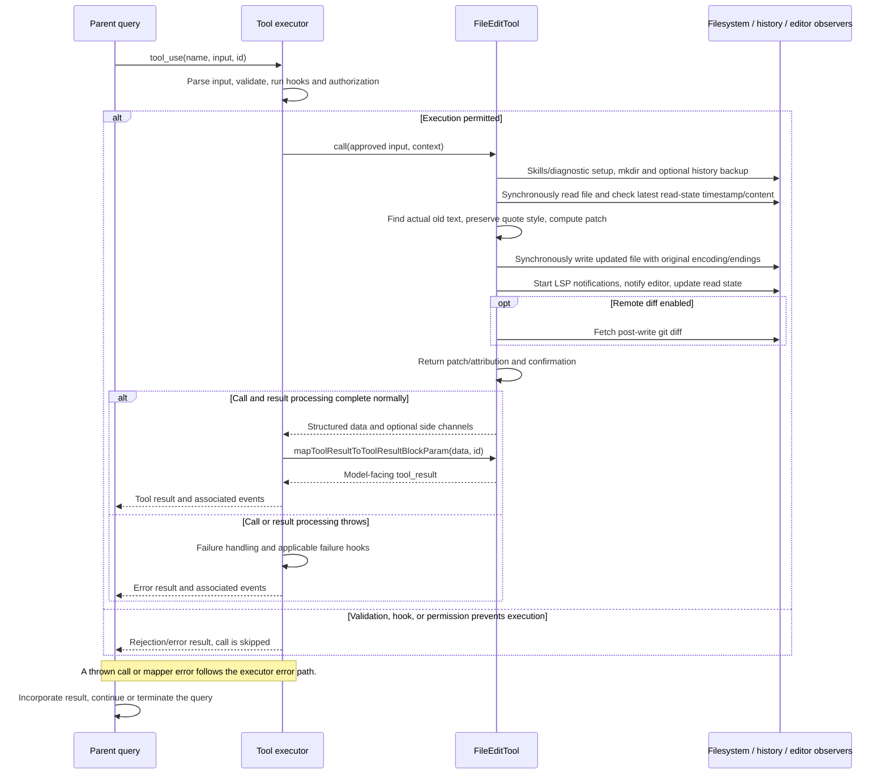

# FileEditTool Internals

Source: [tools/FileEditTool/FileEditTool.ts](../../../../../tools/FileEditTool/FileEditTool.ts). Line ranges refer to this recovered source snapshot; symbols are the stable navigation handles.

## Purpose and caller boundary

Replaces one or all occurrences of a supplied string with quote-style adaptation, preserving existing encoding and line endings. Strict input is defined in types.ts: file_path, old_string, new_string, optional semantic replace_all defaulting false. Output contains actual matched old text, requested new text, original file, patch, user-modified flag, and optional git diff. The tool is mutating and serial by default.

The [shared invocation lifecycle](../../invocation-lifecycle.md) explains registry selection, schema validation, authorization, hooks, result mapping, and exception handling. The sequence below begins with a model tool request and ends at the parent conversation boundary; external services and background workers retain their own lifecycles.

## Source-order walkthrough

### 1. Dependencies, size guard, registration (1–144)

MAX_EDIT_FILE_SIZE is one GiB of stat bytes. Registration supplies strict schemas, prompt/UI, path expansion for observable hooks, wildcard path matcher, and shared write authorization. Classifier uses path/new text. The output’s newString need not exactly equal the quote-adapted bytes written.

### 2. Pure validation guards (146–188)

Expand path; reject team-memory secrets in new_string (code 0), identical old/new text (1), or edit deny rules (2). Some validation results carry behavior ask, but result false still represents preflight failure. UNC paths skip later filesystem checks before authorization.

### 3. Size/read and creation validation (190–264)

Stat and reject over one GiB (10), tolerating ENOENT. Read bytes once, detect UTF-16LE BOM or UTF-8, normalize CRLF. Missing file permits empty old_string; otherwise return missing-file code 4 with cwd/similar suggestions. Existing content plus empty old_string is rejected (3) unless trim is empty, in which case validation returns early.

### 4. Notebook and read-state guards (266–311)

For nonempty old-string edits, reject .ipynb (5), absent/partial-view read state (6), or newer mtime (7). A full read with identical normalized content tolerates a newer timestamp. Earlier creation/empty-file returns bypass these checks; execution still has its own existing-file stale guard.

### 5. Match and settings validation (313–362)

findActualString locates exact or quote-normalized old text. Missing match gives code 8; multiple nonoverlapping matches without replace_all gives 9 and includes the actual match in metadata. Settings-file validation simulates replace/replaceAll using the requested new string. If that helper returns a result, use it; otherwise return success and actualOldString metadata.

### 6. Input equivalence (364–389)

Wrap each input as a one-element edit list with normalized replace_all false and delegate to areFileEditsInputsEquivalent. This supports comparing permission-edited proposals rather than applying a second mutation.

### 7. Asynchronous preparation (391–449)

Resolve file/cwd. Unless CLAUDE_CODE_SIMPLE, discover skill directories, record triggers, start background loading, and activate path-conditional skills. Await diagnostic baseline, parent mkdir, and optional history capture. These steps finish before the synchronous stale-check/write section.

### 8. Read current state and reject stale edits (451–478)

readFileForEdit returns current normalized content, existence, encoding, and line endings. For existing files, missing state/newer mtime requires identical content from a full-read entry or throws. No await appears between this check and disk write; external process races remain possible.

### 9. Match adaptation, patch, write (480–505)

Recompute actualOldString, falling back to requested old text. preserveQuoteStyle adapts new text to matched quote style. getPatchForEdit produces patch and updatedFile, then writeTextContent preserves encoding/endings. Helper failures throw before the write; there is no silent no-match success intended by this path.

### 10. Post-write observers and read state (507–540)

Clear delivered LSP diagnostics, start change/save notifications with caught logging, notify VSCode, and replace readFileState with post-write content/mtime and undefined range. This prevents future Read from mistaking old context for a read of the new file.

### 11. Accounting, remote diff, return (542–589)

Record CLAUDE.md edits, changed lines, operation and string-byte telemetry. Optionally await remote git diff after write. Return actualOldString but requested new_string, patch/original content, userModified default false, replaceAll, and optional diff.

### 12. Mapper and read helper (591–626)

The mapper reports replacement success and whether a user changed the proposal, with an all-occurrences variant. readFileForEdit only maps ENOENT to empty/nonexistent UTF-8 LF metadata; other read errors throw.

## End-to-end sequence

The success arrows after `call` describe normal completion. An exception skips normal result mapping; see the failure boundaries below. Query continuation remains subject to cancellation and turn/budget limits.

## State, failure, and cancellation boundaries

Preflight and call are deliberately separate checks. Empty-file creation can pass validation yet fail execution if an existing file lacks read state. Settings simulation uses requested new text, while execution can adapt quote style. The critical region is not a cross-process transaction. Later notification/diff failures can follow a successful write; asynchronous LSP failures are logged. No call-level abort signal is threaded into mutation.

## Related design

[Edit application](./edit-application.md) expands findActualString, preserveQuoteStyle, getPatchForEdit, and equality helpers.
