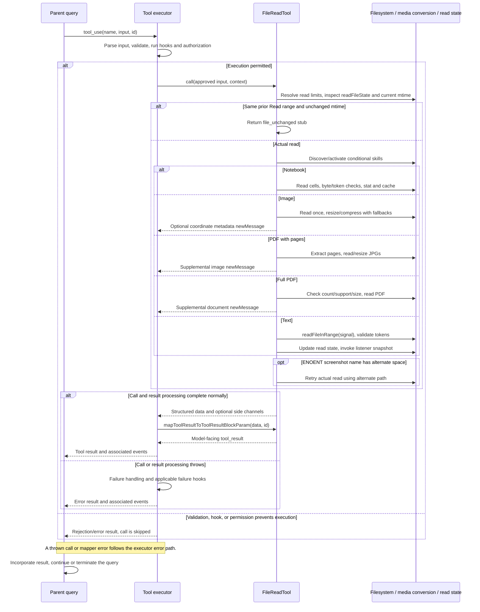

# FileReadTool Internals

Source: [tools/FileReadTool/FileReadTool.ts](../../../../../tools/FileReadTool/FileReadTool.ts). Line ranges refer to this recovered source snapshot; symbols are the stable navigation handles.

## Purpose and caller boundary

Reads text, notebooks, images, or PDFs into typed data and sometimes supplemental user messages. Strict input contains file_path, optional integer offset >=0, positive integer limit, and PDF pages string. The read-only, concurrency-safe tool also updates read-file state, discovers skills, and triggers nested memory. Its infinite result-persistence threshold avoids circularly persisting content that Read would have to read again; content limits are enforced within the implementation.

The [shared invocation lifecycle](../../invocation-lifecycle.md) explains registry selection, schema validation, authorization, hooks, result mapping, and exception handling. The sequence below begins with a model tool request and ends at the parent conversation boundary; external services and background workers retain their own lifecycles.

## Source-order walkthrough

### 1. Dependencies and path helpers (1–160)

Imports tie reading to file/token limits, image/PDF/notebook conversion, permissions, analytics, skill discovery, and memory freshness. Blocked device paths cover infinite/blocking devices and stdio /proc aliases using string checks only. getAlternateScreenshotPath switches ordinary/narrow spaces before AM/PM in PNG screenshot names for a later ENOENT retry.

### 2. Listeners, token error, analytics identity (162–227)

registerFileReadListener appends a callback and returns an unsubscribe closure. MaxFileReadTokenExceededError carries count/limit. Image extension set dispatches supported raster types. detectSessionFileType classifies config-tree session-memory Markdown and project JSONL for analytics after slash normalization.

### 3. Input/output schemas (229–330)

Output is a discriminated union: text with range counts, image with base64/MIME/optional dimensions, notebook cells, full PDF base64, extracted-page parts metadata, or file_unchanged. pages syntax is validated separately; text offset zero is accepted alongside the ordinary one-based default.

### 4. Registration and permissions (332–416)

Prompt reflects default size/range guidance and numbered-line format. Observable file_path is expanded before hooks; getPath otherwise uses supplied path or cwd. Shared read permissions and wildcard path matching apply. UI shows summary chrome, so transcript search extraction returns empty rather than indexing unseen file content.

### 5. Pure validation (418–496)

Parse supplied page range: invalid gives code 7 and too many/open-ended pages code 8. Expand path and reject matching read deny (1). UNC returns early before later checks. Reject unsupported binary extensions (4), allowing PDF and known images; reject enumerated blocking devices (9). Existence is deliberately not checked here.

### 6. Effective limits and dedup (498–575)

call defaults offset to one and limit undefined, resolves context overrides, logs override use, and expands path. Unless the dedup killswitch is on, an existing nonpartial-view Read entry with a defined offset qualifies. Exact offset/limit plus exact mtime equality returns file_unchanged. Edit/Write entries have undefined offset and cannot trigger this shortcut. Stat failure falls through to a real read.

### 7. Skill activation and retry shell (577–650)

Outside simple mode, discover directories, record triggers, start background loading with swallowed errors, and activate conditional skills. Await callInner. ENOENT for a matching screenshot retries the alternate-space path while retaining original output/cache identity; non-ENOENT alternate errors throw. If still missing, produce cwd and similar-path suggestions. Other errors propagate unchanged.

### 8. Model mapper (652–722)

Image becomes an image block; notebook delegates cell mapping. PDF and parts map to metadata text because actual content travels in newMessages. file_unchanged maps to a fixed stub. Nonempty text combines memory freshness prefix, numbered lines, and a model-dependent mitigation reminder. Empty content distinguishes empty file from offset past end. No mapper filesystem read occurs.

### 9. Formatting/freshness/token helpers (724–801)

Line format is fixed to addLineNumbers. A canonical-model exemption controls reminder inclusion. A WeakMap keyed by result-object identity carries auto-memory mtime into the mapper without schema fields. validateContentTokens first estimates; estimates no greater than a quarter of limit skip API counting. Otherwise await token count, fall back to estimate, and throw above max. createImageResponse base64-encodes bytes and attaches optional dimensions.

### 10. Notebook dispatch (803–860)

readNotebook returns cells, which are serialized for byte/token checks. Over-size content throws with targeted jq guidance; tokens are validated. Stat then store serialized cells and range metadata under original expanded path, add nested-memory trigger, log operation, and return cells. offset/limit do not slice notebook cells in this branch.

### 11. Image dispatch (862–891)

Read/resize using the token-budget helper without applying text maxSizeBytes. Add nested-memory trigger, log image data, and return image result plus an optional meta user message explaining coordinate dimensions. Images do not populate readFileState here.

### 12. Explicit PDF pages (893–948)

Extract requested pages; failure throws helper error. Log extraction, enumerate/sort JPGs, read/resize them concurrently, and return parts data plus a meta user message containing image blocks. Extraction writes artifacts before result construction and is not merely a text read.

### 13. Full PDF path (950–1025)

Count pages and reject known counts above inline threshold without pages. Stat and attempt extraction for unsupported models or large files, logging outcome; this branch does not return those extracted parts. Unsupported full-PDF models then throw. Otherwise readPDF and return metadata plus a supplemental base64 document message. Failed optional extraction does not automatically prevent a supported full-PDF read.

### 14. Text path and observers (1027–1102)

Convert offset zero to zero, otherwise offset minus one. readFileInRange receives signal; byte cap applies only when limit is undefined. Validate returned tokens, then store content/floored mtime/range and add nested-memory trigger. Invoke a snapshot of listeners so unsubscribe cannot skip a sibling. Build text data and attach auto-memory mtime via WeakMap, then log operation/session-file metrics.

### 15. Image budget helper (1104–1184)

Read bytes once with optional caller maxBytes; zero bytes throw. Detect format from bytes and try standard resize. ImageResizeError rethrows; other resize errors log and retain original bytes. Estimate tokens from base64 length; if over limit, compress from original buffer. On compression failure try Sharp inside 400×400 JPEG quality 20; if that fails too, log and return original bytes. This final fallback is not a hard token-budget guarantee.

## End-to-end sequence

The success arrows after `call` describe normal completion. An exception skips normal result mapping; see the failure boundaries below. Query continuation remains subject to cancellation and turn/budget limits.

## State, failure, and cancellation boundaries

Text read cancellation is explicitly forwarded; image/notebook/PDF calls here do not receive that signal. Read-state/listener updates precede the final return, so a throwing listener can fail the tool after state was updated. Dedup relies on timestamp/range/cache provenance, not a content hash. Images/PDFs use separate result-message channels, and extraction artifacts can survive a failed later step. Image compression has a last-resort original-byte fallback; do not claim an absolute token bound for every image path.

## Related design

[Read overview](./filereadtool.md) and [UI](./ui.md) describe consumer-facing rendering.
