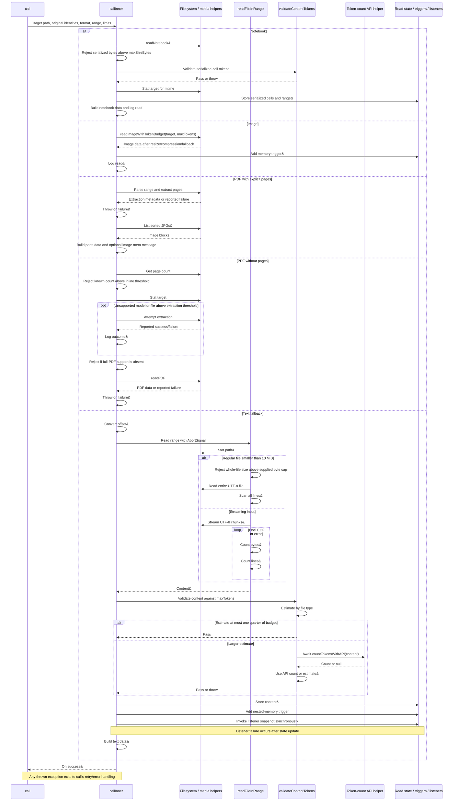

# FileReadTool Internals

Source: [tools/FileReadTool/FileReadTool.ts](../../../../../tools/FileReadTool/FileReadTool.ts). Line ranges refer to this recovered source snapshot; symbols are the stable navigation handles.

## Purpose and caller boundary

Reads text, notebooks, images, or PDFs into typed data and sometimes supplemental user messages. Strict input contains file_path, optional integer offset >=0, positive integer limit, and PDF pages string. The read-only, concurrency-safe tool also updates read-file state, discovers skills, and triggers nested memory. **Its infinite result-persistence threshold avoids circularly persisting content that Read would have to read again;(TODO)** content limits are enforced within the implementation.

The [shared invocation lifecycle](../../invocation-lifecycle.md) explains registry selection, schema validation, authorization, hooks, result mapping, and exception handling. The sequence below begins with a model tool request and ends at the parent conversation boundary; external services and background workers retain their own lifecycles.

## Source-order walkthrough

### 1. Dependencies and path helpers (1–160)

Imports tie reading to file/token limits, image/PDF/notebook conversion, permissions, analytics, skill discovery, and memory freshness. Blocked device paths cover infinite/blocking devices and stdio /proc aliases using string checks only. getAlternateScreenshotPath switches ordinary/narrow spaces before AM/PM in PNG screenshot names for a later ENOENT retry.

### 2. Listeners, token error, analytics identity (162–225)

registerFileReadListener appends a callback and returns an unsubscribe closure. MaxFileReadTokenExceededError carries count/limit. Image extension set dispatches supported raster types. detectSessionFileType classifies config-tree session-memory Markdown and project JSONL for analytics after slash normalization.

### 3. Input/output schemas (227–335)

Output is a discriminated union: text with range counts, image with base64/MIME/optional dimensions, notebook cells, full PDF base64, extracted-page parts metadata, or file_unchanged. pages syntax is validated separately; text offset zero is accepted alongside the ordinary one-based default.

### 4. Registration and permissions (337–416)

Prompt reflects default size/range guidance and numbered-line format. Observable file_path is expanded before hooks; getPath otherwise uses supplied path or cwd. Shared read permissions and wildcard path matching apply. UI shows summary chrome, so transcript search extraction returns empty rather than indexing unseen file content.

### 5. Pure validation (418–495)

Parse supplied page range: invalid gives code 7 and too many/open-ended pages code 8. Expand path and reject matching read deny (1). UNC returns early before later checks. Reject unsupported binary extensions (4), allowing PDF and known images; reject enumerated blocking devices (9). Existence is deliberately not checked here.

### 6. call(): setup, deduplication, and skill activation (496–591)

`call()` is the outer orchestration layer. It resolves policy and file identity before delegating actual reading to `callInner()`. Its `_canUseTool` argument is unused here; the shared executor owns authorization before invocation.

#### 6.1 Resolve effective limits (496–516)

Default offset to 1 and leave limit undefined. Read `readFileState` and optional `fileReadingLimits` from context. Resolve maxSizeBytes and maxTokens independently: a non-nullish context field wins over `getDefaultFileReadingLimits()`. If the override object exists, emit `tengu_file_read_limits_override` with flags identifying which fields were supplied, even if the object is empty.

#### 6.2 Establish extension and path identity (518–521)

Compute the lowercase extension from the supplied file_path, then normalize the path with expandPath. Keep both values: file_path is the requested identity in returned data, while fullFilePath is the normalized cache/logging identity. The initial filesystem target is also fullFilePath; the screenshot retry can later change only that target.

#### 6.3 Qualify an existing read for deduplication (523–554)

Read `tengu_read_dedup_killswitch`; when enabled, skip cache lookup. Otherwise obtain readFileState[fullFilePath]. A candidate must exist, must not have isPartialView set, and must have a defined offset. The defined-offset check distinguishes prior Read entries from Edit/Write entries, whose post-edit timestamp must not cause a stub referring to pre-edit content. The requested offset and limit must both match exactly; even equivalent offset values 0 and 1 do not match each other.

#### 6.4 Confirm freshness or fall through (555–573)

For a qualified range, await getFileModificationTimeAsync and compare it with the cached timestamp. Equality emits `tengu_file_read_dedup` and returns `{data: {type: 'file_unchanged', file: {filePath: file_path}}}`. This exits before skill discovery and callInner. A timestamp mismatch, an ineligible cache entry, or a failure in this try block falls through to the actual read. This is timestamp/range-based reuse, not content hashing or a fresh token-budget check.

#### 6.5 Discover and activate skills before reading (575–591)

File read/edit/write operations provide convenient triggers for path-based skill discovery and activation: the target path indicates which part of the project the agent is working in. The file operation itself does not require those skills. Discovery finds nested `.claude/skills` directories below cwd, while conditional activation makes already-known skills available when their path patterns match. This prepares relevant skills for subsequent use; it does not automatically execute them or inject their full instructions. The same integration appears in [FileEditTool](../../../../../tools/FileEditTool/FileEditTool.ts) and [FileWriteTool](../../../../../tools/FileWriteTool/FileWriteTool.ts); the shared implementation is in [loadSkillsDir.ts](../../../../../skills/loadSkillsDir.ts).

Capture cwd. Outside CLAUDE_CODE_SIMPLE mode, **await** discoverSkillDirsForPaths. Record newly discovered directories in dynamicSkillDirTriggers, then start addSkillDirectories without awaiting it; its rejection is swallowed. Activate conditional skills matching fullFilePath. Despite the broad fire-and-forget source comment, only skill loading is backgrounded: directory discovery is awaited. This work precedes the callInner try/catch, so a discovery failure does not enter screenshot retry or missing-file suggestion handling. Skill effects can occur even if the later read fails.

### 7. call(): delegation and missing-path recovery (593–650)

#### 7.1 Await the initial callInner attempt (593–607)

Pass the three path identities, extension, offset/limit/pages, effective byte/token limits, readFileState, context, and optional parent message ID. `return await callInner(...)` keeps asynchronous failures inside the surrounding catch. On success, return its data and optional newMessages unchanged.

#### 7.2 Retry only an eligible ENOENT path (608–637)

Inspect the caught error's errno. Non-ENOENT errors propagate unchanged. For ENOENT, getAlternateScreenshotPath may produce a PNG screenshot path with the alternate ordinary/thin space before AM/PM. If present, await callInner again with that resolvedFilePath; preserve the original file_path, fullFilePath, extension, limits, and context. This does not repeat deduplication or skill discovery. Alternate-attempt success returns immediately; an alternate non-ENOENT error propagates; another ENOENT proceeds to suggestions. There is no smaller-range or token-overflow retry.

#### 7.3 Report a missing path (639–649)

Compute a similar filename and await a path-under-cwd suggestion. Throw a friendly error containing cwd, preferring the cwd suggestion over the similar filename when both exist. The shared executor turns this final exception into an error tool result. The retry shell is not transactional: it does not undo effects performed before an exception.

### 8. Model mapper (652–718)

Image becomes an image block; notebook delegates cell mapping. PDF and parts map to metadata text because actual content travels in newMessages. file_unchanged maps to a fixed stub. Nonempty text combines memory freshness prefix, numbered lines, and a model-dependent mitigation reminder. Empty content distinguishes empty file from offset past end. No mapper filesystem read occurs.

### 9. Formatting/freshness/token helpers (720–799)

Line format is fixed to addLineNumbers. A canonical-model exemption controls reminder inclusion. A WeakMap keyed by result-object identity carries auto-memory mtime into the mapper without schema fields. validateContentTokens first estimates; estimates no greater than a quarter of limit skip API counting. Otherwise await token count, fall back to estimate, and throw above max. createImageResponse base64-encodes bytes and attaches optional dimensions.

#### Token-limit policy: bounded content and recoverable errors

**The policy does not minimize Read failures at any cost. It checks content before admitting it into the conversation and uses a small, actionable error to steer the model toward a narrower read. With the default 25,000-token budget, estimates up to 6,250 skip API counting; larger estimates trigger an API count, even when the estimate already exceeds the budget. The quarter-budget threshold leaves headroom for estimation error, while API counting can avoid rejecting content whose estimate was too high.**

[tokenEstimation.ts](../../../../../services/tokenEstimation.ts) estimates with `Math.round(content.length / ratio)`: the ratio is 2 for JSON/JSONL/JSONC and 4 otherwise. Despite the helper's bytes-per-token terminology, this uses JavaScript string length. If API counting is unavailable, validation uses this estimate. This is a best-effort check, not a strict token guarantee: an underestimate can pass. It also checks the selected content in isolation, not the conversation's remaining capacity or the final result after line numbers and reminders are added.

An oversized text read throws before updating readFileState or notifying read listeners. The tool does not automatically shrink the range, truncate to the token budget, or retry smaller chunks. MaxFileReadTokenExceededError instructs the model to use offset/limit or search; the [shared executor](../../../../../services/tools/toolExecution.ts) converts the exception into a tool_result with is_error=true. A subsequent narrower Read is model-driven recovery, subject to the parent query continuing.

The default byte guard is 256 KB and applies when limit is omitted; an explicit line limit bypasses that byte guard but retains token validation. The comment in [limits.ts](../../../../../tools/FileReadTool/limits.ts) records why reducing tool errors alone is not the objective: an experiment replacing byte-limit errors with truncation reduced errors but increased mean token consumption, so it was reverted. A small error result was cheaper than returning roughly 25K tokens of truncated content. The takeaway is to limit oversized content, accept recoverable tool failures, and provide feedback for a more targeted next request.

### 10. callInner(): contract and ordered dispatch (804–820)

callInner returns `{data: Output, newMessages?: UserMessage[]}`. It has no local catch wrapping the dispatch: helper errors propagate to call(), which applies the ENOENT policy above.

| Input | Responsibility |
|---|---|
| file_path | Requested identity in text/notebook output and error guidance |
| fullFilePath | Original expanded identity for read state, memory triggers, and operation logging |
| resolvedFilePath | Actual filesystem target; may be the alternate screenshot path |
| ext | Lowercase extension chosen by call(); determines the branch |
| offset / limit / pages | Text range or PDF-page selection; not universal slicing controls |
| maxSizeBytes / maxTokens | Effective limits; each format applies its own checks |
| readFileState / context | Cache, cancellation, memory triggers, and other invocation state |
| messageId | Optional parent message ID for text-read telemetry |

Dispatch order is notebook, image, PDF, then text fallback. Every successful format branch returns immediately; text runs only after all other format checks fail.

### 11. callInner(): notebook branch (821–863)

1. **Read and serialize.** For ext=ipynb, await readNotebook(resolvedFilePath), then serialize the returned cells with jsonStringify. offset and limit do not select cells.
2. **Check bytes.** Compare Buffer.byteLength(cellsJson) with maxSizeBytes. Overflow throws with jq examples for selecting cells or code sources; no read-state update has happened yet.
3. **Check tokens.** Await validateContentTokens(cellsJson, ext, maxTokens). The extension remains ipynb, so the file-type estimator uses its default ratio rather than the JSON-extension ratio.
4. **Record successful read state.** Stat resolvedFilePath, then store serialized cells, floored mtime, offset, and limit under fullFilePath. Add the nested-memory trigger. A stat failure prevents this update.
5. **Build and return.** Construct notebook data containing file_path and cells, log the serialized content, and return `{data}`. There are no fileReadListeners callbacks or supplemental messages in this branch; the mapper later converts cells to tool-result content.

### 12. callInner(): image branch (865–891)

1. **Read with the image budget.** If IMAGE_EXTENSIONS contains ext, await readImageWithTokenBudget(resolvedFilePath, maxTokens). Do not pass maxSizeBytes; the helper's optional byte cap is therefore unset here. Compression and fallback behavior are described below.
2. **Record side effects.** Add fullFilePath to nested-memory triggers and log the returned base64 content. This branch does not populate readFileState or invoke text-read listeners.
3. **Build optional coordinate guidance.** If returned dimensions exist, derive createImageMetadataText. When nonempty, wrap it in a meta user message.
4. **Return both channels.** Return image data plus optional metadata newMessages. The actual image becomes a tool_result image block in the mapper; the supplemental message contains coordinate guidance, not another image copy.

### 13. callInner(): PDF branches (893–1017)

#### 13.1 Explicit pages: extract and return images (895–946)

1. Parse the supplied pages string again and call extractPDFPages with the parsed range (or undefined). Normal tool invocation has already validated page syntax and count in validateInput.
2. If extraction reports failure, throw its message. Otherwise log successful extraction and a read operation describing the selected pages. Extracted files already exist at this point.
3. Read the output directory, retain filenames ending in `.jpg`, and sort them. Promise.all reads and resizes the images concurrently; its result array retains the sorted input order.
4. Convert each resized buffer into a base64 image block with the returned MIME type. Return extraction metadata as data; if there are image blocks, place them together in one meta user message in newMessages.

A directory-read, image-read, or resize failure prevents a successful result, but earlier extraction artifacts and logs remain. These images use the standard resize helper, not readImageWithTokenBudget or validateContentTokens.

#### 13.2 No pages: check count, then optionally extract (948–977)

Await getPDFPageCount. A known count above PDF_AT_MENTION_INLINE_THRESHOLD throws guidance to use explicit page ranges. A null count does not reject here. Next, stat resolvedFilePath. If the model lacks full-PDF support or the file exceeds PDF_EXTRACT_SIZE_THRESHOLD, attempt extraction and log the helper's success/failure result.

This optional extraction does not switch the return value to extracted page images. A reported extraction failure is logged and execution continues; a thrown exception still propagates. Successful extraction artifacts may remain even though the later path returns a full PDF or fails its support check.

#### 13.3 Enforce support and return the full document (979–1016)

If full PDFs are unsupported, throw model/page-range guidance even if optional extraction succeeded. Otherwise await readPDF and throw on a reported failure. Log successful base64 content, then return PDF data plus one meta user message containing a base64 application/pdf document block. The mapper returns only PDF metadata in the tool_result.

Neither PDF branch updates readFileState, adds a nested-memory trigger here, or invokes text-read listeners. Neither uses the text maxTokens validation path; PDF helpers and page checks provide separate constraints.

### 14. callInner(): text fallback and observers (1019–1085)

#### 14.1 Translate the range and read (1019–1028)

Convert offset to the helper's zero-based convention: zero stays zero, otherwise subtract one. Await readFileInRange with resolvedFilePath, the converted offset, limit, and context.abortController.signal. Supply maxSizeBytes only when limit is undefined; do not enable truncateOnByteLimit. Retain content, selected/total line counts, byte counts, and mtime from the helper. An undefined limit reaches the helper unchanged and means all remaining lines, despite the tool prompt's advertised 2,000-line default.

#### 14.2 Validate before committing read state (1030–1038)

Await validateContentTokens(content, ext, maxTokens). A byte/read/token failure exits before this branch records a successful read. On success, store content, floored mtime, and the original offset/limit under fullFilePath, then add the nested-memory trigger. This cache entry enables subsequent exact-range deduplication.

#### 14.3 Notify observers after the state update (1040–1044)

Iterate fileReadListeners.slice(), calling each listener with resolvedFilePath and content. The snapshot prevents an unsubscribe during a callback from skipping a sibling. Calls are synchronous and not locally caught: a listener exception stops later callbacks and fails the tool after read state and the memory trigger were already updated.

#### 14.4 Construct data and attach freshness metadata (1046–1058)

Build text data with requested file_path, content, numLines, startLine set to the original offset, and totalLines. If fullFilePath identifies an auto-memory file, associate the unfloored mtime with this data object in memoryFileMtimes. The mapper later retrieves it for the freshness prefix; it is not an output-schema field.

#### 14.5 Log and return (1060–1085)

Log the read operation against fullFilePath, classify session-memory/transcript identity, and emit tengu_session_file_read with total/selected lines and bytes, offset, optional limit/extension/message ID, and session-file flags. Finally return `{data}`. Text adds no supplemental newMessages here; numbering and reminders are deferred to the mapper.

#### readFileInRange: selection, byte limits, and completion

[utils/readFileInRange.ts](../../../../../utils/readFileInRange.ts) reads UTF-8 text and selects the zero-based range `[offset, offset + maxLines)`. An omitted maxLines selects all remaining lines. It removes a leading BOM, strips trailing carriage returns from selected lines, and joins them with newline separators. It performs no token counting or automatic pagination.

The entry point checks an already-aborted signal, stats the path, rejects directories, and chooses between two paths:

| Path | Selection and I/O | Default maxBytes enforcement |
|---|---|---|
| Regular file smaller than 10 MiB | readFile loads the entire file; indexOf scans newlines and retains selected lines | Reject before reading when stats.size exceeds maxBytes |
| Streaming: files at least 10 MiB and nonregular inputs | createReadStream uses a 512 KiB high-water mark; data handlers scan newlines and retain selected lines plus an unfinished selected line | Accumulate decoded input bytes and destroy the stream with FileTooLargeError when the count exceeds maxBytes |

The streaming error event rejects the returned Promise. Thus the large-file path does enforce maxBytes; rejection happens during reading rather than before it. For a large regular file, the initial stat already exposes its size, so an earlier rejection could avoid I/O, but the current implementation does not use that opportunity. Pipes and devices need enforcement as data arrives because their reported size does not reliably describe the incoming data. If maxBytes is undefined, neither path applies a byte cap.

The helper also supports `options.truncateOnByteLimit: true`, which changes maxBytes from an input-size guard to a selected-output budget. It counts UTF-8 bytes including newline separators, keeps only a prefix of complete lines, and returns truncatedByBytes=true when a line would exceed the budget. It does not split an oversized line or skip it to include later lines. Streaming also discards an unfinished selected line once it cannot fit, preventing that fragment from growing further. FileReadTool does not enable this option: its explicit line limit bypasses the byte guard, while post-read token validation still applies.

Both paths continue scanning to EOF to calculate totalLines, even after the requested range or truncation boundary is reached. A small selection therefore reduces returned content, not necessarily filesystem I/O. Streaming discards fragments outside the selected range, but without a byte cap a huge selected line or range can still consume substantial memory.

Streaming completion uses shared StreamState bound to event handlers: open starts fstat for mtime, data accumulates counts and selected text, end handles the final fragment and waits for mtime before resolving, and error rejects. AbortSignal is passed to readFile or createReadStream; the synchronous fast-path scanning loop has no additional cancellation checks.

| Result field | Meaning |
|---|---|
| content / lineCount | Normalized selected text and selected line count |
| totalLines | Whole-input logical line count, including the final fragment |
| totalBytes | UTF-8 byte count of decoded input after BOM removal |
| readBytes | UTF-8 byte count of returned content, not filesystem I/O volume |
| mtimeMs | Modification time; streaming fstat failure falls back to zero |
| truncatedByBytes | Present as true when output was clipped by the optional byte budget |

Two implementation details qualify the helper's opening comments. Both paths unconditionally count a final fragment, so an empty file counts as one logical line and a trailing newline adds an empty final line. Also, only streaming obtains mtime from the opened file descriptor: the fast path uses stat(filePath) before a separate readFile(filePath), so its metadata and content are not guaranteed to describe the same file version.

### 15. Image budget helper (1097–1183)

Read bytes once with optional caller maxBytes; zero bytes throw. Detect format from bytes and try standard resize. ImageResizeError rethrows; other resize errors log and retain original bytes. Estimate tokens from base64 length; if over limit, compress from original buffer. On compression failure try Sharp inside 400×400 JPEG quality 20; if that fails too, log and return original bytes. This final fallback is not a hard token-budget guarantee.

## End-to-end sequence

The first diagram separates outer call orchestration from format dispatch. The second expands callInner, especially the text read and its validation/state boundary. Arrows following a successful step apply only if that step returns normally; exceptions leave the branch and enter the outer failure path.

```mermaid
sequenceDiagram
    participant Q as Parent query
    participant E as Tool executor
    participant C as FileReadTool call
    participant S as Read state / filesystem
    participant K as Skill discovery / loading
    participant I as callInner
    participant M as Result mapper
    Q->>E: tool_use(name, input, id)
    E->>E: Shared validation, hooks, authorization
    alt Execution prevented
        E-->>Q: Rejection/error result&#59; skip call
    else Execution permitted
        E->>C: call(approved input, context)
        C->>C: Resolve limits, extension, expanded identity
        C->>S: Inspect dedup candidate and exact range
        opt Eligible candidate and range match
            C->>S: Await current mtime
            S-->>C: Timestamp or failure
        end
        alt Eligible candidate and matching mtime
            C->>C: Build file_unchanged data
        else Actual read required
            opt Not simple mode
                C->>K: Await discovery for file path
                K-->>C: New skill directories
                C->>C: Record directory triggers
                opt New directories found
                    C->>K: Start loading&#59; do not await&#59; swallow rejection
                end
                C->>K: Activate conditional skills
            end
            Note over C,K: Discovery precedes the callInner try/catch
            C->>I: Await callInner(original identity, original target)
            alt Initial attempt succeeds
                I-->>C: data and optional newMessages
            else Initial attempt throws ENOENT
                C->>C: Check alternate screenshot path
                opt Alternate path exists
                    C->>I: Await callInner(original identity, alternate target)
                    I-->>C: Success or exception
                end
                C->>C: Return alternate success&#59; propagate other error&#59; otherwise build missing-path error
            else Initial attempt throws another error
                I-->>C: Propagate exception unchanged
            end
        end
        alt call returns successfully
            C-->>E: data and optional newMessages
            E->>M: mapToolResultToToolResultBlockParam(data, id)
            alt Mapping and shared result processing succeed
                M-->>E: tool_result content
                E-->>Q: Tool result plus supplemental messages/events
            else Mapping or shared result processing throws
                E->>E: Shared failure handling
                E-->>Q: Error result and associated events
            end
        else call throws
            C-->>E: Exception
            E->>E: Format error and run applicable failure hooks
            E-->>Q: tool_result(is_error=true) and associated events
        end
    end
    Q->>Q: Incorporate result&#59; continue or terminate
```

Skill loading has its own background lifetime. Screenshot retry re-enters only callInner; it does not repeat the outer setup. Supplemental messages are returned alongside data, not independently sent to the executor while a branch is still running. Query continuation remains subject to cancellation and turn/budget limits.

## State, failure, and cancellation boundaries

Text read cancellation is explicitly forwarded; image/notebook/PDF calls here do not receive that signal. Read-state/listener updates precede the final return, so a throwing listener can fail the tool after state was updated. Dedup relies on timestamp/range/cache provenance, not a content hash. Images/PDFs use separate result-message channels, and extraction artifacts can survive a failed later step. Image compression has a last-resort original-byte fallback; do not claim an absolute token bound for every image path.

## Related design

[Read overview](./filereadtool.md) and [UI](./ui.md) describe consumer-facing rendering.
