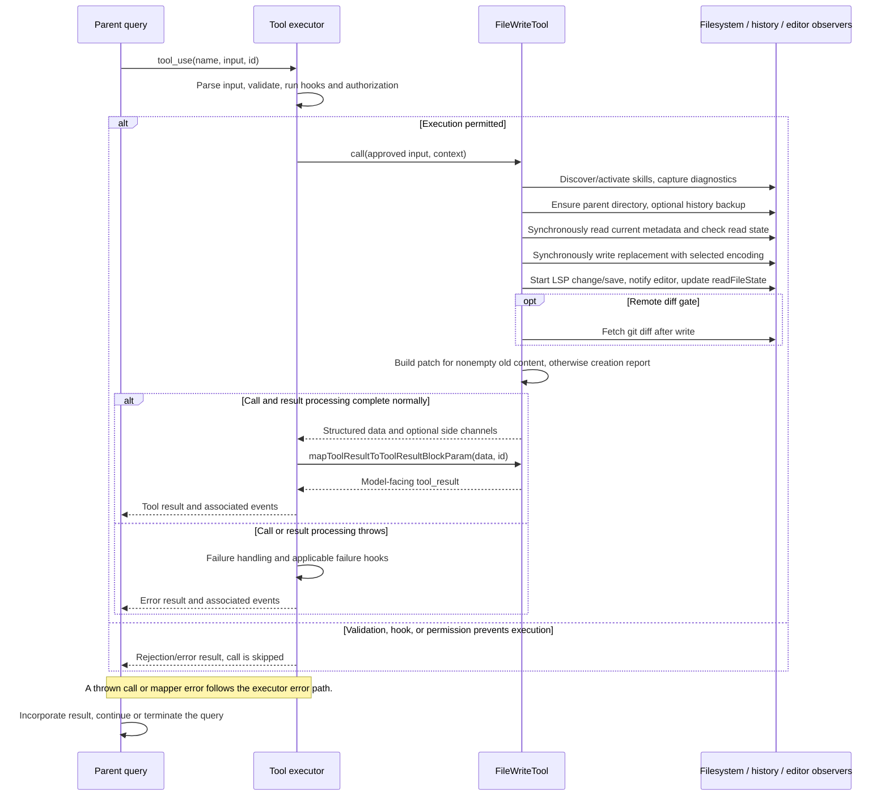

# FileWriteTool Internals

Source: [tools/FileWriteTool/FileWriteTool.ts](../../../../../tools/FileWriteTool/FileWriteTool.ts). Line ranges refer to this recovered source snapshot; symbols are the stable navigation handles.

## Purpose and caller boundary

Creates or replaces a file with explicit content. Strict input requires file_path/content; path descriptions ask for absolute paths, while observable-input normalization expands relative/~ paths. Output includes create/update classification, patch, original content, and optional remote git diff. This mutating tool retains default serial scheduling.

The [shared invocation lifecycle](../../invocation-lifecycle.md) explains registry selection, schema validation, authorization, hooks, result mapping, and exception handling. The sequence below begins with a model tool request and ends at the parent conversation boundary; external services and background workers retain their own lifecycles.

## Source-order walkthrough

### 1. Imports and schemas (1–91)

Dependencies cover read-state staleness, encoding-aware writes, history snapshots, diagnostics/LSP/editor notifications, skill discovery, secret checks, and diff analytics. Output carries full content for UI/attribution; the model result later contains only confirmation.

### 2. Metadata and permission boundary (93–158)

The tool is strict with 100,000-character result limit. getPath exposes file_path, backfillObservableInput expands it for observable hooks, and permission matching uses the normalized path. checkWritePermissionForTool applies filesystem policy. Transcript search extraction is empty to avoid indexing raw content that update UI does not show.

### 3. Secret and deny checks (160–185)

Expand the path; reject team-memory content containing detected secrets (code 0), then reject an edit deny rule (1). These checks precede filesystem preflight. UNC paths return validation success without touching the filesystem, leaving authorization to the permission boundary.

### 4. Existence, read-before-write, staleness (187–229)

Stat the target. ENOENT permits creation; other errors throw. An existing file requires a readFileState entry that is not isPartialView (code 2). Floor mtime and reject if newer than read timestamp (3). This preflight does not apply the later full-content fallback, so it can reject earlier even when call would consider unchanged content safe.

### 5. Pre-write asynchronous work (231–274)

Expand path and discover skill directories; record trigger directories and load them in the background with swallowed rejections. Activate conditional skills. Await diagnostic baseline, mkdir parent, and optional history snapshot keyed to parentMessage.uuid. All awaited setup deliberately precedes the synchronous read/check/write region.

### 6. Current-file check (276–310)

Read content/encoding metadata synchronously; only ENOENT becomes null. If an existing file lacks read state or has newer mtime, allow only a full-read entry (offset and limit undefined) whose normalized content exactly matches current content. Otherwise throw FILE_UNEXPECTEDLY_MODIFIED_ERROR. There is no await until after the write, preventing same-event-loop interleaving, but no external-process lock.

### 7. Replacement and notifications (312–347)

Choose existing encoding or UTF-8, then writeTextContent with LF mode so explicit input line endings are not rewritten to old-file endings. Fire LSP didChange/didSave promises with logging catches after clearing delivered diagnostics; notify VSCode. Set a full post-write read-state entry with offset/limit undefined, ensuring subsequent Read does not dedup against pre-write context.

### 8. Telemetry and optional git diff (349–371)

Log CLAUDE.md writes. Remote-session plus runtime gate enables an awaited git diff after the write. Any uncaught failure here occurs after disk mutation; LSP notifications are independently in flight.

### 9. Update/create projection (373–415)

Branch on truthiness of oldContent, not file existence. Nonempty old content produces display patch, update classification, line-change accounting, and file-operation logging. Missing OR empty old content produces create with originalFile null and empty patch, counting all input lines as additions. Thus overwriting an existing zero-byte file is reported as creation.

### 10. Model mapper (417–435)

Emit a create-path or update-path confirmation only. Full content, originalFile, and patches remain structured data for UI/attribution rather than model text.

## End-to-end sequence

The success arrows after `call` describe normal completion. An exception skips normal result mapping; see the failure boundaries below. Query continuation remains subject to cancellation and turn/budget limits.

## State, failure, and cancellation boundaries

The synchronous region prevents cooperative JavaScript interleaving, not races with external editors. History backups and parent directories can exist even when the stale check fails. Disk write precedes notifications/diff/result construction; a later failure does not roll it back. No context abort signal is consumed by call. “Create” is a result-classification branch and does not necessarily mean the path was previously absent.

## Related design

[Write overview](./filewritetool.md) and [UI](./ui.md).
