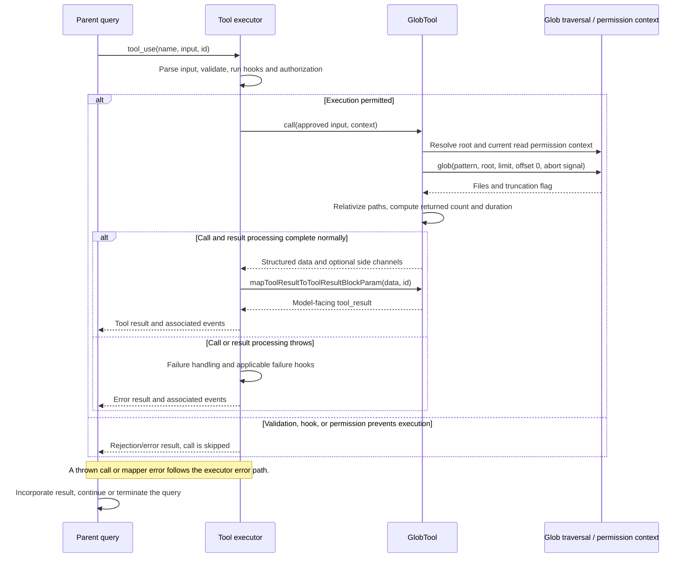

# GlobTool Internals

Source: [tools/GlobTool/GlobTool.ts](../../../../../tools/GlobTool/GlobTool.ts). Line ranges refer to this recovered source snapshot; symbols are the stable navigation handles.

## Purpose and caller boundary

Finds file names matching a glob under an optional directory. Strict input requires pattern; output reports returned filenames/count, duration, and truncation. The read-only, concurrency-safe tool delegates traversal, filtering, and cancellation to utils/glob.ts.

The [shared invocation lifecycle](../../invocation-lifecycle.md) explains registry selection, schema validation, authorization, hooks, result mapping, and exception handling. The sequence below begins with a model tool request and ends at the parent conversation boundary; external services and background workers retain their own lifecycles.

## Source-order walkthrough

### 1. Schemas and metadata (1–89)

Path is optional and pattern is an unrestricted string. Output schema describes a 100-file limit, but context.globLimits.maxResults can override it at execution. Classifier and permission matcher use pattern; getPath expands a truthy path or uses cwd. Search classification is search true/read false.

### 2. Directory validation (90–133)

For a supplied path, expand and stat it. UNC-style paths skip filesystem preflight to avoid triggering network authentication before authorization; that skip is not an allow decision. ENOENT returns code 1 with cwd and optional suggestion; a non-directory returns code 2; other stat exceptions throw.

### 3. Permission and presentation (135–155)

checkReadPermissionForTool uses the current permission context and resolved path. Prompt and UI helpers describe file search. Transcript search indexes only joined filenames, excluding duration/count chrome.

### 4. Execute (157–179)

Capture start/state, choose maxResults or 100, then call glob(pattern, root, {limit, offset:0}, abort signal, permission context). Relativize returned paths under cwd, count only returned filenames, and preserve helper truncation. No file contents are read by this module.

### 5. Model result (180–199)

Empty list becomes ordinary No files found. Otherwise return one path per line plus truncation guidance when the helper says more results exist. Duration and count are not independently serialized.

## End-to-end sequence

The success arrows after `call` describe normal completion. An exception skips normal result mapping; see the failure boundaries below. Query continuation remains subject to cancellation and turn/budget limits.

## State, failure, and cancellation boundaries

A truncated numFiles is a returned-page count, not the full match count. Validation and traversal can race with filesystem changes. The helper owns subprocess/traversal termination; this tool forwards the abort signal and does not convert errors into empty results. UNC preflight skipping must be read together with the later permission check.
