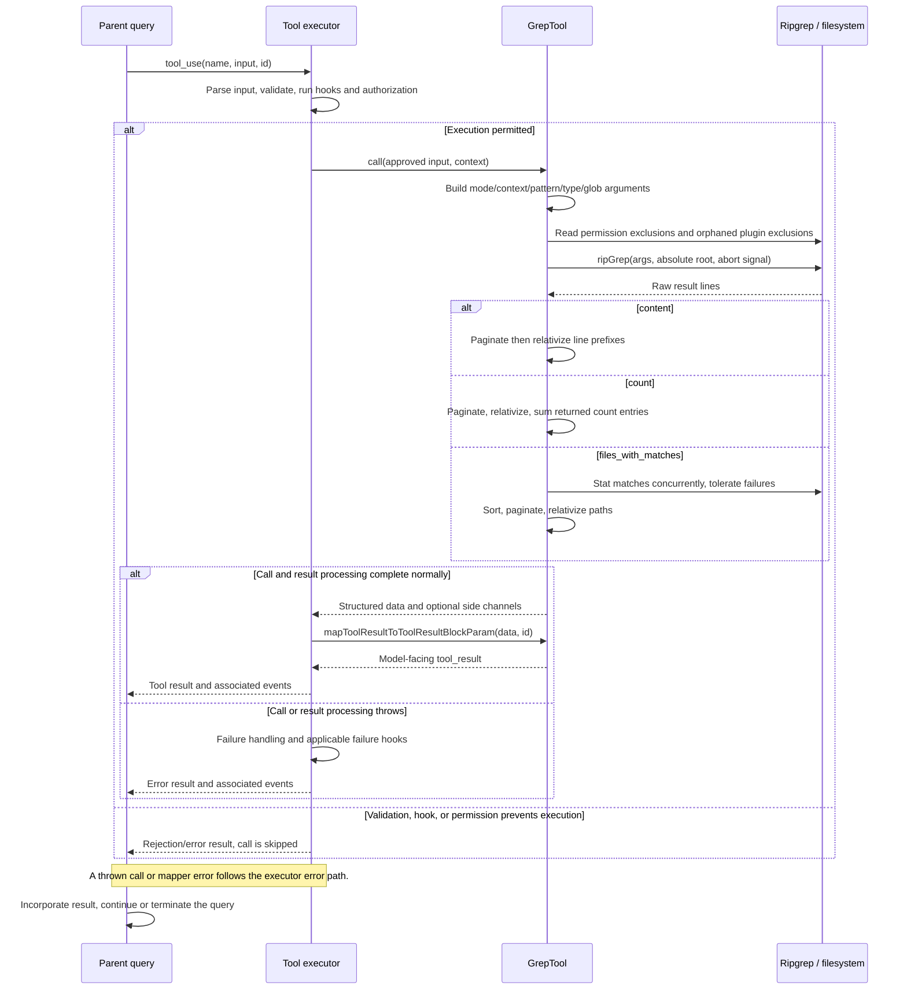

# GrepTool Internals

Source: [tools/GrepTool/GrepTool.ts](../../../../../tools/GrepTool/GrepTool.ts). Line ranges refer to this recovered source snapshot; symbols are the stable navigation handles.

## Purpose and caller boundary

Runs ripgrep and projects content lines, matching file paths, or per-file counts. Strict input contains pattern plus path/glob/type, output_mode, context flags, case/multiline flags, and pagination. The default mode is files_with_matches and default head limit is 250; zero means unlimited. The tool is read-only and concurrency-safe.

The [shared invocation lifecycle](../../invocation-lifecycle.md) explains registry selection, schema validation, authorization, hooks, result mapping, and exception handling. The sequence below begins with a model tool request and ends at the parent conversation boundary; external services and background workers retain their own lifecycles.

## Source-order walkthrough

### 1. Input and pagination helpers (1–152)

Semantic number/boolean wrappers normalize options; numeric fields here have no nonnegative/integer refinements. VCS directories are excluded. applyHeadLimit slices at offset and records appliedLimit only when truncation actually occurs; zero disables the cap while retaining offset. formatLimitInfo includes offset only when truthy. Output separates filenames/content/count metadata.

### 2. Metadata, path, and validation (154–237)

Result persistence threshold is 20,000 characters. Classifier combines pattern/path; permission matcher wildcard-matches the search pattern. Validation expands and stats supplied paths, skipping UNC preflight; unlike Glob it permits either a file or directory. ENOENT gives a suggestion/code 1, other errors throw. Read permissions use the shared filesystem checker.

### 3. UI and mapper before call (239–311)

Searchable transcript text is content for content mode, otherwise filenames. Content results show text or No matches found plus pagination. Count results show raw entries and the sum/file count of the returned page. Filename results show a returned count and paths, with No files found for zero. The mapper does not reapply pagination.

### 4. Base ripgrep arguments (313–382)

Resolve absolute path and start --hidden; append exclusions for VCS and --max-columns 500. Add multiline/case flags, -l for filenames or -c for counts, line numbers only for content. For content context precedence is context, then -C, then separate -B/-A. A leading-dash pattern uses -e so it cannot become an option.

### 5. Filters and exclusions (384–443)

Add type when supplied. Split glob text on whitespace and commas while preserving tokens containing both braces, then add each --glob. Normalize read-ignore patterns against cwd and negate them for ripgrep, prefixing nonabsolute ones with **/. Add orphaned-plugin-cache exclusions from the helper.

### 6. Search boundary (445–451)

Await ripGrep(args, absolutePath, abort signal). The dependency handles process timeout separately from agent abort and throws RipgrepTimeoutError when incomplete; the tool does not turn a timeout into a no-match result.

### 7. Content projection (453–488)

Apply pagination before per-line path work. Split at the first colon to relativize a recognized path prefix and retain the suffix. Return joined lines, numLines, empty filenames, numFiles zero, and optional pagination metadata. Colon splitting is a formatting heuristic, not a structured ripgrep protocol parser.

### 8. Count projection (490–535)

Paginate raw count entries first; split at the last colon for path conversion and integer count parsing. Sum valid counts and count valid entries only in this page. Return raw count lines and page totals; unlimited/global totals are not implied when paginated.

### 9. Filename sorting and return (537–578)

Stat all matched files with Promise.allSettled; failed stats receive mtime zero. Tests sort lexically; ordinary runs sort newest first with lexical ties. Paginate after sorting, then relativize and return filenames/count. A disappeared file can remain in the list because stat failure changes ordering rather than removing the match.

## End-to-end sequence

The success arrows after `call` describe normal completion. An exception skips normal result mapping; see the failure boundaries below. Query continuation remains subject to cancellation and turn/budget limits.

## State, failure, and cancellation boundaries

Pagination limits the returned material, not necessarily ripgrep work or its raw result allocation. File counts and match totals describe the selected page. No snapshot lock protects search/stat results. Empty results are normal; process/search errors throw. Permission exclusions are supplied to ripgrep, while top-level path authorization remains a separate pre-call decision.

## Related design

[Grep overview](./greptool.md) and [UI](./ui.md).
