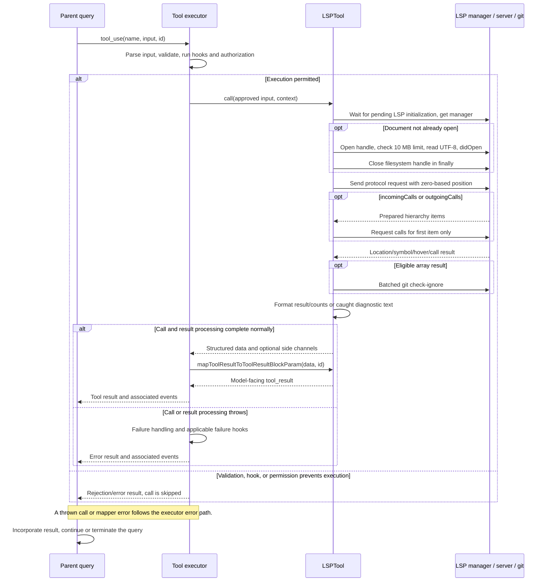

# LSPTool Internals

Source: [tools/LSPTool/LSPTool.ts](../../../../../tools/LSPTool/LSPTool.ts). Line ranges refer to this recovered source snapshot; symbols are the stable navigation handles.

## Purpose and caller boundary

Dispatches nine language-server operations using a file and one-based line/character. Even document/workspace symbol operations require those positional fields in the public schema; workspaceSymbol requests an empty query. Output is formatted text with optional result/file counts. Registry inclusion has an LSP environment gate, while isEnabled checks current LSP connection state. The tool is deferred, read-only, and concurrency-safe.

The [shared invocation lifecycle](../../invocation-lifecycle.md) explains registry selection, schema validation, authorization, hooks, result mapping, and exception handling. The sequence below begins with a model tool request and ends at the parent conversation boundary; external services and background workers retain their own lifecycles.

## Source-order walkthrough

### 1. Schemas and imports (1–126)

The public strict object enumerates definition, references, hover, document/workspace symbols, implementation, prepare hierarchy, incoming calls, and outgoing calls. Positive integer positions are required. MAX_LSP_FILE_SIZE_BYTES is 10,000,000. Formatters and manager helpers are dependencies; no server response schema is applied in this module.

### 2. Registration and validation (128–209)

Revalidate input against lspToolInputSchema discriminated union (code 3). Expand path and skip UNC filesystem preflight. Stat failures produce missing-file code 1 or logged access code 4; nonregular file gives code 2. Shared filesystem read permissions apply after validation. Prompt/UI are imported.

### 3. Initialization and method choice (211–251)

Wait if manager initialization is pending, then retrieve manager. Missing manager returns ordinary diagnostic text. Compute protocol method/params before the main try. The call ignores its context argument, so no tool abort signal is forwarded to manager operations.

### 4. Open document and first request (253–297)

Only if manager does not already consider the file open, open a file handle, stat it, reject oversized content with ordinary text, read UTF-8, and await manager.openFile. Close the handle in finally. Already-open documents bypass this size/read path. Send the selected request; undefined means no server and returns ordinary diagnostic text.

### 5. Two-stage call hierarchy (299–336)

Incoming/outgoing first prepare hierarchy. Null/empty items return zero counts. Otherwise use only the FIRST hierarchy item in the second incomingCalls/outgoingCalls request. Undefined second response is logged and passed to formatters as an empty-like result.

### 6. Gitignore filtering (338–378)

For nonempty array responses of references/definition/implementation/workspaceSymbol only, extract locations, batch-filter ignored paths, then retain original records whose URIs survived. Workspace entries without a URI are retained at this filtering stage. Single Location/LocationLink responses skip the array-only filter. This is not a new per-result permission authorization pass.

### 7. Formatting and caught failures (380–422)

formatResult returns formatted text/counts for the requested operation. Any error inside open/request/filter/format is logged and returned as ordinary Error performing text. The mapper emits only result and never sets is_error; pending-initialization/method-selection errors outside try can still throw.

### 8. Protocol parameter mapping (424–520)

pathToFileURL encodes the absolute path and positions subtract one. References includes declarations. Document symbols omit position; workspace symbols sends query empty. Incoming/outgoing map initially to prepareCallHierarchy; the second call is handled above. Definition/implementation/hover use their corresponding textDocument methods.

### 9. Count and URI helpers (522–552)

countSymbols recursively includes children; unique-file counts use URI sets. uriToFilePath strips file://, normalizes a leading Windows drive slash, and percent-decodes with fallback on malformed encoding.

### 10. Gitignore helper and link normalization (554–629)

Deduplicate URI paths and run git check-ignore in batches of 50 with a five-second timeout. Only exit zero plus stdout adds ignored paths; failures/nonrepo/no-match leave entries unfiltered. Filter by observed ignored set. LocationLink converts to targetUri plus targetSelectionRange or targetRange.

### 11. Formatter dispatch (631–825)

Definition/implementation normalize single/list results for counts, log invalid URIs, and reuse definition formatting. References counts valid locations. Hover counts one when truthy. DocumentSymbol detects hierarchical range versus flat location format and recursively counts only hierarchical symbols. WorkspaceSymbol filters malformed locations for counts. Hierarchy prepare/incoming/outgoing count items/calls and unique involved URIs. Formatting receives the original typed result, so count filtering is not a universal malformed-response sanitizer.

### 12. Hierarchy file-count helpers (827–861)

Collect nonempty item.uri, incoming.from.uri, or outgoing.to.uri, then Set size. These helpers tolerate absent nested URIs but otherwise rely on the cast server result shapes.

## End-to-end sequence

The success arrows after `call` describe normal completion. An exception skips normal result mapping; see the failure boundaries below. Query continuation remains subject to cancellation and turn/budget limits.

## State, failure, and cancellation boundaries

Read-only metadata permits opening documents in language-server state. Existing open content can differ from disk; this call does not force refresh. The file handle is finally-closed, but LSP document lifecycle stays with the manager. Most operational failures become non-error text. No cancellation signal is forwarded from context, and gitignore filtering is best effort rather than a confidentiality boundary.
