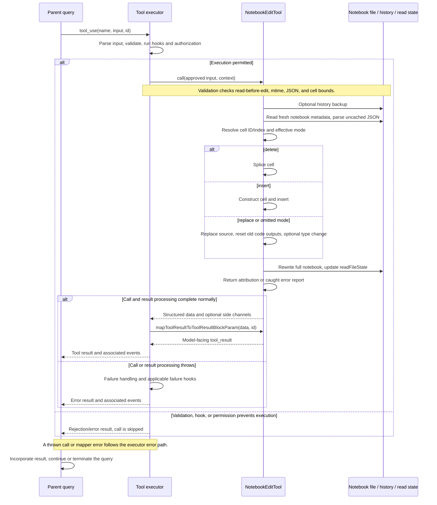

# NotebookEditTool Internals

Source: [tools/NotebookEditTool/NotebookEditTool.ts](../../../../../tools/NotebookEditTool/NotebookEditTool.ts). Line ranges refer to this recovered source snapshot; symbols are the stable navigation handles.

## Purpose and caller boundary

Mutates one cell in a Jupyter notebook and rewrites the full JSON file. Strict input requires notebook_path/new_source, with optional cell_id, cell_type, and edit_mode. Mode defaults effectively to replace. The deferred mutating tool keeps serial scheduling; it does not execute notebook code or restart a kernel.

The [shared invocation lifecycle](../../invocation-lifecycle.md) explains registry selection, schema validation, authorization, hooks, result mapping, and exception handling. The sequence below begins with a model tool request and ends at the parent conversation boundary; external services and background workers retain their own lifecycles.

## Source-order walkthrough

### 1. Contracts and metadata (1–131)

Output retains source, cell identity/type/language, mode, optional error, and full original/updated JSON for attribution. Classifier uses path/mode/source only under TRANSCRIPT_CLASSIFIER. Shared write authorization applies to notebook_path; relative paths are resolved in validation/call, not expanded by the Edit/Write observable-input helper.

### 2. Mapper and UI (133–178)

A truthy error produces is_error true. Otherwise map replace/insert/delete to source-bearing confirmation; unknown mode gives ordinary fallback text. UI adapters are separate from mutation.

### 3. Path/mode/type validation (180–217)

Resolve relative path against cwd; UNC returns early before filesystem checks. Require .ipynb (code 2), a known mode (4, largely redundant with schema), and a cell_type for insert (5).

### 4. Read-state and JSON validation (219–259)

Require read state (9) and mtime no newer than the recorded timestamp (10). It does not reject isPartialView explicitly or compare unchanged contents as a timestamp fallback. Read metadata; ENOENT maps to code 1 when reached. safeParseJSON failure gives code 6. JSON is cast to NotebookContent rather than structurally validated here.

### 5. Cell identity validation (261–292)

Noninsert requires cell_id (7). Try actual cell ID first, then parseCellId for cell-N index. Missing indexed cell is code 7; unrecognized/missing named ID is 8. Insert without ID is valid and means beginning.

### 6. History and fresh mutable parse (294–345)

Resolve path and await optional history capture BEFORE the main try. Read metadata again, but do not repeat the mtime/read-state comparison at execution. Use nonmemoized jsonParse because cells will be mutated in place; parse failure returns an error-shaped result with empty attribution strings.

### 7. Index/mode/ID resolution (347–386)

No ID selects index zero; otherwise locate actual ID then numeric fallback. Explicit insert adds one after the addressed cell. Explicit replace one-past-end converts to insert/default code, although ordinary validation normally rejects that nonexistent index. For notebook format >=4.5 generate a random ID on insert; otherwise reuse supplied identity. Language defaults to python.

### 8. Mutation branches (388–425)

Delete splices one cell. Insert builds markdown metadata/source or code source with null execution_count/empty outputs. Replacement updates source, clears execution fields if the OLD cell type was code, then optionally changes cell type. Converting markdown to code does not independently initialize those execution fields in this branch.

### 9. Rewrite, cache, result (427–457)

Serialize with one-space indentation and write using original encoding/line endings. Update read state to the full post-write JSON with undefined offset/limit, breaking Read dedup. Return supplied source/type fallback, effective mode, generated/reused ID, language, and before/after text. Reported cell_type defaults to code even if an unchanged target was markdown and input omitted type.

### 10. Catch boundary (459–491)

Errors inside read/parse/mutate/write/state-update region become structured error output; non-Error throws get generic text. The mapper sets is_error. History failures occur outside this catch. A failure after write can return empty attribution despite changed disk state.

## End-to-end sequence

The success arrows after `call` describe normal completion. An exception skips normal result mapping; see the failure boundaries below. Query continuation remains subject to cancellation and turn/budget limits.

## State, failure, and cancellation boundaries

Unlike FileEdit/Write, this call does not repeat staleness validation after approval/history awaits. A concurrent edit can therefore be overwritten from the newly read notebook without confirming the model saw it. No kernel execution occurs, and execution outputs are only cleared in the described branches. There is no tool-level rollback or explicit abort signal. Notebook shape/type errors can emerge during mutation because parsing alone is not structural validation.
