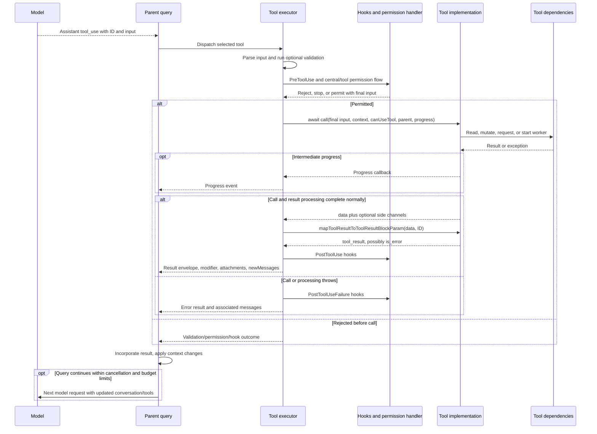

# Shared Tool Invocation Lifecycle

This document supplies the caller boundary shared by the individual tool internals. It describes model-driven invocation through the query tool executor. Direct callers of `Tool.call` can bypass parts of this path; individual documents identify such cases when relevant.

## Registry, exposure, and scheduling

[`tools.ts`](../../../tools.ts) builds the base pool with environment/build gates, then applies availability and policy filtering. Dynamic MCP and synthetic-output factories supply additional tool objects. A directory is not proof that a tool is available, and a registry reference is not proof its implementation was recovered.

[`Tool.ts`](../../../Tool.ts) supplies `buildTool` defaults: nonconcurrent, not read-only, not destructive, and a tool-specific allow decision. Definitions override those defaults. A tool-specific allow means the tool adds no objection at that stage; it does not erase central deny rules, hooks, mode restrictions, or required interactions. Deferred discovery controls schema exposure, independently of authorization.

Concurrency-safe/read-only metadata describes scheduling and policy classification. Some tools marked read-only still update notification flags, connection caches, language-server state, local result artifacts, or recipient queues. The individual state sections name these effects.

## Execution in source order

Primary source: [`services/tools/toolExecution.ts`](../../../services/tools/toolExecution.ts), particularly `checkPermissionsAndCallTool`.

| Region | Responsibility and boundary |
|---|---|
| 599–681 | Parse input with the tool's Zod schema; invalid input produces an error outcome before call. The outputSchema is not automatically parsed at the result-mapping boundary. |
| 683 onward | Await optional validateInput before the permission interaction. A failed validator prevents call; it does not become the tool's structured output. |
| 776–1030 | Prepare observable input for hooks, run PreToolUse hooks, and compose decisions/updated input/continuation state with the central permission flow. Observable compatibility fields and approved execution input have distinct purposes. |
| 1207–1222 | Await tool.call with approved input, ToolUseContext, inherited canUseTool, parent assistant message, and a progress callback. |
| 1272–1280 | Convert an optional structured_output side channel into an attachment. This is separate from data and model-facing text. |
| 1292 onward | Call mapToolResultToToolResultBlockParam once, then apply executor result processing/persistence where applicable. A mapper can itself set is_error on a normally returned report. |
| 1397–1564 | Preserve a returned contextModifier on the result envelope and run PostToolUse hooks. Non-MCP results are added before these hooks; MCP handling can incorporate hook-modified output. |
| 1566–1570 | Append tool-supplied newMessages, such as skill prompts or PDF/image payloads. |
| 1589 onward | Catch execution/processing failures, run PostToolUseFailure hooks, and construct error results. An error result does not prove preceding side effects were rolled back. |

A callback publishes progress while `call` is pending. An async generator used *inside* a tool may yield progress and return a final value; its caller must explicitly capture that return value, as the shell tools do. The Tool API itself returns a promise for a result object, not an iterator of model messages.

## End-to-end boundary

Tool-specific diagrams expand the middle of this path. Normal return arrows are conditional: exceptional branches skip normal result mapping. A returned success-false report can remain a non-error tool result, while an exception uses executor error handling. The parent query decides whether to continue; tool completion does not guarantee another model request.

## Ownership, cancellation, and persistence

ToolUseContext supplies state getters/setters, abortController, read-file state, tool-use identity, available tools, and per-agent overrides. Async agents can require the shared task setter `setAppStateForTasks` because their ordinary setter may be restricted. An inherited canUseTool authorizes child tool requests; it is not a blanket approval of everything a child might do.

Only dependencies that receive or observe the signal participate in cancellation. Several tools do not pass it to storage/RPC helpers; MCP auth deliberately creates an independent controller; background shell transfer changes ownership. A cancelled transport can leave remote side effects with an unknown outcome. Per-tool sections state the actual propagation and cleanup boundaries.

A returned output path, saved transcript entry, queued message, or completed file write is not by itself a stable-storage/fsync acknowledgement. Background workers, task notifications, session sinks, and remote consumers have lifecycles beyond the initial tool call. See [query-loop internals](../query-loop-internals.md), [tool system](../tool-system.md), and [permissions](../permissions.md) for the surrounding machinery.
