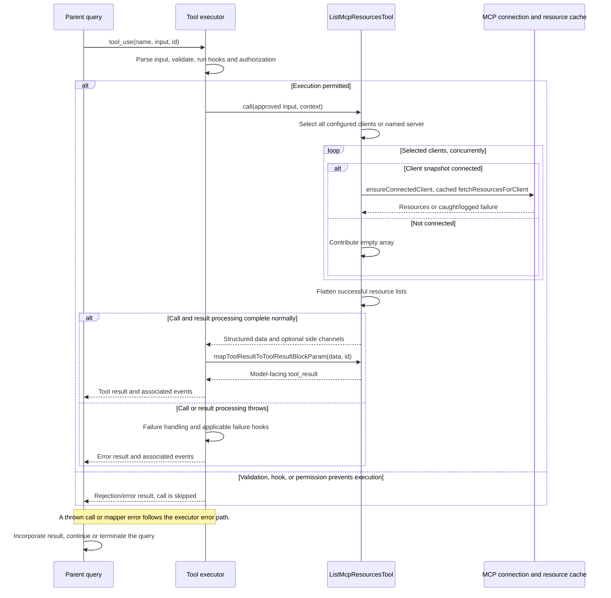

# ListMcpResourcesTool Internals

Source: [tools/ListMcpResourcesTool/ListMcpResourcesTool.ts](../../../../../tools/ListMcpResourcesTool/ListMcpResourcesTool.ts). Line ranges refer to this recovered source snapshot; symbols are the stable navigation handles.

## Purpose and caller boundary

Lists resources advertised by configured MCP connections, optionally restricted by server name. The ordinary object input accepts optional server; it is not strict. Output is a flat array of URI/name/MIME/description/server records. Deferred, read-only, and concurrency-safe, it tolerates individual server failures.

The [shared invocation lifecycle](../../invocation-lifecycle.md) explains registry selection, schema validation, authorization, hooks, result mapping, and exception handling. The sequence below begins with a model tool request and ends at the parent conversation boundary; external services and background workers retain their own lifecycles.

## Source-order walkthrough

### 1. Schemas and metadata (1–65)

Imports connection recovery, cached resource discovery, error logging, serialization, and UI. The classifier is server-or-empty. maxResultSizeChars is 100,000. Resource metadata does not include contents.

### 2. Select server set (66–78)

A truthy target name filters context.options.mcpClients exactly; otherwise all clients are selected. A named target with no match throws and lists available names. An empty string behaves as no filter.

### 3. Parallel discovery and isolation (80–100)

Promise.all maps selected clients. Non-connected states return empty immediately. Connected entries call ensureConnectedClient, then fetchResourcesForClient. Each reconnect/list exception is logged and converted to [], so one failure does not reject the whole request. Resource discovery uses a cache keyed by server, invalidated by close/list-changed machinery; freshness depends on that machinery and server notifications.

### 4. Result and rendering (102–124)

Flatten arrays, expose UI and a JSON-based terminal truncation check. Empty results map to a normal no-resources message that explicitly allows the server still to have tools; nonempty arrays map to JSON.

## End-to-end sequence

The success arrows after `call` describe normal completion. An exception skips normal result mapping; see the failure boundaries below. Query continuation remains subject to cancellation and turn/budget limits.

## State, failure, and cancellation boundaries

An empty result does not prove a server has no resources: disconnected clients and caught errors also produce empty arrays. No abort signal is explicitly forwarded by this tool. Recovery can mutate connection/cache state despite read-only metadata. A connection that was non-connected in the supplied snapshot is skipped rather than recovered here.
