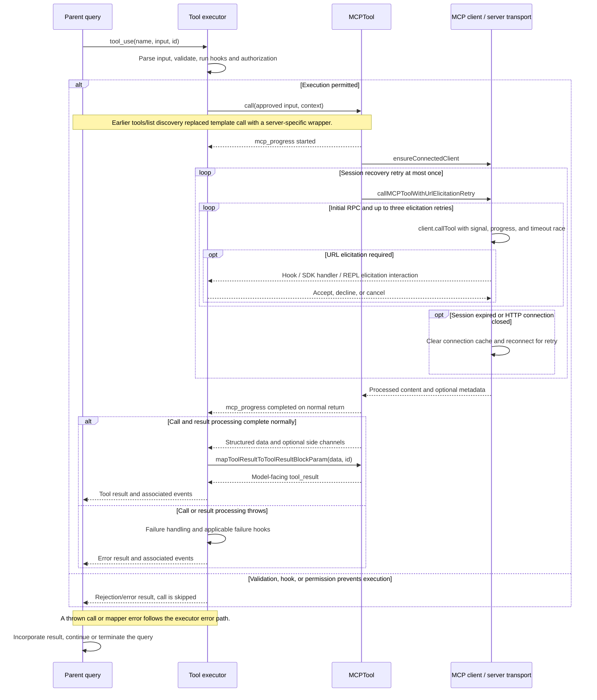

# MCPTool Internals

Source: [tools/MCPTool/MCPTool.ts](../../../../../tools/MCPTool/MCPTool.ts). Line ranges refer to this recovered source snapshot; symbols are the stable navigation handles.

## Purpose and caller boundary

Defines the template spread into discovered MCP tool wrappers. The template alone accepts any object, returns an empty string, and never calls a server. Real end-to-end behavior is installed by fetchToolsForClient in services/mcp/client.ts; documenting only the 78-line template would miss execution, retries, progress, and cancellation.

The [shared invocation lifecycle](../../invocation-lifecycle.md) explains registry selection, schema validation, authorization, hooks, result mapping, and exception handling. The sequence below begins with a model tool request and ends at the parent conversation boundary; external services and background workers retain their own lifecycles.

## Source-order walkthrough

### 1. Base schemas (1–25)

Input is an empty object with passthrough because server tools own their JSON schemas. Base output is string and MCPProgress is re-exported. Dynamic wrappers can return processed content blocks and metadata beyond this nominal base type.

### 2. Base metadata and stub call (27–55)

isMcp is true, initial name/user-facing identity is mcp, and the base open-world flag is false. Description/prompt are placeholders. call returns data empty string; discovery must override it for any RPC to occur.

### 3. Permission and presentation template (56–78)

checkPermissions returns passthrough, preserving the central MCP policy decision. Imported use/progress/result UI and a terminal truncation predicate are reused. The mapper preserves supplied content with the original tool-use ID.

### 4. Discovery and wrapper construction (services/mcp/client.ts:1743–1832)

Connected clients with tools capability request tools/list; unsupported states return []. Sanitize server metadata, optionally drop the invocation prefix for opted-in SDK servers, and retain mcpInfo for permission identity. Spread MCPTool, install server name/description/schema, whitespace-normalized search hint and alwaysLoad metadata. readOnlyHint drives both concurrency and read-only flags; other annotations drive destructive/open-world hints. Permission suggestions still use the fully qualified server tool name.

### 5. Dynamic invocation (client.ts:1833–1922)

Extract a tool-use ID from the parent’s first content block, attach claudecode/toolUseId metadata, and emit started progress when possible. Ensure connection and call the URL-elicitation retry helper with context abort signal, progress, state setter, and elicitation handler. On normal return emit completed and return processed content plus optional _meta/structuredContent side-channel metadata.

### 6. Session retry and discovery failures (client.ts:1923–1996)

Retry once for McpSessionExpiredError after lower-level cache clearing. Other failures emit failed progress; plain Error and numeric McpError receive telemetry-safe wrappers, while other types rethrow. Display names prefer annotation titles; special browser/computer-use render overrides are conditional. Inclusion filtering applies after construction. Discovery exceptions are logged and produce [], unlike invocation errors.

### 7. URL elicitation retry boundary (client.ts:2813–3027)

The wrapper retries up to three times after MCP UrlElicitationRequired errors with valid URL-mode elicitation records. Elicitation hooks run first; otherwise a supplied SDK handler or REPL queue gathers the result. Accepted elicitation allows retry, while declined/cancelled flows can return explanatory ordinary content. Nonmatching errors, missing valid elicitation data, or exhausted attempts rethrow. This is a separate retry layer from session recovery.

### 8. RPC timeout, error conversion, cleanup (client.ts:3029–3250)

callMCPTool starts periodic debug logging and races client.callTool against an independent timeout. It also supplies the signal and SDK timeout/progress callback. The race timer is cleared in finally; RPC isError becomes McpToolCallError with available error details/meta. Normal results pass through processMCPResult. HTTP 401/Unauthorized becomes McpAuthError. Session-expired/HTTP connection-closed conditions clear the server cache and throw the special retry signal. An Error named AbortError is swallowed into `{content: undefined}`. Logging interval cleanup runs in finally.

## End-to-end sequence

The success arrows after `call` describe normal completion. An exception skips normal result mapping; see the failure boundaries below. Query continuation remains subject to cancellation and turn/budget limits.

## State, failure, and cancellation boundaries

Server annotations are scheduling/policy inputs, not verification of server behavior. The independent timeout rejects the wait without proving server work stopped. A transport abort can return undefined content from the lower helper and then produce completed progress at the wrapper: that progress label is not proof of remote success. Retry after session loss can repeat an operation whose remote outcome was uncertain; this layer does not impose idempotency. Template-only execution never reaches these RPC paths.

## Related design

[MCP subsystem](../../../mcp.md) covers transport setup and connection ownership.
