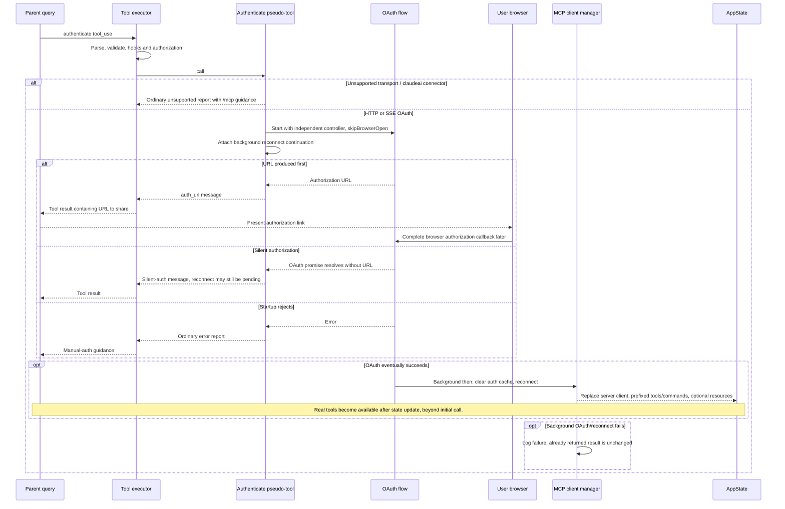

# McpAuthTool Internals

Source: [tools/McpAuthTool/McpAuthTool.ts](../../../../../tools/McpAuthTool/McpAuthTool.ts). Line ranges refer to this recovered source snapshot; symbols are the stable navigation handles.

## Purpose and caller boundary

createMcpAuthTool builds a server-specific authenticate pseudo-tool for a needs-auth MCP server. It starts OAuth without opening a browser, returns an authorization URL or a silent-auth message, and replaces the pseudo-tool after background reconnect. Output status is auth_url/unsupported/error; those statuses are ordinary results.

The [shared invocation lifecycle](../../invocation-lifecycle.md) explains registry selection, schema validation, authorization, hooks, result mapping, and exception handling. The sequence below begins with a model tool request and ends at the parent conversation boundary; external services and background workers retain their own lifecycles.

## Source-order walkthrough

### 1. Factory inputs and identity (1–62)

The factory closes over serverName and ScopedMcpServerConfig. getConfigUrl returns a URL when present; transport defaults to stdio for description text. Name/mcpInfo use the server’s authenticate identity. The empty input object is non-strict. It is enabled, mutating, and serial.

### 2. Tool contract and unsupported cases (64–111)

Description explains browser authorization; tool-specific permission check returns allow. claudeai-proxy returns unsupported with /mcp guidance because it uses a separate connector flow. Non-http/sse transports also return unsupported rather than calling OAuth.

### 3. Start OAuth and capture URL (113–138)

Construct an authUrlPromise whose resolver is passed to performMCPOAuthFlow. Create a NEW AbortController and call OAuth with skipBrowserOpen true. This signal is independent of the tool context’s cancellation. Capture the app-state setter for later continuation.

### 4. Background reconnect (140–182)

Attach a detached then/catch to OAuth. After success, clear auth cache and await reconnectMcpServerImpl. Replace matching client, remove tools/commands with the server prefix, append newly discovered ones, and replace resources only when returned. This prefix removes the authenticate pseudo-tool. Errors are logged; they do not retroactively change an already returned result.

### 5. URL-versus-completion race (184–206)

Race authUrlPromise against OAuth completion mapped to null. URL wins: return auth_url with browser instructions immediately. Silent completion wins: return auth_url without URL and a completion message, even though the separately attached reconnect may still be pending. A startup race rejection is caught and becomes status error with manual-auth guidance.

### 6. Mapper and factory return (208–216)

Only data.message becomes the model tool_result. There is no success is_error flag for status error, and the factory returns the customized Tool object directly rather than buildTool.

## End-to-end sequence

The success arrows after `call` describe normal completion. An exception skips normal result mapping; see the failure boundaries below. Query continuation remains subject to cancellation and turn/budget limits.

## State, failure, and cancellation boundaries

Tool cancellation does not abort the separately created controller here, and no cleanup in this factory calls controller.abort. Returning a URL means authorization is pending. Silent OAuth completion can precede reconnect/tool replacement. A failed background reconnect is only logged. Prefix replacement preserves other servers but depends on the supplied state setter remaining valid after the initial call.
