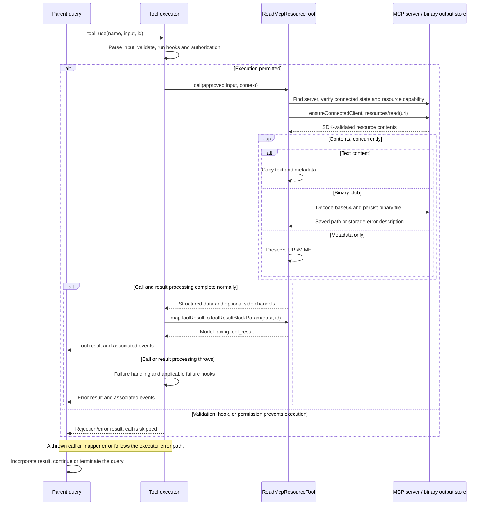

# ReadMcpResourceTool Internals

Source: [tools/ReadMcpResourceTool/ReadMcpResourceTool.ts](../../../../../tools/ReadMcpResourceTool/ReadMcpResourceTool.ts). Line ranges refer to this recovered source snapshot; symbols are the stable navigation handles.

## Purpose and caller boundary

Reads one named server resource using resources/read. Input requires server and uri in a non-strict object. Output contents retain textual data or saved binary paths. The tool is deferred, concurrency-safe, and marked read-only, although binary response handling writes local files.

The [shared invocation lifecycle](../../invocation-lifecycle.md) explains registry selection, schema validation, authorization, hooks, result mapping, and exception handling. The sequence below begins with a model tool request and ends at the parent conversation boundary; external services and background workers retain their own lifecycles.

## Source-order walkthrough

### 1. Imports and contracts (1–47)

The MCP SDK ReadResourceResultSchema validates the protocol response. Public contents hold uri, optional MIME/text/blobSavedTo; raw base64 is absent from this output schema. Storage helpers persist binary content and construct model guidance.

### 2. Registration (49–73)

Server plus URI becomes classifier input. The tool supplies description/prompt, schemas, a 100,000-character result limit, and UI adapters. It does not validate the URI against an earlier resource-list response.

### 3. Connection and capability guards (75–93)

Find server in the context snapshot. Missing, non-connected, or absent resources capability each throws a distinct error before requesting data. Only after those guards does ensureConnectedClient recover/reuse the connection.

### 4. Resource request (95–102)

Send resources/read with uri and the SDK response schema. This request does not explicitly pass the tool abort signal or an invocation-specific timeout.

### 5. Concurrent content conversion (104–141)

Map all response contents with Promise.all. Text wins when present. A record lacking a string blob becomes URI/MIME metadata only. For a blob, base64-decode, generate a time/index/random persistence ID, and await persistBinaryContent. A returned storage error becomes explanatory text; success emits blobSavedTo plus a saved-content message with source identity and byte count.

### 6. Return, truncation, mapper (143–159)

Return converted contents, detect terminal line truncation from JSON, and JSON-serialize the full output into tool_result. Binary bytes are represented by paths instead of being dumped into model context.

## End-to-end sequence

The success arrows after `call` describe normal completion. An exception skips normal result mapping; see the failure boundaries below. Query continuation remains subject to cancellation and turn/budget limits.

## State, failure, and cancellation boundaries

Protocol/connection exceptions throw, while storage helpers returning {error} become ordinary content text. Other unexpected exceptions in Promise.all reject the invocation after sibling binary writes may already have succeeded. No rollback removes those files. Read-only describes remote resource access rather than the absence of local output artifacts.
