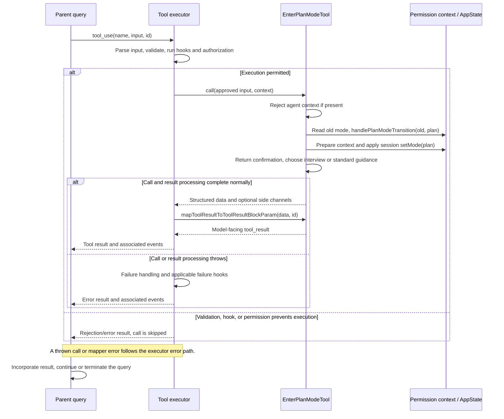

# EnterPlanModeTool Internals

Source: [tools/EnterPlanModeTool/EnterPlanModeTool.ts](../../../../../tools/EnterPlanModeTool/EnterPlanModeTool.ts). Line ranges refer to this recovered source snapshot; symbols are the stable navigation handles.

## Purpose and caller boundary

Enters plan permission mode for the root context. Input is a strict empty object and output a confirmation message. The tool is deferred, marked read-only and concurrency-safe, even though it changes session permission state. The actual permission decision is owned by the shared executor; this definition does not implement an ask-returning checkPermissions method.

The [shared invocation lifecycle](../../invocation-lifecycle.md) explains registry selection, schema validation, authorization, hooks, result mapping, and exception handling. The sequence below begins with a model tool request and ends at the parent conversation boundary; external services and background workers retain their own lifecycles.

## Source-order walkthrough

### 1. Dependencies and schemas (1–34)

Imports connect bootstrap transition bookkeeping, permission updates, plan-mode preparation, and interview-phase prompt selection. No caller-supplied mode or destination is accepted.

### 2. Registration (36–77)

The tool uses the plan-mode prompt and UI adapters. KAIROS/KAIROS_CHANNELS plus nonempty allowed channels disables entry, matching exit’s interaction gate. The empty user-facing name suppresses a separate label.

### 3. Root guard and transition (78–86)

`call` rejects any context.agentId. For a root call, read the current mode and invoke `handlePlanModeTransition(oldMode, plan)` before updating app state. This is transition bookkeeping, not a plan-file write.

### 4. Permission-state mutation (88–98)

A functional setter passes current permission context through `prepareContextForPlanMode`, then `applyPermissionUpdate` with setMode plan and session destination. Preparation owns classifier activation side effects and retained pre-plan context; direct assignment would bypass that lifecycle.

### 5. Result and instructions (100–126)

Return a fixed entered-plan confirmation. The mapper selects interview-phase guidance permitting the plan file or a longer exploration/design workflow ending with ExitPlanMode. These are model instructions; filesystem enforcement remains in permission machinery.

## End-to-end sequence

The success arrows after `call` describe normal completion. An exception skips normal result mapping; see the failure boundaries below. Query continuation remains subject to cancellation and turn/budget limits.

## State, failure, and cancellation boundaries

No external process or file operation is awaited here. State transition bookkeeping precedes the state setter, with no compensating rollback if a later operation throws. Read-only is tool metadata and does not mean permission state is immutable. Returning instructions does not itself create a plan, gather approval to implement it, or run the proposed work.
