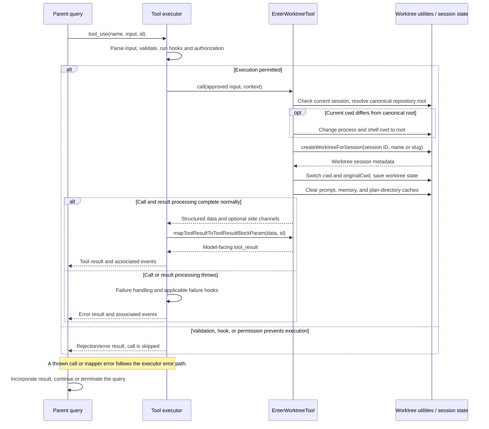

# EnterWorktreeTool Internals

Source: [tools/EnterWorktreeTool/EnterWorktreeTool.ts](../../../../../tools/EnterWorktreeTool/EnterWorktreeTool.ts). Line ranges refer to this recovered source snapshot; symbols are the stable navigation handles.

## Purpose and caller boundary

Creates a session worktree through `utils/worktree.ts` and switches process/session working directories into it. Strict input has an optional validated name. Output contains worktreePath, optional worktreeBranch, and confirmation. The deferred mutating tool retains default serial scheduling; registry exposure additionally depends on worktree-mode enablement.

The [shared invocation lifecycle](../../invocation-lifecycle.md) explains registry selection, schema validation, authorization, hooks, result mapping, and exception handling. The sequence below begins with a model tool request and ends at the parent conversation boundary; external services and background workers retain their own lifecycles.

## Source-order walkthrough

### 1. Imports and slug validation (1–40)

The schema wraps `validateWorktreeSlug` in superRefine, converting thrown slug errors to schema issues. The validator constrains slash-separated segments and total length. Omitting name defers selection to the plan slug helper; the schema does not create a directory.

### 2. Output and registration (42–77)

Branch is optional for hook-backed worktrees. Registration installs the creation prompt/UI and name-or-empty classifier. The source delegates git/hook mechanics to `createWorktreeForSession`.

### 3. Session guard and canonical root (78–91)

Throw if a current worktree session already exists. Resolve the canonical main git root from current cwd; when different, immediately process.chdir and setCwd to it. This happens before worktree creation and is not wrapped in restoration on failure.

### 4. Create and switch (93–101)

Choose input name or getPlanSlug; await createWorktreeForSession(session ID, slug). On success switch process cwd, shell cwd, and originalCwd to the new path, then save worktree state. The helper owns currentWorktreeSession and underlying git or hook operations.

### 5. Invalidate dependent context (102–112)

Clear cached system-prompt sections, memory-file caches, and plans-directory memoization so subsequent context uses the new cwd. Emit mid-session creation telemetry. This tool does not call setProjectRoot or refresh hook configuration here.

### 6. Result and mapper (114–127)

Format an optional branch suffix, return path/branch/message, and map only the message into the model result. The message directs future exit through ExitWorktree or session shutdown.

## End-to-end sequence

The success arrows after `call` describe normal completion. An exception skips normal result mapping; see the failure boundaries below. Query continuation remains subject to cancellation and turn/budget limits.

## State, failure, and cancellation boundaries

Creation and session switching are multi-step mutations without a tool-level transaction. Failure after changing to the canonical root can leave cwd changed; failure after creating the worktree can leave resources requiring later cleanup. The call has no abort-signal parameter for creation. `saveWorktreeState` is a persistence request, not an explicit fsync acknowledgement from this function.
