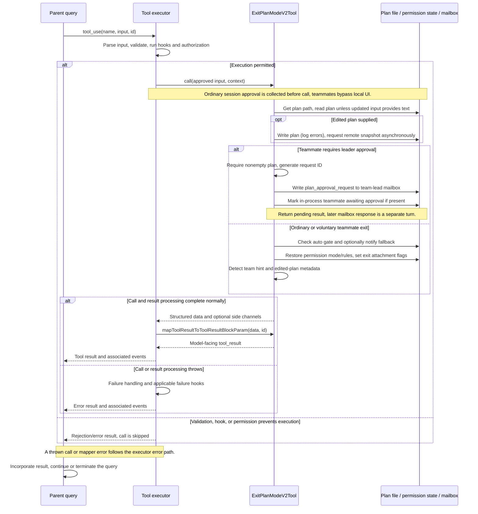

# ExitPlanModeV2Tool Internals

Source: [tools/ExitPlanModeTool/ExitPlanModeV2Tool.ts](../../../../../tools/ExitPlanModeTool/ExitPlanModeV2Tool.ts). Line ranges refer to this recovered source snapshot; symbols are the stable navigation handles.

## Purpose and caller boundary

Presents a disk-backed plan for approval or sends a teammate’s plan to its leader. Input accepts optional Bash semantic allowedPrompts and preserves additional fields through passthrough; SDK normalization exposes optional plan and planFilePath. Normal return either leaves the teammate awaiting approval or restores the local pre-plan permission mode. It does not execute the implementation plan.

The [shared invocation lifecycle](../../invocation-lifecycle.md) explains registry selection, schema validation, authorization, hooks, result mapping, and exception handling. The sequence below begins with a model tool request and ends at the parent conversation boundary; external services and background workers retain their own lifecycles.

## Source-order walkthrough

### 1. Imports and conditional classifier modules (1–60)

Bootstrap flags, plan storage, mailbox routing, teammate state, and mode helpers support separate local/leader workflows. TRANSCRIPT_CLASSIFIER gates require of auto-mode modules, which remain null when unavailable.

### 2. Contracts (62–147)

allowedPrompts restricts tool to Bash but accepts arbitrary prompt strings. Despite beginning as strictObject, passthrough preserves extra fields. SDK schema adds injected plan/file path. Output distinguishes isAgent, awaitingLeaderApproval/requestId, optional team hint, and whether a plan was edited. Plan itself is nullable.

### 3. Registration and interaction gates (149–199)

Deferred, concurrency-safe, and explicitly not read-only because edited plans can be written. Channel sessions disable the tool. All teammates report no local user interaction; ordinary contexts require confirmation. This metadata is separate from context.agentId.

### 4. Validation and tool permission decision (200–247)

Teammates pass validation regardless of AppState mode because the shared state can reflect the leader. Other callers must currently be in plan mode or receive code 1 before a dialog. Teammates get tool-specific allow; others get ask. Global policy and hooks still wrap these decisions.

### 5. Select and synchronize plan (251–274)

Determine isAgent from context.agentId and compute plan path from that ID. Prefer an input.plan string, including empty string, over getPlan. If edited input exists, await writeFile with errors caught/logged, then start persistFileSnapshotIfRemote without awaiting it. Thus the selected returned plan may differ from disk after a failed sync.

### 6. Required teammate approval (276–335)

A teammate requiring approval must have a truthy plan or throws. Create a plan_approval request ID with agent/team identity; send plan path/content and timestamp to team-lead mailbox. After successful delivery find its in-process task and mark awaiting approval if found. Return immediately with awaitingLeaderApproval; do not restore local mode in this branch.

### 7. Auto-mode fallback notification (337–379)

For local/voluntary exit, inspect prior mode and auto-mode gate. If restoring auto is disallowed, compute an unavailable reason, log it, and optionally notify the UI. The state setter independently checks the gate again, preventing direct restoration from bypassing it.

### 8. Restore permission lifecycle (381–433)

The setter no-ops if mode already changed from plan. Otherwise mark plan exited and request a plan-exit attachment. Restore prePlanMode or default; if auto gate is off use default. Set authoritative auto-mode activity and request auto-exit attachment when leaving active auto behavior. Strip dangerous permissions when returning to auto, or restore previously stripped rules when returning elsewhere. Clear prePlanMode in the new context.

### 9. Return context metadata (435–453)

A team hint requires swarms enabled and an Agent tool match in available tools. Return plan, agent flag, path, optional hint, and planWasEdited when input.plan was supplied. Background plan verification is registered elsewhere after context clear, not here.

### 10. Model mapper branches (455–493)

Awaiting-leader output tells the teammate to wait and includes request ID. Other agent contexts receive a short approved/acknowledge message. An empty root plan gives a simple exit confirmation. Nonempty root plans always include full approved text because the Ultraplan consumer parses it; edited plans get a distinct label, and available team capability adds a suggestion.

## End-to-end sequence

The success arrows after `call` describe normal completion. An exception skips normal result mapping; see the failure boundaries below. Query continuation remains subject to cancellation and turn/budget limits.

## State, failure, and cancellation boundaries

Mailbox delivery precedes the awaiting-state update; a later failure does not retract the request. Edited-plan write errors are logged and suppressed, while missing required teammate plans or mailbox failures throw. Remote snapshot completion is not awaited. An awaiting result is submission, not leader approval. Permission handlers may already have changed the mode before call; the setter deliberately tolerates that. The module does not itself apply allowedPrompts to policy or run coding/verification.
