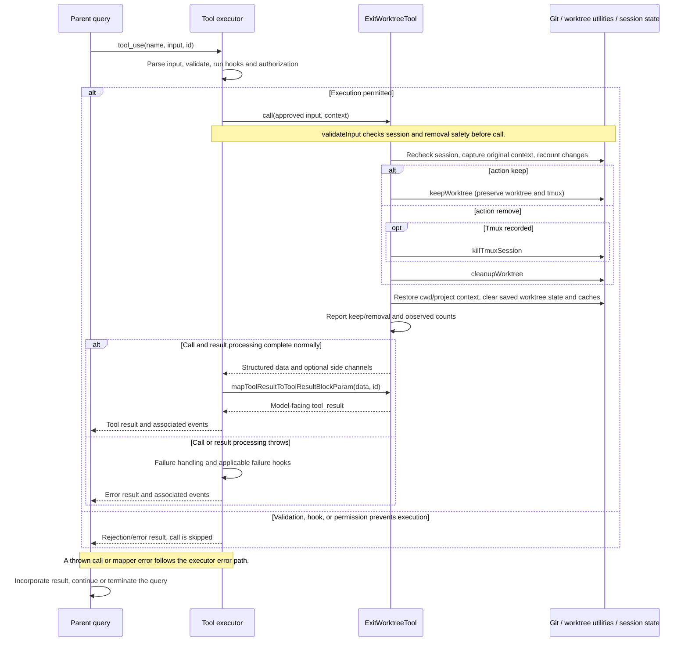

# ExitWorktreeTool Internals

Source: [tools/ExitWorktreeTool/ExitWorktreeTool.ts](../../../../../tools/ExitWorktreeTool/ExitWorktreeTool.ts). Line ranges refer to this recovered source snapshot; symbols are the stable navigation handles.

## Purpose and caller boundary

Leaves the current session-managed worktree, keeping it or removing it. Strict input requires action keep/remove and optionally discard_changes. Removal is marked destructive. The tool restores session directory state after the utility completes and returns paths plus a human-readable report.

The [shared invocation lifecycle](../../invocation-lifecycle.md) explains registry selection, schema validation, authorization, hooks, result mapping, and exception handling. The sequence below begins with a model tool request and ends at the parent conversation boundary; external services and background workers retain their own lifecycles.

## Source-order walkthrough

### 1. Contracts (1–66)

Output includes action, original cwd, worktree path/branch, optional tmux session, optional discarded counts, and message. Only the currently recorded worktree session is in scope; the tool does not accept an arbitrary deletion path.

### 2. Change-count helper (68–112)

Run git status --porcelain and count nonblank output lines. A nonzero exit returns null. Missing originalHeadCommit also returns null even when status works because commit safety cannot be established. Otherwise run rev-list --count baseline..HEAD; nonzero returns null, parsed output falls back to zero. These are uncommitted-entry and post-baseline commit counts, not a remote merge proof.

### 3. Session restoration helper (114–146)

Worktree utilities own process.chdir and clearing currentWorktreeSession. This helper restores shell cwd/originalCwd, conditionally restores projectRoot and hook config snapshot when the captured equality indicates worktree project identity, clears persisted worktree state, and invalidates prompt/memory/plans caches.

### 4. Registration and scope validation (148–198)

Registration is deferred and marks only remove destructive. Validation rejects absent currentWorktreeSession with code 1. It does not enumerate arbitrary git worktrees. The message describes the session-only scope; the actual guard is the utility’s current session record.

### 5. Removal preflight (200–233)

For remove without truthy discard_changes, count changes. Unknown state returns code 3. Nonzero files or commits returns code 2 with counts and guidance to obtain user confirmation before discarding. keep and explicit discard bypass this count-based refusal. These checks precede permission handling/execution.

### 6. Capture execution state and recount (235–271)

Recheck the session and throw if it vanished. Capture paths, branch, tmux, and baseline before utilities clear the session. Determine project-root restoration by comparing getProjectRoot with getOriginalCwd. Recount only for analytics/result reporting; null becomes zero/zero. The execution-time recount does NOT repeat the removal safety refusal.

### 7. Keep branch (273–298)

Await keepWorktree, restore session context, log kept telemetry, and return retained path/branch plus tmux reattach guidance if applicable. Tmux remains running in this branch.

### 8. Remove branch and result (300–329)

If tmux exists, await killTmuxSession before cleanupWorktree. Then restore session context, log counts, format discarded-work text, and return removal metadata. The mapper serializes only the message. Failures before restoration bypass that helper; there is no finally enforcing it.

## End-to-end sequence

The success arrows after `call` describe normal completion. An exception skips normal result mapping; see the failure boundaries below. Query continuation remains subject to cancellation and turn/budget limits.

## State, failure, and cancellation boundaries

Preflight and removal are not atomic. A worktree can change after validation; the call’s recount only affects reporting. Unknown execution counts become zero and must not be treated as proof that no work was discarded. Tmux termination can succeed before cleanup fails. Restoration is sequential rather than finally-protected. Underlying worktree utilities own git/hook error semantics and process cwd; this tool does not pass a cancellation signal to them.
