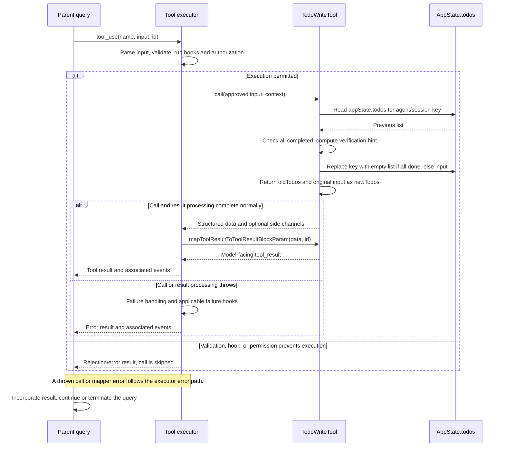

# TodoWriteTool Internals

Source: [tools/TodoWriteTool/TodoWriteTool.ts](../../../../../tools/TodoWriteTool/TodoWriteTool.ts). Line ranges refer to this recovered source snapshot; symbols are the stable navigation handles.

## Purpose and caller boundary

Replaces the current agent/session’s legacy todo array in application state. Strict input is a todos array; each item has nonempty content and activeForm plus pending/in_progress/completed status. The tool is enabled when TodoV2 is disabled, and deferred. It does not declare concurrency safety, so the buildTool default remains serial scheduling.

The [shared invocation lifecycle](../../invocation-lifecycle.md) explains registry selection, schema validation, authorization, hooks, result mapping, and exception handling. The sequence below begins with a model tool request and ends at the parent conversation boundary; external services and background workers retain their own lifecycles.

## Source-order walkthrough

### 1. Schemas and dependencies (1–29)

`TodoListSchema` from `utils/todo/types.ts` validates items but does not restrict array size or enforce exactly one in-progress item. Output contains oldTodos, newTodos, and an optional verification nudge. It imports session identity and feature/gate helpers rather than the persistent task-file store.

### 2. Registration and permissions (31–64)

The tool is strict, has an empty user-facing name, classifies by item count, and returns a tool-specific allow decision with unchanged input. The central permission/hook boundary still applies. No read-only or concurrency-safe override is declared. The call renderer is null.

### 3. Scope and completion normalization (65–70)

Read app state and choose `context.agentId ?? getSessionId()` as todoKey. Capture that key’s old list or empty. `every(completed)` determines allDone, including true for an empty input. The state replacement is empty when allDone; otherwise it is the input list.

### 4. Verification guidance gate (76–86)

With VERIFICATION_AGENT and its runtime gate enabled, a root-context all-completed input with at least three items and no /verif/i content sets verificationNudgeNeeded. It examines the original input, not the cleared state array.

### 5. State merge and structured return (88–102)

Use a functional app-state setter to preserve other todo keys and replace this key. The return preserves oldTodos and assigns `newTodos: todos`, the ORIGINAL input. Therefore a fully completed nonempty request returns completed items while storing an empty list. The setter is the supplied context setter; this tool itself performs no durable file write.

### 6. Model result (104–115)

The mapper emits a fixed success/reminder message, with optional verification-agent instructions. It does not echo either list, instantiate an agent, or guarantee the model follows that guidance.

## End-to-end sequence

The success arrows after `call` describe normal completion. An exception skips normal result mapping; see the failure boundaries below. Query continuation remains subject to cancellation and turn/budget limits.

## State, failure, and cancellation boundaries

The todo array is application state scoped by agent ID or session ID, separate from persistent TodoV2 files and runtime background tasks. This function supplies no disk durability acknowledgement. The functional setter preserves other keys, while the oldTodos return is a prior snapshot. There is no explicit abort operation or asynchronous external call in this function; executor cancellation governs whether it is reached. A verification nudge is model-facing text, not an executed verification workflow.
