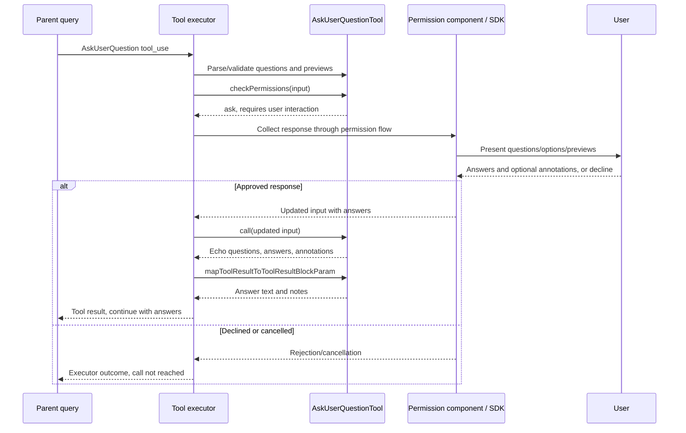

# AskUserQuestionTool Internals

Source: [tools/AskUserQuestionTool/AskUserQuestionTool.tsx](../../../../../tools/AskUserQuestionTool/AskUserQuestionTool.tsx). Line ranges refer to this recovered source snapshot; symbols are the stable navigation handles.

## Purpose and caller boundary

Collects answers through the permission interaction, then returns the approved input’s answers. `call` itself neither displays a dialog nor waits for input. Strict top-level input contains 1–4 questions, each with 2–4 options, optional answers/annotations/metadata. The read-only, concurrency-safe, deferred tool explicitly requires user interaction.

The [shared invocation lifecycle](../../invocation-lifecycle.md) explains registry selection, schema validation, authorization, hooks, result mapping, and exception handling. The sequence below begins with a model tool request and ends at the parent conversation boundary; external services and background workers retain their own lifecycles.

## Source-order walkthrough

### 1. Question and annotation schemas (1–32)

Each option has label, description, and optional preview. A question has text, header, options, and default-false multiSelect. Header length and suggested label word count are descriptions rather than length refinements. Annotations keyed by question text can hold preview and notes. Nested objects are ordinary Zod objects rather than top-level strict objects.

### 2. Uniqueness, shared fields, SDK contract (33–85)

A refinement rejects duplicate question text or duplicate option labels within a question. Optional answers map question text to strings; there is no refinement proving answers correspond to the options or that every question was answered. Multi-select answers are represented as comma-separated strings. SDK input/output aliases use the same schemas.

### 3. Result component (86–112)

The compiled React component renders a heading and one question-to-answer row per entry. Memo slots only cache JSX. It displays answers without mutating the questions or application state.

### 4. Registration and environment (113–168)

Prompt construction appends preview-format guidance only when a format is configured. Channel-enabled KAIROS/KAIROS_CHANNELS sessions disable the tool because the local interaction is unavailable. Classification joins question texts. `requiresUserInteraction` is true; concurrency-safe does not mean an unattended caller can auto-answer.

### 5. Preview validation and permission interaction (169–202)

Only HTML preview mode calls `validateHtmlPreview` for each option. A failure returns code 1 naming the option/question. The tool-specific permission decision is ask with unchanged input. The permission component/SDK supplies answer-bearing updated input before execution.

### 6. UI and call (203–232)

Use/progress/error renderers are empty; rejection states that the user declined. `call` echoes questions, defaults missing answers to {}, and conditionally includes annotations. It performs no answer acquisition, storage write, or cancellation wait.

### 7. Model mapper (233–250)

Iterate answers, append selected preview and notes when truthy, and build a continuation message associated with the original tool-use ID. Metadata is not echoed. An empty answer map still produces a normal result.

### 8. HTML fragment check (252–265)

The helper allows absent preview, rejects full-document html/body/doctype tags and script/style tags, and requires at least one HTML-looking tag. It is a regex intent check, not a sanitizer or parser; inline event attributes are not rejected here.

## End-to-end sequence

The success arrows after `call` describe normal completion. An exception skips normal result mapping; see the failure boundaries below. Query continuation remains subject to cancellation and turn/budget limits.

## State, failure, and cancellation boundaries

The interaction occurs before `call`, and approval supplies the input that `call` echoes. Rejection/cancellation is owned by the permission handler/executor, not this function. Tool-level answer echo cannot attest how an SDK produced its answers. HTML preview validation does not replace consumer-side sanitization. There is no durable answer store in this module.
