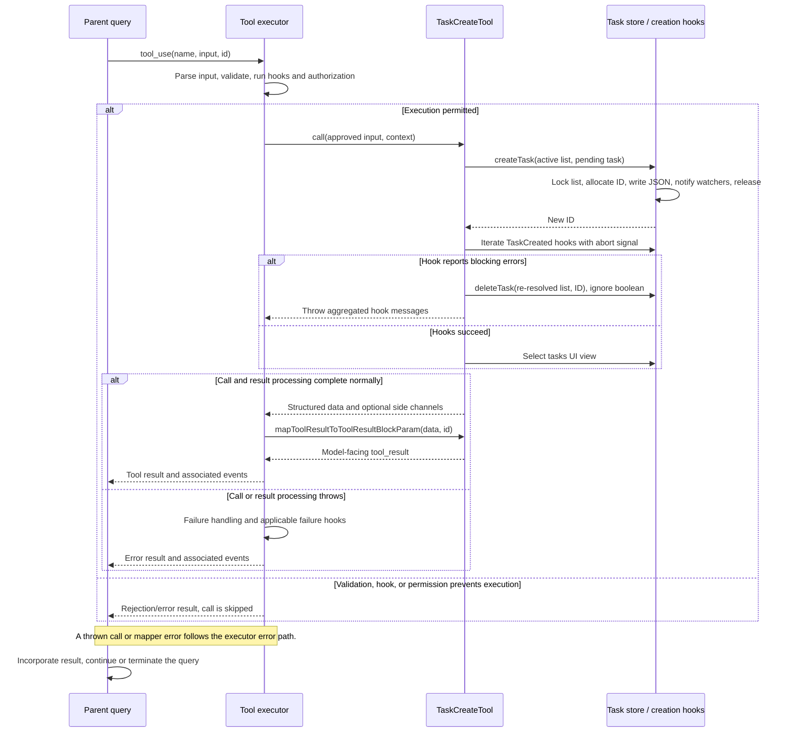

# TaskCreateTool Internals

Source: [tools/TaskCreateTool/TaskCreateTool.ts](../../../../../tools/TaskCreateTool/TaskCreateTool.ts). Line ranges refer to this recovered source snapshot; symbols are the stable navigation handles.

## Purpose and caller boundary

Creates a pending TodoV2 task and then runs creation hooks. Inputs are strict `subject`, `description`, optional `activeForm`, and optional metadata. The returned object contains only the new task ID and subject. The tool is deferred, concurrency-safe, and enabled by `isTodoV2Enabled()`; concurrent-safe describes scheduling, not a transaction across storage and hooks.

The [shared invocation lifecycle](../../invocation-lifecycle.md) explains registry selection, schema validation, authorization, hooks, result mapping, and exception handling. The sequence below begins with a model tool request and ends at the parent conversation boundary; external services and background workers retain their own lifecycles.

## Source-order walkthrough

### 1. Imports and schemas (1–46)

The tool imports storage, teammate identity, TaskCreated hooks, and tool construction. Required strings have no nonempty refinement. Unknown top-level input keys fail strict parsing. Output is a small task projection rather than the persisted record.

### 2. Registration and presentation (48–79)

Registration installs the lazy schemas and prompt, the TodoV2 gate, and the subject as classifier text. The call renderer returns null. No read-only override is supplied: creation mutates storage. Deferred exposure does not bypass executor permission checks.

### 3. Allocate and persist (80–90)

`createTask(getTaskListId(), ...)` writes pending status, undefined owner, empty dependency arrays, and the supplied content/metadata. The store creates the directory and list lock, chooses max(file IDs, high-water mark) + 1, writes JSON, notifies watchers, and releases the lock in finally. These effects happen before any TaskCreated hook.

### 4. Creation hooks and compensation (92–113)

The hook generator receives ID, subject, description, agent/team identity, context, and abort signal. Blocking errors are converted to user-facing hook messages and accumulated. If any exist, the tool calls `deleteTask(getTaskListId(), id)` and throws their joined text. It resolves the list again, and ignores the deletion boolean. A thrown hook exception escapes directly; there is no enclosing rollback finally.

### 5. UI and result (115–138)

After successful hooks, `setAppState` selects the tasks expanded view only when needed. The structured result projects ID/subject. The mapper formats the creation confirmation using the original tool-use ID.

## End-to-end sequence

The success arrows after `call` describe normal completion. An exception skips normal result mapping; see the failure boundaries below. Query continuation remains subject to cancellation and turn/budget limits.

## State, failure, and cancellation boundaries

Task-list identity is resolved by `getTaskListId()` in `utils/tasks.ts`: explicit environment override, in-process teammate team, process/leader team, then session ID. Paths live under the Claude config directory's `tasks` tree, with sanitized list and task IDs. This is the persistent TodoV2 list, separate from `AppState.tasks` runtime jobs.

The store uses per-list locking for ID allocation and per-file locking for updates. Neither makes an entire tool invocation transactional. Reads return null for missing, invalid, or unreadable task records; list reads omit invalid records and can return an empty list on directory errors. Hooks receive the context abort signal where passed; ordinary file operations here do not implement transport cancellation.

A task can be observed before hook approval. Hook rejection uses compensating deletion, which may fail or only partially clean references; this is not atomic rollback. Hook exceptions can leave the created task behind. There is no explicit pre-write abort check in `call`.

## Related design

[Task storage](./task-storage.md) describes locking, migration, watchers, and list identity.
