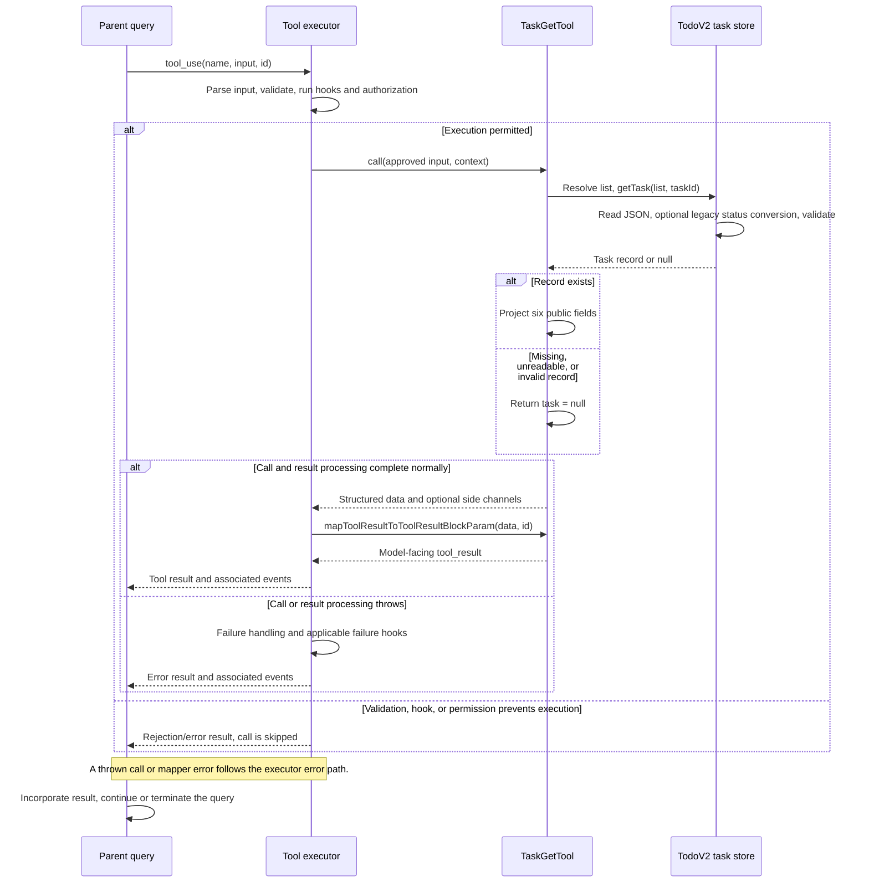

# TaskGetTool Internals

Source: [tools/TaskGetTool/TaskGetTool.ts](../../../../../tools/TaskGetTool/TaskGetTool.ts). Line ranges refer to this recovered source snapshot; symbols are the stable navigation handles.

## Purpose and caller boundary

Reads one TodoV2 task by strict string `taskId`. It is deferred, read-only, and concurrency-safe. Its result is a nullable projection of the record; owner, activeForm, and metadata are intentionally excluded.

The [shared invocation lifecycle](../../invocation-lifecycle.md) explains registry selection, schema validation, authorization, hooks, result mapping, and exception handling. The sequence below begins with a model tool request and ends at the parent conversation boundary; external services and background workers retain their own lifecycles.

## Source-order walkthrough

### 1. Contract (1–36)

Imports bind the tool to `getTask`, list identity, and the TodoV2 gate. The nullable output contains ID, subject, description, status, blocks, and blockedBy. No numeric-ID constraint is added by this tool.

### 2. Registration (38–72)

The input ID becomes classifier text. The same TodoV2 enablement and deferral conventions as TaskCreate apply, but this tool advertises read-only execution. Its call renderer returns null.

### 3. Read and project (73–98)

Capture the active task-list ID once, await `getTask`, and return `{task: null}` if storage returns null. Otherwise copy only the six output fields. The store may migrate legacy statuses in memory for internal users before validating the record; this read does not persist that migration.

### 4. Model result (99–128)

A null task maps to ordinary text `Task not found`, without an error flag. A present task renders title, status, description, and nonempty blockedBy/blocks arrays using # IDs. Dependencies are the stored arrays, including references to completed tasks; unlike TaskList, the mapper does not filter them.

## End-to-end sequence

The success arrows after `call` describe normal completion. An exception skips normal result mapping; see the failure boundaries below. Query continuation remains subject to cancellation and turn/budget limits.

## State, failure, and cancellation boundaries

Task-list identity is resolved by `getTaskListId()` in `utils/tasks.ts`: explicit environment override, in-process teammate team, process/leader team, then session ID. Paths live under the Claude config directory's `tasks` tree, with sanitized list and task IDs. This is the persistent TodoV2 list, separate from `AppState.tasks` runtime jobs.

The store uses per-list locking for ID allocation and per-file locking for updates. Neither makes an entire tool invocation transactional. Reads return null for missing, invalid, or unreadable task records; list reads omit invalid records and can return an empty list on directory errors. Hooks receive the context abort signal where passed; ordinary file operations here do not implement transport cancellation.

“Task not found” is a normal tool result and does not prove an ENOENT condition: the storage helper intentionally coalesces other read failures. This invocation changes neither task JSON nor dependency visibility. No store snapshot is held against concurrent updates.
