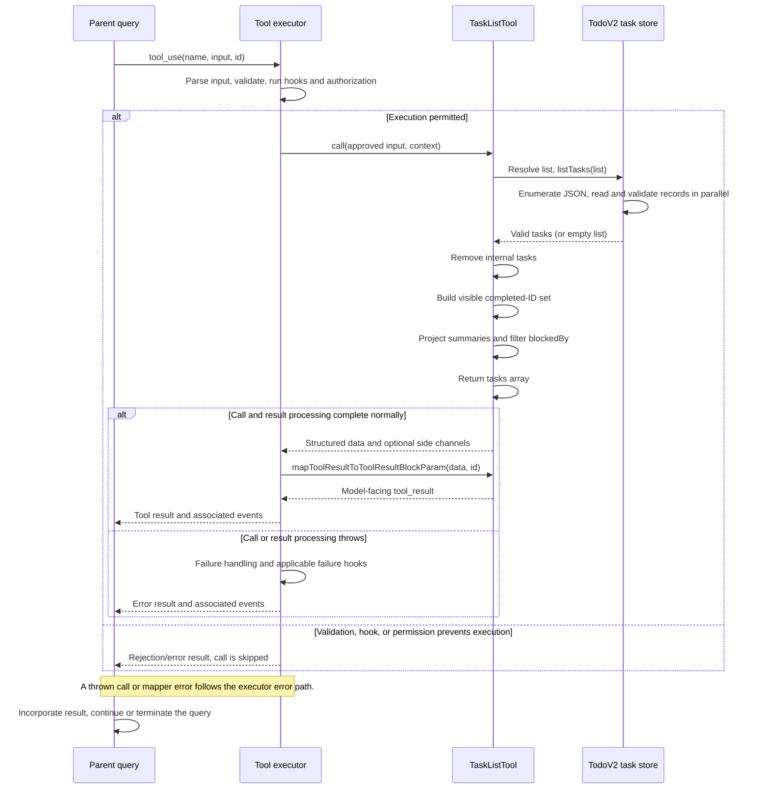

# TaskListTool Internals

Source: [tools/TaskListTool/TaskListTool.ts](../../../../../tools/TaskListTool/TaskListTool.ts). Line ranges refer to this recovered source snapshot; symbols are the stable navigation handles.

## Purpose and caller boundary

Lists visible TodoV2 task summaries from a strict empty input object. It is deferred, read-only, and concurrency-safe. Each summary contains ID, subject, status, optional owner, and unresolved blockedBy IDs.

The [shared invocation lifecycle](../../invocation-lifecycle.md) explains registry selection, schema validation, authorization, hooks, result mapping, and exception handling. The sequence below begins with a model tool request and ends at the parent conversation boundary; external services and background workers retain their own lifecycles.

## Source-order walkthrough

### 1. Schemas (1–31)

The empty strict input rejects unknown keys. Output omits descriptions, active forms, metadata, and forward `blocks` edges. Status follows the task storage schema.

### 2. Registration (33–64)

The TodoV2 feature gate selects this persistent-task tool family. The tool supplies no custom classifier and renders no inline call content. Read-only and concurrency-safe flags describe the invocation scheduler.

### 3. Load and hide internal tasks (65–73)

Resolve the list once and await `listTasks`. Filter records with truthy `metadata._internal`. Storage enumerates .json files, reads them in parallel, drops null records, and does not sort the results.

### 4. Dependency projection (75–90)

Build a completed-ID set from the already filtered visible tasks. Map each visible record, removing those IDs from its blockedBy array. This is a view transformation, not a storage update. Completed internal tasks are absent from the set; their IDs, and nonexistent blockers, can remain in visible summaries.

### 5. Model result (91–116)

An empty summary list renders `No tasks found` as a normal result. Otherwise each row contains #ID, status, subject, optional truthy owner, and nonempty unresolved blockers. The tool preserves enumeration order.

## End-to-end sequence

The success arrows after `call` describe normal completion. An exception skips normal result mapping; see the failure boundaries below. Query continuation remains subject to cancellation and turn/budget limits.

## State, failure, and cancellation boundaries

Task-list identity is resolved by `getTaskListId()` in `utils/tasks.ts`: explicit environment override, in-process teammate team, process/leader team, then session ID. Paths live under the Claude config directory's `tasks` tree, with sanitized list and task IDs. This is the persistent TodoV2 list, separate from `AppState.tasks` runtime jobs.

The store uses per-list locking for ID allocation and per-file locking for updates. Neither makes an entire tool invocation transactional. Reads return null for missing, invalid, or unreadable task records; list reads omit invalid records and can return an empty list on directory errors. Hooks receive the context abort signal where passed; ordinary file operations here do not implement transport cancellation.

An empty result may mean no tasks, only hidden/invalid tasks, or a directory-read failure. The completion filter is presentation-only and is not a claim that the stored graph has been repaired. Concurrent writes can produce a mixed-time list because there is no list-wide read transaction.
