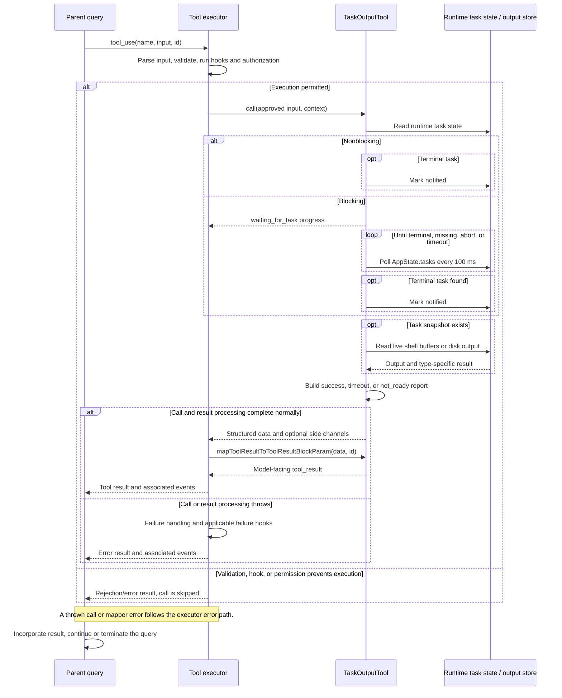

# TaskOutputTool Internals

Source: [tools/TaskOutputTool/TaskOutputTool.tsx](../../../../../tools/TaskOutputTool/TaskOutputTool.tsx). Line ranges refer to this recovered source snapshot; symbols are the stable navigation handles.

## Purpose and caller boundary

Retrieves output for a runtime job in `AppState.tasks`, optionally waiting for completion. Strict input requires task_id, defaults block to true and timeout to 30,000 ms, and restricts timeout to 0–600,000. Output has retrieval_status success/timeout/not_ready and a nullable task projection. This deprecated tool recommends Read on the output file; compatibility aliases are AgentOutputTool and BashOutputTool.

The [shared invocation lifecycle](../../invocation-lifecycle.md) explains registry selection, schema validation, authorization, hooks, result mapping, and exception handling. The sequence below begins with a model tool request and ends at the parent conversation boundary; external services and background workers retain their own lifecycles.

## Source-order walkthrough

### 1. Imports, input and output types (1–59)

Dependencies include runtime task types, disk output, task-state updates, formatting, AbortError, and shell/agent UI components. `semanticBoolean` wraps block parsing. Task output can carry exitCode, error, prompt, or result according to task type; there is no separate runtime output schema in this definition.

### 2. Output collection (61–118)

`getTaskOutputData` prefers a local shell’s live taskOutput object, awaiting stdout and then reading stderr, otherwise reading disk. Other types start from disk output. Shell results add nullable exit code. Local agents prefer nonempty clean final assistant text over the full JSONL transcript for both result and output, and add prompt/error. Remote agents add their command as prompt. Other types retain the common projection.

### 3. Polling helper (121–148)

`waitForTaskCompletion` checks the abort signal, then app state, every 100 ms while elapsed time is below timeout. Disappearance returns null; any state other than running/pending returns immediately. At timeout it takes a final state snapshot without another abort check. timeout zero skips the loop. The plain sleep is not signal-aware, so an abort is observed on the next loop check.

### 4. Registration and validation (150–208)

The tool is deferred, read-only, and concurrency-safe. The recovered enabled check compares the literal external to ant, so it evaluates true in this file; do not reinterpret it as a dynamic USER_TYPE check. Validation rejects an empty ID (code 1) or absent task (code 2). Prompt text explains deprecation and output paths. Validation does not require the task to be running.

### 5. Nonblocking call (209–241)

Re-read the task and throw if it vanished since validation. If block is false, terminal status marks the task notified before collecting output and returns success. Running/pending returns not_ready with the current partial output, without marking notified.

### 6. Blocking call (243–294)

Emit one waiting progress event if a callback exists, then await polling with the tool abort controller. A disappeared task returns timeout/null. Running or pending at deadline returns timeout plus current output. A terminal task is marked notified before output retrieval and returns success. Timeout does not stop the worker.

### 7. Model mapper (296–325)

Build XML-like retrieval_status, task ID/type/status, optional exit_code, nonblank formatted output, and error fields. `formatTaskOutput` controls output presentation/truncation. A task error is text inside an error tag; this mapper does not set is_error. Prompt/result metadata are not independently serialized.

### 8. Tool UI adapters (327–377)

Call text identifies nonblocking mode; a tag shows task ID. The progress UI displays task description and waiting text. Result rendering delegates to TaskOutputResultDisplay, while rejection/error use fallback components.

### 9. Result display (379–582)

React compiler memo slots cache derived values and JSX, without changing task state. Parse string content as JSON. Missing task shows no output. Shell tasks adapt to BashToolResultMessage. Successful local agents show a compact expansion hint or verbose description, line count, prompt, answer, and error. Timeout/running/not_ready show waiting text, with a fallback not-ready message. Remote tasks show status and optionally expanded output; unknown types show description/status and the first 500 characters.

## End-to-end sequence

The success arrows after `call` describe normal completion. An exception skips normal result mapping; see the failure boundaries below. Query continuation remains subject to cancellation and turn/budget limits.

## State, failure, and cancellation boundaries

Read-only here still permits notification bookkeeping. The notified mutation precedes output I/O; an output-read failure can therefore suppress a later notification even though retrieval throws. Waiting cancellation aborts the retrieval, not the target task. State and output are not an atomic snapshot, and polling can overshoot the requested timeout by scheduling delay. The result’s success means retrieval reached a terminal task, not that the underlying command/agent succeeded.

## Related design

[Runtime task overview](./runtime-task-tools.md) and [Agent internals](../../delegation-teams-agent-runtime/agenttool/agent-tool-internals.md).
