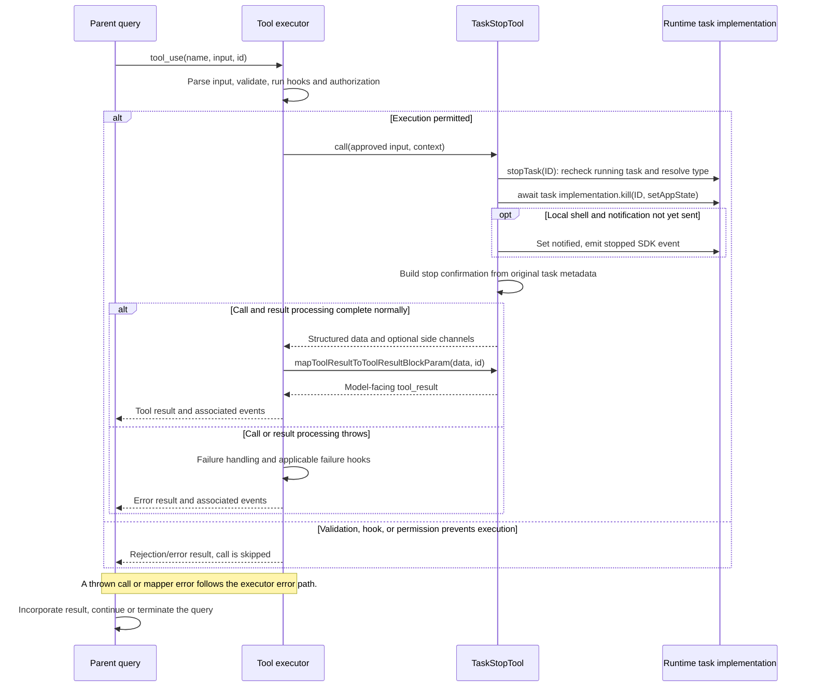

# TaskStopTool Internals

Source: [tools/TaskStopTool/TaskStopTool.ts](../../../../../tools/TaskStopTool/TaskStopTool.ts). Line ranges refer to this recovered source snapshot; symbols are the stable navigation handles.

## Purpose and caller boundary

Stops a running runtime task through the task-type implementation. Strict input accepts task_id or deprecated shell_id; task_id takes precedence via nullish coalescing. Alias KillShell preserves old transcripts. Output carries message, task_id, task_type, and optional command, allowing older transcript records without command.

The [shared invocation lifecycle](../../invocation-lifecycle.md) explains registry selection, schema validation, authorization, hooks, result mapping, and exception handling. The sequence below begins with a model tool request and ends at the parent conversation boundary; external services and background workers retain their own lifecycles.

## Source-order walkthrough

### 1. Contract and registration (1–58)

Both input IDs are schema-optional; required-ID enforcement is in validation and call. The tool is deferred and concurrency-safe, with task ID as classifier text. Its user-facing name depends on USER_TYPE. It is a mutating tool despite being safe to schedule concurrently.

### 2. Validation (59–91)

Resolve task_id ?? shell_id. An empty preferred task_id does not fall back to shell_id. Missing ID or absent runtime task returns code 1; a status other than running returns code 3. Pending tasks cannot be stopped by this contract. These reads are preflight checks, not a lock.

### 3. Prompt, mapper, and UI (92–108)

The prompt describes stopping a background task. The mapper JSON-serializes the structured report into a tool_result; UI functions are imported from UI.js. Execution exceptions do not pass through this success mapper.

### 4. Call and shared stop helper (109–131)

Resolve the ID again and throw if absent, then await `stopTask` with getAppState/setAppState. Although abortController is destructured, it is not passed or used. The helper rechecks existence/running state, looks up the task implementation, and throws StopTaskError with not_found, not_running, or unsupported_type before dispatch when applicable. Await its kill method, then return the success message and helper projection.

### 5. Dependency ordering: tasks/stopTask.ts (38–107)

The helper delegates cancellation/termination to `getTaskByType(task.type).kill`. For local shells only, it marks an existing unnotified task notified to suppress the noisy exit notification; when suppression occurs it emits a stopped SDK event directly. Agent tasks keep their notification path so abort handling can report partial results. The command field is shell command for local shells, otherwise description.

## End-to-end sequence

The success arrows after `call` describe normal completion. An exception skips normal result mapping; see the failure boundaries below. Query continuation remains subject to cancellation and turn/budget limits.

## State, failure, and cancellation boundaries

Validation and execution can race with natural completion, so a valid request can still throw not_running in stopTask. A successful kill dispatch does not establish that every remote subprocess or agent cleanup action is durably complete; those semantics belong to the task implementation. This tool does not cancel itself through the supplied abortController. Kill errors propagate; no success report or notification suppression is performed after a thrown kill.
